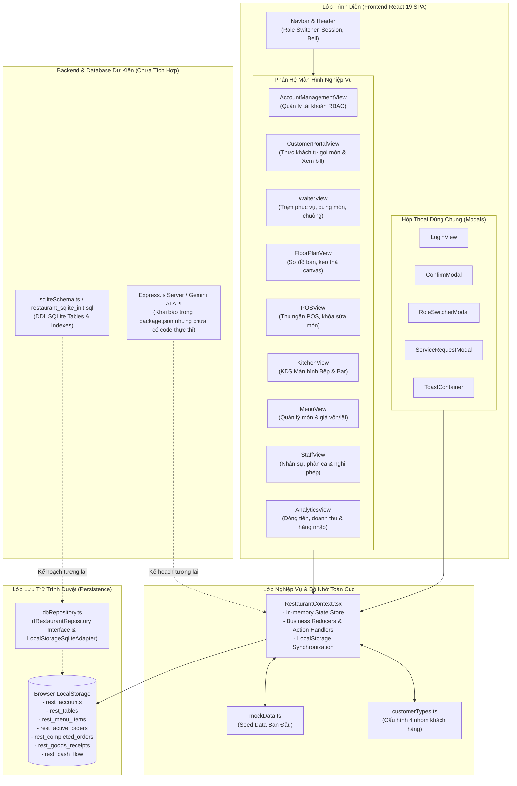
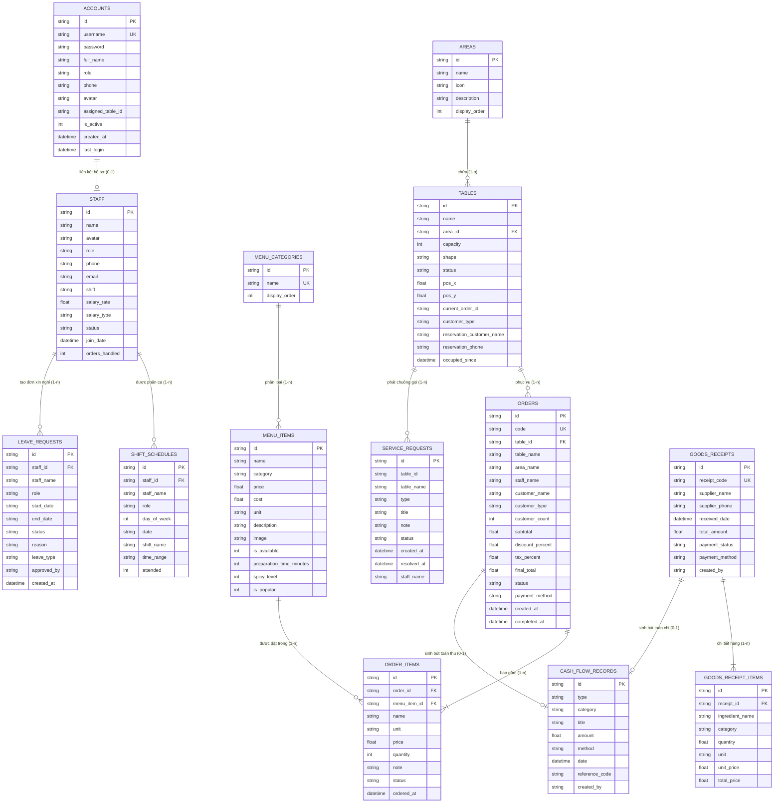
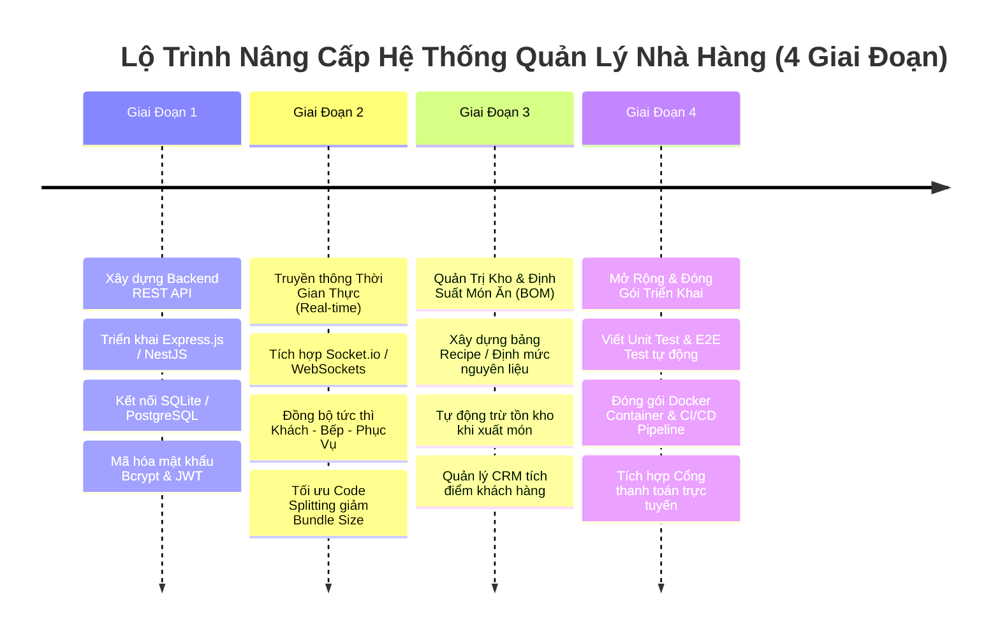

# BÁO CÁO TOÀN DIỆN KIỂM TOÁN DỰ ÁN (FULL PROJECT AUDIT REPORT)
## DỰ ÁN: HỆ THỐNG QUẢN LÝ NHÀ HÀNG TOÀN DIỆN (RESTAURANT MANAGEMENT SYSTEM)

---

| Thông Tin Kiểm Toán | Chi Tiết |
| :--- | :--- |
| **Tên dự án** | Restaurant Asia / Quản Lý Nhà Hàng Pro (Restaurant Suite) |
| **Phiên bản hiện tại** | 0.0.0 (Giai đoạn Alpha / Client-side Prototype) |
| **Đơn vị / Nhóm phát triển** | Nhóm TanQuyn-IOS (5 thành viên: Quyn, Thắng, Thiện, Hào, Anh) |
| **Ngày thực hiện kiểm toán** | 24/11/2026 |
| **Chuyên viên kiểm toán** | Senior Software Architect, Senior Full-stack Developer & Database Engineer |
| **Mục tiêu kiểm toán** | Rà soát toàn bộ source code, kiến trúc, cơ sở dữ liệu, API, bảo mật và nghiệp vụ |
| **Tệp tin báo cáo** | `PROJECT_AUDIT_REPORT.md` |

---

## MỤC LỤC BÁO CÁO

1. **PHẦN 1: TỔNG QUAN DỰ ÁN**
   - 1.1. Tên và mục đích ứng dụng
   - 1.2. Mô hình hoạt động hệ thống
   - 1.3. Kiến trúc tổng thể hiện tại
   - 1.4. Sơ đồ kiến trúc Mermaid
2. **PHẦN 2: CÔNG NGHỆ SỬ DỤNG**
   - 2.1. Phân tích Frontend Stack
   - 2.2. Phân tích Backend Stack & Tình trạng thực tế
   - 2.3. Ngôn ngữ & Framework
   - 2.4. Cơ sở dữ liệu (Database)
   - 2.5. Danh mục thư viện phụ thuộc (Dependencies)
3. **PHẦN 3: CẤU TRÚC SOURCE CODE**
   - 3.1. Cây thư mục dự án rút gọn
   - 3.2. Chức năng từng thư mục chính
   - 3.3. Vai trò các file quan trọng
   - 3.4. Phân loại Module nghiệp vụ và Module dùng chung
   - 3.5. Nhận diện file và thư viện dư thừa / chưa sử dụng
4. **PHẦN 4: DATABASE VÀ SƠ ĐỒ THỰC THỂ QUAN HỆ (ERD)**
   - 4.1. Tên database và cơ chế lưu trữ
   - 4.2. Danh sách bảng và từ điển dữ liệu (Data Dictionary)
   - 4.3. Các ràng buộc (PK, FK, Unique, Check Constraints, Index)
   - 4.4. Đánh giá sự sai lệch giữa DDL SQL và TypeScript Entities
   - 4.5. Sơ đồ ERD thực thể quan hệ bằng Mermaid
5. **PHẦN 5: BACKEND VÀ API**
   - 5.1. Tình trạng Backend hiện tại
   - 5.2. Bảng danh sách API / Service Methods nội bộ
   - 5.3. Phân tích luồng xử lý các nghiệp vụ trọng yếu
6. **PHẦN 6: FRONTEND VÀ GIAO DIỆN (UI/UX)**
   - 6.1. Danh sách màn hình & Phân hệ chức năng
   - 6.2. Cơ chế Điều hướng (Routing / Navigation)
   - 6.3. Quản lý trạng thái (State Management)
   - 6.4. Form nhập liệu, Tìm kiếm, Lọc và Phân trang
   - 6.5. Xử lý lỗi giao diện và trải nghiệm người dùng
7. **PHẦN 7: PHÂN TÍCH 15 NGHIỆP VỤ NHÀ HÀNG CHUYÊN SÂU**
   - Bảng tổng hợp đánh giá 15 nghiệp vụ (Trạng thái & File liên quan)
   - Phân tích chi tiết từng nghiệp vụ
8. **PHẦN 8: AUTHENTICATION VÀ AUTHORIZATION (RBAC)**
   - 8.1. Các loại tài khoản và 6 vai trò hệ thống
   - 8.2. Ma trận phân quyền ma trận truy cập (RBAC Matrix)
   - 8.3. Cơ chế xác thực và quản lý phiên làm việc
   - 8.4. Đánh giá lỗ hổng an toàn thông tin
9. **PHẦN 9: ĐÁNH GIÁ CHẤT LƯỢNG MÃ NGUỒN (CODE QUALITY)**
   - 9.1. Đánh giá cấu trúc & nguyên tắc phân tầng
   - 9.2. Mức độ phụ thuộc & Trùng lặp mã nguồn
   - 9.3. Xử lý lỗi & Data Validation
   - 9.4. Hiệu năng & Bundle Size
   - 9.5. Tình trạng kiểm thử (Testing)
10. **PHẦN 10: TỔNG HỢP LỖI VÀ RỦI RO HỆ THỐNG**
    - 10.1. Mức độ CRITICAL (Nghiêm trọng)
    - 10.2. Mức độ HIGH (Cao)
    - 10.3. Mức độ MEDIUM (Trung bình)
    - 10.4. Mức độ LOW (Thấp)
11. **PHẦN 11: HƯỚNG DẪN CÀI ĐẶT VÀ VẬN HÀNH DỰ ÁN**
    - 11.1. Yêu cầu môi trường
    - 11.2. Các bước khởi chạy Frontend & Build
    - 11.3. Cấu hình biến môi trường (Environment Variables)
    - 11.4. Các lỗi thường gặp khi khởi động & Cách khắc phục
12. **PHẦN 12: TỔNG KẾT VÀ LỘ TRÌNH NÂNG CẤP KIẾN TRÚC**
    - 12.1. Đánh giá tổng thể
    - 12.2. Điểm mạnh và điểm yếu cốt lõi
    - 12.3. Đề xuất kiến trúc Microservices / Modular Monolith cho phiên bản tiếp theo
    - 12.4. Lộ trình triển khai nâng cấp theo 4 giai đoạn

---

## PHẦN 1: TỔNG QUAN DỰ ÁN

### 1.1. Tên và Mục Đích Ứng Dụng
- **Tên dự án được định danh:**
  - Trong `README.md`: **Restaurant Asia - Hệ Thống Quản Lý Nhà Hàng** (Kho chứa Git: `https://github.com/TanQuyn-IOS/Restaurant_Asia.git`).
  - Trong `metadata.json`: **Quản Lý Nhà Hàng Pro - Restaurant Suite**.
  - Trong `package.json`: `react-example` (Tên mặc định khởi tạo).
  - Trên thanh điều hướng UI (`Navbar.tsx`): **Quản Lý Nhà Hàng PRO**.
- **Mục đích:**
  - Xây dựng giải pháp phần mềm quản trị nhà hàng tập trung, tích hợp đa vai trò (Role-Based Access Control) khép kín quy trình phục vụ ăn uống:
    1. **Khách hàng (Diner):** Quét mã tại bàn, tự gọi món qua điện thoại (Self-ordering), theo dõi tiến độ nấu nướng tại bếp (Live Cooking Tracker), xem hóa đơn tạm tính và gọi nhân viên phục vụ / xin nước đá / yêu cầu thanh toán.
    2. **Nhân viên phục vụ (Waiter):** Tiếp nhận yêu cầu chuông, bưng món đã nấu xong từ bếp ra bàn, đặt bàn trước, mở bàn, gộp bàn và chuyển bàn.
    3. **Bếp & Quầy Bar (KDS - Kitchen Display System):** Màn hình hiển thị danh sách món cần nấu theo thời gian thực, cập nhật tiến độ (Chờ nấu ➔ Đang nấu ➔ Đã nấu xong) và quản lý bật/tắt món hết hàng.
    4. **Thu ngân (Cashier POS):** Lập đơn tại quầy, áp dụng chiết khấu voucher / phân loại khách hàng, tính thuế VAT, in hóa đơn nhiệt và thanh toán đa kênh (Tiền mặt, VietQR, Thẻ POS, Chuyển khoản).
    5. **Quản lý Nhân sự (HR Manager):** Quản lý hồ sơ nhân viên, phân ca làm việc, chấm công và theo dõi đơn nghỉ phép.
    6. **Chủ nhà hàng / Quản trị viên (Admin / Owner):** Quản lý toàn bộ tài khoản nhân viên, thiết kế sơ đồ mặt bằng bàn ăn kéo thả (Floor Plan), quản lý thực đơn & định giá vốn, theo dõi dòng tiền thu chi (Cash Flow) và quản lý phiếu nhập hàng kho (Goods Receipts).

### 1.2. Mô Hình Hoạt Động Hệ Thống
Hệ thống hiện tại hoạt động theo mô hình **Single Page Application (SPA)** thuần túy chạy hoàn toàn trên trình duyệt người dùng (Client-Side In-Memory Execution) với các đặc điểm:
- **Xác thực:** Dựa trên mảng tài khoản nội bộ (`accounts`) lưu trong bộ nhớ và đồng bộ với `localStorage`.
- **Dữ liệu hoạt động:** State toàn cục được chia sẻ qua React Context API (`RestaurantContext.tsx`). Khi người dùng tải lại trang, dữ liệu được phục hồi từ trình duyệt qua `localStorage`.
- **Đồng bộ liên vai trò:** Trong môi trường thử nghiệm trên cùng 1 máy tính/trình duyệt, việc chuyển đổi vai trò (Role Switcher) cho phép kiểm thử toàn bộ luồng nghiệp vụ giữa Khách hàng, Bếp, Phục vụ, Thu ngân và Quản trị viên một cách tức thì.

### 1.3. Kiến Trúc Tổng Thể Hiện Tại
```
[ Browser UI Layer ]
  ├── Navbar (Role Switcher & Top Session)
  ├── 9 Feature Views (FloorPlan, POS, Kitchen, Waiter, Menu, Staff, Analytics, Accounts, Customer)
  └── Global Modals & Toast Notification Container
        │
        ▼
[ Business Logic & Global State Layer ]
  ├── RestaurantContext.tsx (React Context Provider & Hooks)
  ├── Mock Data Seed (mockData.ts)
  └── Constants Meta (customerTypes.ts)
        │
        ▼
[ Client Persistence Layer ]
  ├── LocalStorage Keys (rest_accounts, rest_tables, rest_orders, etc.)
  └── dbRepository.ts (LocalStorageSqliteAdapter - Interface trừu tượng hóa)
        │
        ▼
[ Unconnected Database Definitions (Chưa liên kết thực thi) ]
  ├── sqliteSchema.ts (DDL SQLite tạo bảng & Index)
  └── restaurant_sqlite_init.sql (DDL SQLite & Dữ liệu Seed khởi tạo)
```

### 1.4. Sơ Đồ Kiến Trúc Hệ Thống (Mermaid)



---

## PHẦN 2: CÔNG NGHỆ SỬ DỤNG

### 2.1. Phân Tích Frontend Stack
- **React 19.0.1 (`react`, `react-dom`):** Sử dụng phiên bản React mới nhất, tận dụng functional components, React Hooks (`useState`, `useEffect`, `useContext`, `useRef`).
- **Vite 6.2.3 (`vite`, `@vitejs/plugin-react`):** Trình đóng gói và dev-server tốc độ cao với Hot Module Replacement (HMR).
- **Tailwind CSS v4.1.14 (`@tailwindcss/vite`, `tailwindcss`, `autoprefixer`):** Sử dụng engine TailwindCSS v4 tích hợp trực tiếp qua Vite plugin, thiết kế giao diện theo phong cách slate/amber hiện đại, hỗ trợ responsive hoàn chỉnh từ mobile đến desktop.
- **Lucide React 0.546.0 (`lucide-react`):** Bộ icon vector toàn diện cho nhà hàng (bàn ăn, dụng cụ ăn uống, mũ bếp, hóa đơn, người dùng, chuông báo, v.v.).
- **Motion 12.23.24 (`motion`):** Hỗ trợ hoạt ảnh mượt mà cho thông báo nổi (`ToastContainer.tsx`) và hiệu ứng chuyển tab.
- **Recharts 3.10.1 (`recharts`):** Thư viện biểu đồ phục vụ trực quan hóa dữ liệu kinh doanh tại `AnalyticsView.tsx` (AreaChart cho doanh thu theo khung giờ, PieChart cho tỷ trọng danh mục món).
- **Canvas Confetti 1.9.4 (`canvas-confetti`):** Hiệu ứng pháo giấy chúc mừng khi thu ngân bấm thanh toán thành công hóa đơn tại `ReceiptModal.tsx`.

### 2.2. Phân Tích Backend Stack & Tình Trạng Thực Tế
- **Khai báo trong `package.json`:**
  - `express`: `^4.21.2`
  - `@types/express`: `^4.17.21`
  - `@google/genai`: `^2.4.0`
  - `dotenv`: `^17.2.3`
  - `tsx`: `^4.21.0`
- **Thực tế kiểm tra mã nguồn (Fact-checking):**
  - **KHÔNG CÓ BẤT KỲ FILE SERVER BACKEND NÀO:** Không tồn tại `server.ts`, `server.js`, `app.js` hoặc bất kỳ file xử lý HTTP Server nào trong toàn bộ dự án.
  - Lệnh script `"clean": "rm -rf dist server.js"` trong `package.json` cho thấy dự án có nguồn gốc xuất phát từ một template có tạo file `server.js` khi biên dịch/deploy, nhưng hiện tại file này đã bị xóa hoặc chưa được triển khai.
  - **Không có lệnh gọi mạng (No Network Fetch):** Toàn bộ source code trong thư mục `src/` không hề có bất kỳ câu lệnh `fetch()`, `axios`, hay WebSocket client nào.
  - **Gemini AI chưa được tích hợp:** Thư viện `@google/genai` và cấu hình biến môi trường `GEMINI_API_KEY` trong `.env.example` hoàn toàn chưa được import hoặc gọi ở bất kỳ dòng mã nào trong `src/`.

### 2.3. Ngôn Ngữ & Framework
- **Ngôn ngữ chính:** **TypeScript 5.8.2** (Cấu hình trong `tsconfig.json` với `target: ESNext`, `moduleResolution: bundler`, `strict: true`). Kiểm tra `tsc --noEmit` hoàn tất không có lỗi cú pháp hay kiểu dữ liệu.
- **Ngôn ngữ dữ liệu:** **SQL (SQLite dialect)** được viết trong `src/db/restaurant_sqlite_init.sql` và `src/db/sqliteSchema.ts`.
- **Framework nền tảng:** Client-side SPA trên nền **React 19** + **Vite 6**.

### 2.4. Cơ Sở Dữ Liệu (Database)
- **Cơ sở dữ liệu đang thực thi (Runtime Database):**
  - Trình duyệt **Browser Web Storage (`localStorage`)**.
  - Toàn bộ dữ liệu được lưu dưới dạng chuỗi JSON gắn với các key có tiền tố `rest_*`.
- **Cơ sở dữ liệu được thiết kế (Target Database):**
  - **SQLite 3:** Đã được thiết kế chi tiết bằng câu lệnh DDL tiêu chuẩn trong `src/db/sqliteSchema.ts` và script nạp dữ liệu mẫu `src/db/restaurant_sqlite_init.sql`.
  - Chưa được nhúng engine thực thi (chưa cài đặt `better-sqlite3`, `sql.js` hay kết nối tới SQLite backend service).

### 2.5. Danh Mục Thư Viện Phụ Thuộc (Dependencies)

| Tên Gói | Phiên Bản | Phân Loại | Mục Đích Sử Dụng Trong Dự Án |
| :--- | :--- | :--- | :--- |
| `react` | `^19.0.1` | Dependency | Thư viện UI nền tảng |
| `react-dom` | `^19.0.1` | Dependency | Render React DOM |
| `vite` | `^6.2.3` | Dependency & Dev | Bundler & Dev Server |
| `@tailwindcss/vite` | `^4.1.14` | Dependency | Plugin tích hợp TailwindCSS v4 cho Vite |
| `tailwindcss` | `^4.1.14` | DevDependency | Framework CSS tiện ích |
| `autoprefixer` | `^10.4.21` | DevDependency | Tự động thêm tiền tố vendor CSS |
| `lucide-react` | `^0.546.0` | Dependency | Hệ thống Icon đồ họa |
| `motion` | `^12.23.24` | Dependency | Thư viện Animation mượt mà |
| `recharts` | `^3.10.1` | Dependency | Biểu đồ trực quan hóa doanh thu và danh mục |
| `canvas-confetti` | `^1.9.4` | Dependency | Hiệu ứng pháo giấy khi thanh toán xong |
| `express` | `^4.21.2` | Dependency | *(Dư thừa)* Chưa có mã nguồn backend sử dụng |
| `@google/genai` | `^2.4.0` | Dependency | *(Dư thừa)* Chưa có mã nguồn gọi AI API |
| `dotenv` | `^17.2.3` | Dependency | *(Dư thừa)* Không sử dụng trong client-side Vite |
| `tsx` | `^4.21.0` | DevDependency | *(Dư thừa)* Chưa có script backend TypeScript để chạy |
| `typescript` | `~5.8.2` | DevDependency | Trình biên dịch & kiểm tra kiểu TypeScript |

---

## PHẦN 3: CẤU TRÚC SOURCE CODE

### 3.1. Cây Thư Mục Dự Án Rút Gọn

```
restomanager/
├── .env.example                          # File mẫu cấu hình biến môi trường
├── .gitignore                            # Khai báo file bỏ qua khi commit Git
├── bun.lock                              # Lockfile Bun (dư thừa song song với package-lock)
├── index.html                            # File HTML gốc chứa div#root
├── metadata.json                         # Khai báo metadata AI Studio
├── package.json                          # Khai báo dependencies & scripts
├── package-lock.json                     # Lockfile chính thức của npm
├── README.md                             # Tài liệu phân công nhóm & hướng dẫn Git
├── tsconfig.json                         # Cấu hình biên dịch TypeScript
├── vite.config.ts                        # Cấu hình Vite & plugin TailwindCSS
├── assets/
│   └── .aistudio/
│       └── .gitignore                    # File quản lý môi trường AI Studio
└── src/
    ├── App.tsx                           # Root Component điều hướng Tab theo Role
    ├── index.css                         # CSS toàn cục (chứa @import "tailwindcss")
    ├── main.tsx                          # Điểm vào chính của ứng dụng React (createRoot)
    ├── mockData.ts                       # Dữ liệu hạt giống (Seed Data) ban đầu
    ├── types.ts                          # Định nghĩa toàn bộ TypeScript Interfaces & Types
    ├── constants/
    │   └── customerTypes.ts              # Cấu hình 4 phân loại khách hàng (Walk-in, Regular, VIP, Group)
    ├── context/
    │   └── RestaurantContext.tsx         # Context toàn cục quản lý State & Nghiệp vụ (1.522 dòng)
    ├── db/
    │   ├── restaurant_sqlite_init.sql    # DDL & Data seed nạp vào SQLite
    │   └── sqliteSchema.ts               # DDL câu lệnh tạo bảng & Index SQLite
    ├── services/
    │   └── dbRepository.ts               # Interface & Adapter lưu trữ LocalStorage/SQLite
    └── components/
        ├── Navbar.tsx                    # Thanh điều hướng trên cùng, Role Switcher & Live stats
        ├── AccountManagement/
        │   └── AccountManagementView.tsx # Màn hình quản lý tài khoản người dùng & đổi pass
        ├── Analytics/
        │   ├── AddCashFlowModal.tsx      # Modal lập bút toán thu/chi sổ quỹ tiền mặt
        │   ├── AddGoodsReceiptModal.tsx  # Modal lập phiếu nhập kho nguyên vật liệu
        │   └── AnalyticsView.tsx         # Màn hình báo cáo doanh thu, dòng tiền & hàng nhập
        ├── Auth/
        │   └── LoginView.tsx             # Hộp thoại đăng nhập & chế độ khách hàng
        ├── Common/
        │   ├── ConfirmModal.tsx          # Modal xác nhận thao tác nguy hiểm (Xóa, Hủy, Reset)
        │   ├── RoleSwitcherModal.tsx     # Modal chuyển đổi vai trò (RBAC)
        │   ├── ServiceRequestModal.tsx   # Modal quản lý danh sách chuông gọi phục vụ
        │   └── ToastContainer.tsx        # Khung hiển thị thông báo nổi Toast Notification
        ├── Customer/
        │   ├── CustomerPortalView.tsx    # Cổng gọi món tự phục vụ cho thực khách tại bàn
        │   └── TableRegistrationModal.tsx# Modal đăng ký chọn số bàn ăn & thông tin khách
        ├── FloorPlan/
        │   ├── FloorPlanView.tsx         # Mặt bằng sơ đồ bàn ăn kéo thả & căn đối xứng
        │   ├── ReservationModal.tsx      # Modal đặt bàn trước cho khách
        │   ├── TableModal.tsx            # Modal thêm mới/chỉnh sửa thông tin bàn
        │   └── TransferTableModal.tsx    # Modal chuyển bàn / đổi bàn ăn
        ├── Kitchen/
        │   └── KitchenView.tsx           # Màn hình hiển thị bếp KDS (Kitchen Display System)
        ├── Menu/
        │   ├── DishModal.tsx             # Modal thêm mới/sửa món ăn & giá vốn/lãi
        │   └── MenuView.tsx              # Danh mục món ăn, tìm kiếm & bộ lọc
        ├── POS/
        │   ├── POSView.tsx               # Màn hình thu ngân POS tính tiền (khóa sửa món)
        │   └── ReceiptModal.tsx          # Modal xem trước bill nhiệt, quét VietQR & in hóa đơn
        ├── Staff/
        │   ├── LeaveRequestModal.tsx     # Modal tạo đơn xin nghỉ phép nhân viên
        │   ├── StaffModal.tsx            # Modal thêm mới/sửa hồ sơ nhân sự & lương
        │   └── StaffView.tsx             # Quản lý nhân sự, ca trực & duyệt nghỉ phép
        └── Waiter/
            ├── QuickOrderModal.tsx       # Modal phục vụ tạo đơn gọi món nhanh tại bàn
            ├── TableBillReviewModal.tsx  # Modal phục vụ kiểm tra bill & hỗ trợ thanh toán tại bàn
            └── WaiterView.tsx            # Trạm phục vụ, danh sách món sẵn sàng bưng & chuông gọi
```

### 3.2. Chức Năng Từng Thư Mục Chính
- `src/components/`: Chứa toàn bộ giao diện người dùng được module hóa theo từng nghiệp vụ chuyên biệt của nhà hàng.
- `src/context/`: Chứa State Management trung tâm (`RestaurantContext.tsx`), đóng vai trò là "Single Source of Truth" cho toàn bộ dữ liệu runtime.
- `src/services/`: Lớp trừu tượng hóa kho dữ liệu (`dbRepository.ts`), cung cấp hợp đồng giao diện `IRestaurantRepository` để dễ dàng thay thế `LocalStorage` bằng API/SQLite trong tương lai.
- `src/db/`: Chứa định nghĩa lược đồ quan hệ DDL và script SQL khởi tạo cơ sở dữ liệu SQLite.
- `src/constants/`: Chứa metadata và hằng số cấu hình hệ thống (như màu sắc, icon, chiết khấu mặc định của 4 nhóm khách hàng).

### 3.3. Vai Trò Các File Quan Trọng
- `src/App.tsx`: Bộ điều phối giao diện gốc, kiểm tra vai trò hiện tại (`currentRole`) và hiển thị Tab chức năng tương ứng, quản lý modal đăng nhập và khung thông báo.
- `src/context/RestaurantContext.tsx`: File hạt nhân quan trọng nhất của dự án (1.522 dòng), chứa toàn bộ logic nghiệp vụ (tính tiền, chiết khấu, thuế VAT, thêm/sửa/xóa bàn, xử lý trạng thái nấu nướng, lập phiếu nhập hàng, quản lý dòng tiền và đồng bộ `localStorage`).
- `src/types.ts`: Khai báo 255 dòng kiểu dữ liệu chặt chẽ cho toàn bộ đối tượng trong nhà hàng.
- `src/mockData.ts`: Khởi tạo dữ liệu ban đầu cho 6 tài khoản, 3 khu vực, 14 bàn ăn, 17 món ăn, 5 nhân viên, 2 hóa đơn mẫu, 2 yêu cầu phục vụ, phiếu nhập hàng và dòng tiền.

### 3.4. Phân Loại Module Nghiệp Vụ và Module Dùng Chung
- **Module nghiệp vụ riêng biệt:**
  - `AccountManagement`: Quản trị tài khoản RBAC.
  - `Customer`: Khách hàng tự phục vụ (Self-ordering).
  - `FloorPlan`: Thiết kế và quản lý mặt bằng bàn ăn.
  - `Kitchen`: Bếp KDS.
  - `Menu`: Quản lý thực đơn và định giá.
  - `POS`: Bán hàng và thanh toán thu ngân.
  - `Staff`: Quản lý nhân sự và nghỉ phép.
  - `Waiter`: Điều phối phục vụ và chuông gọi.
  - `Analytics`: Quản lý dòng tiền, doanh thu và hàng nhập.
- **Module dùng chung (Shared Components):**
  - `Navbar.tsx`: Header điều hướng, thanh trạng thái phiên và nút chuông toàn cục.
  - `Common/ConfirmModal.tsx`: Hộp thoại xác nhận đa năng với các cấp độ `danger`, `warning`.
  - `Common/RoleSwitcherModal.tsx`: Hộp thoại chuyển đổi vai trò nhanh.
  - `Common/ServiceRequestModal.tsx`: Hộp thoại tiếp nhận chuông gọi phục vụ.
  - `Common/ToastContainer.tsx`: Hệ thống thông báo nổi toàn ứng dụng.

### 3.5. Nhận Diện File và Thư Viện Dư Thừa / Không Sử Dụng
1. **Thư viện `express` & `@types/express`:** Được cài trong `package.json` nhưng không có bất kỳ dòng code backend nào sử dụng.
2. **Thư viện `@google/genai`:** Khai báo trong dependencies nhưng không được import vào dự án.
3. **Thư viện `dotenv` & `tsx`:** Được đưa vào `package.json` nhưng không có ứng dụng Node.js độc lập để sử dụng.
4. **File `bun.lock`:** Tồn tại song song với `package-lock.json`, gây dư thừa và tiềm ẩn xung đột phiên bản khi nhiều người dùng các package manager khác nhau.
5. **File `src/services/dbRepository.ts`:** Mặc dù được viết rất chỉn chu với `LocalStorageSqliteAdapter`, nhưng `RestaurantContext.tsx` hầu như tự thao tác trực tiếp với `localStorage.setItem()` mà không gọi qua singleton `dbRepository`, làm cho file này bị cô lập trong luồng thực thi.

---

## PHẦN 4: DATABASE VÀ SƠ ĐỒ THỰC THỂ QUAN HỆ (ERD)

### 4.1. Tên Database và Cơ Chế Lưu Trữ
- **Tên Database thiết kế:** `restaurant.db` (theo định nghĩa trong `src/db/restaurant_sqlite_init.sql` và `src/db/sqliteSchema.ts`).
- **Engine thiết kế:** **SQLite 3** (Hỗ trợ Khóa ngoại: `PRAGMA foreign_keys = ON;`).
- **Cơ chế lưu trữ thực tế hiện tại:** Trình duyệt **Web Storage (`localStorage`)**.

### 4.2. Danh Sách Bảng và Từ Điển Dữ Liệu (Data Dictionary)

Theo thiết kế DDL trong `src/db/sqliteSchema.ts` và `src/db/restaurant_sqlite_init.sql`, cơ sở dữ liệu bao gồm 7 bảng quan hệ chính:

#### 1. Bảng `accounts` (Tài khoản người dùng & Phân quyền RBAC)
| Cột | Kiểu Dữ Liệu | Ràng Buộc | Mô Tả |
| :--- | :--- | :--- | :--- |
| `id` | TEXT | PRIMARY KEY | Khóa chính mã định danh tài khoản (vd: `acc-admin`) |
| `username` | TEXT | UNIQUE, NOT NULL | Tên đăng nhập hệ thống (vd: `admin`, `thungan`) |
| `password` | TEXT | NOT NULL, DEFAULT '123' | Mật khẩu tài khoản (chưa mã hóa) |
| `full_name` | TEXT | NOT NULL | Họ và tên đầy đủ người dùng |
| `role` | TEXT | NOT NULL, CHECK | Vai trò: `admin`, `customer`, `cashier`, `kitchen`, `waiter`, `hr_manager` |
| `phone` | TEXT | NULL | Số điện thoại liên lạc |
| `avatar` | TEXT | NULL | Đường dẫn ảnh đại diện |
| `assigned_table_id` | TEXT | NULL | Mã bàn được gán cố định (nếu là tài khoản khách bàn) |
| `is_active` | INTEGER | NOT NULL, DEFAULT 1 | Trạng thái hoạt động (1: Hoạt động, 0: Bị khóa) |
| `created_at` | TEXT | NOT NULL, DEFAULT now | Thời gian tạo tài khoản |
| `last_login` | TEXT | NULL | Thời gian đăng nhập gần nhất |

#### 2. Bảng `areas` (Khu vực / Tầng nhà hàng)
| Cột | Kiểu Dữ Liệu | Ràng Buộc | Mô Tả |
| :--- | :--- | :--- | :--- |
| `id` | TEXT | PRIMARY KEY | Mã khu vực (vd: `area-1`, `area-2`) |
| `name` | TEXT | NOT NULL | Tên khu vực (vd: `Tầng 1 - Sảnh Chính`, `Phòng VIP`) |
| `icon` | TEXT | NULL | Tên biểu tượng hiển thị |
| `description` | TEXT | NULL | Mô tả đặc điểm không gian |
| `display_order` | INTEGER | DEFAULT 0 | Thứ tự hiển thị trên thanh tab |

#### 3. Bảng `tables` (Bàn ăn & Tọa độ mặt bằng)
| Cột | Kiểu Dữ Liệu | Ràng Buộc | Mô Tả |
| :--- | :--- | :--- | :--- |
| `id` | TEXT | PRIMARY KEY | Mã bàn ăn (vd: `t-101`, `t-vip-1`) |
| `name` | TEXT | NOT NULL | Tên bàn hiển thị (vd: `Bàn 01`, `VIP Hoàng Gia`) |
| `area_id` | TEXT | NOT NULL, FK -> areas(id) ON DELETE CASCADE | Thuộc khu vực nào |
| `capacity` | INTEGER | NOT NULL, DEFAULT 4 | Số chỗ ngồi tối đa |
| `shape` | TEXT | NOT NULL, CHECK ('round', 'square', 'rectangle') | Hình dạng bàn trên bản đồ |
| `status` | TEXT | NOT NULL, CHECK ('available', 'occupied', 'reserved', 'cleaning') | Trạng thái bàn |
| `pos_x` | REAL | NOT NULL, DEFAULT 0 | Tọa độ X trên canvas (tỷ lệ %) |
| `pos_y` | REAL | NOT NULL, DEFAULT 0 | Tọa độ Y trên canvas (tỷ lệ %) |
| `width` | REAL | DEFAULT 90 | Chiều rộng hiển thị (px) |
| `height` | REAL | DEFAULT 90 | Chiều cao hiển thị (px) |
| `current_order_id` | TEXT | NULL | Mã đơn hàng đang hoạt động tại bàn |
| `reservation_customer_name` | TEXT | NULL | Tên khách đặt trước |
| `reservation_phone` | TEXT | NULL | SĐT khách đặt trước |
| `reservation_guest_count` | INTEGER | NULL | Số lượng khách đặt trước |
| `reservation_time` | TEXT | NULL | Giờ hẹn đặt bàn (vd: "19:30") |
| `reservation_notes` | TEXT | NULL | Ghi chú yêu cầu đặt bàn |
| `occupied_since` | TEXT | NULL | Thời điểm bắt đầu có khách ngồi |

#### 4. Bảng `menu_categories` (Danh mục thực đơn)
| Cột | Kiểu Dữ Liệu | Ràng Buộc | Mô Tả |
| :--- | :--- | :--- | :--- |
| `id` | TEXT | PRIMARY KEY | Mã danh mục (vd: `cat-1`) |
| `name` | TEXT | UNIQUE, NOT NULL | Tên danh mục (vd: `Khai vị`, `Món chính`, `Hải sản`) |
| `display_order` | INTEGER | DEFAULT 0 | Thứ tự sắp xếp hiển thị |

#### 5. Bảng `menu_items` (Món ăn & Đồ uống)
| Cột | Kiểu Dữ Liệu | Ràng Buộc | Mô Tả |
| :--- | :--- | :--- | :--- |
| `id` | TEXT | PRIMARY KEY | Mã món ăn (vd: `m-1`, `m-4`) |
| `name` | TEXT | NOT NULL | Tên món ăn |
| `category` | TEXT | NOT NULL | Tên danh mục món |
| `price` | REAL | NOT NULL | Giá bán niêm yết (VNĐ) |
| `cost` | REAL | NOT NULL, DEFAULT 0 | Giá vốn nguyên liệu (phục vụ tính lợi nhuận) |
| `unit` | TEXT | NOT NULL, DEFAULT 'phần' | Đơn vị tính (`dĩa`, `tô`, `nồi`, `ly`, `phần`) |
| `description` | TEXT | NULL | Mô tả chi tiết thành phần & hương vị |
| `image` | TEXT | NULL | URL hình ảnh món ăn |
| `is_available` | INTEGER | NOT NULL, DEFAULT 1 | 1: Còn hàng, 0: Tạm hết hàng |
| `preparation_time_minutes` | INTEGER | DEFAULT 15 | Thời gian chế biến tiêu chuẩn (phút) |
| `spicy_level` | INTEGER | DEFAULT 0 | Mức độ cay (0 - 3) |
| `tags` | TEXT | NULL | Chuỗi JSON mảng tag (vd: `["Đặc sản", "Nóng hổi"]`) |
| `is_popular` | INTEGER | DEFAULT 0 | 1: Món bán chạy (Best Seller) |
| `created_at` | TEXT | DEFAULT now | Thời điểm thêm món |

#### 6. Bảng `orders` (Hóa đơn & Đơn đặt bàn)
| Cột | Kiểu Dữ Liệu | Ràng Buộc | Mô Tả |
| :--- | :--- | :--- | :--- |
| `id` | TEXT | PRIMARY KEY | Mã đơn nội bộ (vd: `ord-101`) |
| `code` | TEXT | UNIQUE, NOT NULL | Số hiệu hóa đơn in ra bill (vd: `#HD-8801`) |
| `table_id` | TEXT | NOT NULL, FK -> tables(id) | Mã bàn phục vụ |
| `table_name` | TEXT | NOT NULL | Tên bàn lưu vết |
| `area_name` | TEXT | NOT NULL | Tên khu vực lưu vết |
| `staff_id` | TEXT | NULL | Mã nhân viên phục vụ / lập đơn |
| `staff_name` | TEXT | NULL | Tên nhân viên phục vụ |
| `customer_name` | TEXT | NULL | Tên khách hàng |
| `customer_phone` | TEXT | NULL | Số điện thoại khách |
| `customer_count` | INTEGER | DEFAULT 2 | Số lượng khách tại bàn |
| `subtotal` | REAL | NOT NULL, DEFAULT 0 | Tiền món trước thuế & giảm giá |
| `discount_percent` | REAL | DEFAULT 0 | Phần trăm chiết khấu (0 - 20%) |
| `tax_percent` | REAL | DEFAULT 0 | Thuế VAT (thường 8% hoặc 10%) |
| `final_total` | REAL | NOT NULL, DEFAULT 0 | Tổng tiền cuối cùng khách phải trả |
| `status` | TEXT | NOT NULL, CHECK ('active', 'completed', 'cancelled') | Trạng thái đơn |
| `payment_method` | TEXT | NULL, CHECK ('cash', 'transfer', 'card', 'qr') | Phương thức thanh toán |
| `notes` | TEXT | NULL | Ghi chú chung của bàn |
| `created_at` | TEXT | NOT NULL, DEFAULT now | Thời gian tạo đơn |
| `completed_at` | TEXT | NULL | Thời điểm hoàn tất thanh toán |

#### 7. Bảng `order_items` (Chi tiết món trong đơn hàng)
| Cột | Kiểu Dữ Liệu | Ràng Buộc | Mô Tả |
| :--- | :--- | :--- | :--- |
| `id` | TEXT | PRIMARY KEY | Mã dòng món (vd: `oi-101-1`) |
| `order_id` | TEXT | NOT NULL, FK -> orders(id) ON DELETE CASCADE | Thuộc đơn hàng nào |
| `menu_item_id` | TEXT | NOT NULL, FK -> menu_items(id) | Mã món ăn tham chiếu |
| `name` | TEXT | NOT NULL | Tên món lưu vết |
| `unit` | TEXT | NOT NULL, DEFAULT 'phần' | Đơn vị tính lưu vết |
| `price` | REAL | NOT NULL | Đơn giá tại thời điểm gọi |
| `quantity` | INTEGER | NOT NULL, DEFAULT 1 | Số lượng món |
| `note` | TEXT | NULL | Ghi chú chế biến riêng (vd: "Ít cay", "Không hành") |
| `status` | TEXT | NOT NULL, CHECK ('pending', 'cooking', 'ready', 'served', 'cancelled') | Trạng thái chế biến tại Bếp KDS |
| `ordered_at` | TEXT | NOT NULL, DEFAULT now | Thời điểm gọi món |

#### 8. Bảng `staff` (Hồ sơ nhân sự)
| Cột | Kiểu Dữ Liệu | Ràng Buộc | Mô Tả |
| :--- | :--- | :--- | :--- |
| `id` | TEXT | PRIMARY KEY | Mã nhân viên (vd: `st-1`) |
| `name` | TEXT | NOT NULL | Tên nhân viên |
| `avatar` | TEXT | NULL | Ảnh chân dung nhân viên |
| `role` | TEXT | NOT NULL | Chức danh: `Quản lý`, `Thu ngân`, `Phục vụ`, `Bếp trưởng`, `Đầu bếp`, `Pha chế` |
| `phone` | TEXT | NULL | SĐT liên hệ |
| `email` | TEXT | NULL | Email nhân viên |
| `shift` | TEXT | NULL | Ca trực mặc định |
| `salary_rate` | REAL | NOT NULL, DEFAULT 0 | Mức lương (theo tháng hoặc giờ) |
| `salary_type` | TEXT | NOT NULL, CHECK ('monthly', 'hourly') | Hình thức trả lương |
| `status` | TEXT | NOT NULL, CHECK ('active', 'on_break', 'off') | Tình trạng làm việc |
| `join_date` | TEXT | NOT NULL, DEFAULT now | Ngày bắt đầu làm việc |
| `orders_handled` | INTEGER | DEFAULT 0 | Số đơn hàng đã phục vụ |

#### 9. Bảng `shift_schedules` (Phân ca trực hàng tuần)
| Cột | Kiểu Dữ Liệu | Ràng Buộc | Mô Tả |
| :--- | :--- | :--- | :--- |
| `id` | TEXT | PRIMARY KEY | Mã phân ca |
| `staff_id` | TEXT | NOT NULL, FK -> staff(id) ON DELETE CASCADE | Nhân viên trực |
| `staff_name` | TEXT | NOT NULL | Tên nhân viên lưu vết |
| `role` | TEXT | NOT NULL | Vị trí ca |
| `day_of_week` | INTEGER | NOT NULL | Thứ trong tuần (0: CN, 1: T2,... 6: T7) |
| `date` | TEXT | NOT NULL | Ngày phân ca (YYYY-MM-DD) |
| `shift_name` | TEXT | NOT NULL | Tên ca (`Ca Sáng`, `Ca Chiều`, `Ca Tối`) |
| `time_range` | TEXT | NOT NULL | Khung giờ làm việc (vd: `06:00 - 14:00`) |
| `attended` | INTEGER | DEFAULT 0 | 1: Đã điểm danh, 0: Chưa điểm danh |

#### 10. Bảng `service_requests` (Yêu cầu phục vụ & Chuông gọi bàn)
| Cột | Kiểu Dữ Liệu | Ràng Buộc | Mô Tả |
| :--- | :--- | :--- | :--- |
| `id` | TEXT | PRIMARY KEY | Mã yêu cầu (vd: `req-1`) |
| `table_id` | TEXT | NOT NULL | Bàn phát yêu cầu |
| `table_name` | TEXT | NOT NULL | Tên bàn gọi chuông |
| `type` | TEXT | NOT NULL | Loại yêu cầu (`water`, `bill`, `call_waiter`, `cutlery`, `clean_table`) |
| `title` | TEXT | NOT NULL | Tiêu đề tóm tắt |
| `note` | TEXT | NULL | Lời nhắn chi tiết từ khách |
| `status` | TEXT | NOT NULL, CHECK ('pending', 'attending', 'resolved') | Trạng thái xử lý |
| `created_at` | TEXT | NOT NULL, DEFAULT now | Thời điểm phát tín hiệu |
| `resolved_at` | TEXT | NULL | Thời điểm xử lý xong |
| `staff_name` | TEXT | NULL | Nhân viên phụ trách hỗ trợ |

---

### 4.3. Đánh Giá Sự Sai Lệch Giữa DDL SQL và TypeScript Entities

Khi đối chiếu giữa file DDL (`src/db/sqliteSchema.ts`) và mã nguồn TypeScript (`src/types.ts` & `src/context/RestaurantContext.tsx`), phát hiện các điểm sai lệch cấu trúc quan trọng:

1. **Thiếu Bảng Trong DDL:**
   - Trong ứng dụng đã có nghiệp vụ **Quản lý Dòng tiền (`CashFlowRecord`)**, **Hàng nhập kho (`GoodsReceipt` & `GoodsReceiptItem`)**, và **Đơn nghỉ phép (`LeaveRequest`)**.
   - Tuy nhiên, trong `sqliteSchema.ts` và `restaurant_sqlite_init.sql` **hoàn toàn chưa có câu lệnh CREATE TABLE** cho `cash_flow_records`, `goods_receipts`, `goods_receipt_items`, và `leave_requests`.
2. **Trường Phân Loại Khách Hàng (`customerType`):**
   - Trong `src/types.ts` và trên giao diện có 4 nhóm khách hàng: `'walk_in' | 'regular' | 'vip' | 'group'`. Bảng `tables` và `orders` trong TypeScript có lưu thuộc tính `customerType`.
   - Nhưng trong câu lệnh DDL của SQLite bảng `tables` và bảng `orders`, cột `customer_type` **hoàn toàn bị thiếu**.
3. **Mối Quan Hệ Danh Mục Món:**
   - Bảng `menu_categories` có `id` và `name`. Nhưng bảng `menu_items` lại lưu `category TEXT NOT NULL` bằng tên trực tiếp thay vì tạo Khóa ngoại `category_id REFERENCES menu_categories(id)`. Điều này vi phạm chuẩn hóa cơ sở dữ liệu (3NF).

---

### 4.4. Sơ Đồ Thực Thể Quan Hệ (Mermaid ERD)

Dưới đây là sơ đồ ERD phản ánh cấu trúc dữ liệu quan hệ theo DDL và các thực thể nghiệp vụ đang vận hành:



---

## PHẦN 5: BACKEND VÀ API

### 5.1. Tình Trạng Backend Hiện Tại
- **Không có Web Server thực tế:** Dự án không chạy backend service (Express hay NestJS).
- **Service Layer trong Context:** Tầng điều phối dữ liệu được mô hình hóa thành các hàm trong React Context (`src/context/RestaurantContext.tsx`). Khi nâng cấp lên kiến trúc Client-Server, các hàm này sẽ được chuyển hóa thành các RESTful API Endpoint hoặc RPC Controller tương ứng.

### 5.2. Bảng Danh Sách API / Service Methods Nội Bộ

Dưới đây là bảng đối chiếu chi tiết giữa các hàm nghiệp vụ hiện có và endpoint REST API tương ứng trong tương lai:

| STT | API Endpoint Tương Ứng | HTTP Method | Chức Năng Nghiệp Vụ | Authentication / Role | Trạng Thái Hiện Tại |
| :---: | :--- | :---: | :--- | :--- | :--- |
| 1 | `/api/auth/login` | POST | Đăng nhập tài khoản nhân viên / quản lý | Public | Hoàn thành (In-memory) |
| 2 | `/api/auth/logout` | POST | Đăng xuất phiên làm việc | Authenticated | Hoàn thành (In-memory) |
| 3 | `/api/accounts` | GET | Lấy danh sách toàn bộ tài khoản người dùng | Admin | Hoàn thành (In-memory) |
| 4 | `/api/accounts` | POST | Tạo mới tài khoản nhân viên / người dùng | Admin | Hoàn thành (In-memory) |
| 5 | `/api/accounts/:id` | PUT | Cập nhật thông tin tài khoản | Admin | Hoàn thành (In-memory) |
| 6 | `/api/accounts/:id` | DELETE | Xóa tài khoản (chặn xóa Admin gốc & chính mình) | Admin | Hoàn thành (In-memory) |
| 7 | `/api/accounts/:id/toggle-status` | PATCH | Khóa hoặc mở khóa tài khoản | Admin | Hoàn thành (In-memory) |
| 8 | `/api/accounts/:id/reset-password` | PATCH | Đặt lại mật khẩu tài khoản | Admin | Hoàn thành (In-memory) |
| 9 | `/api/areas` | GET | Lấy danh sách khu vực / tầng | All Roles | Hoàn thành (In-memory) |
| 10 | `/api/areas` | POST | Tạo thêm khu vực mới | Admin | Hoàn thành (In-memory) |
| 11 | `/api/areas/:id` | DELETE | Xóa khu vực (chặn nếu còn bàn ăn) | Admin | Hoàn thành (In-memory) |
| 12 | `/api/tables` | GET | Lấy danh sách bàn, trạng thái & vị trí canvas | All Roles | Hoàn thành (In-memory) |
| 13 | `/api/tables` | POST | Thêm bàn mới (tự động căn đối xứng) | Admin | Hoàn thành (In-memory) |
| 14 | `/api/tables/:id` | PUT | Cập nhật thông tin bàn ăn (sức chứa, hình dạng) | Admin | Hoàn thành (In-memory) |
| 15 | `/api/tables/:id` | DELETE | Xóa bàn ăn khỏi mặt bằng | Admin | Hoàn thành (In-memory) |
| 16 | `/api/tables/:id/position` | PATCH | Cập nhật tọa độ kéo thả (X, Y) với bước nhảy 5% | Admin | Hoàn thành (In-memory) |
| 17 | `/api/tables/align-symmetrically` | POST | Tự động tính toán căn chỉnh bàn đối xứng lưới | Admin | Hoàn thành (In-memory) |
| 18 | `/api/tables/:id/status` | PATCH | Đổi trạng thái bàn (`available`, `occupied`,...) | Staff / Admin | Hoàn thành (In-memory) |
| 19 | `/api/tables/:id/customer-type` | PATCH | Gán phân loại khách (`walk_in`, `vip`, `group`) | Staff / Admin | Hoàn thành (In-memory) |
| 20 | `/api/tables/:id/reserve` | POST | Đặt bàn trước cho khách (giờ, tên, SĐT) | Waiter / Admin | Hoàn thành (In-memory) |
| 21 | `/api/tables/:id/cancel-reservation` | POST | Hủy đặt bàn trước | Waiter / Admin | Hoàn thành (In-memory) |
| 22 | `/api/tables/transfer` | POST | Chuyển bàn / Đổi bàn ăn đang phục vụ | Waiter / Admin | Hoàn thành (In-memory) |
| 23 | `/api/tables/:id/clear-session` | POST | Dọn bàn sạch và giải phóng phiên ăn | Waiter / Admin | Hoàn thành (In-memory) |
| 24 | `/api/menu-items` | GET | Lấy danh sách món ăn & thức uống | All Roles | Hoàn thành (In-memory) |
| 25 | `/api/menu-items` | POST | Thêm món mới vào thực đơn kèm giá vốn | Kitchen / Admin | Hoàn thành (In-memory) |
| 26 | `/api/menu-items/:id` | PUT | Chỉnh sửa thông tin món ăn, hình ảnh, giá | Kitchen / Admin | Hoàn thành (In-memory) |
| 27 | `/api/menu-items/:id` | DELETE | Xóa món ăn khỏi thực đơn | Kitchen / Admin | Hoàn thành (In-memory) |
| 28 | `/api/menu-items/:id/toggle-availability`| PATCH | Bật / tắt món còn hàng hoặc tạm hết | Kitchen / Admin | Hoàn thành (In-memory) |
| 29 | `/api/orders/active` | GET | Lấy danh sách đơn hàng đang phục vụ | Staff / Admin | Hoàn thành (In-memory) |
| 30 | `/api/orders/customer-submit` | POST | Khách hàng tự nộp đơn gọi món vào bếp | Customer / Public | Hoàn thành (In-memory) |
| 31 | `/api/orders/:id/items` | POST | Thêm món vào đơn hàng hiện tại | Waiter / Admin | Hoàn thành (In-memory) |
| 32 | `/api/orders/:id/items/:itemId` | PATCH | Đổi số lượng món ăn trong đơn (chặn thu ngân) | Waiter / Admin | Hoàn thành (In-memory) |
| 33 | `/api/orders/:id/items/:itemId` | DELETE | Xóa món khỏi đơn hàng (chặn thu ngân) | Waiter / Admin | Hoàn thành (In-memory) |
| 34 | `/api/orders/:id/items/:itemId/status`| PATCH | Cập nhật tiến độ nấu món (`pending` ➔ `cooking` ➔ `ready` ➔ `served`) | Kitchen / Waiter | Hoàn thành (In-memory) |
| 35 | `/api/orders/:id/checkout` | POST | Thanh toán bill, chiết khấu, VAT & chuyển bàn dọn | Cashier / Admin | Hoàn thành (In-memory) |
| 36 | `/api/orders/:id/cancel` | POST | Hủy toàn bộ đơn hàng của bàn | Waiter / Admin | Hoàn thành (In-memory) |
| 37 | `/api/service-requests` | GET | Lấy danh sách chuông gọi hỗ trợ | Staff / Admin | Hoàn thành (In-memory) |
| 38 | `/api/service-requests` | POST | Khách bấm chuông gọi nước, bill, phục vụ | Customer | Hoàn thành (In-memory) |
| 39 | `/api/service-requests/:id/status`| PATCH | Đổi trạng thái xử lý chuông (`attending`, `resolved`) | Staff / Admin | Hoàn thành (In-memory) |
| 40 | `/api/staff` | GET | Lấy danh sách hồ sơ nhân sự | HR / Admin | Hoàn thành (In-memory) |
| 41 | `/api/staff` | POST | Thêm mới hồ sơ nhân viên | HR / Admin | Hoàn thành (In-memory) |
| 42 | `/api/staff/:id` | PUT | Sửa hồ sơ nhân viên, mức lương | HR / Admin | Hoàn thành (In-memory) |
| 43 | `/api/staff/:id` | DELETE | Xóa hồ sơ nhân viên | HR / Admin | Hoàn thành (In-memory) |
| 44 | `/api/leave-requests` | GET | Lấy danh sách đơn nghỉ phép (đã, đang, sắp) | HR / Admin | Hoàn thành (In-memory) |
| 45 | `/api/leave-requests` | POST | Tạo đơn xin nghỉ phép cho nhân sự | HR / Admin | Hoàn thành (In-memory) |
| 46 | `/api/leave-requests/:id/status`| PATCH | Cập nhật trạng thái duyệt đơn nghỉ phép | HR / Admin | Hoàn thành (In-memory) |
| 47 | `/api/cash-flow` | GET | Lấy sổ quỹ thu chi dòng tiền | Admin (Chủ) | Hoàn thành (In-memory) |
| 48 | `/api/cash-flow` | POST | Lập bút toán thu / chi tiền mặt | Admin (Chủ) | Hoàn thành (In-memory) |
| 49 | `/api/goods-receipts` | GET | Lấy danh sách phiếu nhập kho nguyên liệu | Admin (Chủ) | Hoàn thành (In-memory) |
| 50 | `/api/goods-receipts` | POST | Tạo phiếu nhập kho và tự động ghi sổ chi tiền | Admin (Chủ) | Hoàn thành (In-memory) |

---

### 5.3. Phân Tích Luồng Xử Lý Của Các Nghiệp Vụ Trọng Yếu

#### 1. Luồng Khách Hàng Gọi Món Tự Phục Vụ (Self-Ordering Flow)
```
[ Khách quét QR / Truy cập Web ]
               │
               ▼
   [ Chọn món vào Giỏ hàng ]
               │
               ▼
[ Nhấn "Gửi Đơn Vào Bếp & Bar" ]
               │
               ├──> Nếu chưa đăng ký bàn: Mở TableRegistrationModal (chọn bàn, số khách, SĐT)
               │
               ▼
[ customerSubmitOrder() trong Context ]
               ├── 1. Kiểm tra đơn hiện hữu tại bàn (nếu có thì gộp món pending, chưa có thì tạo mới #HD-xxxx)
               ├── 2. Tính lại Subtotal và FinalTotal (kèm VAT 8%)
               ├── 3. Chuyển trạng thái bàn -> 'occupied', gán currentOrderId
               ├── 4. Bắn thông báo Toast thành công
               └── 5. Món xuất hiện ngay trên KitchenView (KDS) với trạng thái 'pending'
```

#### 2. Luồng Điều Phối Món & Chế Biến Tại Bếp (Kitchen KDS Workflow)
```
[ Món mới 'pending' hiển thị trên KDS Ticket ]
               │
               ▼
[ Đầu bếp bấm nút "Bắt Đầu Nấu" ]
               ├── Cập nhật OrderItem.status -> 'cooking'
               ├── Thẻ món chuyển sang viền hổ phách, hiển thị icon lửa Flame
               │
               ▼
[ Đầu bếp hoàn tất, bấm "Nấu Xong" ]
               ├── Cập nhật OrderItem.status -> 'ready'
               ├── Thẻ chuyển sang màu xanh ngọc
               ├── Bắn Toast thông báo: "Món đã nấu xong, sẵn sàng mang ra bàn!"
               │
               ▼
[ WaiterView (Trạm phục vụ) nhận tín hiệu ]
               ├── Món xuất hiện ở tab "Món Sẵn Sàng Bưng (Ready Food)"
               ├── Nhân viên phục vụ bưng món ra bàn, bấm "Đã Mang Ra Bàn"
               └── Cập nhật OrderItem.status -> 'served'
```

#### 3. Luồng Thu Ngân Tính Tiền & Bảo Vệ Chống Gian Lận (POS & Anti-fraud Flow)
```
[ Thu ngân chọn bàn thanh toán trên POSView ]
               │
               ├──> Hệ thống nhận diện role === 'cashier'
               │    - Khóa toàn bộ nút thêm món trên danh mục
               │    - Khóa nút tăng/giảm số lượng món trong giỏ
               │    - Khóa nút xóa món khỏi đơn (bảo đảm tính toàn vẹn)
               │
               ▼
[ Bấm "Thanh Toán" -> Mở ReceiptModal ]
               ├── Chọn hình thức: Tiền mặt / VietQR / Chuyển khoản / Thẻ
               ├── Áp dụng voucher / Chiết khấu theo phân loại khách (VIP -10%, Đoàn -5%)
               ├── Nếu tiền mặt: Nhập tiền khách đưa, tự tính tiền thừa trả lại
               ├── Bấm "Hoàn Tất Thanh Toán":
               │    ├── 1. Kích hoạt hiệu ứng confetti bắn pháo giấy
               │    ├── 2. Chuyển đơn sang 'completed' (lưu completedAt)
               │    ├── 3. Tự động sinh 1 bút toán thu tiền (+finalTotal) trong CashFlowRecord
               │    ├── 4. Chuyển bàn sang trạng thái 'cleaning' (chờ dọn)
               │    └── 5. Hỗ trợ in bill nhiệt ra máy in khổ giấy 80mm
```

---

## PHẦN 6: FRONTEND VÀ GIAO DIỆN (UI/UX)

### 6.1. Danh Sách Màn Hình & Phân Hệ Chức Năng
Ứng dụng được tổ chức thành 9 màn hình chính (Tabs) và 11 hộp thoại tương tác (Modals):

| Màn Hình / Modal | File Component | Đối Tượng Phục Vụ | Chức Năng Chính |
| :--- | :--- | :--- | :--- |
| **1. Quản Lý Tài Khoản** | `AccountManagementView.tsx` | Admin | Quản lý danh sách tài khoản, thêm, sửa, xóa, khóa tài khoản, đổi mật khẩu, phân quyền |
| **2. Thực Khách Gọi Món** | `CustomerPortalView.tsx` | Khách hàng | Xem menu ảnh, giỏ hàng, nộp đơn bếp, theo dõi live trạng thái nấu, xem bill, quét QR |
| **3. Trạm Phục Vụ** | `WaiterView.tsx` | Phục vụ | Trạm bưng món nấu xong, tiếp nhận chuông gọi nước/bill, tạo order bàn, kiểm tra bill |
| **4. Sơ Đồ Bàn & Khách** | `FloorPlanView.tsx` | Admin / Thu ngân / Phục vụ | Canvas trực quan, kéo thả bàn với lưới snap 5%, căn đối xứng tự động, đặt bàn, chuyển bàn |
| **5. Thu Ngân POS** | `POSView.tsx` | Thu ngân / Admin | Chế độ bán hàng, chế độ bảo mật thu ngân (khóa sửa món), phân loại khách, tính tiền |
| **6. Màn Hình Bếp (KDS)** | `KitchenView.tsx` | Bếp & Bar | Quản lý phiếu chế biến, đồng hồ đếm thời gian trễ món, chuyển trạng thái nấu, hoàn tất cả bàn |
| **7. Quản Lý Thực Đơn** | `MenuView.tsx` | Admin / Bếp | Danh mục món ăn, tìm kiếm, lọc theo tình trạng còn/hết, tính biên lợi nhuận % từng món |
| **8. Quản Lý Nhân Sự** | `StaffView.tsx` | HR / Admin | Danh sách nhân viên, bảng phân ca tuần, theo dõi 3 trạng thái nghỉ phép (đã, đang, sắp) |
| **9. Dòng Tiền & Báo Cáo** | `AnalyticsView.tsx` | Admin (Chủ) | Biểu đồ doanh thu Recharts, cơ cấu danh mục, sổ quỹ dòng tiền thu/chi, phiếu nhập kho |
| **Modal Đăng Nhập** | `LoginView.tsx` | Toàn bộ nhân sự & Khách | Đăng nhập tài khoản hoặc bấm xem menu ngay dạng khách vãng lai |
| **Modal Đăng Ký Bàn** | `TableRegistrationModal.tsx` | Khách hàng | Modal bắt buộc khi khách submit giỏ hàng để định danh vị trí bàn ăn |
| **Modal Hóa Đơn & VietQR**| `ReceiptModal.tsx` | Thu ngân | Xem trước phiếu in nhiệt, mã VietQR ngân hàng Vietcombank, máy tính tiền thừa trả khách |
| **Modal Chuyển Bàn** | `TransferTableModal.tsx` | Phục vụ / Admin | Chuyển toàn bộ đơn hàng sang bàn trống khác và đưa bàn cũ về trạng thái dọn dẹp |
| **Modal Đặt Bàn Trước** | `ReservationModal.tsx` | Phục vụ / Admin | Nhập thông tin khách đặt trước (giờ hẹn, tên, SĐT, số khách, phân loại khách) |
| **Modal Nhập Hàng Kho** | `AddGoodsReceiptModal.tsx`| Admin (Chủ) | Tạo phiếu nhập nguyên vật liệu theo danh mục, tính tổng tiền và sinh bút toán chi |
| **Modal Bút Toán Sổ Quỹ** | `AddCashFlowModal.tsx` | Admin (Chủ) | Ghi nhận các khoản thu/chi thực tế phát sinh (điện, nước, mặt bằng, tiếp thị,...) |
| **Modal Thêm/Sửa Món** | `DishModal.tsx` | Admin / Bếp | Thêm món ăn, chọn ảnh mẫu có sẵn, gán độ cay, tag đặc biệt, giá vốn và giá bán |
| **Modal Thêm/Sửa Bàn** | `TableModal.tsx` | Admin | Thêm bàn ăn mới, gán khu vực, sức chứa và hình dạng |
| **Modal Đơn Nghỉ Phép** | `LeaveRequestModal.tsx` | HR / Admin | Lập đơn nghỉ phép cho nhân viên theo 4 lý do (phép năm, ốm, việc gia đình, bù) |
| **Modal Chuông Dịch Vụ** | `ServiceRequestModal.tsx`| Toàn bộ nhân viên | Danh sách yêu cầu cần hỗ trợ từ khách và phân công nhân viên đang đến |

---

### 6.2. Cơ Chế Điều Hướng (Routing & Navigation)
- Dự án **không sử dụng `react-router-dom`**.
- Toàn bộ cơ chế điều hướng trang hoạt động qua `activeTab` trong component `App.tsx` với kiểu `TabType = 'accounts' | 'floor' | 'menu' | 'pos' | 'kitchen' | 'waiter' | 'staff' | 'analytics' | 'customer'`.
- Khi người dùng đăng nhập hoặc đổi vai trò, `useEffect` trong `App.tsx` tự động chuyển `activeTab` về tab mặc định của vai trò đó (vd: Khách hàng ➔ `customer`, Bếp ➔ `kitchen`, Thu ngân ➔ `pos`, HR ➔ `staff`, Admin ➔ `accounts`).

### 6.3. Quản Lý State (State Management)
- Sử dụng **React Context API** qua Provider `RestaurantProvider` bọc toàn bộ ứng dụng.
- Lưu trữ 12 mảng dữ liệu chính trong state: `accounts`, `areas`, `tables`, `menuItems`, `staffList`, `activeOrders`, `completedOrders`, `leaveRequests`, `goodsReceipts`, `cashFlowRecords`, `serviceRequests`, `toasts`.
- Cơ chế đồng bộ hóa liên tục sử dụng chuỗi các hook `useEffect` lắng nghe thay đổi của từng mảng state để ghi đè chuỗi JSON tương ứng vào `localStorage`.

### 6.4. Form Nhập Liệu, Tìm Kiếm, Lọc & Phân Trang
- **Form nhập liệu:** Sử dụng Controlled Components với `useState` nội bộ trong từng modal. Có kiểm tra các trường bắt buộc cơ bản (vd: tên bàn, tên đăng nhập, số lượng món).
- **Tìm kiếm:** Tìm kiếm tức thì (Client-side real-time filtering) qua chuỗi con không phân biệt hoa thường (`toLowerCase().includes()`) tại MenuView, POSView, StaffView, AccountManagementView, CustomerPortalView.
- **Bộ lọc:** Lọc đa tầng kết hợp:
  - MenuView: Lọc theo 8 danh mục + lọc theo tình trạng còn hàng/bán chạy/lợi nhuận cao.
  - FloorPlanView: Lọc theo khu vực tầng + lọc theo 4 trạng thái bàn (`available`, `occupied`, `reserved`, `cleaning`).
  - AnalyticsView: Lọc theo phương thức thanh toán, loại dòng tiền (`inflow`/`outflow`), trạng thái phiếu nhập kho (`paid`/`pending`).
- **Phân trang (Pagination):** **CHƯA ĐƯỢC CÀI ĐẶT**. Tất cả các danh sách (hóa đơn hoàn thành, món ăn, tài khoản) hiện đang render toàn bộ danh sách với thanh cuộn dọc `max-h-[...] overflow-y-auto`.

---

## PHẦN 7: PHÂN TÍCH 15 NGHIỆP VỤ NHÀ HÀNG CHUYÊN SÂU

Dưới đây là bảng đánh giá chi tiết 15 nghiệp vụ quản lý nhà hàng cốt lõi dựa trên việc kiểm tra từng dòng mã nguồn:

| STT | Nghiệp Vụ Nhà Hàng | Đánh Giá Hiện Trạng | Mức Độ Hoàn Thiện | Tệp Tin Source Code Liên Quan |
| :---: | :--- | :--- | :---: | :--- |
| **1** | **Đăng nhập và quản lý tài khoản** | **Đã hoàn thành** (Client-side) | 90% | `src/components/Auth/LoginView.tsx`<br/>`src/components/AccountManagement/AccountManagementView.tsx`<br/>`src/context/RestaurantContext.tsx` |
| **2** | **Quản lý nhân viên** | **Đã hoàn thành** | 90% | `src/components/Staff/StaffView.tsx`<br/>`src/components/Staff/StaffModal.tsx`<br/>`src/types.ts` |
| **3** | **Quản lý khách hàng** | **Đang triển khai** | 50% | `src/constants/customerTypes.ts`<br/>`src/components/FloorPlan/ReservationModal.tsx`<br/>`src/components/Customer/TableRegistrationModal.tsx` |
| **4** | **Quản lý bàn ăn & Sơ đồ** | **Đã hoàn thành** | 95% | `src/components/FloorPlan/FloorPlanView.tsx`<br/>`src/components/FloorPlan/TableModal.tsx`<br/>`src/components/FloorPlan/TransferTableModal.tsx` |
| **5** | **Quản lý thực đơn** | **Đã hoàn thành** | 90% | `src/components/Menu/MenuView.tsx`<br/>`src/components/Menu/DishModal.tsx` |
| **6** | **Quản lý danh mục món ăn** | **Đang triển khai** | 45% | `src/types.ts` (MenuCategory hardcoded enum)<br/>`src/db/sqliteSchema.ts` (Bảng menu_categories) |
| **7** | **Quản lý nguyên liệu** | **Đang triển khai** | 40% | `src/components/Analytics/AddGoodsReceiptModal.tsx`<br/>`src/types.ts` (GoodsReceiptItem) |
| **8** | **Quản lý kho** | **Đang triển khai** | 35% | `src/components/Analytics/AnalyticsView.tsx` (Tab Goods Receipts) |
| **9** | **Quản lý đơn hàng** | **Đã hoàn thành** | 95% | `src/context/RestaurantContext.tsx`<br/>`src/components/Kitchen/KitchenView.tsx`<br/>`src/components/Waiter/WaiterView.tsx` |
| **10** | **Quản lý giỏ hàng** | **Đã hoàn thành** | 95% | `src/components/Customer/CustomerPortalView.tsx`<br/>`src/components/POS/POSView.tsx`<br/>`src/components/Waiter/QuickOrderModal.tsx` |
| **11** | **Quản lý hóa đơn** | **Đã hoàn thành** | 90% | `src/components/POS/ReceiptModal.tsx`<br/>`src/components/Waiter/TableBillReviewModal.tsx`<br/>`src/components/Analytics/AnalyticsView.tsx` |
| **12** | **Thanh toán đa kênh** | **Đã hoàn thành** | 90% | `src/components/POS/ReceiptModal.tsx`<br/>`src/components/POS/POSView.tsx` |
| **13** | **Quản lý doanh thu** | **Đã hoàn thành** | 85% | `src/components/Analytics/AnalyticsView.tsx`<br/>`src/components/Navbar.tsx` |
| **14** | **Báo cáo thống kê** | **Đã hoàn thành** | 80% | `src/components/Analytics/AnalyticsView.tsx` |
| **15** | **Quản lý quyền & vai trò (RBAC)**| **Đã hoàn thành** | 90% | `src/components/Navbar.tsx`<br/>`src/components/Common/RoleSwitcherModal.tsx`<br/>`src/context/RestaurantContext.tsx` |

---

### Phân Tích Chi Tiết Từng Nghiệp Vụ

#### 1. Đăng nhập và quản lý tài khoản: Đã hoàn thành (90%)
- Hệ thống hỗ trợ đầy đủ thêm, sửa, xóa, khóa/mở khóa tài khoản người dùng, đổi mật khẩu và chuyển đổi tài khoản nhanh (`switchAccount`).
- Có cơ chế chặn xóa tài khoản Admin gốc (`username: 'admin'`) và chặn người dùng tự xóa tài khoản của chính mình.
- **Hạn chế:** Toàn bộ mật khẩu lưu dưới dạng plain-text (`123`), chưa có mã hóa băm mật khẩu và chưa có JWT/Session an toàn.

#### 2. Quản lý nhân viên: Đã hoàn thành (90%)
- Quản lý đầy đủ danh sách nhân sự với chức vụ, số điện thoại, email, ca trực, mức lương và hình thức tính lương (theo tháng/theo giờ).
- Có phân hệ theo dõi lịch phân ca trong tuần và hệ thống quản lý đơn nghỉ phép với 3 trạng thái rõ rệt: Đang nghỉ phép hôm nay (`active`), Sắp nghỉ phép (`upcoming`), và Đã nghỉ xong (`completed`).

#### 3. Quản lý khách hàng: Đang triển khai (50%)
- Đã thiết lập cấu hình metadata phân loại 4 nhóm thực khách (`walk_in`, `regular`, `vip`, `group`) kèm icon, màu sắc và tỷ lệ chiết khấu mặc định (VIP -10%, Đoàn -5%).
- Có lưu tên và số điện thoại khách hàng trên đơn hàng và thông tin đặt bàn.
- **Hạn chế:** Chưa có bảng `customers` độc lập để quản lý hồ sơ khách hàng trung thành (CRM), chưa có cơ chế tích điểm thành viên, lưu lịch sử sở thích ăn uống hay xếp hạng hạng thẻ (Silver, Gold, Platinum).

#### 4. Quản lý bàn ăn & Sơ đồ mặt bằng: Đã hoàn thành (95%)
- Thiết kế mặt bằng linh hoạt theo từng khu vực (Tầng 1, Tầng 2, Phòng VIP).
- Hỗ trợ chế độ Canvas kéo thả tọa độ bàn với cơ chế tự động hít lưới (Snap-to-Grid) bước nhảy 5% giúp bố cục thẳng hàng.
- Tính năng nổi bật: Thuật toán tự động căn chỉnh đối xứng ma trận bàn ăn (`alignTablesSymmetrically` / `calculateSymmetricalTablePositions`).
- Đầy đủ nghiệp vụ đặt bàn trước (`reserveTable`), hủy đặt bàn (`cancelReservation`), đổi bàn (`transferTable`), và dọn bàn sạch (`clearTableSession`).

#### 5. Quản lý thực đơn: Đã hoàn thành (90%)
- Quản lý danh mục món ăn với đầy đủ giá bán, giá vốn (cost), đơn vị tính, mô tả, ảnh món, thời gian chuẩn bị và cấp độ cay.
- Tính toán tự động tỷ suất biên lợi nhuận % trên từng món ăn (`(price - cost) / price * 100`).
- Cho phép bếp bật/tắt nhanh trạng thái Còn hàng / Tạm hết hàng (`toggleItemAvailability`).

#### 6. Quản lý danh mục món ăn: Đang triển khai (45%)
- Trong mã nguồn TypeScript, các danh mục đang bị cố định cứng (hardcoded) trong union type `MenuCategory = 'Khai vị' | 'Món chính' | 'Món lẩu' | 'Hải sản' | 'Món chay' | 'Tráng miệng' | 'Đồ uống' | 'Combo'`.
- Mặc dù file DDL có bảng `menu_categories` nhưng trên giao diện chưa có màn hình CRUD cho phép chủ nhà hàng tự thêm, sửa, xóa danh mục mới theo ý muốn.

#### 7. Quản lý nguyên liệu: Đang triển khai (40%)
- Đã có cấu trúc phân loại nguyên vật liệu trong phiếu nhập kho (`GoodsReceiptItem.category`: Thịt & Hải sản, Rau củ quả, Bia & Nước giải khát, Gia vị & Khô, Vật tư tiêu hao).
- **Hạn chế:** Chưa có bảng định mức công thức món ăn (BOM - Bill of Materials / Recipe) để quy định 1 tô phở cần bao nhiêu gram thịt bò, bánh phở, gia vị.

#### 8. Quản lý kho: Đang triển khai (35%)
- Đã có chức năng lập phiếu nhập kho hàng hóa (`GoodsReceipt`), lưu tên nhà cung cấp, đơn giá, số lượng, phương thức thanh toán và trạng thái công nợ (`paid`/`pending`).
- **Hạn chế:** Chưa có bảng tồn kho thực tế (Stock On Hand). Khi bán 1 món ăn, hệ thống chưa tự động trừ lùi số lượng nguyên liệu trong kho.

#### 9. Quản lý đơn hàng: Đã hoàn thành (95%)
- Quản lý khép kín vòng đời đơn hàng: Khởi tạo (`active`) ➔ Gửi món vào bếp ➔ Chế biến từng món ➔ Hoàn tất thanh toán (`completed`) hoặc Hủy đơn (`cancelled`).
- Hỗ trợ gộp món tự động khi khách gọi thêm lần 2, lần 3 cùng một bàn.

#### 10. Quản lý giỏ hàng: Đã hoàn thành (95%)
- Cả 3 phân hệ (Khách tự gọi `CustomerPortalView`, Thu ngân `POSView`, Phục vụ `QuickOrderModal`) đều có giỏ hàng riêng biệt với khả năng tăng/giảm số lượng, thêm ghi chú chi tiết từng món.

#### 11. Quản lý hóa đơn: Đã hoàn thành (90%)
- Lập hóa đơn tự động với mã đơn riêng biệt (`#HD-xxxx`), tính toán tự động Subtotal, chiết khấu %, thuế VAT (8% hoặc 10%) và Final Total.
- Hỗ trợ hiển thị hóa đơn chuẩn máy in nhiệt 80mm có thông tin cửa hàng, hotline, wifi và hỗ trợ lệnh `window.print()`.

#### 12. Thanh toán đa kênh: Đã hoàn thành (90%)
- Hỗ trợ 4 phương thức thanh toán: Tiền mặt, Quét mã VietQR, Chuyển khoản ngân hàng, Thẻ tín dụng/POS.
- Có tính năng máy tính tiền mặt (Cash Calculator) gợi ý phím chọn nhanh 100k, 200k, 500k, 1.000k và tự động tính tiền thừa cần thối lại khách.
- Tự động sinh mã QR VietQR mẫu liên kết số tài khoản Vietcombank.

#### 13. Quản lý doanh thu: Đã hoàn thành (85%)
- Thống kê doanh thu thời gian thực hiển thị trên thanh Header.
- Biểu đồ AreaChart hiển thị doanh thu theo các khung giờ trong ngày.
- Bảng lịch sử các hóa đơn đã thanh toán với tính năng tìm kiếm và in lại hóa đơn cũ.

#### 14. Báo cáo thống kê: Đã hoàn thành (80%)
- Thống kê cơ cấu doanh thu theo nhóm danh mục món ăn dạng PieChart.
- Thống kê doanh thu theo 4 nhóm khách hàng (Vãng lai, Thường, VIP, Đoàn).
- Quản lý sổ quỹ dòng tiền (Cash Flow Ledger) phản ánh dòng tiền thu vào (Inflow) từ bán hàng và chi ra (Outflow) từ nhập hàng, tiền lương, mặt bằng, điện nước.

#### 15. Quản lý quyền và vai trò (RBAC): Đã hoàn thành (90%)
- Phân chia 6 vai trò rành mạch: Admin, Khách hàng, Thu ngân, Bếp, Phục vụ, Quản lý HR.
- Tự động ẩn/hiện các tab điều hướng trên Header dựa theo quyền hạn của vai trò đang đăng nhập.
- Áp dụng các quy tắc bảo mật chuyên biệt: Thu ngân bị khóa tính năng sửa/xóa món trong khi tính tiền bill; Quản lý HR bị chặn hoàn toàn không được xem dữ liệu doanh thu, sổ quỹ và hàng nhập của Chủ quán.

---

## PHẦN 8: AUTHENTICATION VÀ AUTHORIZATION (RBAC)

### 8.1. Các Loại Tài Khoản và 6 Vai Trò Hệ Thống
Hệ thống thiết lập 6 vai trò trong `AppRole`:
1. `admin`: **Chủ Nhà Hàng / Quản Trị Viên Toàn Quyền.** Truy cập toàn bộ hệ thống, quản lý tài khoản, cấu hình mặt bằng, sửa menu, xem dòng tiền, doanh thu và nhập kho.
2. `customer`: **Thực Khách Gọi Món Tại Bàn.** Chỉ truy cập giao diện xem thực đơn, nộp đơn gọi món, theo dõi tiến độ nấu nướng tại bàn mình ngồi, xem hóa đơn và bấm chuông gọi nhân viên.
3. `cashier`: **Thu Ngân POS.** Truy cập sơ đồ bàn và màn hình tính tiền POS. Có cơ chế khóa đặc biệt: **Không được thêm hoặc xóa món trong đơn** nhằm bảo đảm tính minh bạch và tránh thất thoát doanh thu.
4. `waiter`: **Nhân Viên Phục Vụ.** Xem trạng thái bàn, trạm nhận món đã nấu xong từ bếp để bưng ra bàn, tiếp nhận chuông yêu cầu hỗ trợ và hỗ trợ gọi món nhanh cho khách tại bàn.
5. `kitchen`: **Quản Lý Bếp & Bar (KDS).** Xem phiếu chế biến, đồng hồ cảnh báo trễ món, chuyển đổi trạng thái nấu ăn, bật/tắt món còn/hết hàng.
6. `hr_manager`: **Quản Lý Vận Hành & Nhân Sự.** Quản lý hồ sơ nhân viên, phân ca làm việc, duyệt đơn nghỉ phép. **Bị chặn xem doanh thu, dòng tiền và chi phí nhập hàng.**

### 8.2. Ma Trận Phân Quyền Truy Cập (RBAC Matrix)

Dưới đây là ma trận phân quyền thực tế được cài đặt tại `src/components/Navbar.tsx`:

| Màn Hình Chức Năng (Tab) | Admin | Khách Hàng | Thu Ngân | Bếp Trưởng | Phục Vụ | Quản Lý HR |
| :--- | :---: | :---: | :---: | :---: | :---: | :---: |
| **Dòng Tiền, Doanh Thu & Hàng Nhập** (`analytics`) | ✅ Có | ❌ Không | ❌ Không | ❌ Không | ❌ Không | ❌ Bị chặn |
| **Quản Lý Tài Khoản** (`accounts`) | ✅ Có | ❌ Không | ❌ Không | ❌ Không | ❌ Không | ❌ Không |
| **Thực Khách Gọi Món** (`customer`) | ✅ Có | ✅ Có | ❌ Không | ❌ Không | ✅ Có | ✅ Có |
| **Trạm Phục Vụ & Chuông Báo** (`waiter`) | ✅ Có | ❌ Không | ❌ Không | ❌ Không | ✅ Có | ✅ Có |
| **Sơ Đồ Bàn & Khách** (`floor`) | ✅ Có | ❌ Không | ✅ Có | ❌ Không | ✅ Có | ✅ Có |
| **POS Thu Ngân** (`pos`) | ✅ Có | ❌ Không | ✅ Có (Khóa sửa) | ❌ Không | ✅ Có | ❌ Không |
| **Màn Hình Bếp KDS** (`kitchen`) | ✅ Có | ❌ Không | ❌ Không | ✅ Có | ❌ Không | ✅ Có |
| **Quản Lý Thực Đơn** (`menu`) | ✅ Có | ❌ Không | ❌ Không | ✅ Có | ❌ Không | ❌ Không |
| **Điều Hành Nhân Sự & Nghỉ Phép** (`staff`) | ✅ Có | ❌ Không | ❌ Không | ❌ Không | ❌ Không | ✅ Có |

---

### 8.3. Cơ Chế Xác Thực và Quản Lý Phiên Làm Việc
- **Cơ chế:** Lưu thông tin tài khoản đang đăng nhập dưới dạng JSON trong key `rest_current_user` của `localStorage`.
- **Đăng nhập:** So khớp trực tiếp chuỗi ký tự `username` và `password` với mảng `accounts`.
- **Đăng xuất:** Xóa key `rest_current_user`, đưa role về `'customer'` và mở modal đăng nhập.
- **Tài khoản mặc định:** Hệ thống có sẵn 6 tài khoản mẫu tương ứng với 6 vai trò: `admin`, `thungan`, `bep`, `phucvu`, `khachhang`, `nhansu`. Tất cả đều có mật khẩu mặc định là `123`.

---

### 8.4. Đánh Giá Lỗ Hổng An Toàn Thông Tin

> [!CAUTION]
> Dưới đây là các phát hiện bảo mật cần khắc phục ngay khi đưa hệ thống lên môi trường mạng Internet:

1. **Lỗ hổng leo quyền phía Client (Client-side Privilege Escalation):**
   - Việc kiểm tra quyền hạn hoàn toàn nằm ở tầng UI của React (`Navbar.tsx` và `AnalyticsView.tsx`).
   - Bất kỳ người dùng nào mở trình duyệt (DevTools Console / Application Storage) đều có thể chỉnh sửa giá trị `localStorage.setItem('rest_current_role', 'admin')` để chiếm quyền quản trị tối cao mà không có bất kỳ rào cản xác thực nào từ server.
2. **Lưu trữ mật khẩu dạng rõ (Cleartext Password Exposure):**
   - Thuộc tính `password` của người dùng được lưu ở dạng văn bản thuần túy trong `localStorage` và trong tệp DDL SQL (`restaurant_sqlite_init.sql`).
   - Chưa áp dụng các thuật toán băm mật khẩu một chiều có muối (Salted Hashing) như **bcrypt** hay **Argon2id**.
3. **Thiếu cơ chế cấp phát Token an toàn (No JWT / Session Cookies):**
   - Ứng dụng không sử dụng JSON Web Token (JWT) có chữ ký mật mã (HMAC-SHA256/RSA) hoặc cookie phiên bảo mật `HttpOnly; Secure; SameSite=Strict`.
4. **Nguy cơ tấn công XSS (Cross-Site Scripting):**
   - Mặc dù React tự động escape ký tự khi render text, nhưng các trường như `avatar` của tài khoản, `image` của món ăn nhận URL trực tiếp từ người dùng mà không có whitelist domain hoặc bộ lọc giao thức `javascript:`. Nếu kẻ tấn công chèn liên kết độc hại, rủi ro XSS có thể xảy ra.
5. **Rủi ro SQL Injection tiềm ẩn khi tích hợp backend:**
   - Trong mã nguồn hiện tại, chuỗi DDL SQL (`sqliteSchema.ts`) chứa nhiều câu truy vấn mẫu. Khi đội ngũ phát triển chuyển đổi `dbRepository.ts` sang kết nối SQLite thực tế, nếu sử dụng phương pháp nối chuỗi (String Concatenation) thay vì câu lệnh có tham số (Parameterized Queries / Prepared Statements), nguy cơ SQL Injection sẽ rất cao.

---

## PHẦN 9: ĐÁNH GIÁ CHẤT LƯỢNG MÃ NGUỒN (CODE QUALITY)

### 9.1. Đánh Giá Cấu Trúc & Nguyên Tắc Phân Tầng
- **Điểm sáng:** Mã nguồn được tổ chức theo thư mục tính năng (Feature-based folder structure) rất ngăn nắp. Các component có kích thước vừa phải, tên file rõ ràng, giao diện UI TailwindCSS chuyên nghiệp.
- **Vi phạm phân tầng (Layering Violation):**
  - Tầng Business Logic và State Management bị dồn quá mức vào một file duy nhất: `src/context/RestaurantContext.tsx` dài tới **1.522 dòng code**.
  - File này vừa quản lý tài khoản, vừa quản lý bàn, vừa tính tiền hóa đơn, vừa căn chỉnh ma trận bàn ăn đối xứng, vừa ghi sổ dòng tiền, vừa nạp dữ liệu mẫu. Điều này vi phạm nghiêm trọng nguyên tắc **Single Responsibility Principle (SRP)**.

### 9.2. Mức Độ Phụ Thuộc & Trùng Lặp Mã Nguồn
- **Trùng lặp logic tính tiền (Logic Duplication):**
  - Hàm tính toán tiền món, tiền thuế, tiền giảm giá (`calculateOrderTotals`) xuất hiện trong `RestaurantContext.tsx` nhưng tại `ReceiptModal.tsx` và `TableBillReviewModal.tsx` lại tự viết lại các dòng code tính toán tương tự.
- **Trùng lặp dữ liệu (Data Duplication):**
  - Dữ liệu mẫu khởi tạo được khai báo hai lần: một lần trong `src/mockData.ts` (dạng TypeScript objects) và một lần trong `src/db/restaurant_sqlite_init.sql` (dạng câu lệnh SQL INSERT). Nếu thay đổi một bên, bên còn lại sẽ bị lệch dữ liệu.
- **Khớp nối chặt (Tight Coupling):**
  - Hầu như mọi component đều phụ thuộc trực tiếp vào `useRestaurant()`. Khi bất kỳ state nhỏ nào thay đổi (như thêm 1 yêu cầu phục vụ), toàn bộ cây component lắng nghe Context sẽ bị kích hoạt re-render.

### 9.3. Xử Lý Lỗi & Data Validation
- **Thiếu Schema Validation:** Toàn bộ dữ liệu đầu vào (từ input người dùng, form đặt bàn, tạo món, nhập hàng) đều chưa qua các thư viện kiểm thực lược đồ như **Zod** hoặc **Yup**.
- **Xử lý ngoại lệ sơ sài:** Các khối lệnh `try...catch` chủ yếu chỉ bọc việc `JSON.parse()` từ `localStorage` và ghi log ra `console.error`, chưa có màn hình báo lỗi toàn cục (React Error Boundary) khi xảy ra sự cố sập ứng dụng.

### 9.4. Hiệu Năng & Bundle Size
- Khi chạy lệnh `npm run build`, Vite cảnh báo kích thước gói JavaScript:
  ```
  dist/assets/index-C4ZzbKjm.js   1,184.30 kB │ gzip: 322.15 kB
  (!) Some chunks are larger than 500 kB after minification.
  ```
- **Nguyên nhân:** Toàn bộ 9 màn hình lớn cùng các thư viện nặng (`recharts`, `motion`, `lucide-react`, `canvas-confetti`) được gói chung vào **1 file bundle duy nhất**. Ứng dụng hoàn toàn chưa áp dụng cơ chế phân tách mã nguồn theo nhu cầu (**Code Splitting / Dynamic Import `React.lazy()`**).

### 9.5. Tình Trạng Kiểm Thử (Testing)
- **Tình trạng:** **0% (HOÀN TOÀN KHÔNG CÓ TEST).**
- Dự án không có bất kỳ file kiểm thử đơn vị (Unit Test - Jest/Vitest), kiểm thử tích hợp (Integration Test) hay kiểm thử đầu cuối (E2E Test - Cypress/Playwright).
- Trong `package.json` không có cấu hình script `test`.

---

## PHẦN 10: TỔNG HỢP LỖI VÀ RỦI RO HỆ THỐNG

Các vấn đề được phân loại theo mức độ nghiêm trọng:

```
[ CRITICAL ] Mật khẩu Plaintext & Xác thực ảo phía Client
      │
[ HIGH ] Thiếu Cơ Sở Dữ Liệu Backend & Nguy cơ mất trắng dữ liệu
      │
[ MEDIUM ] Context Monolith 1.522 dòng & Bundle Size vượt ngưỡng 1.18 MB
      │
[ LOW ] Sai lệch lược đồ DDL SQL & Thông tin VietQR hardcoded
```

### 10.1. Mức Độ CRITICAL (Nghiêm Trọng)
1. **Lỗ hổng mật khẩu dạng văn bản thuần túy (Cleartext Passwords):**
   - *Vị trí:* `src/mockData.ts` (dòng 7, 19, 31, 43, 55, 68), `src/context/RestaurantContext.tsx` (dòng 165, 359), `src/db/restaurant_sqlite_init.sql` (dòng 42-47).
   - *Bằng chứng:*
     ```typescript
     // src/context/RestaurantContext.tsx
     if (found.password !== password) {
       return { success: false, message: 'Mật khẩu không chính xác. Vui lòng thử lại!' };
     }
     ```
   - *Hậu quả:* Bất kỳ ai mở Console trình duyệt hoặc truy cập mã nguồn đều đọc được mật khẩu của quản trị viên và toàn bộ nhân viên.
2. **Cơ chế phân quyền hoàn toàn không có bảo vệ:**
   - *Vị trí:* `src/components/Navbar.tsx` và `src/context/RestaurantContext.tsx`.
   - *Hậu quả:* Người dùng có thể tự ý gán quyền `'admin'` bằng cách đổi giá trị `localStorage` hoặc mở modal `RoleSwitcherModal.tsx`.

### 10.2. Mức Độ HIGH (Cao)
1. **Rủi ro mất trắng dữ liệu kinh doanh (Data Loss Risk):**
   - *Vị trí:* Toàn bộ dữ liệu nằm trong `localStorage`.
   - *Hậu quả:* Nếu người dùng dọn dẹp trình duyệt (Clear Cache & Cookies), chuyển sang chế độ ẩn danh, hoặc sử dụng thiết bị khác, toàn bộ đơn hàng, doanh thu và sổ quỹ dòng tiền sẽ biến mất hoàn toàn.
2. **Không có khả năng đồng bộ đa thiết bị thời gian thực (No Real-time Sync):**
   - Hiện tại khách hàng gọi món trên điện thoại thì máy tính của bếp KDS **sẽ không thể nhận được đơn** nếu chạy ở 2 trình duyệt khác nhau vì `localStorage` bị cô lập trên từng máy khách riêng biệt. Thiếu hoàn toàn giao thức WebSocket / SSE.

### 10.3. Mức Độ MEDIUM (Trung Bình)
1. **Context Monolith gây suy giảm hiệu năng (Performance Bottleneck):**
   - *Vị trí:* `src/context/RestaurantContext.tsx` chứa hơn 50 hàm và 12 mảng state.
   - *Hậu quả:* Việc thay đổi 1 dòng text ghi chú món ăn cũng có thể kích hoạt re-render lại toàn bộ cây component từ Navbar đến các Modal.
2. **Bundle Size vượt ngưỡng chuẩn (1.18 MB):**
   - *Vị trí:* File đóng gói `dist/assets/index-C4ZzbKjm.js` nặng 1.184 kB.
   - *Hậu quả:* Tốc độ tải trang lần đầu (First Contentful Paint) trên thiết bị di động kết nối mạng 3G/4G sẽ bị chậm đáng kể.

### 10.4. Mức Độ LOW (Thấp)
1. **Sai lệch lược đồ giữa SQL DDL và TypeScript:**
   - *Vị trí:* `src/db/sqliteSchema.ts` thiếu bảng `cash_flow_records`, `goods_receipts`, `leave_requests` và thiếu cột `customer_type`.
2. **Hardcoded thông tin tài khoản ngân hàng VietQR:**
   - *Vị trí:* `src/components/POS/ReceiptModal.tsx` (dòng 243) ghi cứng STK `1029384756` Vietcombank mà không cho phép chủ nhà hàng cấu hình linh hoạt trong cài đặt.

---

## PHẦN 11: HƯỚNG DẪN CÀI ĐẶT VÀ VẬN HÀNH DỰ ÁN

### 11.1. Yêu Cầu Môi Trường
- **Node.js:** Phiên bản 18.x trở lên (Khuyến nghị Node.js v20 LTS hoặc v22).
- **Trình quản lý gói:** `npm` (v10+), `yarn` hoặc `pnpm`.
- **Hệ điều hành:** Hỗ trợ tốt trên Windows 10/11, macOS và Linux.

### 11.2. Các Bước Khởi Chạy Frontend & Build

#### Bước 1: Cài đặt các gói phụ thuộc
```bash
npm install
```

#### Bước 2: Khởi chạy môi trường phát triển (Development)
```bash
npm run dev
```
- Ứng dụng sẽ khởi chạy trên cổng **3000** và lắng nghe trên mọi giao diện mạng:
  - Truy cập cục bộ: `http://localhost:3000`
  - Truy cập từ mạng nội bộ (điện thoại cùng wifi): `http://<IP-may-tinh>:3000`

#### Bước 3: Kiểm tra kiểu dữ liệu TypeScript (Linting)
```bash
npm run lint
```
*(Chạy lệnh `tsc --noEmit` để rà soát lỗi cú pháp và kiểu dữ liệu)*

#### Bước 4: Đóng gói sản phẩm (Production Build)
```bash
npm run build
```
- Sản phẩm sau khi đóng gói sẽ nằm trong thư mục `dist/`.

#### Bước 5: Xem trước bản đóng gói (Preview)
```bash
npm run preview
```

### 11.3. Cấu Hình Biến Môi Trường (Environment Variables)
Tạo file `.env` tại thư mục gốc dựa theo `.env.example`:

```env
# API Key sử dụng cho Google Gemini AI (Hiện tại chưa kích hoạt trong mã nguồn)
GEMINI_API_KEY="[DA_CHE_GIAU_THONG_TIN_NHAY_CAM]"

# URL gốc lưu trữ của ứng dụng phục vụ callback và link tự tham chiếu
APP_URL="http://localhost:3000"
```

> [!NOTE]
> Lưu ý: Dự án hiện tại chạy Client-side SPA thuần túy nên biến môi trường không chứa mật khẩu database hay secret key máy chủ.

### 11.4. Các Lỗi Thường Gặp Khi Khởi Động & Cách Khắc Phục

1. **Lỗi cổng 3000 đã bị chiếm dụng (`Port 3000 is already in use`):**
   - *Nguyên nhân:* Có ứng dụng khác đang chạy trên cổng 3000.
   - *Khắc phục:* Đổi cổng trong file `package.json` tại script dev: `"dev": "vite --port=3001 --host=0.0.0.0"`.
2. **Lỗi không nhận diện TailwindCSS:**
   - *Nguyên nhân:* Sử dụng phiên bản Node quá cũ không tương thích với `@tailwindcss/vite` v4.
   - *Khắc phục:* Nâng cấp Node.js lên phiên bản LTS mới nhất (v20+).
3. **Mất dữ liệu sau khi mở trình duyệt ẩn danh:**
   - *Nguyên nhân:* Dữ liệu hiện tại lưu trên `localStorage` của trình duyệt.
   - *Khắc phục:* Bấm nút **"Dữ liệu mẫu" (Reset Data)** trên thanh Header để hệ thống tự động nạp lại toàn bộ dữ liệu seed mặc định.

---

## PHẦN 12: TỔNG KẾT VÀ LỘ TRÌNH NÂNG CẤP KIẾN TRÚC

### 12.1. Đánh Giá Tổng Thể
Dự án **Restaurant Asia / Quản Lý Nhà Hàng Pro** là một sản phẩm phần mềm mẫu (Prototype/MVP) được đầu tư rất bài bản về mặt **Trải nghiệm người dùng (UX) và Thiết kế giao diện (UI)**:
- Giao diện thiết kế bằng TailwindCSS v4 vô cùng trực quan, hiện đại, màu sắc phân định vai trò sắc nét.
- Logic nghiệp vụ nhà hàng (POS, KDS, Sơ đồ bàn kéo thả, phân loại khách hàng, tính hóa đơn, chia ca, nghỉ phép, sổ quỹ dòng tiền) được mô phỏng đầy đủ và thông minh.
- **Tuy nhiên**, dự án hiện tại chỉ dừng lại ở mức **Frontend Prototype**. Ứng dụng chưa có backend API thực sự, chưa kết nối cơ sở dữ liệu vật lý và chưa bảo đảm an toàn thông tin để triển khai vào môi trường kinh doanh thực tế.

---

### 12.2. Điểm Mạnh và Điểm Yếu Cốt Lõi

#### Điểm mạnh cốt lõi:
1. **Bao phủ đầy đủ nghiệp vụ:** Quy trình phục vụ từ lúc khách bước vào quán ➔ đặt bàn ➔ chọn món ➔ bếp nấu ➔ phục vụ bưng món ➔ thanh toán ➔ ghi sổ dòng tiền được mô hình hóa khép kín.
2. **Giao diện kéo thả mặt bằng thông minh:** Thuật toán căn chỉnh ma trận bàn ăn đối xứng (`calculateSymmetricalTablePositions`) và kéo thả bàn hít lưới 5% là một điểm sáng công nghệ ấn tượng.
3. **Cơ chế chống gian lận cho Thu ngân:** Việc tự động khóa quyền thêm/sửa/xóa món khi tài khoản Thu ngân đăng nhập thể hiện tư duy thiết kế phần mềm thực tế cao.

#### Điểm yếu cốt lõi:
1. **Thiếu hoàn toàn tầng Backend & Database Server:** Dữ liệu hoàn toàn phụ thuộc vào `localStorage` của một trình duyệt đơn lẻ.
2. **Không có Real-time:** Bếp không thể nhận thông báo tức thì khi khách gọi món từ thiết bị khác.
3. **Bảo mật bằng 0:** Mật khẩu lưu rõ ràng, không có token xác thực, dễ dàng bị leo quyền quản trị.

---

### 12.3. Đề Xuất Kiến Trúc Cho Phiên Bản Tiếp Theo (Target Architecture)

Để đưa hệ thống vào vận hành thực tế tại chuỗi nhà hàng, kiến trúc cần chuyển đổi sang mô hình **Client - Server hiện đại với giao tiếp Real-time**:

```mermaid
flowchart LR
    subgraph Clients["Thiết Bị Đầu Cuối (Multi-Clients)"]
        C_PHONE["Smartphone Khách Hàng<br/>(Quét mã VietQR tại bàn)"]
        C_TABLET["Tablet Phục Vụ / POS<br/>(Trạm di động Waiter & Thu ngân)"]
        C_KITCHEN["Màn Hình Cảm Ứng Bếp<br/>(KDS Kitchen Display)"]
        C_ADMIN["PC / Laptop Quản Trị<br/>(Dashboard Báo cáo & Nhân sự)"]
    end

    subgraph Gateway["Cổng Kết Nối & Bảo Mật"]
        NGINX["Reverse Proxy (Nginx / Cloudflare)<br/>- SSL/TLS Encryption<br/>- Rate Limiting<br/>- Gzip/Brotli Compression"]
    end

    subgraph Backend_App["Tầng Dịch Vụ Máy Chủ (Node.js / Express / NestJS)"]
        AUTH_SVC["Auth Service<br/>(JWT + Bcrypt Hashing)"]
        ORDER_SVC["Order & Billing Service<br/>(Tạo đơn, tính thuế, hóa đơn)"]
        TABLE_SVC["Floor & Table Service<br/>(Sơ đồ bàn & Đặt bàn)"]
        SOCKET_SVC["WebSocket Gateway<br/>(Socket.io / PubSub Sự kiện Bếp & Chuông)"]
        FINANCE_SVC["Finance & Inventory Service<br/>(Sổ quỹ, Hàng nhập, Định mức kho)"]
    end

    subgraph Database_Cluster["Tầng Cơ Sở Dữ Liệu"]
        DB_SQL[("PostgreSQL / SQLite 3<br/>- Bảng quan hệ chuẩn hóa 3NF<br/>- ACID Transactions<br/>- Ràng buộc Khóa ngoại chặt chẽ")]
        CACHE[("Redis Cache<br/>- Lưu trữ Session / Token Blacklist<br/>- Queue hàng đợi gửi thông báo")]
    end

    Clients <==>|HTTPS / WSS| NGINX
    NGINX <==> Backend_App
    Backend_App <==> Database_Cluster
```



---

### 12.4. Lộ Trình Nâng Cấp Theo 4 Giai Đoạn



#### Giai Đoạn 1: Xây Dựng Backend & Chuẩn Hóa Cơ Sở Dữ Liệu (Thời gian: 2 - 3 tuần)
- Khởi tạo dự án backend bằng **Node.js (Express.js hoặc NestJS)** với TypeScript.
- Chuyển toàn bộ các hàm trong `RestaurantContext.tsx` thành các REST API endpoints chuẩn (theo bảng mục 5.2).
- Kết nối cơ sở dữ liệu quan hệ (**SQLite 3** cho cửa hàng đơn lẻ hoặc **PostgreSQL** cho chuỗi).
- Chuẩn hóa lại DDL: bổ sung bảng `cash_flow_records`, `goods_receipts`, `leave_requests`, bổ sung cột `customer_type` và khóa ngoại danh mục món.
- Triển khai xác thực bảo mật: Mã hóa mật khẩu bằng **bcrypt**, cấp phát **JWT Token** có gắn vai trò (RBAC Middleware).

#### Giai Đoạn 2: Tích Hợp Real-Time & Tối Ưu Frontend (Thời gian: 2 tuần)
- Cài đặt **Socket.io** trên server và client:
  - Khi khách submit đơn ➔ Server phát sự kiện `order:new` tới Bếp KDS ngay lập tức.
  - Khi bếp bấm nấu xong ➔ Phát sự kiện `dish:ready` tới màn hình của nhân viên phục vụ.
  - Khi khách bấm chuông hỗ trợ ➔ Phát sự kiện `service:call` rung chuông trên thiết bị nhân viên.
- Tối ưu Frontend: Áp dụng `React.lazy()` và `Suspense` để chia nhỏ bundle `index.js`, giảm kích thước từ 1.18 MB xuống dưới 300 kB.

#### Giai Đoạn 3: Nâng Cấp Quản Trị Kho & Định Mức Món Ăn (BOM) (Thời gian: 2 - 3 tuần)
- Xây dựng bảng định lượng món ăn (Recipe / Bill of Materials): quy định chi tiết 1 phần ăn tiêu tốn bao nhiêu gram thịt, rau, gia vị.
- Tự động trừ kho (Auto-depletion): Khi đơn hàng chuyển trạng thái thanh toán, hệ thống tự động trừ lùi nguyên liệu tương ứng trong bảng tồn kho.
- Cảnh báo tồn kho an toàn: Khi nguyên liệu xuống dưới ngưỡng tối thiểu, tự động cảnh báo bếp và gợi ý lập phiếu nhập kho.
- Nâng cấp CRM khách hàng: Quản lý tích điểm số điện thoại, hạng thẻ thành viên.

#### Giai Đoạn 4: Kiểm Thử, Đóng Gói Docker & Triển Khai Vận Hành (Thời gian: 1 - 2 tuần)
- Viết bộ kiểm thử tự động (Unit Test với Vitest, E2E Test luồng đặt món - thanh toán với Playwright).
- Đóng gói toàn bộ hệ thống bằng **Docker & Docker-Compose** (Frontend container, Backend container, Database container).
- Thiết lập quy trình tự động hóa CI/CD, phân quyền sao lưu dữ liệu tự động (Database Daily Backup).

---
*Báo cáo được lập bởi: Senior Software Architect, Senior Full-stack Developer & Database Engineer.*  
*Tài liệu có giá trị kỹ thuật làm căn cứ nghiệm thu và định hướng phát triển phiên bản thương mại hóa cho dự án.*
