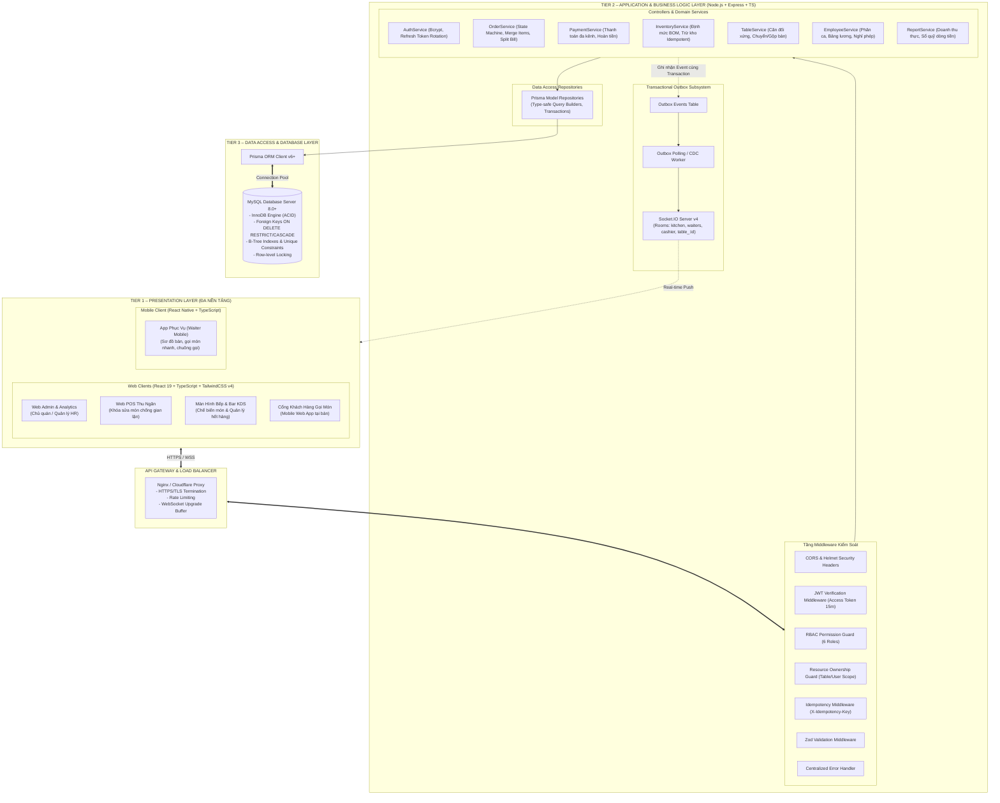
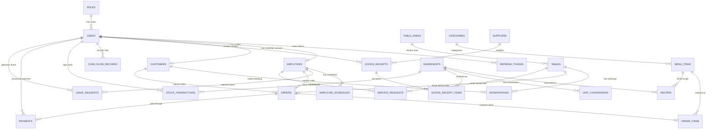
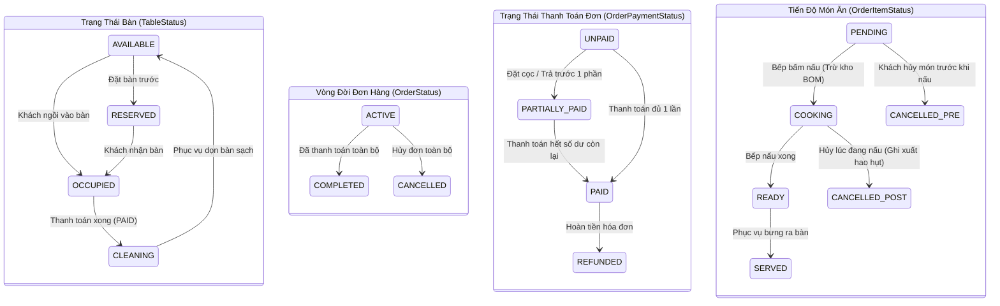
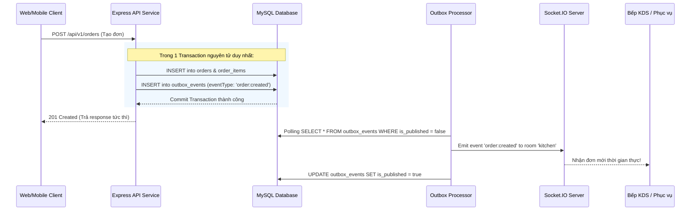
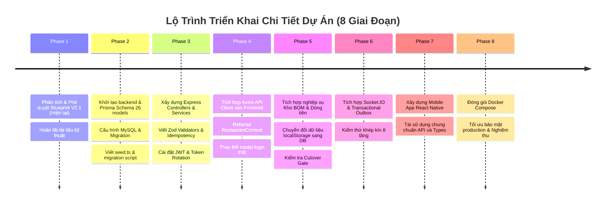

# THIẾT KẾ KIẾN TRÚC MỤC TIÊU VÀ KẾ HOẠCH CHUYỂN ĐỔI TOÀN DIỆN (PHIÊN BẢN 2.1)
## DỰ ÁN: RESTAURANT ASIA / QUẢN LÝ NHÀ HÀNG PRO (THREE-TIER ARCHITECTURE MASTER BLUEPRINT)

---

| Thông Tin Tài Liệu | Chi Tiết |
| :--- | :--- |
| **Dự án** | Restaurant Asia / Quản Lý Nhà Hàng Pro |
| **Phiên bản tài liệu** | **2.1.0 (Production-Ready Architecture Blueprint)** |
| **Vai trò lập tài liệu** | Senior Software Architect, Database Architect, Senior Backend Engineer & Security Reviewer |
| **Mục tiêu kỹ thuật** | Rà soát toàn diện, hiệu chỉnh triệt để các sai lệch của bản V2.0, hoàn thiện 100% đặc tả cho kiến trúc 3 tầng chuẩn doanh nghiệp (React/React Native + Express.js/Node.js + Prisma ORM + MySQL 8.0+ + Socket.IO) |
| **Trạng thái thực thi** | **CHỜ PHÊ DUYỆT (PENDING APPROVAL) – CHƯA TRIỂN KHAI CODE/MIGRATION** |
| **Quy tắc tuân thủ** | Chỉ phân tích và lập kế hoạch tài liệu; không sửa đổi mã nguồn ứng dụng, không chạy migration, không tác động cơ sở dữ liệu |

---

## MỤC LỤC TÀI LIỆU V2.1

1. **TỔNG QUAN ĐIỀU HÀNH (EXECUTIVE SUMMARY)**
2. **KIẾN TRÚC THREE-TIER MỤC TIÊU HOÀN THIỆN**
3. **DANH MỤC MÔ HÌNH DỮ LIỆU ĐÃ HIỆU CHỈNH (CORRECTED DATABASE INVENTORY)**
4. **TỪ ĐIỂN DỮ LIỆU TOÀN DIỆN (COMPLETE DATA DICTIONARY)**
5. **PRISMA SCHEMA CHUẨN XÁC (`schema.prisma`)**
6. **SƠ ĐỒ THỰC THỂ QUAN HỆ TOÀN DIỆN (COMPLETE ERD)**
7. **CHIẾN LƯỢC MIGRATION DỮ LIỆU TỪ `LOCALSTORAGE` SANG MYSQL**
8. **QUY TẮC NGHIỆP VỤ KHO VÀ ĐỊNH MỨC MÓN ĂN (INVENTORY & BOM)**
9. **THIẾT KẾ BẢO MẬT, XÁC THỰC VÀ PHÂN QUYỀN (AUTH & RBAC)**
10. **STATE MACHINE CHO ĐƠN HÀNG, BÀN ĂN VÀ THANH TOÁN**
11. **KIẾN TRÚC TRUYỀN THÔNG THỜI GIAN THỰC (SOCKET.IO & TRANSACTIONAL OUTBOX)**
12. **ĐẶC TẢ HỆ THỐNG RESTFUL API (API SPECIFICATION)**
13. **CHIẾN LƯỢC KIỂM THỬ TOÀN DIỆN (TESTING MATRIX)**
14. **ĐÁNH GIÁ RỦI RO VÀ GIẢI PHÁP KIỂM SOÁT (RISK ASSESSMENT)**
15. **LỘ TRÌNH TRIỂN KHAI THEO 8 GIAI ĐOẠN (IMPLEMENTATION ROADMAP)**
16. **NHẬT KÝ THAY ĐỔI: V2.0 ➔ V2.1 (CHANGE LOG)**
17. **DANH MỤC CÁC QUYẾT ĐỊNH CHỜ THỐNG NHẤT (OPEN DECISIONS)**

---

## 1. TỔNG QUAN ĐIỀU HÀNH (EXECUTIVE SUMMARY)

Bản tài liệu **V2.1** là kết quả rà soát sâu từ các góc độ Kiến trúc phần mềm, Kiến trúc cơ sở dữ liệu, Kỹ thuật backend và An toàn thông tin đối với bản thiết kế V2.0 trước đó.

### Những hiệu chỉnh và đột phá quan trọng nhất trong V2.1:
1. **Giải quyết triệt để sự sai lệch số lượng bảng:** Khắc phục lỗi đếm sai bảng ở bản V2.0. Danh mục mô hình dữ liệu được định danh chính xác thành **26 Models chuẩn hóa**, bổ sung các thực thể còn thiếu trong nghiệp vụ nhà hàng: `UnitConversion` (Quy đổi đơn vị nguyên liệu), `OutboxEvent` (Đảm bảo độ tin cậy Socket.IO qua Transactional Outbox Pattern), và `IdempotencyRecord` (Chống trùng lặp thanh toán/trừ kho khi mạng chập chờn).
2. **Khóa an toàn khi Migration dữ liệu `localStorage`:** Không chuyển đổi mật khẩu mặc định yếu (`123`) thành mật khẩu vĩnh viễn trên production. Bổ sung cờ `mustChangePassword = true` bắt buộc nhân viên đổi mật khẩu ngay lần đăng nhập đầu tiên. Áp dụng kỹ thuật soft-delete (`isDeleted`) cho món ăn để bảo tồn toàn vẹn dữ liệu hóa đơn lịch sử.
3. **Quản lý kho BOM chuẩn xác và chống trừ kho trùng lặp (Idempotency):** Chuẩn hóa hệ thống đơn vị đo lường cơ sở (Base Units), bổ sung cờ `isStockDeducted` và bảng giao dịch kho `StockTransaction` với `idempotencyKey`, ngăn chặn việc đầu bếp bấm nút nhiều lần dẫn đến trừ kho nhiều lần.
4. **Tách biệt rành mạch State Machine Đơn hàng và Thanh toán:** Phân định rõ trạng thái của từng giao dịch thanh toán (`PaymentStatus`) với trạng thái tổng thanh toán của đơn hàng (`OrderPaymentStatus`), hỗ trợ thanh toán từng phần (Partial Payment) và thanh toán đa phương thức (ví dụ: một phần tiền mặt, một phần chuyển khoản).
5. **Bảo vệ Concurrency & Race Conditions:** Bổ sung cơ chế khóa lạc quan (Optimistic Concurrency Control qua trường `version` trong `RestaurantTable` và `Order`) để ngăn chặn việc 2 nhân viên cùng mở, gộp hoặc chuyển một bàn cùng một tích tắc.
6. **Socket.IO độ tin cậy cao với Transactional Outbox Pattern:** Sự kiện thời gian thực không bắn trực tiếp từ controller (dễ mất mát nếu server crash), mà được ghi nhận nguyên tử trong cùng DB transaction qua bảng `outbox_events`, sau đó Outbox Worker đẩy vào Socket.IO.

---

## 2. KIẾN TRÚC THREE-TIER MỤC TIÊU HOÀN THIỆN



---

## 3. DANH MỤC MÔ HÌNH DỮ LIỆU ĐÃ HIỆU CHỈNH (26 MODELS)

Khắc phục hoàn toàn sự thiếu sót ở bản V2.0, danh mục mô hình dữ liệu chính thức bao gồm đúng **26 Models**, được phân loại theo 9 phân hệ nghiệp vụ:

| STT | Tên Model Prisma | Tên Bảng MySQL | Phân Hệ Nghiệp Vụ | Vai Trò & Mô Tả Nghiệp Vụ |
| :---: | :--- | :--- | :--- | :--- |
| 1 | `Role` | `roles` | Auth & RBAC | Danh mục 6 vai trò hệ thống (`ADMIN`, `CASHIER`, `KITCHEN`, `WAITER`, `HR_MANAGER`, `CUSTOMER`) |
| 2 | `User` | `users` | Auth & RBAC | Tài khoản đăng nhập hệ thống, lưu mật khẩu băm bcrypt và cờ bắt buộc đổi mật khẩu |
| 3 | `RefreshToken` | `refresh_tokens` | Auth & RBAC | Quản lý phiên đăng nhập theo Token Family, hỗ trợ Rotation và phát hiện tái sử dụng token |
| 4 | `Employee` | `employees` | Nhân sự (HR) | Hồ sơ nhân viên, chức danh, mức lương, hình thức lương (tháng/giờ), liên kết 1-1 với `User` |
| 5 | `EmployeeSchedule` | `employee_schedules` | Nhân sự (HR) | Lịch phân ca làm việc chi tiết hàng tuần cho từng nhân viên |
| 6 | `LeaveRequest` | `leave_requests` | Nhân sự (HR) | Đơn xin nghỉ phép của nhân viên với 4 trạng thái (`ACTIVE`, `UPCOMING`, `COMPLETED`, `CANCELLED`) |
| 7 | `Customer` | `customers` | Khách hàng (CRM) | Hồ sơ khách hàng, số điện thoại, phân loại 4 nhóm (Vãng lai, Thường, VIP, Đoàn), tích điểm |
| 8 | `TableArea` | `table_areas` | Mặt bằng & Bàn | Phân khu mặt bằng nhà hàng (Tầng 1, Sân vườn, Phòng VIP) |
| 9 | `RestaurantTable` | `tables` | Mặt bằng & Bàn | Thông tin bàn ăn, sức chứa, tọa độ canvas X/Y, trạng thái và trường `version` chống xung đột |
| 10 | `Reservation` | `reservations` | Đặt bàn | Lịch hẹn đặt bàn trước của khách hàng kèm kiểm tra trùng lặp thời gian |
| 11 | `Category` | `categories` | Thực đơn (Menu) | Danh mục món ăn linh hoạt (cho phép thêm/sửa/xóa qua Admin UI) |
| 12 | `MenuItem` | `menu_items` | Thực đơn (Menu) | Món ăn, giá bán, giá vốn (cost), thời gian nấu, hỗ trợ cờ `isDeleted` (soft-delete) |
| 13 | `Ingredient` | `ingredients` | Kho & BOM | Danh mục nguyên vật liệu thô (thịt, cá, rau, gia vị) với đơn vị tính chuẩn (Base Unit) |
| 14 | `UnitConversion` | `unit_conversions` | Kho & BOM | Bảng quy đổi đơn vị nhập/chế biến về đơn vị đo lường chuẩn (vd: 1 két = 24 lon, 1 hộp = 500g) |
| 15 | `Recipe` | `recipes` | Kho & BOM | Bảng định mức công thức chế biến (**BOM**), liên kết món ăn và nguyên vật liệu tiêu hao |
| 16 | `Order` | `orders` | Đơn hàng & POS | Hóa đơn bán hàng, lưu tổng tiền, chiết khấu, VAT, mã `#HD-xxxx`, trạng thái đơn & thanh toán |
| 17 | `OrderItem` | `order_items` | Đơn hàng & POS | Chi tiết từng món trong đơn, lưu giá thời điểm bán, ghi chú, trạng thái KDS và cờ trừ kho |
| 18 | `Payment` | `payments` | Thanh toán | Bản ghi từng giao dịch thanh toán (hỗ trợ thanh toán từng phần, đa kênh: Tiền mặt, VietQR, Thẻ) |
| 19 | `Supplier` | `suppliers` | Nhập kho | Thông tin nhà cung cấp nguyên vật liệu |
| 20 | `GoodsReceipt` | `goods_receipts` | Nhập kho | Phiếu nhập kho nguyên liệu từ nhà cung cấp kèm trạng thái công nợ |
| 21 | `GoodsReceiptItem` | `goods_receipt_items` | Nhập kho | Chi tiết số lượng và đơn giá từng nguyên vật liệu nhập |
| 22 | `StockTransaction` | `stock_transactions` | Sổ cái Kho | Sổ cái ghi nhận mọi biến động kho (nhập, xuất món, hoàn trả, xuất hủy, kiểm kê điều chỉnh) |
| 23 | `CashFlowRecord` | `cash_flow_records` | Tài chính | Sổ quỹ thu chi tiền mặt và ngân hàng (hạch toán tự động từ bán hàng và nhập kho) |
| 24 | `ServiceRequest` | `service_requests` | Phục vụ bàn | Chuông gọi phục vụ từ thực khách (xin nước đá, khăn, tính tiền, dọn bàn) |
| 25 | `OutboxEvent` | `outbox_events` | Hệ thống | Bảng lưu sự kiện giao dịch phục vụ phát Socket.IO đảm bảo độ tin cậy tuyệt đối |
| 26 | `IdempotencyRecord` | `idempotency_records` | Hệ thống | Bảng lưu khóa Idempotency Key ngăn chặn trùng lặp giao dịch thanh toán và trừ kho |

---

## 4. TỪ ĐIỂN DỮ LIỆU TOÀN DIỆN (COMPLETE DATA DICTIONARY)

Dưới đây là từ điển đặc tả chi tiết các trường cốt lõi, kiểu dữ liệu MySQL, ràng buộc và mục đích:

### 4.1. Bảng `users` (Tài khoản người dùng)
* `id` (VARCHAR(36), PK): Định danh duy nhất (UUID v4).
* `username` (VARCHAR(50), UNIQUE, NOT NULL): Tên đăng nhập (chữ thường, không dấu).
* `password_hash` (VARCHAR(255), NOT NULL): Mật khẩu băm bằng bcrypt (saltRounds = 10).
* `role_id` (VARCHAR(36), FK -> `roles.id`, NOT NULL): Vai trò hệ thống.
* `full_name` (VARCHAR(100), NOT NULL): Họ và tên hiển thị.
* `phone` (VARCHAR(20), NULL): Số điện thoại liên hệ.
* `avatar` (VARCHAR(500), NULL): URL hình ảnh đại diện.
* `is_active` (BOOLEAN, NOT NULL, DEFAULT TRUE): Trạng thái tài khoản (true: hoạt động, false: bị khóa).
* `must_change_password` (BOOLEAN, NOT NULL, DEFAULT FALSE): Bắt buộc đổi mật khẩu khi đăng nhập lần đầu (đặc biệt áp dụng cho tài khoản migration từ mật khẩu cũ `123`).
* `last_login_at` (DATETIME, NULL): Thời điểm đăng nhập gần nhất.
* `created_at` (DATETIME, NOT NULL, DEFAULT CURRENT_TIMESTAMP): Thời điểm tạo.
* `updated_at` (DATETIME, NOT NULL, ON UPDATE CURRENT_TIMESTAMP): Thời điểm cập nhật cuối.

### 4.2. Bảng `tables` (Bàn ăn mặt bằng)
* `id` (VARCHAR(36), PK): Mã định danh bàn (vd: `t-101`).
* `name` (VARCHAR(50), NOT NULL): Tên bàn hiển thị (vd: "Bàn 01", "VIP 1").
* `area_id` (VARCHAR(36), FK -> `table_areas.id`, NOT NULL): Thuộc khu vực tầng nào.
* `capacity` (INT, NOT NULL, DEFAULT 4): Số chỗ ngồi tối đa.
* `shape` (ENUM('ROUND', 'SQUARE', 'RECTANGLE'), NOT NULL, DEFAULT 'SQUARE'): Hình dạng bàn.
* `status` (ENUM('AVAILABLE', 'OCCUPIED', 'RESERVED', 'CLEANING'), NOT NULL, DEFAULT 'AVAILABLE'): Trạng thái bàn.
* `pos_x` (DOUBLE, NOT NULL, DEFAULT 0): Tọa độ X trên bản đồ mặt bằng (%).
* `pos_y` (DOUBLE, NOT NULL, DEFAULT 0): Tọa độ Y trên bản đồ mặt bằng (%).
* `occupied_since` (DATETIME, NULL): Thời điểm khách bắt đầu ngồi.
* `version` (INT, NOT NULL, DEFAULT 0): Cờ phiên bản phục vụ khóa lạc quan (Optimistic Concurrency Lock).

### 4.3. Bảng `orders` (Đơn hàng / Hóa đơn)
* `id` (VARCHAR(36), PK): Mã đơn hàng nội bộ.
* `code` (VARCHAR(20), UNIQUE, NOT NULL): Mã số hóa đơn hiển thị trên bill nhiệt (vd: `#HD-1024`).
* `table_id` (VARCHAR(36), FK -> `tables.id`, NOT NULL): Bàn đang phục vụ.
* `customer_id` (VARCHAR(36), FK -> `customers.id`, NULL): Khách hàng thành viên (nếu có).
* `served_by_id` (VARCHAR(36), FK -> `employees.id`, NULL): Nhân viên phụ trách bàn.
* `customer_count` (INT, NOT NULL, DEFAULT 2): Số lượng khách thực tế tại bàn.
* `subtotal` (DECIMAL(12, 2), NOT NULL, DEFAULT 0.00): Tổng tiền món trước giảm giá và thuế.
* `discount_percent` (DECIMAL(5, 2), NOT NULL, DEFAULT 0.00): Tỷ lệ chiết khấu (0 - 100%).
* `discount_amount` (DECIMAL(12, 2), NOT NULL, DEFAULT 0.00): Số tiền được chiết khấu.
* `tax_percent` (DECIMAL(5, 2), NOT NULL, DEFAULT 8.00): Thuế suất VAT (mặc định 8%).
* `tax_amount` (DECIMAL(12, 2), NOT NULL, DEFAULT 0.00): Tiền thuế VAT.
* `final_total` (DECIMAL(12, 2), NOT NULL, DEFAULT 0.00): Tổng tiền thanh toán cuối cùng.
* `status` (ENUM('ACTIVE', 'COMPLETED', 'CANCELLED'), NOT NULL, DEFAULT 'ACTIVE'): Vòng đời đơn hàng.
* `payment_status` (ENUM('UNPAID', 'PARTIALLY_PAID', 'PAID', 'REFUNDED'), NOT NULL, DEFAULT 'UNPAID'): Trạng thái thanh toán của đơn.
* `version` (INT, NOT NULL, DEFAULT 0): Khóa lạc quan chống race condition khi thanh toán/gộp đơn.

### 4.4. Bảng `order_items` (Chi tiết món ăn trong đơn)
* `id` (VARCHAR(36), PK): Mã dòng món ăn.
* `order_id` (VARCHAR(36), FK -> `orders.id` ON DELETE CASCADE, NOT NULL): Thuộc đơn hàng nào.
* `menu_item_id` (VARCHAR(36), FK -> `menu_items.id` ON DELETE RESTRICT, NOT NULL): Mã món ăn gốc.
* `name` (VARCHAR(150), NOT NULL): Tên món lưu vết tại thời điểm gọi.
* `unit` (VARCHAR(20), NOT NULL): Đơn vị tính lưu vết.
* `price` (DECIMAL(12, 2), NOT NULL): Đơn giá tại thời điểm gọi.
* `quantity` (INT, NOT NULL, DEFAULT 1): Số lượng gọi.
* `note` (VARCHAR(255), NULL): Ghi chú chế biến riêng từ khách (vd: "Không ớt", "Ít đường").
* `status` (ENUM('PENDING', 'COOKING', 'READY', 'SERVED', 'CANCELLED'), NOT NULL, DEFAULT 'PENDING'): Trạng thái chế biến Bếp KDS.
* `is_stock_deducted` (BOOLEAN, NOT NULL, DEFAULT FALSE): Cờ đánh dấu nguyên liệu đã bị trừ kho (ngăn chặn trừ trùng lặp).

### 4.5. Bảng `payments` (Giao dịch thanh toán)
* `id` (VARCHAR(36), PK): Mã giao dịch thanh toán.
* `order_id` (VARCHAR(36), FK -> `orders.id` ON DELETE RESTRICT, NOT NULL): Đơn hàng thanh toán.
* `payment_code` (VARCHAR(50), UNIQUE, NOT NULL): Mã giao dịch thanh toán duy nhất.
* `amount` (DECIMAL(12, 2), NOT NULL): Số tiền thanh toán trong giao dịch này.
* `payment_method` (ENUM('CASH', 'VIETQR', 'TRANSFER', 'CARD'), NOT NULL, DEFAULT 'CASH'): Hình thức thanh toán.
* `payment_status` (ENUM('PENDING', 'COMPLETED', 'REFUNDED', 'FAILED'), NOT NULL, DEFAULT 'COMPLETED'): Trạng thái giao dịch.
* `received_amount` (DECIMAL(12, 2), NOT NULL, DEFAULT 0.00): Số tiền khách đưa (khi trả tiền mặt).
* `change_amount` (DECIMAL(12, 2), NOT NULL, DEFAULT 0.00): Tiền thừa thối lại khách.
* `reference_code` (VARCHAR(100), NULL): Mã giao dịch ngân hàng / POS thẻ.
* `idempotency_key` (VARCHAR(100), UNIQUE, NULL): Khóa chống trùng lặp thanh toán khi mạng lag.
* `processed_by_id` (VARCHAR(36), FK -> `users.id`, NOT NULL): Thu ngân thực hiện.

---

## 5. PRISMA SCHEMA CHUẨN XÁC (`schema.prisma`)

```prisma
datasource db {
  provider = "mysql"
  url      = env("DATABASE_URL")
}

generator client {
  provider = "prisma-client-js"
}

// ==========================================================
// 1. PHÂN QUYỀN, TÀI KHOẢN & PHIÊN ĐĂNG NHẬP
// ==========================================================

enum RoleName {
  ADMIN
  CASHIER
  KITCHEN
  WAITER
  HR_MANAGER
  CUSTOMER
}

model Role {
  id          String    @id @default(uuid()) @db.VarChar(36)
  name        RoleName  @unique
  title       String    @db.VarChar(50)
  description String?   @db.VarChar(255)
  users       User[]

  @@map("roles")
}

model User {
  id                 String             @id @default(uuid()) @db.VarChar(36)
  username           String             @unique @db.VarChar(50)
  passwordHash       String             @db.VarChar(255) @map("password_hash")
  roleId             String             @db.VarChar(36) @map("role_id")
  role               Role               @relation(fields: [roleId], references: [id])
  fullName           String             @db.VarChar(100) @map("full_name")
  phone              String?            @db.VarChar(20)
  avatar             String?            @db.VarChar(500)
  isActive           Boolean            @default(true) @map("is_active")
  mustChangePassword Boolean            @default(false) @map("must_change_password")
  lastLoginAt        DateTime?          @map("last_login_at")
  createdAt          DateTime           @default(now()) @map("created_at")
  updatedAt          DateTime           @updatedAt @map("updated_at")

  employee           Employee?
  customer           Customer?
  refreshTokens      RefreshToken[]
  goodsReceipts      GoodsReceipt[]
  cashFlowRecords    CashFlowRecord[]
  approvedLeaves     LeaveRequest[]     @relation("ApprovedBy")
  stockTransactions  StockTransaction[]
  processedPayments  Payment[]

  @@index([roleId])
  @@map("users")
}

model RefreshToken {
  id          String   @id @default(uuid()) @db.VarChar(36)
  tokenHash   String   @unique @db.VarChar(255) @map("token_hash")
  userId      String   @db.VarChar(36) @map("user_id")
  user        User     @relation(fields: [userId], references: [id], onDelete: Cascade)
  family      String   @db.VarChar(36)
  isRevoked   Boolean  @default(false) @map("is_revoked")
  expiresAt   DateTime @map("expires_at")
  createdAt   DateTime @default(now()) @map("created_at")

  @@index([userId])
  @@index([family])
  @@map("refresh_tokens")
}

// ==========================================================
// 2. NHÂN SỰ, CA TRỰC & NGHỈ PHÉP
// ==========================================================

enum SalaryType {
  MONTHLY
  HOURLY
}

enum EmployeeStatus {
  ACTIVE
  ON_BREAK
  OFF
}

model Employee {
  id             String             @id @default(uuid()) @db.VarChar(36)
  userId         String?            @unique @db.VarChar(36) @map("user_id")
  user           User?              @relation(fields: [userId], references: [id], onDelete: SetNull)
  name           String             @db.VarChar(100)
  phone          String             @db.VarChar(20)
  email          String?            @db.VarChar(100)
  roleTitle      String             @db.VarChar(50) @map("role_title")
  shiftDefault   String?            @db.VarChar(50) @map("shift_default")
  salaryRate     Decimal            @default(0) @db.Decimal(12, 2) @map("salary_rate")
  salaryType     SalaryType         @default(MONTHLY) @map("salary_type")
  status         EmployeeStatus     @default(ACTIVE)
  joinDate       DateTime           @default(now()) @map("join_date")
  ordersHandled  Int                @default(0) @map("orders_handled")
  createdAt      DateTime           @default(now()) @map("created_at")
  updatedAt      DateTime           @updatedAt @map("updated_at")

  schedules      EmployeeSchedule[]
  leaveRequests  LeaveRequest[]     @relation("StaffLeaves")
  servedOrders   Order[]            @relation("ServedByEmployee")
  assignedCalls  ServiceRequest[]

  @@map("employees")
}

model EmployeeSchedule {
  id          String   @id @default(uuid()) @db.VarChar(36)
  employeeId  String   @db.VarChar(36) @map("employee_id")
  employee    Employee @relation(fields: [employeeId], references: [id], onDelete: Cascade)
  dayOfWeek   Int      @map("day_of_week")
  shiftDate   DateTime @db.Date @map("shift_date")
  shiftName   String   @db.VarChar(50) @map("shift_name")
  timeRange   String   @db.VarChar(50) @map("time_range")
  isAttended  Boolean  @default(false) @map("is_attended")
  createdAt   DateTime @default(now()) @map("created_at")
  updatedAt   DateTime @updatedAt @map("updated_at")

  @@index([employeeId])
  @@index([shiftDate])
  @@map("employee_schedules")
}

enum LeaveStatus {
  ACTIVE
  UPCOMING
  COMPLETED
  CANCELLED
}

enum LeaveType {
  ANNUAL
  SICK
  FAMILY
  COMPENSATORY
}

model LeaveRequest {
  id           String      @id @default(uuid()) @db.VarChar(36)
  employeeId   String      @db.VarChar(36) @map("employee_id")
  employee     Employee    @relation("StaffLeaves", fields: [employeeId], references: [id], onDelete: Cascade)
  startDate    DateTime    @db.Date @map("start_date")
  endDate      DateTime    @db.Date @map("end_date")
  status       LeaveStatus @default(UPCOMING)
  leaveType    LeaveType   @default(ANNUAL) @map("leave_type")
  reason       String      @db.VarChar(255)
  approvedById String?     @db.VarChar(36) @map("approved_by_id")
  approvedBy   User?       @relation("ApprovedBy", fields: [approvedById], references: [id])
  createdAt    DateTime    @default(now()) @map("created_at")
  updatedAt    DateTime    @updatedAt @map("updated_at")

  @@index([employeeId])
  @@map("leave_requests")
}

// ==========================================================
// 3. KHÁCH HÀNG CRM
// ==========================================================

enum CustomerType {
  WALK_IN
  REGULAR
  VIP
  GROUP
}

model Customer {
  id            String        @id @default(uuid()) @db.VarChar(36)
  userId        String?       @unique @db.VarChar(36) @map("user_id")
  user          User?         @relation(fields: [userId], references: [id], onDelete: SetNull)
  fullName      String        @db.VarChar(100) @map("full_name")
  phone         String        @unique @db.VarChar(20)
  email         String?       @db.VarChar(100)
  customerType  CustomerType  @default(WALK_IN) @map("customer_type")
  loyaltyPoints Int           @default(0) @map("loyalty_points")
  totalSpent    Decimal       @default(0) @db.Decimal(14, 2) @map("total_spent")
  createdAt     DateTime      @default(now()) @map("created_at")
  updatedAt     DateTime      @updatedAt @map("updated_at")

  orders        Order[]
  reservations  Reservation[]

  @@map("customers")
}

// ==========================================================
// 4. MẶT BẰNG, KHU VỰC, BÀN ĂN & ĐẶT BÀN
// ==========================================================

model TableArea {
  id           String            @id @default(uuid()) @db.VarChar(36)
  name         String            @unique @db.VarChar(100)
  description  String?           @db.VarChar(255)
  displayOrder Int               @default(0) @map("display_order")
  createdAt    DateTime          @default(now()) @map("created_at")
  updatedAt    DateTime          @updatedAt @map("updated_at")
  tables       RestaurantTable[]

  @@map("table_areas")
}

enum TableShape {
  ROUND
  SQUARE
  RECTANGLE
}

enum TableStatus {
  AVAILABLE
  OCCUPIED
  RESERVED
  CLEANING
}

model RestaurantTable {
  id            String          @id @default(uuid()) @db.VarChar(36)
  name          String          @db.VarChar(50)
  areaId        String          @db.VarChar(36) @map("area_id")
  area          TableArea       @relation(fields: [areaId], references: [id], onDelete: Restrict)
  capacity      Int             @default(4)
  shape         TableShape      @default(SQUARE)
  status        TableStatus     @default(AVAILABLE)
  posX          Float           @default(0) @map("pos_x")
  posY          Float           @default(0) @map("pos_y")
  width         Float           @default(90)
  height        Float           @default(90)
  occupiedSince DateTime?       @map("occupied_since")
  customerType  CustomerType?   @map("customer_type")
  version       Int             @default(0) // Optimistic Locking
  createdAt     DateTime        @default(now()) @map("created_at")
  updatedAt     DateTime        @updatedAt @map("updated_at")

  orders        Order[]
  reservations  Reservation[]
  serviceCalls  ServiceRequest[]

  @@index([areaId])
  @@index([status])
  @@map("tables")
}

enum ReservationStatus {
  CONFIRMED
  SEATED
  CANCELLED
  NO_SHOW
}

model Reservation {
  id              String            @id @default(uuid()) @db.VarChar(36)
  tableId         String            @db.VarChar(36) @map("table_id")
  table           RestaurantTable   @relation(fields: [tableId], references: [id], onDelete: Restrict)
  customerId      String?           @db.VarChar(36) @map("customer_id")
  customer        Customer?         @relation(fields: [customerId], references: [id], onDelete: SetNull)
  customerName    String            @db.VarChar(100) @map("customer_name")
  phone           String            @db.VarChar(20)
  guestCount      Int               @default(2) @map("guest_count")
  reservationTime DateTime          @map("reservation_time")
  customerType    CustomerType      @default(REGULAR) @map("customer_type")
  status          ReservationStatus @default(CONFIRMED)
  notes           String?           @db.VarChar(255)
  createdAt       DateTime          @default(now()) @map("created_at")
  updatedAt       DateTime          @updatedAt @map("updated_at")

  @@index([tableId])
  @@index([reservationTime])
  @@map("reservations")
}

// ==========================================================
// 5. THỰC ĐƠN, MÓN ĂN, NGUYÊN LIỆU & QUY ĐỔI ĐƠN VỊ (BOM)
// ==========================================================

model Category {
  id           String     @id @default(uuid()) @db.VarChar(36)
  name         String     @unique @db.VarChar(100)
  displayOrder Int        @default(0) @map("display_order")
  isActive     Boolean    @default(true) @map("is_active")
  createdAt    DateTime   @default(now()) @map("created_at")
  updatedAt    DateTime   @updatedAt @map("updated_at")
  menuItems    MenuItem[]

  @@map("categories")
}

model MenuItem {
  id              String      @id @default(uuid()) @db.VarChar(36)
  categoryId      String      @db.VarChar(36) @map("category_id")
  category        Category    @relation(fields: [categoryId], references: [id], onDelete: Restrict)
  name            String      @db.VarChar(150)
  price           Decimal     @db.Decimal(12, 2)
  costPrice       Decimal     @default(0) @db.Decimal(12, 2) @map("cost_price")
  unit            String      @default("phần") @db.VarChar(20)
  description     String?     @db.Text
  image           String?     @db.VarChar(500)
  isAvailable     Boolean     @default(true) @map("is_available")
  isDeleted       Boolean     @default(false) @map("is_deleted") // Soft-delete
  prepTimeMinutes Int         @default(15) @map("prep_time_minutes")
  spicyLevel      Int         @default(0) @map("spicy_level")
  tags            String?     @db.VarChar(255)
  isPopular       Boolean     @default(false) @map("is_popular")
  createdAt       DateTime    @default(now()) @map("created_at")
  updatedAt       DateTime    @updatedAt @map("updated_at")

  orderItems      OrderItem[]
  recipes         Recipe[]

  @@index([categoryId])
  @@index([isAvailable])
  @@index([isDeleted])
  @@map("menu_items")
}

model Ingredient {
  id                 String             @id @default(uuid()) @db.VarChar(36)
  name               String             @unique @db.VarChar(150)
  category           String             @db.VarChar(100) // 'Thịt & Hải sản', 'Rau củ quả', 'Gia vị & Khô'
  baseUnit           String             @db.VarChar(20)  @map("base_unit") // 'g', 'ml', 'unit'
  currentStock       Decimal            @default(0) @db.Decimal(12, 3) @map("current_stock")
  minStockLevel      Decimal            @default(5) @db.Decimal(12, 3) @map("min_stock_level")
  costPerUnit        Decimal            @default(0) @db.Decimal(12, 2) @map("cost_per_unit")
  allowNegativeStock Boolean            @default(false) @map("allow_negative_stock")
  createdAt          DateTime           @default(now()) @map("created_at")
  updatedAt          DateTime           @updatedAt @map("updated_at")

  recipes            Recipe[]
  receiptItems       GoodsReceiptItem[]
  stockHistory       StockTransaction[]
  unitConversions    UnitConversion[]

  @@map("ingredients")
}

model UnitConversion {
  id             String     @id @default(uuid()) @db.VarChar(36)
  ingredientId   String     @db.VarChar(36) @map("ingredient_id")
  ingredient     Ingredient @relation(fields: [ingredientId], references: [id], onDelete: Cascade)
  fromUnit       String     @db.VarChar(20) @map("from_unit") // e.g. 'kg', 'két', 'hộp'
  toUnit         String     @db.VarChar(20) @map("to_unit")   // Base unit e.g. 'g', 'lon', 'g'
  conversionRate Decimal    @db.Decimal(10, 4) @map("conversion_rate") // e.g. 1 kg = 1000 g -> rate = 1000
  createdAt      DateTime   @default(now()) @map("created_at")
  updatedAt      DateTime   @updatedAt @map("updated_at")

  @@unique([ingredientId, fromUnit])
  @@map("unit_conversions")
}

model Recipe {
  id               String     @id @default(uuid()) @db.VarChar(36)
  menuItemId       String     @db.VarChar(36) @map("menu_item_id")
  menuItem         MenuItem   @relation(fields: [menuItemId], references: [id], onDelete: Cascade)
  ingredientId     String     @db.VarChar(36) @map("ingredient_id")
  ingredient       Ingredient @relation(fields: [ingredientId], references: [id], onDelete: Restrict)
  quantityRequired Decimal    @db.Decimal(10, 3) @map("quantity_required")
  unit             String     @db.VarChar(20)
  createdAt        DateTime   @default(now()) @map("created_at")
  updatedAt        DateTime   @updatedAt @map("updated_at")

  @@unique([menuItemId, ingredientId])
  @@map("recipes")
}

// ==========================================================
// 6. ĐƠN HÀNG, CHI TIẾT MÓN & THANH TOÁN
// ==========================================================

enum OrderStatus {
  ACTIVE
  COMPLETED
  CANCELLED
}

enum OrderPaymentStatus {
  UNPAID
  PARTIALLY_PAID
  PAID
  REFUNDED
}

enum OrderItemStatus {
  PENDING
  COOKING
  READY
  SERVED
  CANCELLED
}

model Order {
  id              String             @id @default(uuid()) @db.VarChar(36)
  code            String             @unique @db.VarChar(20)
  tableId         String             @db.VarChar(36) @map("table_id")
  table           RestaurantTable    @relation(fields: [tableId], references: [id], onDelete: Restrict)
  customerId      String?            @db.VarChar(36) @map("customer_id")
  customer        Customer?          @relation(fields: [customerId], references: [id], onDelete: SetNull)
  servedById      String?            @db.VarChar(36) @map("served_by_id")
  servedBy        Employee?          @relation("ServedByEmployee", fields: [servedById], references: [id], onDelete: SetNull)
  customerName    String?            @db.VarChar(100) @map("customer_name")
  customerPhone   String?            @db.VarChar(20) @map("customer_phone")
  customerType    CustomerType       @default(WALK_IN) @map("customer_type")
  customerCount   Int                @default(2) @map("customer_count")
  subtotal        Decimal            @default(0) @db.Decimal(12, 2)
  discountPercent Decimal            @default(0) @db.Decimal(5, 2) @map("discount_percent")
  discountAmount  Decimal            @default(0) @db.Decimal(12, 2) @map("discount_amount")
  taxPercent      Decimal            @default(8) @db.Decimal(5, 2) @map("tax_percent")
  taxAmount       Decimal            @default(0) @db.Decimal(12, 2) @map("tax_amount")
  finalTotal      Decimal            @default(0) @db.Decimal(12, 2) @map("final_total")
  status          OrderStatus        @default(ACTIVE)
  paymentStatus   OrderPaymentStatus @default(UNPAID) @map("payment_status")
  notes           String?            @db.VarChar(255)
  version         Int                @default(0)
  createdAt       DateTime           @default(now()) @map("created_at")
  updatedAt       DateTime           @updatedAt @map("updated_at")
  completedAt     DateTime?          @map("completed_at")

  items           OrderItem[]
  payments        Payment[]

  @@index([tableId])
  @@index([status])
  @@index([paymentStatus])
  @@index([createdAt])
  @@map("orders")
}

model OrderItem {
  id              String          @id @default(uuid()) @db.VarChar(36)
  orderId         String          @db.VarChar(36) @map("order_id")
  order           Order           @relation(fields: [orderId], references: [id], onDelete: Cascade)
  menuItemId      String          @db.VarChar(36) @map("menu_item_id")
  menuItem        MenuItem        @relation(fields: [menuItemId], references: [id], onDelete: Restrict)
  name            String          @db.VarChar(150)
  unit            String          @db.VarChar(20)
  price           Decimal         @db.Decimal(12, 2)
  quantity        Int             @default(1)
  note            String?         @db.VarChar(255)
  status          OrderItemStatus @default(PENDING)
  isStockDeducted Boolean         @default(false) @map("is_stock_deducted")
  orderedAt       DateTime        @default(now()) @map("ordered_at")
  updatedAt       DateTime        @updatedAt @map("updated_at")

  @@index([orderId])
  @@index([status])
  @@map("order_items")
}

enum PaymentMethod {
  CASH
  VIETQR
  TRANSFER
  CARD
}

enum PaymentStatus {
  PENDING
  COMPLETED
  REFUNDED
  FAILED
}

model Payment {
  id             String        @id @default(uuid()) @db.VarChar(36)
  orderId        String        @db.VarChar(36) @map("order_id")
  order          Order         @relation(fields: [orderId], references: [id], onDelete: Restrict)
  paymentCode    String        @unique @db.VarChar(50) @map("payment_code")
  amount         Decimal       @db.Decimal(12, 2)
  paymentMethod  PaymentMethod @default(CASH) @map("payment_method")
  paymentStatus  PaymentStatus @default(COMPLETED) @map("payment_status")
  receivedAmount Decimal       @default(0) @db.Decimal(12, 2) @map("received_amount")
  changeAmount   Decimal       @default(0) @db.Decimal(12, 2) @map("change_amount")
  referenceCode  String?       @db.VarChar(100) @map("reference_code")
  idempotencyKey String?       @unique @db.VarChar(100) @map("idempotency_key")
  processedById  String        @db.VarChar(36) @map("processed_by_id")
  processedBy    User          @relation(fields: [processedById], references: [id], onDelete: Restrict)
  paidAt         DateTime      @default(now()) @map("paid_at")
  createdAt      DateTime      @default(now()) @map("created_at")
  updatedAt      DateTime      @updatedAt @map("updated_at")

  @@index([orderId])
  @@map("payments")
}

// ==========================================================
// 7. NHÀ CUNG CẤP, HÀNG NHẬP & SỔ CÁI BIẾN ĐỘNG KHO
// ==========================================================

model Supplier {
  id            String         @id @default(uuid()) @db.VarChar(36)
  name          String         @db.VarChar(150)
  phone         String?        @db.VarChar(20)
  email         String?        @db.VarChar(100)
  address       String?        @db.VarChar(255)
  isActive      Boolean        @default(true) @map("is_active")
  createdAt     DateTime       @default(now()) @map("created_at")
  updatedAt     DateTime       @updatedAt @map("updated_at")

  goodsReceipts GoodsReceipt[]

  @@map("suppliers")
}

model GoodsReceipt {
  id            String             @id @default(uuid()) @db.VarChar(36)
  receiptCode   String             @unique @db.VarChar(50) @map("receipt_code")
  supplierId    String             @db.VarChar(36) @map("supplier_id")
  supplier      Supplier           @relation(fields: [supplierId], references: [id], onDelete: Restrict)
  receivedDate  DateTime           @default(now()) @map("received_date")
  totalAmount   Decimal            @db.Decimal(14, 2) @map("total_amount")
  paymentStatus String             @default("paid") @db.VarChar(20) @map("payment_status")
  paymentMethod PaymentMethod      @default(TRANSFER) @map("payment_method")
  notes         String?            @db.VarChar(255)
  createdById   String             @db.VarChar(36) @map("created_by_id")
  createdBy     User               @relation(fields: [createdById], references: [id], onDelete: Restrict)
  createdAt     DateTime           @default(now()) @map("created_at")
  updatedAt     DateTime           @updatedAt @map("updated_at")

  items         GoodsReceiptItem[]

  @@index([supplierId])
  @@map("goods_receipts")
}

model GoodsReceiptItem {
  id           String       @id @default(uuid()) @db.VarChar(36)
  receiptId    String       @db.VarChar(36) @map("receipt_id")
  receipt      GoodsReceipt @relation(fields: [receiptId], references: [id], onDelete: Cascade)
  ingredientId String       @db.VarChar(36) @map("ingredient_id")
  ingredient   Ingredient   @relation(fields: [ingredientId], references: [id], onDelete: Restrict)
  quantity     Decimal      @db.Decimal(12, 3)
  unit         String       @db.VarChar(20)
  unitPrice    Decimal      @db.Decimal(12, 2) @map("unit_price")
  totalPrice   Decimal      @db.Decimal(14, 2) @map("total_price")
  createdAt    DateTime     @default(now()) @map("created_at")
  updatedAt    DateTime     @updatedAt @map("updated_at")

  @@index([receiptId])
  @@index([ingredientId])
  @@map("goods_receipt_items")
}

enum StockTransactionType {
  GOODS_RECEIPT
  ORDER_CONSUMPTION
  ORDER_CANCELLATION_RETURN
  STOCK_TAKE_ADJUSTMENT
  WASTE_DAMAGE
  SUPPLIER_RETURN
}

model StockTransaction {
  id              String               @id @default(uuid()) @db.VarChar(36)
  ingredientId    String               @db.VarChar(36) @map("ingredient_id")
  ingredient      Ingredient           @relation(fields: [ingredientId], references: [id], onDelete: Restrict)
  transactionType StockTransactionType @map("transaction_type")
  quantity        Decimal              @db.Decimal(12, 3)
  balanceAfter    Decimal              @db.Decimal(12, 3) @map("balance_after")
  referenceType   String               @db.VarChar(50) @map("reference_type")
  referenceId     String?              @db.VarChar(50) @map("reference_id")
  idempotencyKey  String?              @unique @db.VarChar(100) @map("idempotency_key")
  notes           String?              @db.VarChar(255)
  createdById     String               @db.VarChar(36) @map("created_by_id")
  createdBy       User                 @relation(fields: [createdById], references: [id], onDelete: Restrict)
  createdAt       DateTime             @default(now()) @map("created_at")

  @@index([ingredientId])
  @@index([transactionType])
  @@map("stock_transactions")
}

// ==========================================================
// 8. SỔ QUỸ DÒNG TIỀN & CHUÔNG GỌI PHỤC VỤ
// ==========================================================

enum CashFlowType {
  INFLOW
  OUTFLOW
}

enum CashFlowCategory {
  REVENUE_ORDER
  GOODS_PURCHASE
  STAFF_SALARY
  UTILITIES
  MARKETING
  OTHER
}

model CashFlowRecord {
  id            String           @id @default(uuid()) @db.VarChar(36)
  type          CashFlowType
  category      CashFlowCategory
  title         String           @db.VarChar(255)
  amount        Decimal          @db.Decimal(14, 2)
  method        PaymentMethod    @default(CASH)
  referenceCode String?          @db.VarChar(100) @map("reference_code")
  notes         String?          @db.VarChar(255)
  createdById   String           @db.VarChar(36) @map("created_by_id")
  createdBy     User             @relation(fields: [createdById], references: [id], onDelete: Restrict)
  createdAt     DateTime         @default(now()) @map("created_at")
  updatedAt     DateTime         @updatedAt @map("updated_at")

  @@index([type])
  @@index([category])
  @@index([createdAt])
  @@map("cash_flow_records")
}

enum ServiceRequestType {
  CALL_WAITER
  REQUEST_BILL
  REFILL_WATER
  EXTRA_CUTLERY
  CLEAN_TABLE
  OTHER
}

enum ServiceRequestStatus {
  PENDING
  ATTENDING
  RESOLVED
}

model ServiceRequest {
  id           String               @id @default(uuid()) @db.VarChar(36)
  tableId      String               @db.VarChar(36) @map("table_id")
  table        RestaurantTable      @relation(fields: [tableId], references: [id], onDelete: Cascade)
  type         ServiceRequestType
  title        String               @db.VarChar(100)
  note         String?              @db.VarChar(255)
  status       ServiceRequestStatus @default(PENDING)
  assignedToId String?              @db.VarChar(36) @map("assigned_to_id")
  assignedTo   Employee?            @relation(fields: [assignedToId], references: [id], onDelete: SetNull)
  createdAt    DateTime             @default(now()) @map("created_at")
  resolvedAt   DateTime?            @map("resolved_at")
  updatedAt    DateTime             @updatedAt @map("updated_at")

  @@index([tableId])
  @@index([status])
  @@map("service_requests")
}

// ==========================================================
// 9. TRANSACTIONAL OUTBOX & IDEMPOTENCY
// ==========================================================

model OutboxEvent {
  id            String    @id @default(uuid()) @db.VarChar(36)
  aggregateType String    @db.VarChar(50) @map("aggregate_type") // e.g. 'ORDER', 'KITCHEN', 'TABLE'
  aggregateId   String    @db.VarChar(50) @map("aggregate_id")
  eventType     String    @db.VarChar(100) @map("event_type")   // e.g. 'order:created', 'kitchen:item_ready'
  payload       String    @db.Text
  isPublished   Boolean   @default(false) @map("is_published")
  publishedAt   DateTime? @map("published_at")
  retryCount    Int       @default(0) @map("retry_count")
  createdAt     DateTime  @default(now()) @map("created_at")

  @@index([isPublished, createdAt])
  @@map("outbox_events")
}

model IdempotencyRecord {
  id             String   @id @default(uuid()) @db.VarChar(36)
  idempotencyKey String   @unique @db.VarChar(100) @map("idempotency_key")
  handler        String   @db.VarChar(100)
  requestHash    String   @db.VarChar(64) @map("request_hash")
  responseBody   String   @db.Text @map("response_body")
  statusCode     Int      @map("status_code")
  expiresAt      DateTime @map("expires_at")
  createdAt      DateTime @default(now()) @map("created_at")

  @@index([idempotencyKey])
  @@map("idempotency_records")
}
```

---

## 6. SƠ ĐỒ THỰC THỂ QUAN HỆ TOÀN DIỆN (COMPLETE ERD)



---

## 7. CHIẾN LƯỢC MIGRATION DỮ LIỆU TỪ `LOCALSTORAGE` SANG MYSQL

### 7.1. Định Danh và Bảo Tồn Dữ Liệu
Hệ thống xác định rạch ròi:
- `mockData.ts`: Chỉ dùng làm hạt giống (Seed) khi dựng Database hoàn toàn mới trong môi trường kiểm thử.
- `localStorage`: Là **dữ liệu nghiệp vụ sống** đang tồn tại trên các máy trạm của nhà hàng, phải trải qua pipeline kiểm soát chặt chẽ.

### 7.2. Pipeline Migration 7 Bước và Chiến Lược ID
1. **Trích xuất JSON (Export):** Tiện ích trên giao diện đóng gói toàn bộ key `rest_*` thành một tệp JSON kèm hash checksum SHA-256.
2. **Xử lý Mật Khẩu Yếu (`123`):**
   - **Tuyệt đối không chuyển đổi mật khẩu yếu thành mật khẩu vĩnh viễn trên Production.**
   - Khi import tài khoản từ `localStorage`, hệ thống băm mật khẩu qua bcrypt nhưng đồng thời bật cờ `mustChangePassword = true`.
   - Khi người dùng đăng nhập lần đầu tiên thành công với mật khẩu cũ, hệ thống trả về mã lỗi `REQUIRE_PASSWORD_CHANGE` và điều hướng ép buộc người dùng đặt mật khẩu mới phức tạp (tối thiểu 8 ký tự, có chữ hoa, số).
3. **Bảo Tồn Món Ăn Lịch Sử (Preservation of Deleted Menu Items):**
   - Áp dụng kỹ thuật soft-delete (`isDeleted = true`) trên bảng `menu_items`.
   - Nếu trong `localStorage` có món ăn trong hóa đơn cũ mà món đó đã bị xóa khỏi thực đơn hiện tại: Script migration tự động tạo một bản ghi `menu_items` lưu kho với tên món cũ, cờ `isDeleted = true`, `isAvailable = false` để đảm bảo 100% ràng buộc khóa ngoại `order_items.menu_item_id` toàn vẹn.
4. **Xử lý Trùng Lặp Username và Mã Hóa Đơn:**
   - Trùng `username`: Thêm hậu tố timestamp `_migrated_<time>` và gửi cảnh báo admin.
   - Trùng mã `#HD-xxxx`: Thêm hậu tố `-MIG` đảm bảo tính duy nhất tuyệt đối.
5. **Cơ Chế Bật/Tắt Chuyển Đổi Hệ Thống (Cutover Readiness Gate):**
   - Không chuyển đổi Client sang API một cách mù quáng.
   - Endpoint `/api/v1/health/migration-status` kiểm tra đối soát khớp 100% bản ghi và tổng tiền. Chỉ khi cờ `MIGRATION_VERIFIED = true` được kích hoạt từ Admin Dashboard, Client mới ngắt kết nối `localStorage` và chuyển hoàn toàn sang REST API.

---

## 8. QUY TẮC NGHIỆP VỤ KHO VÀ ĐỊNH MỨC MÓN ĂN (INVENTORY & BOM)

### 8.1. Hệ Thống Đơn Vị Đo Lường Chuẩn (Base Units & Conversions)
- Mọi nguyên liệu trong bảng `ingredients` bắt buộc phải có đơn vị cơ sở (`baseUnit`):
  - Khối lượng: gam (`g`).
  - Thể tích: mililit (`ml`).
  - Đếm: cái / lon / chai (`unit`).
- Bảng `unit_conversions` lưu tỷ lệ quy đổi khi nhập hàng:
  - 1 kg = 1.000 g (`conversionRate = 1000.0000`).
  - 1 két bia = 24 lon (`conversionRate = 24.0000`).
  - 1 chai rượu = 750 ml (`conversionRate = 750.0000`).

### 8.2. Trừ Kho Idempotent và Chống Trừ Trùng Lặp Khi Retry
- Trừ kho diễn ra nguyên tử khi Bếp trưởng bấm **"Bắt đầu nấu" (`status = COOKING`)**.
- **Cơ chế chống trừ trùng lặp (Idempotency Guard):**
  - Cột `order_items.is_stock_deducted` (mặc định `false`).
  - Khi API `/api/v1/kitchen/items/:id/cook` được gọi:
    ```typescript
    await prisma.$transaction(async (tx) => {
      const item = await tx.orderItem.findUnique({ where: { id: itemId } });
      if (item.status === 'COOKING' || item.isStockDeducted) {
        // Đã trừ kho trước đó rồi, bỏ qua không trừ lại!
        return;
      }
      // Thực hiện trừ kho theo BOM
      // ...
      await tx.orderItem.update({
        where: { id: itemId },
        data: { status: 'COOKING', isStockDeducted: true }
      });
    });
    ```

### 8.3. Xử Lý Hủy Món và Trả Kho
1. **Hủy món khi `PENDING`:** `isStockDeducted = false` ➔ Không trừ kho, không sinh biến động kho.
2. **Hủy món khi đã `COOKING` hoặc `READY`:**
   - Mặc định nguyên liệu đã bị chế biến hư hao: Sinh giao dịch `WASTE_DAMAGE` với số lượng âm để ghi nhận chi phí hao hụt.
   - Nếu Bếp trưởng bấm "Hủy & Thu hồi nguyên liệu" (chưa kịp nấu): Sinh giao dịch `ORDER_CANCELLATION_RETURN` với số lượng dương, hoàn trả tồn kho `currentStock = currentStock + qty`.

---

## 9. THIẾT KẾ BẢO MẬT, XÁC THỰC VÀ PHÂN QUYỀN (AUTH & RBAC)

### 9.1. Vòng Đời Token và Xử Lý Concurrent Refresh
- Access Token: 15 phút. Refresh Token: 7 ngày.
- **Xử lý Race Condition khi Client gửi nhiều Request Refresh đồng thời:**
  Khi tải lại trang, 3 component cùng gọi API với access token vừa hết hạn ➔ Cả 3 gửi request tới `/refresh-token` cùng 1 giây.
  - **Giải pháp Cửa sổ Ân Hạn (Grace Period 30 giây):** Khi một refresh token được xoay vòng (rotated), token cũ được đưa vào trạng thái "vừa thay thế" trong 30 giây. Nếu request tiếp theo gửi token này trong vòng 30 giây, server trả về đúng cặp token mới vừa cấp thay vì coi là tấn công replay. Quá 30 giây mới kích hoạt Family Revocation.

### 9.2. Kiểm Tra Quyền Sở Hữu Tài Nguyên (Data Ownership Scope)
- Client **không bao giờ được truyền `role`, `userId`, `tableId`** lên body để quyết định quyền truy cập. Mọi thông tin định danh đều lấy trực tiếp từ JWT đã được giải mã ở server:
  - Khách hàng gọi món: Chỉ được tạo/sửa đơn gắn với `tableId` có trong token phiên khách.
  - Nhân viên phục vụ: Chỉ được cập nhật các đơn bàn nằm trong khu vực tầng được phân công.
  - Quản lý HR: Middleware chặn đứng truy cập vào các route tài chính `/api/v1/cash-flow` và `/api/v1/reports/revenue`.

---

## 10. STATE MACHINE CHO ĐƠN HÀNG, BÀN ĂN VÀ THANH TOÁN

### 10.1. Tách Biệt Rành Mạch 4 Bộ Trạng Thái



### 10.2. Quy Tắc Gộp Bàn, Chuyển Bàn và Khóa Lạc Quan
- **Chuyển bàn:** Bàn đích bắt buộc phải là `AVAILABLE`. Chuyển đổi diễn ra trong transaction, chuyển mã bàn của `Order`, cập nhật bàn cũ thành `CLEANING`, bàn mới thành `OCCUPIED`.
- **Gộp bàn (Table Merging):** Gom toàn bộ `OrderItems` của bàn phụ vào bàn chính, đóng đơn phụ, đưa bàn phụ về trạng thái `CLEANING`.
- **Khóa lạc quan (Optimistic Concurrency Control):**
  Trước khi thanh toán hoặc gộp đơn, API kiểm tra `WHERE id = orderId AND version = expectedVersion`. Nếu có một thu ngân khác vừa thanh toán trước đó 1 tích tắc, lệnh cập nhật sẽ ném lỗi `CONCURRENT_MODIFICATION_ERROR`, buộc client tải lại dữ liệu mới nhất, ngăn chặn thanh toán trùng lặp.

---

## 11. KIẾN TRÚC TRUYỀN THÔNG THỜI GIAN THỰC (SOCKET.IO & TRANSACTIONAL OUTBOX)

### 11.1. Mô Hình Transactional Outbox Pattern Đảm Bảo 100% Tin Cậy



*Lợi ích vượt trội:* Nếu server Express bị crash hoặc mạng WebSocket chập chờn ngay sau khi lưu DB, sự kiện không bao giờ bị mất; Worker sẽ tự động quét lại bảng `outbox_events` và phát bù cho Bếp KDS ngay khi hệ thống hồi phục.

---

## 12. ĐẶC TẢ HỆ THỐNG RESTFUL API (API SPECIFICATION)

### Cấu Trúc Envelope Chuẩn:
```json
{
  "success": true,
  "statusCode": 200,
  "message": "Thao tác thành công",
  "data": { ... },
  "meta": { "page": 1, "limit": 20, "total": 120, "totalPages": 6 }
}
```

### Danh Mục Các API Trọng Yếu Đã Được Bổ Sung Đầy Đủ:
- **`POST /api/v1/orders`** (Header: `X-Idempotency-Key`): Tạo đơn hàng mới kèm mở bàn.
- **`POST /api/v1/orders/:id/items`**: Thêm món ăn vào đơn (gộp món thông minh).
- **`PATCH /api/v1/orders/:id/items/:itemId`**: Sửa số lượng/ghi chú (**Chặn quyền `CASHIER`**).
- **`POST /api/v1/kitchen/items/:id/cook`**: Bếp bấm bắt đầu nấu (Trừ kho BOM nguyên tử).
- **`POST /api/v1/kitchen/items/:id/ready`**: Bếp bấm nấu xong (Gửi socket báo phục vụ).
- **`POST /api/v1/waiter/items/:id/serve`**: Phục vụ xác nhận đã bưng món.
- **`POST /api/v1/payments/checkout`** (Header: `X-Idempotency-Key`): Chốt bill, tính thuế, chiết khấu, in bill nhiệt, giải phóng bàn và hạch toán dòng tiền thu.
- **`POST /api/v1/inventory/adjustments`**: Kiểm kê điều chỉnh kho thực tế.
- **`GET /api/v1/reports/kpi`**: Tổng hợp doanh thu, biên lợi nhuận, tỷ trọng danh mục món và cơ cấu 4 nhóm khách hàng.

---

## 13. CHIẾN LƯỢC KIỂM THỬ TOÀN DIỆN (TESTING MATRIX)

Hệ thống được kiểm soát bởi 8 lớp kiểm thử tự động, đặc biệt có kịch bản kiểm thử khép kín luồng F&B:

| Cấp Độ Kiểm Thử | Công Cụ | Phạm Vi Kiểm Thử | Tiêu Chuẩn Nghiệm Thu |
| :--- | :--- | :--- | :--- |
| **Unit Test** | Vitest | Thuật toán tính hóa đơn, chiết khấu VIP, VAT, làm tròn tiền, thuật toán căn đối xứng bàn ăn | 100% hàm toán học và helper pass |
| **Schema Validation**| Zod | Toàn bộ 40 schema request body và query params | Bắt đúng 100% các dữ liệu sai kiểu |
| **Integration Test** | Supertest + MySQL Test | Repository layer, Prisma Transaction, Rollback test | Transaction hủy bỏ sạch sẽ khi gặp lỗi |
| **Idempotency Test** | Supertest | Gửi cùng 1 request checkout kèm `X-Idempotency-Key` 3 lần liên tiếp | Chỉ tạo đúng 1 Payment duy nhất |
| **Security RBAC Test**| Supertest | Thu ngân thử sửa món; Quản lý HR thử xem doanh thu | Bắt buộc trả về HTTP `403 Forbidden` |
| **Real-time Test** | Socket.IO Client | Phát và nhận sự kiện qua rooms, thử ngắt mạng và reconnect | Nhận đủ sự kiện qua Outbox Worker |
| **Data Migration** | Custom Script | So sánh bản ghi và tổng tiền trước/sau import từ `localStorage` | Sai lệch = 0 dòng, sai lệch tiền = 0đ |
| **E2E Lifecycle** | Playwright | Luồng trọn vẹn: Khách đặt ➔ Bếp nấu (Trừ kho) ➔ Phục vụ bưng ➔ Thu ngân chốt bill ➔ Ghi sổ quỹ | Toàn bộ 5 phân hệ khớp dữ liệu 100% |

---

## 14. ĐÁNH GIÁ RỦI RO VÀ GIẢI PHÁP KIỂM SOÁT (RISK ASSESSMENT)

| Rủi Ro Kỹ Thuật | Xác Suất | Mức Độ | Biện Pháp Kiểm Soát Cụ Thể Trong V2.1 |
| :--- | :---: | :---: | :--- |
| **Trừ kho trùng lặp khi Bếp bấm nhiều lần** | Cao | Cao | Bổ sung cờ `isStockDeducted` và khóa kiểm tra trạng thái trong transaction. |
| **Thanh toán trùng lặp do mạng lag** | Trung bình | Nghiêm trọng | Bắt buộc truyền header `X-Idempotency-Key` cho API thanh toán. |
| **Xung đột 2 thu ngân cùng chốt 1 bàn** | Trung bình | Cao | Áp dụng khóa lạc quan `version` trên bảng `orders` và `tables`. |
| **Mất sự kiện Real-time khi server khởi động lại** | Thấp | Cao | Sử dụng Transactional Outbox Pattern lưu sự kiện vào bảng `outbox_events`. |
| **Lộ mật khẩu yếu do di chuyển mật khẩu cũ '123'** | Cao | Nghiêm trọng | Bắt buộc bật cờ `mustChangePassword = true` ép người dùng đổi mật khẩu an toàn. |

---

## 15. LỘ TRÌNH TRIỂN KHAI THEO 8 GIAI ĐOẠN



---

## 16. NHẬT KÝ THAY ĐỔI: V2.0 ➔ V2.1 (CHANGE LOG)

1. **Hiệu chỉnh danh mục mô hình dữ liệu (Database Inventory):** Khắc phục lỗi sai số lượng bảng ở V2.0. Danh mục được chuẩn hóa chính xác thành **26 Models**, bổ sung `UnitConversion`, `OutboxEvent`, `IdempotencyRecord`.
2. **Bảo mật mật khẩu khi Migration:** Thêm trường `mustChangePassword = true` trong `User` để triệt tiêu lỗ hổng duy trì mật khẩu mặc định `123`.
3. **Bảo tồn món ăn lịch sử:** Thêm cờ `isDeleted` (soft-delete) trong `MenuItem` để bảo vệ toàn vẹn dữ liệu các hóa đơn cũ khi món ăn bị xóa khỏi thực đơn.
4. **Chuẩn hóa đo lường kho và trừ kho Idempotent:** Định nghĩa đơn vị cơ sở `baseUnit` trong `Ingredient`, bảng quy đổi đơn vị `UnitConversion`, cờ `isStockDeducted` trong `OrderItem` chống trừ kho trùng lặp khi retry.
5. **Tách biệt State Machine:** Bổ sung `OrderPaymentStatus` độc lập với `PaymentStatus` và `OrderStatus`, hỗ trợ thanh toán từng phần.
6. **Bảo vệ Concurrency:** Thêm trường `version` trong `RestaurantTable` và `Order` để kích hoạt cơ chế khóa lạc quan (Optimistic Locking).
7. **Đảm bảo độ tin cậy Real-time:** Tích hợp mô hình Transactional Outbox Pattern qua bảng `outbox_events`.
8. **Chống trùng lặp giao dịch tài chính:** Bổ sung bảng `idempotency_records` và header `X-Idempotency-Key`.

---

## 17. DANH MỤC CÁC QUYẾT ĐỊNH CHỜ THỐNG NHẤT (OPEN DECISIONS)

Dưới đây là các điểm nghiệp vụ cần Bạn (Product Owner / Nhà đầu tư) phê duyệt định hướng trước khi mã hóa:

1. **Chính sách Tồn kho âm cho món ăn:** Khi một món hết nguyên liệu trong kho hệ thống, có cho phép nhân viên phục vụ ghi nhận gọi món không?
   - *Lựa chọn A (Khuyến nghị):* Cho phép ghi nhận kèm cảnh báo màu vàng cho quản lý để không làm mất lòng khách trong giờ cao điểm.
   - *Lựa chọn B:* Chặn tuyệt đối không cho thêm món vào đơn.
2. **Quy định tỷ lệ phần trăm VAT:** Hiện tại hệ thống đang mặc định thuế suất VAT là 8% (theo chính sách hỗ trợ hiện hành). Có cần mở cấu hình cho phép đổi linh hoạt thành 10% hoặc 0% trong bảng cài đặt hệ thống không?
3. **Cổng thanh toán tự động trong tương lai:** Ngoài việc xác nhận chuyển khoản VietQR thủ công bằng mắt, nhà hàng có kế hoạch tích hợp Webhook ngân hàng tự động (như VietQR Pro, SePay, Casso) ở Phase 5/Phase 8 không?

---
*Tài liệu đã được biên soạn và lưu trữ độc lập tại:*  
👉 **[`THREE_TIER_MIGRATION_BLUEPRINT_V2.1.md`](file:///c:/Users/QUYN/Downloads/restomanager/THREE_TIER_MIGRATION_BLUEPRINT_V2.1.md)**
