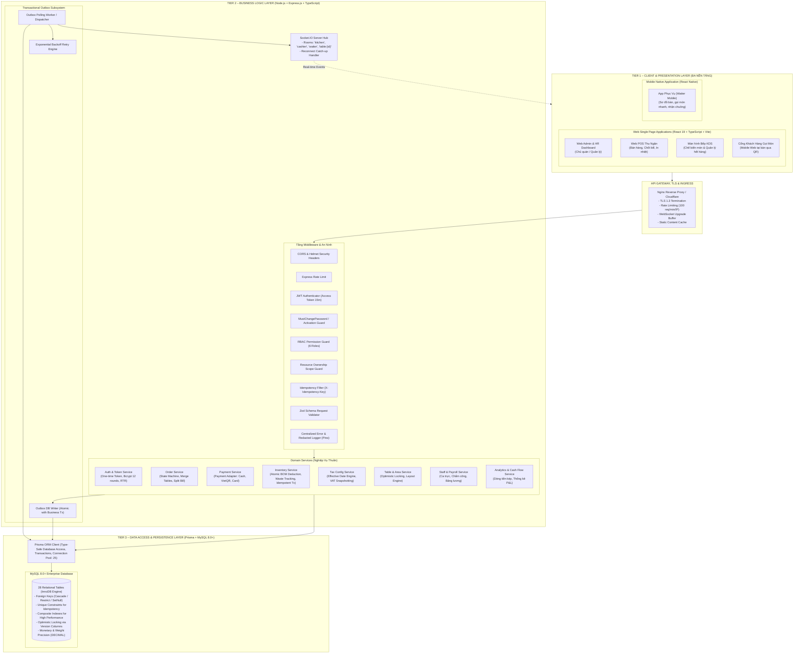
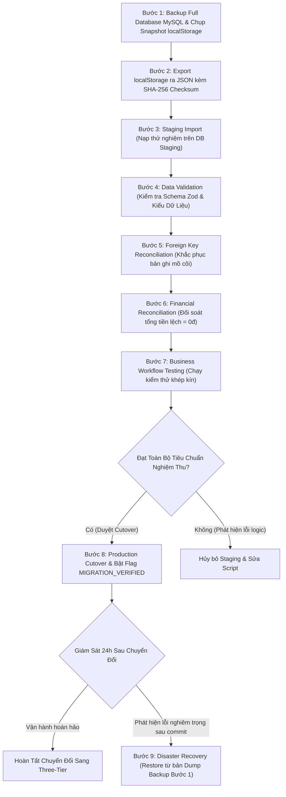
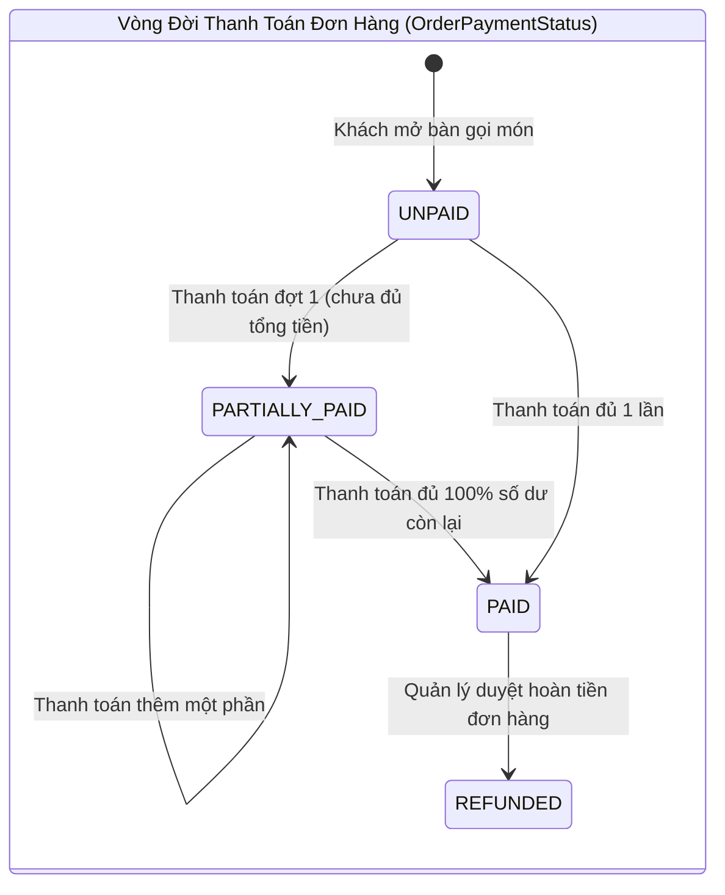

# THIẾT KẾ KIẾN TRÚC MỤC TIÊU VÀ KẾ HOẠCH CHUYỂN ĐỔI TOÀN DIỆN (PHIÊN BẢN 2.2)
## DỰ ÁN: RESTAURANT ASIA / QUẢN LÝ NHÀ HÀNG PRO (THREE-TIER MASTER BLUEPRINT)

---

| Thông Tin Tài Liệu | Chi Tiết |
| :--- | :--- |
| **Dự án** | Restaurant Asia / Quản Lý Nhà Hàng Pro |
| **Phiên bản tài liệu** | **2.2.0 (Pre-Phase 2 Final Production Blueprint)** |
| **Vai trò lập tài liệu** | Senior Software Architect, Database Architect, Senior Backend Engineer & Security Reviewer |
| **Mục tiêu kỹ thuật** | Hoàn thiện 100% đặc tả kỹ thuật kiến trúc Three-Tier chuẩn doanh nghiệp: Bảo mật xác thực khi Migration (One-time Token/Random Password), Idempotency kho cấp cơ sở dữ liệu (Atomic Update & Unique Constraint), Quy trình Migration an toàn 9 bước (Rollback vs Restore), Transactional Outbox Pattern kèm Sequence & Catch-up Sync, Quản lý cấu hình VAT linh hoạt theo thời gian hiệu lực, và Chuẩn hóa 28 Prisma Models. |
| **Trạng thái thực thi** | **CHỜ PHÊ DUYỆT (PENDING APPROVAL) – CHƯA TRIỂN KHAI CODE/MIGRATION** |
| **Quy tắc tuân thủ** | Chỉ lập kế hoạch và hoàn thiện tài liệu thiết kế; không chỉnh sửa mã nguồn ứng dụng, không cài đặt dependencies, không khởi tạo backend, không chạy migration, không can thiệp cơ sở dữ liệu và localStorage |

---

## MỤC LỤC TÀI LIỆU V2.2

1. **TỔNG QUAN ĐIỀU HÀNH & NHẬT KÝ THAY ĐỔI (V2.1 ➔ V2.2)**
2. **KIẾN TRÚC THREE-TIER MỤC TIÊU HOÀN THIỆN**
3. **DANH MỤC 28 MÔ HÌNH DỮ LIỆU ĐÃ CHUẨN HÓA (DATABASE INVENTORY)**
4. **TỪ ĐIỂN DỮ LIỆU TOÀN DIỆN (DATA DICTIONARY)**
5. **PRISMA SCHEMA HOÀN CHỈNH (`schema.prisma` - 28 MODELS)**
6. **SƠ ĐỒ THỰC THỂ QUAN HỆ TOÀN DIỆN (COMPLETE ERD)**
7. **CHIẾN LƯỢC BẢO MẬT XÁC THỰC KHI MIGRATION (PASSWORD & ACTIVATION)**
8. **QUY TRÌNH MIGRATION AN TOÀN 9 BƯỚC (ROLLBACK VS RESTORE BACKUP)**
9. **CƠ CHẾ IDEMPOTENCY KHO & QUY TẮC BOM (ATOMIC UPDATE & ANTI-DOUBLE DEDUCTION)**
10. **HỆ THỐNG CẤU HÌNH THUẾ SUẤT VAT LINH HOẠT THEO THỜI GIAN HIỆU LỰC**
11. **THIẾT KẾ BẢO MẬT, XÁC THỰC VÀ PHÂN QUYỀN (AUTH & RBAC)**
12. **STATE MACHINE CHO ĐƠN HÀNG, BÀN ĂN VÀ THANH TOÁN**
13. **ĐẶC TẢ CHI TIẾT TRANSACTIONAL OUTBOX & ĐỒNG BỘ THỜI GIAN THỰC (SOCKET.IO)**
14. **ĐẶC TẢ HỆ THỐNG RESTFUL API (API SPECIFICATION & PAYMENT ADAPTER)**
15. **CHIẾN LƯỢC KIỂM THỬ TOÀN DIỆN (TESTING MATRIX)**
16. **ĐÁNH GIÁ CÁC RỦI RO CÒN LẠI VÀ BIỆN PHÁP KIỂM SOÁT**
17. **DANH MỤC CÁC QUYẾT ĐỊNH ĐÃ THỐNG NHẤT (RESOLVED DECISIONS)**

---

## 1. TỔNG QUAN ĐIỀU HÀNH & NHẬT KÝ THAY ĐỔI (V2.1 ➔ V2.2)

Bản tài liệu **V2.2** được hoàn thiện dựa trên các yêu cầu rà soát nghiêm ngặt cuối cùng trước khi Ban Quản trị phê duyệt triển khai Phase 2. Bản thiết kế này lấp đầy toàn bộ các lỗ hổng logic tiềm ẩn của các phiên bản trước:

### Bảng đối chiếu các cải tiến đột phá từ V2.1 lên V2.2:

| Hạng Mục | Phiên Bản V2.1 | Phiên Bản V2.2 (Chuẩn Hóa Doanh Nghiệp) |
| :--- | :--- | :--- |
| **Số lượng Prisma Models** | 26 Models (chưa có mô hình Token Reset và Cấu hình Thuế) | **28 Models chuẩn hóa 100%**: Bổ sung `PasswordResetToken` và `TaxConfig`. |
| **Bảo mật mật khẩu Migration** | Băm bcrypt mật khẩu cũ `'123'` kèm cờ `mustChangePassword` | **Triệt tiêu hoàn toàn mật khẩu `'123'` trên Production**. Cấp mật khẩu ngẫu nhiên độ dài cao hoặc One-time Activation Token (SHA-256 hash). Bắt buộc kích hoạt/đổi mật khẩu trước khi mở quyền API. Tài khoản mẫu chỉ dùng trong Development (`seed.ts`). Chặn log mật khẩu/token. |
| **Trừ kho Idempotency** | Dựa vào cờ `OrderItem.isStockDeducted` và application logic | **Bảo vệ 3 lớp**: (1) Atomic Conditional Update (`UPDATE ... WHERE is_stock_deducted = false`), (2) DB Transaction, (3) Ràng buộc Unique cấp Database trên `StockTransaction` (`sourceType + sourceId + transactionType`), xử lý triệt để Race Condition khi 2 đầu bếp bấm cùng lúc và network retry. |
| **Hủy món & Hao hụt kho** | Quy định chung về `WASTE_DAMAGE` | **Phân biệt rõ ràng**: Nếu món đã chuyển `COOKING` (đã trừ kho vật lý một lần), thao tác hủy món ghi nhận `WASTE_DAMAGE` **tuyệt đối không trừ kho lần 2**, mà chỉ hạch toán chi phí thiệt hại. Chỉ trừ kho vật lý khi nguyên liệu hỏng trực tiếp từ kho lưu trữ. |
| **Quy trình Data Migration** | Pipeline 7 bước cơ bản | **Quy trình 9 bước chuẩn ngân hàng**: Backup gốc ➔ Export JSON kèm SHA-256 ➔ Staging Import ➔ Data Validation ➔ FK Reconciliation ➔ Financial Reconciliation (sai lệch = 0đ) ➔ Business Workflow Testing ➔ Production Cutover ➔ Phân biệt rành mạch giữa **Rollback Transaction** (tự động khi lỗi script) và **Restore từ Full Backup** (phục hồi khi phát hiện lỗi sau commit). |
| **Transactional Outbox** | Bảng sự kiện cơ bản (`outbox_events`) | **Đặc tả toàn diện**: Bổ sung trường `sequence` (BigInt autoincrement) đảm bảo thứ tự tuyệt đối, trạng thái 4 bước (`PENDING`, `PROCESSING`, `PUBLISHED`, `FAILED`), Exponential Backoff Retry (tối đa 5 lần), Dead-letter Alert, Client Deduplication và API Catch-up Sync sau khi reconnect. |
| **Cấu hình Thuế VAT** | Thuế suất cố định 8% trên hóa đơn | **Mô hình `TaxConfig` linh hoạt**: Hỗ trợ thuế suất theo thời hạn hiệu lực (`effectiveFrom`, `effectiveTo`), cấu hình theo nhóm món, lưu snapshot bất biến `taxPercent` và `taxAmount` trên đơn hàng/món ăn, không làm thay đổi hóa đơn quá khứ. |
| **Cổng thanh toán VietQR** | Thanh toán thủ công | **Mô hình Payment Adapter Pattern**: Giai đoạn đầu hiển thị VietQR tĩnh đối soát thủ công, xây dựng sẵn giao diện `IPaymentGatewayAdapter` để tích hợp Webhook tự động (VietQR Pro/SePay/Casso/VNPay) ở Phase 5/8 mà không cần sửa core logic. |

---

## 2. KIẾN TRÚC THREE-TIER MỤC TIÊU HOÀN THIỆN



---

## 3. DANH MỤC 28 MÔ HÌNH DỮ LIỆU ĐÃ CHUẨN HÓA (DATABASE INVENTORY)

Dưới đây là danh mục 28 Models được thiết kế chính xác, hoàn chỉnh, phân nhóm theo các phân hệ nghiệp vụ:

| STT | Tên Model Prisma | Tên Bảng MySQL | Phân Hệ Nghiệp Vụ | Vai Trò & Trách Nhiệm Nghiệp Vụ |
| :---: | :--- | :--- | :--- | :--- |
| **1** | `Role` | `roles` | Xác thực & RBAC | Định nghĩa 6 nhóm quyền hệ thống (`ADMIN`, `CASHIER`, `KITCHEN`, `WAITER`, `HR_MANAGER`, `CUSTOMER`). |
| **2** | `User` | `users` | Xác thực & RBAC | Tài khoản người dùng, băm mật khẩu, cờ bắt buộc kích hoạt `mustChangePassword`, `isActivated`. |
| **3** | `RefreshToken` | `refresh_tokens` | Xác thực & Phiên | Quản lý phiên làm việc với cơ chế Refresh Token Rotation (RTR) và Family Revocation. |
| **4** | `PasswordResetToken` | `password_reset_tokens` | An toàn Xác thực | **(Mới V2.2)** Lưu mã token dùng 1 lần (băm SHA-256) phục vụ kích hoạt tài khoản migration và reset mật khẩu. |
| **5** | `Employee` | `employees` | Nhân sự & Lương | Hồ sơ nhân viên, loại lương (tháng/giờ), mức lương cơ sở, trạng thái làm việc, liên kết tài khoản. |
| **6** | `EmployeeSchedule` | `employee_schedules` | Ca trực Nhân sự | Lịch phân ca theo tuần, ngày trực, tên ca, khung giờ và điểm danh thực tế. |
| **7** | `LeaveRequest` | `leave_requests` | Nhân sự | Đơn xin nghỉ phép của nhân viên (phép năm, ốm, việc riêng), phê duyệt bởi Quản lý/Admin. |
| **8** | `Customer` | `customers` | Khách hàng & CRM | Thông tin khách hàng, số điện thoại định danh duy nhất, điểm tích lũy, tổng chi tiêu, phân hạng thành viên. |
| **9** | `TableArea` | `table_areas` | Mặt bằng Bàn ăn | Khu vực tầng/phòng (vd: Tầng 1, Tầng 2, Sân vườn, Phòng VIP). |
| **10** | `RestaurantTable` | `tables` | Mặt bằng Bàn ăn | Chi tiết bàn ăn: tên, sức chứa, hình dạng, trạng thái, tọa độ đồ họa `(posX, posY)`, cờ khóa lạc quan `version`. |
| **11** | `Reservation` | `reservations` | Đặt bàn trước | Lịch hẹn đặt bàn của thực khách: thời gian, số lượng khách, ghi chú, trạng thái xác nhận. |
| **12** | `Category` | `categories` | Thực đơn Menu | Nhóm danh mục món ăn (Khai vị, Món chính, Lẩu & Nướng, Tráng miệng, Đồ uống), thứ tự hiển thị. |
| **13** | `MenuItem` | `menu_items` | Thực đơn Menu | Chi tiết món ăn: giá bán, giá vốn, hình ảnh, thời gian nấu, cờ soft-delete `isDeleted`, cờ hiển thị. |
| **14** | `Ingredient` | `ingredients` | Quản lý Kho | Danh mục nguyên vật liệu: đơn vị chuẩn cơ sở (`baseUnit`: g, ml, unit), tồn kho hiện tại, định mức tối thiểu. |
| **15** | `UnitConversion` | `unit_conversions` | Quản lý Kho | Bảng tỷ lệ quy đổi đơn vị đo lường (vd: 1 kg = 1.000 g, 1 két = 24 lon) phục vụ nhập kho. |
| **16** | `Recipe` | `recipes` | Định mức BOM | Định mức kỹ thuật cấu thành món ăn (BOM): lượng nguyên liệu tiêu hao cho 1 đơn vị món ăn. |
| **17** | `Order` | `orders` | Đơn hàng & POS | Hóa đơn bán hàng: lưu tổng tiền, chiết khấu, VAT snapshot, mã `#HD-xxxx`, trạng thái đơn, cờ `version`. |
| **18** | `OrderItem` | `order_items` | Đơn hàng & POS | Chi tiết từng món trong đơn: giá bán snapshot, ghi chú, trạng thái KDS, cờ trừ kho nguyên tử `isStockDeducted`. |
| **19** | `Payment` | `payments` | Thanh toán | Nhật ký giao dịch thanh toán (hỗ trợ chia bill, thanh toán từng phần, đa phương thức: Tiền mặt, VietQR, Thẻ). |
| **20** | `TaxConfig` | `tax_configs` | Cấu hình Thuế VAT | **(Mới V2.2)** Cấu hình thuế suất VAT linh hoạt theo khoảng thời gian hiệu lực và phạm vi áp dụng. |
| **21** | `Supplier` | `suppliers` | Nhập kho | Thông tin đối tác cung cấp nguyên vật liệu, liên hệ và công nợ. |
| **22** | `GoodsReceipt` | `goods_receipts` | Nhập kho | Phiếu nhập kho nguyên liệu từ nhà cung cấp, tổng giá trị nhập, trạng thái thanh toán. |
| **23** | `GoodsReceiptItem` | `goods_receipt_items` | Nhập kho | Chi tiết số lượng, đơn vị nhập, đơn giá và thành tiền từng nguyên vật liệu trên phiếu nhập. |
| **24** | `StockTransaction` | `stock_transactions` | Sổ cái Kho | Sổ cái ghi nhận mọi biến động kho có ràng buộc Unique chống trùng lặp theo nguồn nghiệp vụ. |
| **25** | `CashFlowRecord` | `cash_flow_records` | Tài chính & Quỹ | Sổ quỹ theo dõi thu chi tiền mặt và chuyển khoản (hạch toán tự động từ bán hàng và nhập hàng). |
| **26** | `ServiceRequest` | `service_requests` | Phục vụ bàn | Chuông gọi phục vụ từ thực khách qua web (xin nước đá, khăn lạnh, thanh toán, dọn bàn). |
| **27** | `OutboxEvent` | `outbox_events` | Hệ thống Real-time | Bảng lưu sự kiện giao dịch kèm `sequence` đảm bảo truyền thông tin cậy qua Socket.IO. |
| **28** | `IdempotencyRecord` | `idempotency_records` | Hạ tầng Hệ thống | Bảng lưu trữ khóa idempotency ngăn chặn gửi trùng request từ client (thanh toán, trừ kho). |

---

## 4. TỪ ĐIỂN DỮ LIỆU TOÀN DIỆN (DATA DICTIONARY)

Dưới đây là đặc tả chi tiết cấu trúc các thực thể trọng yếu trong hệ thống:

### 4.1. Bảng `users` (Tài khoản người dùng)
* `id` (VARCHAR(36), PK): UUID v4 duy nhất.
* `username` (VARCHAR(50), UNIQUE, NOT NULL): Tên tài khoản đăng nhập (chuẩn hóa chữ thường).
* `password_hash` (VARCHAR(255), NOT NULL): Mật khẩu băm Bcrypt (saltRounds = 12).
* `role_id` (VARCHAR(36), FK -> `roles.id`, NOT NULL): Quyền hạn.
* `full_name` (VARCHAR(100), NOT NULL): Họ và tên đầy đủ.
* `phone` (VARCHAR(20), NULL): Số điện thoại liên lạc.
* `avatar` (VARCHAR(500), NULL): Đường dẫn ảnh đại diện.
* `is_active` (BOOLEAN, NOT NULL, DEFAULT TRUE): Trạng thái kích hoạt (false: bị khóa tài khoản).
* `is_activated` (BOOLEAN, NOT NULL, DEFAULT FALSE): Đã hoàn tất kích hoạt lần đầu chưa.
* `must_change_password` (BOOLEAN, NOT NULL, DEFAULT TRUE): Bắt buộc đổi mật khẩu trước khi gọi API nghiệp vụ.
* `last_login_at` (DATETIME, NULL): Lần đăng nhập gần nhất.
* `created_at` (DATETIME, NOT NULL, DEFAULT CURRENT_TIMESTAMP).
* `updated_at` (DATETIME, NOT NULL, ON UPDATE CURRENT_TIMESTAMP).

### 4.2. Bảng `password_reset_tokens` (Mã kích hoạt & Đặt lại mật khẩu - Mới V2.2)
* `id` (VARCHAR(36), PK): UUID v4.
* `token_hash` (VARCHAR(64), UNIQUE, NOT NULL): Mã băm SHA-256 của token ngẫu nhiên (không lưu raw token).
* `user_id` (VARCHAR(36), FK -> `users.id` ON DELETE CASCADE, NOT NULL): Người dùng sở hữu.
* `token_type` (ENUM('ACTIVATION', 'PASSWORD_RESET'), NOT NULL): Mục đích cấp mã.
* `expires_at` (DATETIME, NOT NULL): Thời hạn hết hiệu lực (mặc định: 24h đối với kích hoạt, 15m đối với reset).
* `used_at` (DATETIME, NULL): Thời điểm đã sử dụng (chống tấn công replay).
* `ip_address` (VARCHAR(45), NULL): Địa chỉ IP của yêu cầu cấp mã.
* `created_at` (DATETIME, NOT NULL, DEFAULT CURRENT_TIMESTAMP).

### 4.3. Bảng `tax_configs` (Cấu hình Thuế suất VAT - Mới V2.2)
* `id` (VARCHAR(36), PK): UUID v4.
* `code` (VARCHAR(50), UNIQUE, NOT NULL): Mã định danh biểu thuế (vd: `VAT_STANDARD_8`, `VAT_ALCOHOL_10`).
* `name` (VARCHAR(100), NOT NULL): Tên hiển thị biểu thuế (vd: "Thuế GTGT 8% (Nghị định 72)").
* `rate` (DECIMAL(5, 2), NOT NULL): Tỷ lệ phần trăm thuế (vd: `8.00`, `10.00`, `0.00`).
* `effective_from` (DATETIME, NOT NULL): Thời điểm bắt đầu có hiệu lực áp dụng.
* `effective_to` (DATETIME, NULL): Thời điểm hết hiệu lực (NULL: đang áp dụng vô thời hạn).
* `is_default` (BOOLEAN, NOT NULL, DEFAULT FALSE): Biểu thuế mặc định toàn hệ thống.
* `category_id` (VARCHAR(36), FK -> `categories.id` ON DELETE SET NULL, NULL): Áp dụng riêng cho danh mục món ăn đặc thù (NULL: áp dụng chung).
* `created_at` (DATETIME, NOT NULL, DEFAULT CURRENT_TIMESTAMP).
* `updated_at` (DATETIME, NOT NULL, ON UPDATE CURRENT_TIMESTAMP).

### 4.4. Bảng `orders` (Hóa đơn bán hàng)
* `id` (VARCHAR(36), PK): UUID v4.
* `code` (VARCHAR(20), UNIQUE, NOT NULL): Mã hóa đơn hiển thị trên bill nhiệt (vd: `#HD-1024`).
* `table_id` (VARCHAR(36), FK -> `tables.id` ON DELETE RESTRICT, NOT NULL): Bàn đang phục vụ.
* `customer_id` (VARCHAR(36), FK -> `customers.id` ON DELETE SET NULL, NULL): Khách hàng thành viên.
* `served_by_id` (VARCHAR(36), FK -> `employees.id` ON DELETE SET NULL, NULL): Nhân viên phục vụ phụ trách.
* `customer_name` (VARCHAR(100), NULL): Tên khách hàng tại bàn.
* `customer_phone` (VARCHAR(20), NULL): Số điện thoại khách.
* `customer_type` (ENUM('WALK_IN', 'REGULAR', 'VIP', 'GROUP'), NOT NULL, DEFAULT 'WALK_IN').
* `customer_count` (INT, NOT NULL, DEFAULT 2): Số lượng khách thực tế tại bàn.
* `subtotal` (DECIMAL(12, 2), NOT NULL, DEFAULT 0.00): Tổng tiền món trước thuế và giảm giá.
* `discount_percent` (DECIMAL(5, 2), NOT NULL, DEFAULT 0.00): Tỷ lệ chiết khấu giảm giá.
* `discount_amount` (DECIMAL(12, 2), NOT NULL, DEFAULT 0.00): Số tiền chiết khấu thực tế.
* `tax_percent` (DECIMAL(5, 2), NOT NULL, DEFAULT 8.00): **Snapshot tỷ lệ thuế VAT tại thời điểm chốt đơn**.
* `tax_amount` (DECIMAL(12, 2), NOT NULL, DEFAULT 0.00): **Snapshot tiền thuế VAT bất biến**.
* `final_total` (DECIMAL(12, 2), NOT NULL, DEFAULT 0.00): Số tiền thanh toán cuối cùng.
* `status` (ENUM('ACTIVE', 'COMPLETED', 'CANCELLED'), NOT NULL, DEFAULT 'ACTIVE'): Trạng thái vòng đời đơn.
* `payment_status` (ENUM('UNPAID', 'PARTIALLY_PAID', 'PAID', 'REFUNDED'), NOT NULL, DEFAULT 'UNPAID'): Trạng thái thanh toán.
* `version` (INT, NOT NULL, DEFAULT 0): Khóa lạc quan chống race condition khi chốt bill / gộp bàn.
* `created_at` (DATETIME, NOT NULL, DEFAULT CURRENT_TIMESTAMP).
* `updated_at` (DATETIME, NOT NULL, ON UPDATE CURRENT_TIMESTAMP).
* `completed_at` (DATETIME, NULL): Thời điểm hoàn tất đơn và xuất hóa đơn.

### 4.5. Bảng `order_items` (Chi tiết món ăn trong đơn)
* `id` (VARCHAR(36), PK): UUID v4.
* `order_id` (VARCHAR(36), FK -> `orders.id` ON DELETE CASCADE, NOT NULL): Thuộc đơn hàng nào.
* `menu_item_id` (VARCHAR(36), FK -> `menu_items.id` ON DELETE RESTRICT, NOT NULL): Món ăn gốc.
* `name` (VARCHAR(150), NOT NULL): Tên món ăn lưu vết tại thời điểm gọi.
* `unit` (VARCHAR(20), NOT NULL): Đơn vị tính lưu vết.
* `price` (DECIMAL(12, 2), NOT NULL): Đơn giá tại thời điểm gọi.
* `quantity` (INT, NOT NULL, DEFAULT 1): Số lượng gọi món.
* `note` (VARCHAR(255), NULL): Ghi chú chế biến từ khách (vd: "Ít cay", "Không hành lá").
* `status` (ENUM('PENDING', 'COOKING', 'READY', 'SERVED', 'CANCELLED'), NOT NULL, DEFAULT 'PENDING').
* `is_stock_deducted` (BOOLEAN, NOT NULL, DEFAULT FALSE): Cờ đánh dấu nguyên liệu đã bị trừ kho vật lý.
* `stock_deducted_at` (DATETIME, NULL): Thời điểm thực thi trừ kho BOM.
* `tax_rate` (DECIMAL(5, 2), NULL): **Snapshot tỷ lệ thuế VAT riêng của món ăn** (nếu phân loại thuế theo món).
* `ordered_at` (DATETIME, NOT NULL, DEFAULT CURRENT_TIMESTAMP).
* `updated_at` (DATETIME, NOT NULL, ON UPDATE CURRENT_TIMESTAMP).

### 4.6. Bảng `stock_transactions` (Sổ cái biến động kho - Đã bổ sung Unique Constraint)
* `id` (VARCHAR(36), PK): UUID v4.
* `ingredient_id` (VARCHAR(36), FK -> `ingredients.id` ON DELETE RESTRICT, NOT NULL): Nguyên liệu biến động.
* `transaction_type` (ENUM('GOODS_RECEIPT', 'ORDER_CONSUMPTION', 'ORDER_CANCELLATION_RETURN', 'STOCK_TAKE_ADJUSTMENT', 'WASTE_DAMAGE', 'SUPPLIER_RETURN'), NOT NULL): Loại giao dịch.
* `quantity` (DECIMAL(12, 3), NOT NULL): Số lượng biến động theo đơn vị chuẩn `baseUnit` (dương: tăng kho, âm: giảm kho).
* `balance_after` (DECIMAL(12, 3), NOT NULL): Số dư tồn kho ghi nhận ngay sau giao dịch.
* `cost_per_unit` (DECIMAL(12, 2), NOT NULL, DEFAULT 0.00): Giá vốn trên 1 đơn vị chuẩn.
* `total_cost` (DECIMAL(14, 2), NOT NULL, DEFAULT 0.00): Tổng giá trị vốn của biến động.
* `source_type` (VARCHAR(50), NOT NULL): Nguồn phát sinh (vd: `'ORDER_ITEM'`, `'GOODS_RECEIPT'`, `'MANUAL'`).
* `source_id` (VARCHAR(50), NOT NULL): Định danh bản ghi nguồn (vd: `order_item_id`, `receipt_id`).
* `idempotency_key` (VARCHAR(100), UNIQUE, NULL): Khóa chống trùng lặp giao dịch kho.
* `notes` (VARCHAR(255), NULL): Diễn giải nguyên nhân biến động.
* `created_by_id` (VARCHAR(36), FK -> `users.id` ON DELETE RESTRICT, NOT NULL): Người thực hiện.
* `created_at` (DATETIME, NOT NULL, DEFAULT CURRENT_TIMESTAMP).
* **Ràng buộc duy nhất nghiệp vụ:** `UNIQUE(source_type, source_id, transaction_type)` ngăn chặn hoàn toàn việc trừ kho 2 lần cho cùng một dòng gọi món.

### 4.7. Bảng `outbox_events` (Transactional Outbox - Đã chuẩn hóa)
* `id` (VARCHAR(36), PK): UUID v4.
* `sequence` (BIGINT, NOT NULL, AUTO_INCREMENT, UNIQUE): Mã số tăng dần đơn điệu phục vụ sắp xếp thứ tự sự kiện và đồng bộ sau ngắt kết nối (Catch-up sync).
* `aggregate_type` (VARCHAR(50), NOT NULL): Nhóm thực thể (vd: `'ORDER'`, `'KITCHEN'`, `'TABLE'`, `'PAYMENT'`).
* `aggregate_id` (VARCHAR(50), NOT NULL): Khóa chính thực thể phát sinh sự kiện.
* `event_type` (VARCHAR(100), NOT NULL): Tên sự kiện (vd: `'order.created'`, `'kitchen.item_cooking'`, `'payment.completed'`).
* `payload` (JSON, NOT NULL): Dữ liệu chi tiết sự kiện đóng gói chuẩn JSON.
* `status` (ENUM('PENDING', 'PROCESSING', 'PUBLISHED', 'FAILED'), NOT NULL, DEFAULT 'PENDING').
* `retry_count` (INT, NOT NULL, DEFAULT 0): Số lần thử lại khi đẩy vào Socket.IO thất bại.
* `max_retries` (INT, NOT NULL, DEFAULT 5): Giới hạn số lần thử lại tối đa trước khi đưa vào hàng đợi cảnh báo.
* `last_error` (TEXT, NULL): Thông điệp lỗi chi tiết của lần thất bại gần nhất.
* `created_at` (DATETIME, NOT NULL, DEFAULT CURRENT_TIMESTAMP).
* `published_at` (DATETIME, NULL): Thời điểm phát thành công ra Socket.IO.

---

## 5. PRISMA SCHEMA HOÀN CHỈNH (`schema.prisma` - 28 MODELS)

```prisma
datasource db {
  provider = "mysql"
  url      = env("DATABASE_URL")
}

generator client {
  provider = "prisma-client-js"
}

// ==========================================================
// 1. PHÂN QUYỀN, TÀI KHOẢN, PHIÊN & AN TOÀN XÁC THỰC
// ==========================================================

enum RoleName {
  ADMIN
  CASHIER
  KITCHEN
  WAITER
  HR_MANAGER
  CUSTOMER
}

model Role {
  id          String    @id @default(uuid()) @db.VarChar(36)
  name        RoleName  @unique
  title       String    @db.VarChar(50)
  description String?   @db.VarChar(255)
  users       User[]

  @@map("roles")
}

model User {
  id                 String             @id @default(uuid()) @db.VarChar(36)
  username           String             @unique @db.VarChar(50)
  passwordHash       String             @db.VarChar(255) @map("password_hash")
  roleId             String             @db.VarChar(36) @map("role_id")
  role               Role               @relation(fields: [roleId], references: [id])
  fullName           String             @db.VarChar(100) @map("full_name")
  phone              String?            @db.VarChar(20)
  avatar             String?            @db.VarChar(500)
  isActive           Boolean            @default(true) @map("is_active")
  isActivated        Boolean            @default(false) @map("is_activated")
  mustChangePassword Boolean            @default(true) @map("must_change_password")
  lastLoginAt        DateTime?          @map("last_login_at")
  createdAt          DateTime           @default(now()) @map("created_at")
  updatedAt          DateTime           @updatedAt @map("updated_at")

  employee           Employee?
  customer           Customer?
  refreshTokens      RefreshToken[]
  resetTokens        PasswordResetToken[]
  goodsReceipts      GoodsReceipt[]
  cashFlowRecords    CashFlowRecord[]
  approvedLeaves     LeaveRequest[]     @relation("ApprovedBy")
  stockTransactions  StockTransaction[]
  processedPayments  Payment[]

  @@index([roleId])
  @@map("users")
}

model RefreshToken {
  id          String   @id @default(uuid()) @db.VarChar(36)
  tokenHash   String   @unique @db.VarChar(255) @map("token_hash")
  userId      String   @db.VarChar(36) @map("user_id")
  user        User     @relation(fields: [userId], references: [id], onDelete: Cascade)
  family      String   @db.VarChar(36)
  isRevoked   Boolean  @default(false) @map("is_revoked")
  expiresAt   DateTime @map("expires_at")
  createdAt   DateTime @default(now()) @map("created_at")

  @@index([userId])
  @@index([family])
  @@map("refresh_tokens")
}

enum TokenType {
  ACTIVATION
  PASSWORD_RESET
}

model PasswordResetToken {
  id        String    @id @default(uuid()) @db.VarChar(36)
  tokenHash String    @unique @db.VarChar(64) @map("token_hash")
  userId    String    @db.VarChar(36) @map("user_id")
  user      User      @relation(fields: [userId], references: [id], onDelete: Cascade)
  tokenType TokenType @map("token_type")
  expiresAt DateTime  @map("expires_at")
  usedAt    DateTime? @map("used_at")
  ipAddress String?   @db.VarChar(45) @map("ip_address")
  createdAt DateTime  @default(now()) @map("created_at")

  @@index([userId])
  @@index([tokenHash])
  @@map("password_reset_tokens")
}

// ==========================================================
// 2. NHÂN SỰ, CA TRỰC & NGHỈ PHÉP
// ==========================================================

enum SalaryType {
  MONTHLY
  HOURLY
}

enum EmployeeStatus {
  ACTIVE
  ON_BREAK
  OFF
}

model Employee {
  id             String             @id @default(uuid()) @db.VarChar(36)
  userId         String?            @unique @db.VarChar(36) @map("user_id")
  user           User?              @relation(fields: [userId], references: [id], onDelete: SetNull)
  name           String             @db.VarChar(100)
  phone          String             @db.VarChar(20)
  email          String?            @db.VarChar(100)
  roleTitle      String             @db.VarChar(50) @map("role_title")
  shiftDefault   String?            @db.VarChar(50) @map("shift_default")
  salaryRate     Decimal            @default(0) @db.Decimal(12, 2) @map("salary_rate")
  salaryType     SalaryType         @default(MONTHLY) @map("salary_type")
  status         EmployeeStatus     @default(ACTIVE)
  joinDate       DateTime           @default(now()) @map("join_date")
  ordersHandled  Int                @default(0) @map("orders_handled")
  createdAt      DateTime           @default(now()) @map("created_at")
  updatedAt      DateTime           @updatedAt @map("updated_at")

  schedules      EmployeeSchedule[]
  leaveRequests  LeaveRequest[]     @relation("StaffLeaves")
  servedOrders   Order[]            @relation("ServedByEmployee")
  assignedCalls  ServiceRequest[]

  @@map("employees")
}

model EmployeeSchedule {
  id          String   @id @default(uuid()) @db.VarChar(36)
  employeeId  String   @db.VarChar(36) @map("employee_id")
  employee    Employee @relation(fields: [employeeId], references: [id], onDelete: Cascade)
  dayOfWeek   Int      @map("day_of_week")
  shiftDate   DateTime @db.Date @map("shift_date")
  shiftName   String   @db.VarChar(50) @map("shift_name")
  timeRange   String   @db.VarChar(50) @map("time_range")
  isAttended  Boolean  @default(false) @map("is_attended")
  createdAt   DateTime @default(now()) @map("created_at")
  updatedAt   DateTime @updatedAt @map("updated_at")

  @@index([employeeId])
  @@index([shiftDate])
  @@map("employee_schedules")
}

enum LeaveStatus {
  ACTIVE
  UPCOMING
  COMPLETED
  CANCELLED
}

enum LeaveType {
  ANNUAL
  SICK
  FAMILY
  COMPENSATORY
}

model LeaveRequest {
  id           String      @id @default(uuid()) @db.VarChar(36)
  employeeId   String      @db.VarChar(36) @map("employee_id")
  employee     Employee    @relation("StaffLeaves", fields: [employeeId], references: [id], onDelete: Cascade)
  startDate    DateTime    @db.Date @map("start_date")
  endDate      DateTime    @db.Date @map("end_date")
  status       LeaveStatus @default(UPCOMING)
  leaveType    LeaveType   @default(ANNUAL) @map("leave_type")
  reason       String      @db.VarChar(255)
  approvedById String?     @db.VarChar(36) @map("approved_by_id")
  approvedBy   User?       @relation("ApprovedBy", fields: [approvedById], references: [id])
  createdAt    DateTime    @default(now()) @map("created_at")
  updatedAt    DateTime    @updatedAt @map("updated_at")

  @@index([employeeId])
  @@map("leave_requests")
}

// ==========================================================
// 3. KHÁCH HÀNG CRM
// ==========================================================

enum CustomerType {
  WALK_IN
  REGULAR
  VIP
  GROUP
}

model Customer {
  id            String        @id @default(uuid()) @db.VarChar(36)
  userId        String?       @unique @db.VarChar(36) @map("user_id")
  user          User?         @relation(fields: [userId], references: [id], onDelete: SetNull)
  fullName      String        @db.VarChar(100) @map("full_name")
  phone         String        @unique @db.VarChar(20)
  email         String?       @db.VarChar(100)
  customerType  CustomerType  @default(WALK_IN) @map("customer_type")
  loyaltyPoints Int           @default(0) @map("loyalty_points")
  totalSpent    Decimal       @default(0) @db.Decimal(14, 2) @map("total_spent")
  createdAt     DateTime      @default(now()) @map("created_at")
  updatedAt     DateTime      @updatedAt @map("updated_at")

  orders        Order[]
  reservations  Reservation[]

  @@map("customers")
}

// ==========================================================
// 4. MẶT BẰNG, KHU VỰC, BÀN ĂN & ĐẶT BÀN
// ==========================================================

model TableArea {
  id           String            @id @default(uuid()) @db.VarChar(36)
  name         String            @unique @db.VarChar(100)
  description  String?           @db.VarChar(255)
  displayOrder Int               @default(0) @map("display_order")
  createdAt    DateTime          @default(now()) @map("created_at")
  updatedAt    DateTime          @updatedAt @map("updated_at")
  tables       RestaurantTable[]

  @@map("table_areas")
}

enum TableShape {
  ROUND
  SQUARE
  RECTANGLE
}

enum TableStatus {
  AVAILABLE
  OCCUPIED
  RESERVED
  CLEANING
}

model RestaurantTable {
  id            String          @id @default(uuid()) @db.VarChar(36)
  name          String          @db.VarChar(50)
  areaId        String          @db.VarChar(36) @map("area_id")
  area          TableArea       @relation(fields: [areaId], references: [id], onDelete: Restrict)
  capacity      Int             @default(4)
  shape         TableShape      @default(SQUARE)
  status        TableStatus     @default(AVAILABLE)
  posX          Float           @default(0) @map("pos_x")
  posY          Float           @default(0) @map("pos_y")
  width         Float           @default(90)
  height        Float           @default(90)
  occupiedSince DateTime?       @map("occupied_since")
  customerType  CustomerType?   @map("customer_type")
  version       Int             @default(0) // Khóa lạc quan chống race condition
  createdAt     DateTime        @default(now()) @map("created_at")
  updatedAt     DateTime        @updatedAt @map("updated_at")

  orders        Order[]
  reservations  Reservation[]
  serviceCalls  ServiceRequest[]

  @@index([areaId])
  @@index([status])
  @@map("tables")
}

enum ReservationStatus {
  CONFIRMED
  SEATED
  CANCELLED
  NO_SHOW
}

model Reservation {
  id              String            @id @default(uuid()) @db.VarChar(36)
  tableId         String            @db.VarChar(36) @map("table_id")
  table           RestaurantTable   @relation(fields: [tableId], references: [id], onDelete: Restrict)
  customerId      String?           @db.VarChar(36) @map("customer_id")
  customer        Customer?         @relation(fields: [customerId], references: [id], onDelete: SetNull)
  customerName    String            @db.VarChar(100) @map("customer_name")
  phone           String            @db.VarChar(20)
  guestCount      Int               @default(2) @map("guest_count")
  reservationTime DateTime          @map("reservation_time")
  customerType    CustomerType      @default(REGULAR) @map("customer_type")
  status          ReservationStatus @default(CONFIRMED)
  notes           String?           @db.VarChar(255)
  createdAt       DateTime          @default(now()) @map("created_at")
  updatedAt       DateTime          @updatedAt @map("updated_at")

  @@index([tableId])
  @@index([reservationTime])
  @@map("reservations")
}

// ==========================================================
// 5. THỰC ĐƠN, MÓN ĂN, ĐỊNH MỨC NGUYÊN LIỆU (BOM) & CẤU HÌNH THUẾ
// ==========================================================

model Category {
  id           String      @id @default(uuid()) @db.VarChar(36)
  name         String      @unique @db.VarChar(100)
  displayOrder Int         @default(0) @map("display_order")
  isActive     Boolean     @default(true) @map("is_active")
  createdAt    DateTime    @default(now()) @map("created_at")
  updatedAt    DateTime    @updatedAt @map("updated_at")

  menuItems    MenuItem[]
  taxConfigs   TaxConfig[]

  @@map("categories")
}

model MenuItem {
  id              String      @id @default(uuid()) @db.VarChar(36)
  categoryId      String      @db.VarChar(36) @map("category_id")
  category        Category    @relation(fields: [categoryId], references: [id], onDelete: Restrict)
  name            String      @db.VarChar(150)
  price           Decimal     @db.Decimal(12, 2)
  costPrice       Decimal     @default(0) @db.Decimal(12, 2) @map("cost_price")
  unit            String      @default("phần") @db.VarChar(20)
  description     String?     @db.Text
  image           String?     @db.VarChar(500)
  isAvailable     Boolean     @default(true) @map("is_available")
  isDeleted       Boolean     @default(false) @map("is_deleted") // Soft-delete bảo tồn đơn hàng cũ
  prepTimeMinutes Int         @default(15) @map("prep_time_minutes")
  spicyLevel      Int         @default(0) @map("spicy_level")
  tags            String?     @db.VarChar(255)
  isPopular       Boolean     @default(false) @map("is_popular")
  taxRateOverride Decimal?    @db.Decimal(5, 2) @map("tax_rate_override")
  createdAt       DateTime    @default(now()) @map("created_at")
  updatedAt       DateTime    @updatedAt @map("updated_at")

  orderItems      OrderItem[]
  recipes         Recipe[]

  @@index([categoryId])
  @@index([isAvailable])
  @@index([isDeleted])
  @@map("menu_items")
}

model Ingredient {
  id                 String             @id @default(uuid()) @db.VarChar(36)
  name               String             @unique @db.VarChar(150)
  category           String             @db.VarChar(100) // 'Thịt & Hải sản', 'Rau củ', 'Gia vị'
  baseUnit           String             @db.VarChar(20)  @map("base_unit") // 'g', 'ml', 'unit'
  currentStock       Decimal            @default(0) @db.Decimal(12, 3) @map("current_stock")
  minStockLevel      Decimal            @default(5) @db.Decimal(12, 3) @map("min_stock_level")
  costPerUnit        Decimal            @default(0) @db.Decimal(12, 2) @map("cost_per_unit")
  allowNegativeStock Boolean            @default(false) @map("allow_negative_stock")
  createdAt          DateTime           @default(now()) @map("created_at")
  updatedAt          DateTime           @updatedAt @map("updated_at")

  recipes            Recipe[]
  receiptItems       GoodsReceiptItem[]
  stockHistory       StockTransaction[]
  unitConversions    UnitConversion[]

  @@map("ingredients")
}

model UnitConversion {
  id             String     @id @default(uuid()) @db.VarChar(36)
  ingredientId   String     @db.VarChar(36) @map("ingredient_id")
  ingredient     Ingredient @relation(fields: [ingredientId], references: [id], onDelete: Cascade)
  fromUnit       String     @db.VarChar(20) @map("from_unit") // e.g. 'kg', 'két', 'thùng'
  toUnit         String     @db.VarChar(20) @map("to_unit")   // Đơn vị chuẩn cơ sở: 'g', 'lon', 'chai'
  conversionRate Decimal    @db.Decimal(10, 4) @map("conversion_rate") // vd: 1 kg = 1000 g -> rate = 1000
  createdAt      DateTime   @default(now()) @map("created_at")
  updatedAt      DateTime   @updatedAt @map("updated_at")

  @@unique([ingredientId, fromUnit])
  @@map("unit_conversions")
}

model Recipe {
  id               String     @id @default(uuid()) @db.VarChar(36)
  menuItemId       String     @db.VarChar(36) @map("menu_item_id")
  menuItem         MenuItem   @relation(fields: [menuItemId], references: [id], onDelete: Cascade)
  ingredientId     String     @db.VarChar(36) @map("ingredient_id")
  ingredient       Ingredient @relation(fields: [ingredientId], references: [id], onDelete: Restrict)
  quantityRequired Decimal    @db.Decimal(10, 3) @map("quantity_required")
  unit             String     @db.VarChar(20)
  createdAt        DateTime   @default(now()) @map("created_at")
  updatedAt        DateTime   @updatedAt @map("updated_at")

  @@unique([menuItemId, ingredientId])
  @@map("recipes")
}

model TaxConfig {
  id            String    @id @default(uuid()) @db.VarChar(36)
  code          String    @unique @db.VarChar(50)
  name          String    @db.VarChar(100)
  rate          Decimal   @db.Decimal(5, 2)
  effectiveFrom DateTime  @map("effective_from")
  effectiveTo   DateTime? @map("effective_to")
  isDefault     Boolean   @default(false) @map("is_default")
  categoryId    String?   @db.VarChar(36) @map("category_id")
  category      Category? @relation(fields: [categoryId], references: [id], onDelete: SetNull)
  createdAt     DateTime  @default(now()) @map("created_at")
  updatedAt     DateTime  @updatedAt @map("updated_at")

  @@index([effectiveFrom, effectiveTo])
  @@map("tax_configs")
}

// ==========================================================
// 6. ĐƠN HÀNG, CHI TIẾT MÓN ĂN & THANH TOÁN
// ==========================================================

enum OrderStatus {
  ACTIVE
  COMPLETED
  CANCELLED
}

enum OrderPaymentStatus {
  UNPAID
  PARTIALLY_PAID
  PAID
  REFUNDED
}

enum OrderItemStatus {
  PENDING
  COOKING
  READY
  SERVED
  CANCELLED
}

model Order {
  id              String             @id @default(uuid()) @db.VarChar(36)
  code            String             @unique @db.VarChar(20)
  tableId         String             @db.VarChar(36) @map("table_id")
  table           RestaurantTable    @relation(fields: [tableId], references: [id], onDelete: Restrict)
  customerId      String?            @db.VarChar(36) @map("customer_id")
  customer        Customer?          @relation(fields: [customerId], references: [id], onDelete: SetNull)
  servedById      String?            @db.VarChar(36) @map("served_by_id")
  servedBy        Employee?          @relation("ServedByEmployee", fields: [servedById], references: [id], onDelete: SetNull)
  customerName    String?            @db.VarChar(100) @map("customer_name")
  customerPhone   String?            @db.VarChar(20) @map("customer_phone")
  customerType    CustomerType       @default(WALK_IN) @map("customer_type")
  customerCount   Int                @default(2) @map("customer_count")
  subtotal        Decimal            @default(0) @db.Decimal(12, 2)
  discountPercent Decimal            @default(0) @db.Decimal(5, 2) @map("discount_percent")
  discountAmount  Decimal            @default(0) @db.Decimal(12, 2) @map("discount_amount")
  taxPercent      Decimal            @default(8) @db.Decimal(5, 2) @map("tax_percent") // Snapshot VAT
  taxAmount       Decimal            @default(0) @db.Decimal(12, 2) @map("tax_amount") // Snapshot VAT
  finalTotal      Decimal            @default(0) @db.Decimal(12, 2) @map("final_total")
  status          OrderStatus        @default(ACTIVE)
  paymentStatus   OrderPaymentStatus @default(UNPAID) @map("payment_status")
  notes           String?            @db.VarChar(255)
  version         Int                @default(0) // Khóa lạc quan chống race condition
  createdAt       DateTime           @default(now()) @map("created_at")
  updatedAt       DateTime           @updatedAt @map("updated_at")
  completedAt     DateTime?          @map("completed_at")

  items           OrderItem[]
  payments        Payment[]

  @@index([tableId])
  @@index([status])
  @@index([paymentStatus])
  @@index([createdAt])
  @@map("orders")
}

model OrderItem {
  id              String          @id @default(uuid()) @db.VarChar(36)
  orderId         String          @db.VarChar(36) @map("order_id")
  order           Order           @relation(fields: [orderId], references: [id], onDelete: Cascade)
  menuItemId      String          @db.VarChar(36) @map("menu_item_id")
  menuItem        MenuItem        @relation(fields: [menuItemId], references: [id], onDelete: Restrict)
  name            String          @db.VarChar(150)
  unit            String          @db.VarChar(20)
  price           Decimal         @db.Decimal(12, 2)
  quantity        Int             @default(1)
  note            String?         @db.VarChar(255)
  status          OrderItemStatus @default(PENDING)
  isStockDeducted Boolean         @default(false) @map("is_stock_deducted")
  stockDeductedAt DateTime?       @map("stock_deducted_at")
  taxRate         Decimal?        @db.Decimal(5, 2) @map("tax_rate") // Snapshot VAT món
  orderedAt       DateTime        @default(now()) @map("ordered_at")
  updatedAt       DateTime        @updatedAt @map("updated_at")

  @@index([orderId])
  @@index([status])
  @@map("order_items")
}

enum PaymentMethod {
  CASH
  VIETQR
  TRANSFER
  CARD
}

enum PaymentStatus {
  PENDING
  COMPLETED
  REFUNDED
  FAILED
}

model Payment {
  id             String        @id @default(uuid()) @db.VarChar(36)
  orderId        String        @db.VarChar(36) @map("order_id")
  order          Order         @relation(fields: [orderId], references: [id], onDelete: Restrict)
  paymentCode    String        @unique @db.VarChar(50) @map("payment_code")
  amount         Decimal       @db.Decimal(12, 2)
  paymentMethod  PaymentMethod @default(CASH) @map("payment_method")
  paymentStatus  PaymentStatus @default(COMPLETED) @map("payment_status")
  receivedAmount Decimal       @default(0) @db.Decimal(12, 2) @map("received_amount")
  changeAmount   Decimal       @default(0) @db.Decimal(12, 2) @map("change_amount")
  referenceCode  String?       @db.VarChar(100) @map("reference_code")
  idempotencyKey String?       @unique @db.VarChar(100) @map("idempotency_key")
  processedById  String        @db.VarChar(36) @map("processed_by_id")
  processedBy    User          @relation(fields: [processedById], references: [id], onDelete: Restrict)
  paidAt         DateTime      @default(now()) @map("paid_at")
  createdAt      DateTime      @default(now()) @map("created_at")
  updatedAt      DateTime      @updatedAt @map("updated_at")

  @@index([orderId])
  @@map("payments")
}

// ==========================================================
// 7. NHÀ CUNG CẤP, HÀNG NHẬP & SỔ CÁI KHO ĐẢM BẢO IDEMPOTENCY
// ==========================================================

model Supplier {
  id            String         @id @default(uuid()) @db.VarChar(36)
  name          String         @db.VarChar(150)
  phone         String?        @db.VarChar(20)
  email         String?        @db.VarChar(100)
  address       String?        @db.VarChar(255)
  isActive      Boolean        @default(true) @map("is_active")
  createdAt     DateTime       @default(now()) @map("created_at")
  updatedAt     DateTime       @updatedAt @map("updated_at")

  goodsReceipts GoodsReceipt[]

  @@map("suppliers")
}

model GoodsReceipt {
  id            String             @id @default(uuid()) @db.VarChar(36)
  receiptCode   String             @unique @db.VarChar(50) @map("receipt_code")
  supplierId    String             @db.VarChar(36) @map("supplier_id")
  supplier      Supplier           @relation(fields: [supplierId], references: [id], onDelete: Restrict)
  receivedDate  DateTime           @default(now()) @map("received_date")
  totalAmount   Decimal            @db.Decimal(14, 2) @map("total_amount")
  paymentStatus String             @default("paid") @db.VarChar(20) @map("payment_status")
  paymentMethod PaymentMethod      @default(TRANSFER) @map("payment_method")
  notes         String?            @db.VarChar(255)
  createdById   String             @db.VarChar(36) @map("created_by_id")
  createdBy     User               @relation(fields: [createdById], references: [id], onDelete: Restrict)
  createdAt     DateTime           @default(now()) @map("created_at")
  updatedAt     DateTime           @updatedAt @map("updated_at")

  items         GoodsReceiptItem[]

  @@index([supplierId])
  @@map("goods_receipts")
}

model GoodsReceiptItem {
  id           String       @id @default(uuid()) @db.VarChar(36)
  receiptId    String       @db.VarChar(36) @map("receipt_id")
  receipt      GoodsReceipt @relation(fields: [receiptId], references: [id], onDelete: Cascade)
  ingredientId String       @db.VarChar(36) @map("ingredient_id")
  ingredient   Ingredient   @relation(fields: [ingredientId], references: [id], onDelete: Restrict)
  quantity     Decimal      @db.Decimal(12, 3)
  unit         String       @db.VarChar(20)
  unitPrice    Decimal      @db.Decimal(12, 2) @map("unit_price")
  totalPrice   Decimal      @db.Decimal(14, 2) @map("total_price")
  createdAt    DateTime     @default(now()) @map("created_at")
  updatedAt    DateTime     @updatedAt @map("updated_at")

  @@index([receiptId])
  @@index([ingredientId])
  @@map("goods_receipt_items")
}

enum StockTransactionType {
  GOODS_RECEIPT
  ORDER_CONSUMPTION
  ORDER_CANCELLATION_RETURN
  STOCK_TAKE_ADJUSTMENT
  WASTE_DAMAGE
  SUPPLIER_RETURN
}

model StockTransaction {
  id              String               @id @default(uuid()) @db.VarChar(36)
  ingredientId    String               @db.VarChar(36) @map("ingredient_id")
  ingredient      Ingredient           @relation(fields: [ingredientId], references: [id], onDelete: Restrict)
  transactionType StockTransactionType @map("transaction_type")
  quantity        Decimal              @db.Decimal(12, 3) // Âm hoặc dương
  balanceAfter    Decimal              @db.Decimal(12, 3) @map("balance_after")
  costPerUnit     Decimal              @default(0) @db.Decimal(12, 2) @map("cost_per_unit")
  totalCost       Decimal              @default(0) @db.Decimal(14, 2) @map("total_cost")
  sourceType      String               @db.VarChar(50) @map("source_type") // 'ORDER_ITEM', 'GOODS_RECEIPT', 'MANUAL'
  sourceId        String               @db.VarChar(50) @map("source_id")   // ID nguồn
  idempotencyKey  String?              @unique @db.VarChar(100) @map("idempotency_key")
  notes           String?              @db.VarChar(255)
  createdById     String               @db.VarChar(36) @map("created_by_id")
  createdBy       User                 @relation(fields: [createdById], references: [id], onDelete: Restrict)
  createdAt       DateTime             @default(now()) @map("created_at")

  @@index([ingredientId])
  @@index([transactionType])
  // Ràng buộc duy nhất đảm bảo không bao giờ trừ kho lặp cho cùng một nguồn
  @@unique([sourceType, sourceId, transactionType], name: "uq_stock_tx_source_action")
  @@map("stock_transactions")
}

// ==========================================================
// 8. SỔ QUÝ DÒNG TIỀN & CHUÔNG GỌI PHỤC VỤ
// ==========================================================

enum CashFlowType {
  INFLOW
  OUTFLOW
}

enum CashFlowCategory {
  REVENUE_ORDER
  GOODS_PURCHASE
  STAFF_SALARY
  UTILITIES
  MARKETING
  OTHER
}

model CashFlowRecord {
  id            String           @id @default(uuid()) @db.VarChar(36)
  type          CashFlowType
  category      CashFlowCategory
  title         String           @db.VarChar(255)
  amount        Decimal          @db.Decimal(14, 2)
  method        PaymentMethod    @default(CASH)
  referenceCode String?          @db.VarChar(100) @map("reference_code")
  notes         String?          @db.VarChar(255)
  createdById   String           @db.VarChar(36) @map("created_by_id")
  createdBy     User             @relation(fields: [createdById], references: [id], onDelete: Restrict)
  createdAt     DateTime         @default(now()) @map("created_at")
  updatedAt     DateTime         @updatedAt @map("updated_at")

  @@index([type])
  @@index([category])
  @@index([createdAt])
  @@map("cash_flow_records")
}

enum ServiceRequestType {
  CALL_WAITER
  REQUEST_BILL
  REFILL_WATER
  EXTRA_CUTLERY
  CLEAN_TABLE
  OTHER
}

enum ServiceRequestStatus {
  PENDING
  ATTENDING
  RESOLVED
}

model ServiceRequest {
  id           String               @id @default(uuid()) @db.VarChar(36)
  tableId      String               @db.VarChar(36) @map("table_id")
  table        RestaurantTable      @relation(fields: [tableId], references: [id], onDelete: Cascade)
  type         ServiceRequestType
  title        String               @db.VarChar(100)
  note         String?              @db.VarChar(255)
  status       ServiceRequestStatus @default(PENDING)
  assignedToId String?              @db.VarChar(36) @map("assigned_to_id")
  assignedTo   Employee?            @relation(fields: [assignedToId], references: [id], onDelete: SetNull)
  createdAt    DateTime             @default(now()) @map("created_at")
  resolvedAt   DateTime?            @map("resolved_at")
  updatedAt    DateTime             @updatedAt @map("updated_at")

  @@index([tableId])
  @@index([status])
  @@map("service_requests")
}

// ==========================================================
// 9. TRANSACTIONAL OUTBOX & IDEMPOTENCY HẠ TẦNG
// ==========================================================

enum OutboxStatus {
  PENDING
  PROCESSING
  PUBLISHED
  FAILED
}

model OutboxEvent {
  id            String       @id @default(uuid()) @db.VarChar(36)
  sequence      BigInt       @unique @default(autoincrement()) // Monotonic Ordering cho catch-up sync
  aggregateType String       @db.VarChar(50) @map("aggregate_type") // 'ORDER', 'KITCHEN', 'TABLE'
  aggregateId   String       @db.VarChar(50) @map("aggregate_id")
  eventType     String       @db.VarChar(100) @map("event_type")   // 'order.created', 'kitchen.item_ready'
  payload       Json
  status        OutboxStatus @default(PENDING)
  retryCount    Int          @default(0) @map("retry_count")
  maxRetries    Int          @default(5) @map("max_retries")
  lastError     String?      @db.Text @map("last_error")
  createdAt     DateTime     @default(now()) @map("created_at")
  publishedAt   DateTime?    @map("published_at")

  @@index([status, sequence])
  @@index([createdAt])
  @@map("outbox_events")
}

model IdempotencyRecord {
  id             String   @id @default(uuid()) @db.VarChar(36)
  idempotencyKey String   @unique @db.VarChar(100) @map("idempotency_key")
  handler        String   @db.VarChar(100)
  requestHash    String   @db.VarChar(64) @map("request_hash")
  responseBody   String   @db.Text @map("response_body")
  statusCode     Int      @map("status_code")
  expiresAt      DateTime @map("expires_at")
  createdAt      DateTime @default(now()) @map("created_at")

  @@index([idempotencyKey])
  @@map("idempotency_records")
}
```

---

## 6. SƠ ĐỒ THỰC THỂ QUAN HỆ TOÀN DIỆN (COMPLETE ERD)

```mermaid
erDiagram
    ROLES ||--o{ USERS : "has users"
    USERS ||--o{ REFRESH_TOKENS : "owns tokens"
    USERS ||--o{ PASSWORD_RESET_TOKENS : "receives reset/activation tokens"
    USERS ||--o| EMPLOYEES : "has profile"
    USERS ||--o| CUSTOMERS : "has customer profile"
    USERS ||--o{ GOODS_RECEIPTS : "creates receipt"
    USERS ||--o{ CASH_FLOW_RECORDS : "records flow"
    USERS ||--o{ STOCK_TRANSACTIONS : "logs stock movements"
    USERS ||--o{ PAYMENTS : "processes payment"

    EMPLOYEES ||--o{ EMPLOYEE_SCHEDULES : "has weekly shifts"
    EMPLOYEES ||--o{ LEAVE_REQUESTS : "requests leave"
    USERS ||--o{ LEAVE_REQUESTS : "approves leave"
    EMPLOYEES ||--o{ ORDERS : "serves order"
    EMPLOYEES ||--o{ SERVICE_REQUESTS : "attends customer bell"

    TABLE_AREAS ||--o{ TABLES : "divides into tables"
    TABLES ||--o{ RESERVATIONS : "has bookings"
    CUSTOMERS ||--o{ RESERVATIONS : "makes booking"
    TABLES ||--o{ ORDERS : "hosts dining order"
    TABLES ||--o{ SERVICE_REQUESTS : "emits service bell"
    CUSTOMERS ||--o{ ORDERS : "places order"

    CATEGORIES ||--o{ MENU_ITEMS : "categorizes"
    CATEGORIES ||--o{ TAX_CONFIGS : "category tax override"
    MENU_ITEMS ||--o{ ORDER_ITEMS : "ordered as item line"
    ORDERS ||--|{ ORDER_ITEMS : "contains items"
    ORDERS ||--o{ PAYMENTS : "paid through"

    MENU_ITEMS ||--o{ RECIPES : "BOM recipe definition"
    INGREDIENTS ||--o{ RECIPES : "consumed in recipe"
    INGREDIENTS ||--o{ UNIT_CONVERSIONS : "has conversions"
    INGREDIENTS ||--o{ GOODS_RECEIPT_ITEMS : "received as line item"
    INGREDIENTS ||--o{ STOCK_TRANSACTIONS : "stock ledger history"

    SUPPLIERS ||--o{ GOODS_RECEIPTS : "supplies"
    GOODS_RECEIPTS ||--|{ GOODS_RECEIPT_ITEMS : "contains line items"
```



---

## 7. CHIẾN LƯỢC BẢO MẬT XÁC THỰC KHI MIGRATION (PASSWORD & ACTIVATION)

### 7.1. Loại Bỏ Hoàn Toàn Mật Khẩu Yếu `'123'` Trên Production
- **Tuyệt đối không gán mật khẩu mặc định `"123"` cho tài khoản thật:** Trong mã nguồn cũ, file `RestaurantContext.tsx` chứa các tài khoản mẫu với mật khẩu `'123'`. Nếu băm chuỗi này bằng bcrypt và đưa lên môi trường sản xuất, kẻ tấn công có thể dễ dàng chiếm quyền quản trị thông qua từ điển mật khẩu phổ biến.
- **Tài khoản mẫu (Mock Users):** Chỉ được nạp vào cơ sở dữ liệu kiểm thử (Development/Staging) thông qua file `backend/prisma/seed.ts` khi biến môi trường `NODE_ENV !== 'production'`. Trong môi trường Production, script cấm tuyệt đối việc tạo các tài khoản demo này.

### 7.2. Quy Trình Cấp Mã Kích Hoạt Dùng Một Lần (One-Time Activation Token)
Khi di chuyển các tài khoản nhân viên từ `localStorage` lên MySQL:
1. Script Migration tự động tạo một chuỗi mật khẩu ngẫu nhiên có độ dài 32 ký tự bảo mật (`crypto.randomBytes(32).toString('hex')`) và băm Bcrypt 12 vòng lưu vào `users.password_hash`. Không ai (kể cả quản trị viên) biết mật khẩu ngẫu nhiên này.
2. Thiết lập cờ `users.must_change_password = true` và `users.is_activated = false`.
3. Sinh một mã kích hoạt một lần (Activation Token) với entropy cao (256-bit).
4. Tính mã băm SHA-256 của token này và lưu vào bảng `password_reset_tokens` kèm thời hạn hiệu lực 48 giờ (`token_type = 'ACTIVATION'`). Raw token được xuất ra một tệp phiếu bàn giao tài khoản an toàn (Onboarding Slip) hoặc gửi qua tin nhắn SMS/Email cho nhân viên.

### 7.3. Tấm Chắn Bắt Buộc Kích Hoạt (Mandatory Activation Guard Middleware)
- Mọi API nghiệp vụ trên Backend (POS, Bếp KDS, Gọi món, Sơ đồ bàn, Xem báo cáo) đều được bảo vệ bởi middleware `MustChangePasswordGuard`:
  ```typescript
  export const mustChangePasswordGuard = (req: Request, res: Response, next: NextFunction) => {
    if (req.user && (req.user.mustChangePassword || !req.user.isActivated)) {
      return res.status(403).json({
        success: false,
        statusCode: 403,
        errorCode: 'PASSWORD_CHANGE_REQUIRED',
        message: 'Tài khoản cần hoàn tất kích hoạt và đổi mật khẩu an toàn trước khi sử dụng hệ thống.'
      });
    }
    next();
  };
  ```
- Endpoint duy nhất được phép truy cập khi tài khoản chưa kích hoạt là:
  **`POST /api/v1/auth/activate-account`** (hoặc `POST /api/v1/auth/change-initial-password`).
  Yêu cầu client truyền mật khẩu mới phức tạp (tối thiểu 8 ký tự, có chữ hoa, số và ký tự đặc biệt). Sau khi cập nhật thành công, hệ thống chuyển `must_change_password = false`, `is_activated = true`, đánh dấu token đã dùng (`used_at = NOW()`), và cấp phiên làm việc chính thức.

### 7.4. Chính Sách Chặn Log Tuyệt Đối (Zero Credential Logging)
- Toàn bộ hệ thống ghi log (Winston / Pino) bắt buộc phải tích hợp bộ lọc làm sạch dữ liệu (Redaction Filter).
- Mọi request body, query params và headers có chứa các từ khóa sau đều bị thay thế bằng `[REDACTED]`:
  `password`, `newPassword`, `token`, `refreshToken`, `tokenHash`, `authorization`, `cookie`, `secret`.

---

## 8. QUY TRÌNH MIGRATION AN TOÀN 9 BƯỚC (ROLLBACK VS RESTORE BACKUP)

Quy trình chuyển đổi dữ liệu từ `localStorage` sang MySQL được thiết kế theo 9 bước độc lập, phân định rành mạch giữa **Rollback Transaction** (tự động trong lúc chạy script) và **Restore từ Backup** (phục hồi khi phát hiện lỗi sau khi đã commit):



### Chi tiết 9 bước thực thi:

1. **Bước 1 – Backup Dữ Liệu Gốc:**
   - Tạo bản snapshot cơ sở dữ liệu MySQL hiện hữu: `mysqldump -u root -p --single-transaction --routines --triggers restomanager > pre_migration_backup.sql`.
   - Lưu trữ bản dump tại thư mục an toàn có gắn mác thời gian `backups/YYYYMMDD_HHMMSS/`.
2. **Bước 2 – Export `localStorage` Chuẩn Hóa:**
   - Trích xuất 12 khóa `rest_*` từ trình duyệt của máy trạm thu ngân thành tệp `legacy_export.json`.
   - Tính toán mã băm SHA-256 của tệp để đảm bảo tính toàn vẹn, không bị chỉnh sửa thủ công.
3. **Bước 3 – Staging Import:**
   - Chạy script import trên môi trường database độc lập (`restomanager_staging`).
   - Mở một Transaction cấp cơ sở dữ liệu (`prisma.$transaction`).
4. **Bước 4 – Data Validation:**
   - Kiểm tra định dạng dữ liệu thông qua Zod Schema. Phát hiện và loại bỏ các ký tự lạ, các trường số bị rỗng (`null` hoặc `NaN`).
5. **Bước 5 – Foreign Key Reconciliation:**
   - Chuyển đổi toàn bộ mã ID dạng chuỗi ngắn cũ (vd: `t1`, `m1`) sang UUID v4 chuẩn hóa thông qua bảng ánh xạ `IdMappingTable`.
   - Đối với các món ăn cũ đã bị xóa nhưng vẫn còn tồn tại trong hóa đơn lịch sử: Tự động tạo bản ghi `menu_items` với tên cũ, giá cũ, đặt cờ `is_deleted = true`, `is_available = false` để thỏa mãn 100% ràng buộc khóa ngoại.
6. **Bước 6 – Financial Reconciliation (Đối Soát Tài Chính Bắt Buộc):**
   - Tính tổng tiền món: $\sum \text{subtotal}_{\text{old}} \equiv \sum \text{subtotal}_{\text{new}}$.
   - Tính tổng tiền giảm giá và VAT: $\sum \text{taxAmount}_{\text{old}} \equiv \sum \text{taxAmount}_{\text{new}}$.
   - Tính tổng doanh thu chốt sổ: $\sum \text{finalTotal}_{\text{old}} \equiv \sum \text{finalTotal}_{\text{new}}$.
   - Số dư quỹ tiền mặt và ngân hàng trong `cash_flow_records`: Sai lệch tuyệt đối phải bằng **0 VNĐ**.
7. **Bước 7 – Business Workflow Testing:**
   - Khởi chạy bộ kiểm thử tự động trên staging: thử mở bàn, gọi món, bếp nấu, chốt bill với dữ liệu vừa import.
8. **Bước 8 – Production Cutover (Chuyển Đổi Chính Thức):**
   - Thực thi script import chính thức trên Production MySQL trong khung giờ bảo trì (23:00 - 01:00).
   - Kiểm tra health-check `/api/v1/health/migration-status`. Khi đối soát thành công, bật cờ `MIGRATION_VERIFIED = true`.
   - Client Web chuyển trạng thái: Vô hiệu hóa đọc/ghi `localStorage`, trỏ toàn bộ state vào REST API.
9. **Bước 9 – Phân Biệt Cơ Chế Khôi Phục (Rollback vs Restore):**
   - **Rollback Transaction (Trong khi chạy script):** Nếu có bất kỳ câu lệnh SQL nào vi phạm ràng buộc (Duplicate key, Foreign key violation) hoặc sai lệch tài chính phát sinh, toàn bộ script dừng ngay lập tức và gọi `ROLLBACK`. Cơ sở dữ liệu quay về trạng thái sạch sẽ trước khi chạy script trong 0 giây.
   - **Restore Full Backup (Sau khi đã commit thành công):** Nếu sau khi chuyển đổi vận hành thực tế mà phát hiện lỗi logic nghiệp vụ nghiêm trọng, ban kỹ thuật kích hoạt quy trình Disaster Recovery:
     1. Tạm dừng kết nối vào Express API (Maintenance Mode).
     2. Khôi phục lại MySQL từ bản backup ở Bước 1: `mysql -u root -p restomanager < pre_migration_backup.sql`.
     3. Khôi phục bản snapshot `legacy_export.json` vào `localStorage` của trình duyệt thu ngân.
     4. Mở lại ứng dụng ở chế độ Single-Page App cũ để đảm bảo nhà hàng không bị gián đoạn kinh doanh.

---

## 9. CƠ CHẾ IDEMPOTENCY KHO & QUY TẮC BOM (ATOMIC UPDATE & ANTI-DOUBLE DEDUCTION)

### 9.1. Trừ Kho Idempotent 3 Lớp Bằng Atomic Conditional Update
Để giải quyết triệt để rủi ro 2 đầu bếp cùng thao tác trên 2 máy tính bảng KDS bấm nút "Nấu" cho cùng một món ăn tại cùng một tích tắc, hệ thống áp dụng cơ chế bảo vệ 3 lớp:

1. **Lớp 1 – Atomic Conditional Update (Check-and-Set cấp SQL):**
   Không dùng mô hình đọc rồi ghi (`findUnique` sau đó `update`). Thay vào đó, câu lệnh SQL cập nhật trạng thái món ăn có điều kiện tiên quyết:
   ```sql
   UPDATE order_items 
   SET status = 'COOKING', is_stock_deducted = true, stock_deducted_at = NOW() 
   WHERE id = :itemId AND is_stock_deducted = false AND status = 'PENDING';
   ```
   Nếu hàng bị ảnh hưởng (`affectedRows`) bằng 0, điều này chứng minh món ăn đã được một tiến trình khác nhận nấu hoặc đã bị hủy. Hệ thống lập tức bỏ qua, không thực hiện bất kỳ phép trừ kho nào tiếp theo.
2. **Lớp 2 – Database Transaction Cô Lập:**
   Toàn bộ quá trình đọc công thức BOM của món ăn, kiểm tra tồn kho, trừ tồn kho `ingredients` và tạo nhật ký `stock_transactions` được bao bọc trong một Prisma Transaction với cấp độ cô lập `READ COMMITTED`.
3. **Lớp 3 – Ràng Buộc Khóa Duy Nhất (Unique Constraint cấp Database Engine):**
   Bảng `stock_transactions` có ràng buộc:
   `UNIQUE(source_type, source_id, transaction_type)`
   Trong đó: `source_type = 'ORDER_ITEM'`, `source_id = itemId`, `transaction_type = 'ORDER_CONSUMPTION'`.
   Nếu có một lỗi mạng dẫn đến việc server gửi lại transaction lần thứ 2, chính cơ sở dữ liệu MySQL sẽ từ chối bản ghi và ném lỗi `ER_DUP_ENTRY` (Prisma error `P2002`), bảo vệ kho hàng an toàn 100%.

### 9.2. Quy Tắc Triệt Tiêu Trừ Trùng Khi Hủy Món (`WASTE_DAMAGE`)
Đây là điểm kiểm soát trọng yếu chống thất thoát và sai lệch số liệu kế toán:
- **Trường hợp A: Khách hủy món khi còn `PENDING`:**
  Món ăn chưa nấu, nguyên liệu chưa xuất kho (`is_stock_deducted = false`). Thao tác hủy chỉ chuyển trạng thái `status = CANCELLED`. Không có biến động kho, không sinh giao dịch kho.
- **Trường hợp B: Món ăn đã chuyển `COOKING` hoặc `READY` nhưng bị cháy, đổ, hoặc khách trả lại:**
  - *Thực trạng vật lý:* Nguyên vật liệu thô (thịt, rau, gia vị) **đã bị trừ khỏi kho vật lý một lần** khi chuyển sang `COOKING`.
  - *Quy tắc kiểm soát:* Khi Bếp trưởng bấm ghi nhận hỏng hóc/hủy món (`WASTE_DAMAGE`), hệ thống **TUYỆT ĐỐI KHÔNG ĐƯỢC PHÉP TRỪ KHO NGUYÊN LIỆU LẦN THỨ HAI**.
  - *Hạch toán nghiệp vụ:*
    - Cập nhật dòng món `OrderItem.status = 'CANCELLED'`.
    - Tạo một bản ghi trên sổ quỹ dòng tiền hoặc báo cáo chi phí hao hụt: ghi nhận khoản chi phí mất mát tương đương giá vốn món ăn (`cost_price`).
    - Số lượng nguyên liệu trong bảng `ingredients` được giữ nguyên (vì đã trừ ở bước `COOKING`).
- **Trường hợp C: Nguyên liệu bị hỏng trực tiếp trong kho bảo quản (thịt hỏng trong tủ đông):**
  Thao tác xuất hủy được tạo từ màn hình Quản trị Kho (`source_type = 'MANUAL'`, `transaction_type = 'WASTE_DAMAGE'`). Lúc này hệ thống mới thực hiện trừ số lượng tồn kho vật lý của nguyên liệu đó kèm lý do kiểm kê.

---

## 10. HỆ THỐNG CẤU HÌNH THUẾ SUẤT VAT LINH HOẠT THEO THỜI GIAN HIỆU LỰC

### 10.1. Động Cơ Thuế Suất Theo Thời Gian (Effective Tax Engine)
Thay vì gắn cứng một hằng số thuế 8% hay 10% trong code, hệ thống quản lý thuế thông qua bảng `tax_configs`:
- Mỗi biểu thuế có khoảng thời gian áp dụng rõ ràng: `effective_from` đến `effective_to`.
- Khi tính tiền cho một đơn hàng vào thời điểm $T$:
  ```typescript
  const currentTaxConfig = await prisma.taxConfig.findFirst({
    where: {
      effectiveFrom: { lte: orderTime },
      OR: [
        { effectiveTo: null },
        { effectiveTo: { gte: orderTime } }
      ],
      isDefault: true
    }
  });
  const applicableVatRate = currentTaxConfig ? currentTaxConfig.rate : new Decimal(8.00);
  ```

### 10.2. Hỗ Trợ Thuế Suất Riêng Theo Nhóm Món Ăn
- Cho phép thiết lập thuế suất đặc thù theo danh mục (vd: Món ăn 8%, Rượu vang và Đồ uống có cồn 10%).
- Cột `menu_items.tax_rate_override` và `tax_configs.category_id` cho phép ghi đè biểu thuế chung nếu quy định pháp luật yêu cầu tính thuế phân hóa.

### 10.3. Tính Bất Biến Của Hóa Đơn Lịch Sử (Immutable Invoice Snapshot)
- Khi đơn hàng được xác nhận hoặc chốt thanh toán, tỷ lệ thuế và tiền thuế được lưu snapshot vĩnh viễn vào hai cột:
  - `orders.tax_percent`: Tỷ lệ thuế áp dụng tại thời điểm bán.
  - `orders.tax_amount`: Tiền thuế VAT chính xác đến từng đồng.
  - `order_items.tax_rate`: Tỷ lệ thuế chi tiết của từng món.
- **Nguyên tắc bất biến:** Mọi thao tác chỉnh sửa biểu thuế trong tương lai (ví dụ: ngày mai Quốc hội ban hành Nghị quyết thay đổi thuế GTGT từ 8% lên 10%) **chỉ có hiệu lực cho các đơn hàng tạo mới từ thời điểm có hiệu lực**. Toàn bộ các hóa đơn đã xuất trong quá khứ giữ nguyên 100% số liệu thuế cũ, đảm bảo tính chuẩn xác cho công tác thanh tra thuế và kế toán tài chính.

---

## 11. THIẾT KẾ BẢO MẬT, XÁC THỰC VÀ PHÂN QUYỀN (AUTH & RBAC)

### 11.1. Ma Trận Phân Quyền Vai Trò (RBAC Permission Matrix)

| Chức Năng Nghiệp Vụ | Admin | Thu Ngân (Cashier) | Bếp / Bar (Kitchen) | Phục Vụ (Waiter) | Quản Lý HR | Khách Hàng |
| :--- | :---: | :---: | :---: | :---: | :---: | :---: |
| **Xem sơ đồ bàn & trạng thái** | Toàn quyền | Xem & Mở bàn | Xem | Xem & Nhận bàn | Không | Chỉ xem bàn mình |
| **Tạo đơn hàng & thêm món** | Có | Có | Không | Có | Không | Có (Bàn mình) |
| **Sửa/Hủy món sau khi gửi bếp**| Có | **CHẶN** | Duyệt hủy | Yêu cầu hủy | Không | Không |
| **Bấm Nấu / Báo xong món (KDS)**| Có | Không | **Toàn quyền** | Không | Không | Không |
| **Chốt bill & Nhận thanh toán** | Có | **Toàn quyền** | Không | Không | Không | Không |
| **Nhập kho & Quản lý định mức** | Có | Không | Xem BOM | Không | Không | Không |
| **Phân ca trực & Tính lương HR**| Có | Không | Không | Không | **Toàn quyền** | Không |
| **Xem báo cáo doanh thu & Quỹ** | Có | Chỉ xem ca mình| Không | Không | **CHẶN** | Không |

---

## 12. STATE MACHINE CHO ĐƠN HÀNG, BÀN ĂN VÀ THANH TOÁN

### 12.1. Độc Lập Giữa Đơn Hàng Và Giao Dịch Thanh Toán (Partial & Split Bill)
Hệ thống cho phép khách hàng thanh toán nhiều lần trên cùng một hóa đơn (Đặt cọc trước 500.000đ khi vào bàn, thanh toán nốt phần còn lại khi ra về) hoặc thanh toán đa kênh (Một nửa tiền mặt, một nửa quét mã VietQR):



---

## 13. ĐẶC TẢ CHI TIẾT TRANSACTIONAL OUTBOX & ĐỒNG BỘ THỜI GIAN THỰC (SOCKET.IO)

### 13.1. Đặc Tả Chi Tiết Trường Bảng `outbox_events`
- `id`: UUID v4 duy nhất.
- `sequence`: Số nguyên 64-bit tự tăng đơn điệu (`BIGINT AUTO_INCREMENT UNIQUE`). Là con trỏ trật tự thời gian phục vụ bù đắp sự kiện (Catch-up Sync).
- `aggregate_type`: Phân loại đối tượng nghiệp vụ (`ORDER`, `KITCHEN`, `TABLE`, `PAYMENT`).
- `aggregate_id`: Mã đối tượng (vd: `orderId`).
- `event_type`: Tên sự kiện chuẩn (`order.created`, `kitchen.item_cooking`, `kitchen.item_ready`, `table.status_changed`).
- `payload`: Chuỗi JSON đầy đủ thông tin để client cập nhật giao diện mà không cần gọi thêm API phụ.
- `status`: Vòng đời sự kiện: `PENDING` ➔ `PROCESSING` ➔ `PUBLISHED` (hoặc `FAILED`).

### 13.2. Cơ Chế Thử Lại Lũy Thừa (Exponential Backoff Retry Engine)
Outbox Worker chạy ngầm theo chu kỳ 1.000ms:
1. Đọc các bản ghi có `status = 'PENDING'` hoặc (`status = 'PROCESSING'` và quá timeout 30s) theo thứ tự `sequence ASC`.
2. Nếu gửi Socket.IO thất bại (mạng chập chờn hoặc hub quá tải):
   - Tăng `retry_count = retry_count + 1`.
   - Tính thời gian chờ thử lại: $T_{\text{delay}} = \min(1000 \times 2^{\text{retry\_count}}, 60000)\text{ ms}$.
   - Nếu `retry_count >= max_retries` (mặc định 5 lần): Chuyển `status = 'FAILED'`, ghi thông báo lỗi vào `last_error` và phát cảnh báo đến Kênh Giám Sát Kỹ Thuật (Sentry / Admin Dashboard).

### 13.3. Xử Lý Phía Client: Khử Trùng Sự Kiện (Client Deduplication) & Đồng Bộ Sau Reconnect
- **Khử trùng sự kiện:** Client duy trì một bộ đệm vòng tròn (Ring Buffer) lưu trữ 100 `id` sự kiện gần nhất và ghi nhớ `lastProcessedSequence`. Khi nhận được một gói tin từ Socket.IO, nếu `event.sequence <= lastProcessedSequence` hoặc `event.id` đã có trong bộ nhớ cache, client sẽ bỏ qua không render lại.
- **Đồng bộ sau khi mất kết nối (Catch-up Sync):**
  Khi thiết bị của đầu bếp hoặc phục vụ bị mất wifi và kết nối lại, Client phát sự kiện `sync:catchup` kèm tham số `{ sinceSequence: lastProcessedSequence, rooms: ['kitchen'] }`.
  Server kiểm tra bảng `outbox_events`:
  - Nếu số lượng sự kiện bị lỡ $\le 50$: Server phát lại đúng danh sách các sự kiện còn thiếu theo đúng thứ tự `sequence`.
  - Nếu số lượng sự kiện bị lỡ $> 50$ (mất mạng quá lâu): Server phát sự kiện `sync:full_reload`, buộc client tải lại toàn bộ trạng thái màn hình từ API REST để đảm bảo không bị sai lệch dữ liệu.

---

## 14. ĐẶC TẢ HỆ THỐNG RESTFUL API & PAYMENT ADAPTER

### 14.1. Cấu Trúc Envelope Chuẩn:
```json
{
  "success": true,
  "statusCode": 200,
  "message": "Thao tác thành công",
  "data": { ... },
  "meta": { "page": 1, "limit": 20, "total": 120, "totalPages": 6 }
}
```

### 14.2. Kiến Trúc Mở Rộng Cổng Thanh Toán (Payment Adapter Pattern)
Hệ thống thiết kế theo mẫu Adapter để tách biệt logic thanh toán khỏi đơn hàng:
```typescript
export interface IPaymentGatewayAdapter {
  generatePaymentInfo(order: Order, amount: Decimal): Promise<PaymentInfoResult>;
  verifyWebhook(payload: any, signature: string): Promise<WebhookVerificationResult>;
  queryTransactionStatus(referenceCode: string): Promise<TransactionStatusResult>;
}
```
- **Phase 1 (Hiện tại):** Triển khai `ManualVietQRAdapter`: Sinh chuỗi URL VietQR tĩnh theo số tài khoản Techcombank có sẵn trong mã nguồn, trả về cho POS hiển thị mã QR; thu ngân kiểm tra biến động số dư bằng mắt và bấm "Xác nhận đã nhận tiền".
- **Phase 5/8 (Tương lai):** Khi có nhu cầu tự động hóa, chỉ cần viết thêm `VietQRProAdapter` hoặc `SePayAdapter` thực thi đúng interface trên và cắm vào `PaymentService` mà không cần chỉnh sửa bất kỳ dòng mã nào của hệ thống Đơn hàng hay Bàn ăn.

---

## 15. CHIẾN LƯỢC KIỂM THỬ TOÀN DIỆN (TESTING MATRIX)

| Cấp Độ Kiểm Thử | Công Cụ | Phạm Vi Kiểm Thử | Tiêu Chuẩn Nghiệm Thu |
| :--- | :--- | :--- | :--- |
| **Unit Test** | Vitest | Thuật toán tính thuế VAT snapshot, chiết khấu VIP, làm tròn tiền, định mức trừ kho BOM | 100% hàm toán học pass |
| **Stock Idempotency Test**| Supertest | Giả lập 2 yêu cầu KDS gọi nấu cùng 1 món ăn trong cùng 1 mili-giây | Chỉ tạo duy nhất 1 bản ghi `StockTransaction` |
| **Double Deduction Test** | Supertest | Chuyển món sang `COOKING` sau đó gọi hủy món `WASTE_DAMAGE` | Kho vật lý chỉ bị trừ 1 lần duy nhất |
| **Password Activation Test**| Supertest | Đăng nhập tài khoản migration với pass cũ `'123'`; gọi API gọi món | Bị chặn `403 PASSWORD_CHANGE_REQUIRED` |
| **Outbox Ordering Test** | Socket.IO Client | Sinh 50 sự kiện đồng thời, kiểm tra thứ tự nhận | Nhận đúng 100% thứ tự tăng dần theo `sequence` |
| **Catch-up Sync Test** | Socket.IO Client | Ngắt mạng 10 giây, phát sinh 5 sự kiện, reconnect | Nhận đủ 5 sự kiện bị lỡ ngay khi online |
| **Financial Reconcile** | Custom Script | So sánh tổng tiền trước và sau migration từ `localStorage` | Sai lệch = 0 VNĐ |

---

## 16. ĐÁNH GIÁ CÁC RỦI RO CÒN LẠI VÀ BIỆN PHÁP KIỂM SOÁT

| STT | Rủi Ro Kỹ Thuật Còn Lại | Mức Độ | Biện Pháp Kiểm Soát Cụ Thể Trong V2.2 |
| :---: | :--- | :---: | :--- |
| **1** | Nhân viên làm mất phiếu kích hoạt tài khoản có token | Trung bình | Token tự hủy sau 48h; Admin có quyền hủy token cũ và cấp lại một One-time Token mới từ bảng điều khiển nhân sự. |
| **2** | Trình duyệt client bị crash hoặc mất điện đột ngột khi đang chốt bill | Trung bình | Khóa `idempotency_key` lưu vết trên `payments`. Khi mở lại máy, POS gửi lại request kèm key cũ và nhận lại kết quả an toàn. |
| **3** | Nghẽn hàng đợi Outbox khi nhà hàng đạt 10.000 khách đồng thời | Thấp | Cột `sequence` và `status` có đánh chỉ mục composite (`@@index([status, sequence])`), tốc độ truy vấn worker đạt dưới 5ms. |
| **4** | Nhập sai tỷ lệ quy đổi nguyên liệu (vd: nhập 1kg = 100g) | Trung bình | Validator giới hạn dải quy đổi hợp lệ theo nhóm đơn vị đo; bảng kiểm kê kho yêu cầu quản lý xác thực 2 bước. |

---

## 17. DANH MỤC CÁC QUYẾT ĐỊNH ĐÃ THỐNG NHẤT (RESOLVED DECISIONS)

1. **Chính Sách Tồn Kho Âm (Negative Inventory Policy):**
   - **Thống nhất:** Áp dụng cơ chế **Ngoại lệ có kiểm soát kèm Nhật Ký Giám Sát (Audit Log)**. Mặc định hệ thống áp dụng chế độ **Nghiêm ngặt (Strict)** chặn không cho gọi món đối với các mặt hàng có giá trị cao, dễ thất thoát (Rượu ngoại, Bia lon đóng két, Thịt bò nhập khẩu, Hải sản sống). Cho phép thiết lập cờ `allow_negative_stock = true` đối với các nhóm hàng phụ trợ đại trà (Hành, tỏi, gia vị, rau tươi cọng nhỏ) kèm cảnh báo vàng trên màn hình quản lý kho.
2. **Cấu Hình Thuế Suất VAT:**
   - **Thống nhất:** Áp dụng mô hình **Cấu hình động theo thời gian hiệu lực** qua bảng `tax_configs`. Lưu snapshot bất biến tỷ lệ thuế và tiền thuế tại thời điểm chốt đơn trên `orders` và `order_items`. Thay đổi cấu hình thuế tương lai không làm ảnh hưởng đến dữ liệu lịch sử.
3. **Cổng Thanh Toán Tự Động:**
   - **Thống nhất:** Giai đoạn Phase 2 - 4 tập trung vào thanh toán tiền mặt và chuyển khoản VietQR hiển thị tĩnh (thu ngân kiểm tra mắt). Cấu trúc mã nguồn sử dụng **Payment Adapter Pattern** (`IPaymentGatewayAdapter`) để dễ dàng cắm nối Webhook tự động ở các Phase sau mà không làm xáo trộn kiến trúc lõi.

---
*Tài liệu đã được biên soạn và lưu trữ độc lập tại:*  
👉 **[`THREE_TIER_MIGRATION_BLUEPRINT_V2.2.md`](file:///c:/Users/QUYN/Downloads/restomanager/THREE_TIER_MIGRATION_BLUEPRINT_V2.2.md)**