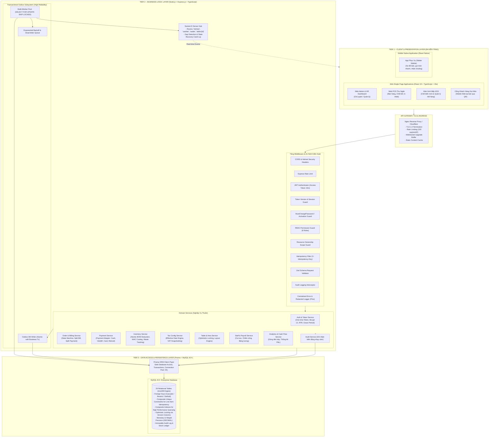
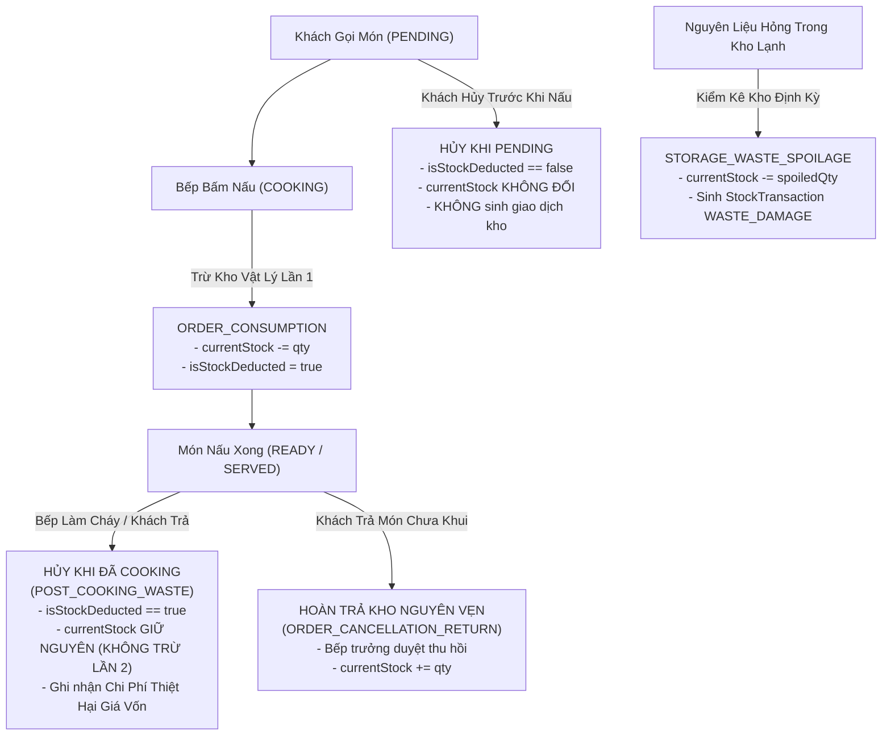
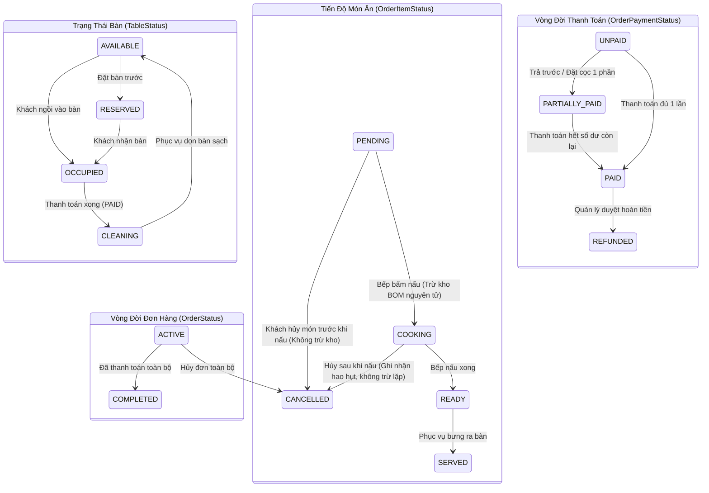

# THIẾT KẾ KIẾN TRÚC MỤC TIÊU VÀ KẾ HOẠCH CHUYỂN ĐỔI TOÀN DIỆN (PHIÊN BẢN 2.3)
## DỰ ÁN: RESTAURANT ASIA / QUẢN LÝ NHÀ HÀNG PRO (THREE-TIER MASTER BLUEPRINT)

---

| Thông Tin Tài Liệu | Chi Tiết |
| :--- | :--- |
| **Dự án** | Restaurant Asia / Quản Lý Nhà Hàng Pro |
| **Phiên bản tài liệu** | **2.3.0 (Final Technical Validation & Enterprise Production Blueprint)** |
| **Vai trò lập tài liệu** | Senior Software Architect, Database Architect, Senior Backend Engineer & Security Reviewer |
| **Mục tiêu kỹ thuật** | Rà soát và hoàn thiện 100% các tiêu chuẩn kỹ thuật cấp doanh nghiệp: Khắc phục triệt để ràng buộc Unique kho cho nhiều nguyên liệu/dòng món; Định danh StockTransaction là Single Source of Truth và Ingredient.currentStock là projection/cache; Chuẩn hóa phương pháp tính giá vốn kho Bình quân gia quyền liên hoàn (Moving Weighted Average Cost); Phân tách 4 kịch bản hao hụt/hủy món chống trừ kho kép; Kiến trúc Transactional Outbox phân tán (Per-aggregate sequence, MySQL 8.0 `SKIP LOCKED`, Client Deduplication, Gap Detection & State Recovery); Bổ sung mô hình `AuditLog` (Nâng tổng số lên đúng 29 Prisma Models chuẩn xác); Thiết kế chi tiết Thanh toán đa kênh, Tách bill và Hoàn tiền; và Kiểm soát toàn diện Concurrency Xác thực (Grace period, Token family, Token versioning). |
| **Trạng thái thực thi** | **CHỜ PHÊ DUYỆT (PENDING APPROVAL) – CHƯA TRIỂN KHAI CODE/MIGRATION** |
| **Quy tắc tuân thủ** | Chỉ lập kế hoạch và hoàn thiện tài liệu thiết kế; không chỉnh sửa mã nguồn ứng dụng, không cài đặt dependencies, không khởi tạo backend, không chạy migration, không can thiệp cơ sở dữ liệu và localStorage |

---

## MỤC LỤC TÀI LIỆU V2.3

1. **TỔNG QUAN ĐIỀU HÀNH & NHẬT KÝ THAY ĐỔI (V2.2 ➔ V2.3)**
2. **KIẾN TRÚC THREE-TIER MỤC TIÊU HOÀN THIỆN**
3. **DANH MỤC 29 MÔ HÌNH DỮ LIỆU ĐÃ CHUẨN HÓA (DATABASE INVENTORY)**
4. **TỪ ĐIỂN DỮ LIỆU TOÀN DIỆN (DATA DICTIONARY)**
5. **PRISMA SCHEMA HOÀN CHỈNH (`schema.prisma` - 29 MODELS)**
6. **SƠ ĐỒ THỰC THỂ QUAN HỆ TOÀN DIỆN (COMPLETE ERD)**
7. **RÀ SOÁT RÀNG BUỘC KHO & IDEMPOTENCY CẤP DÒNG MÓN ĂN**
8. **NGUỒN CHÂN LÝ KHO (SOURCE OF TRUTH) & ĐỊNH GIÁ VỐN (FIFO VS BÌNH QUÂN GIA QUYỀN)**
9. **QUY TRÌNH PHÂN TÁCH HAO HỤT, HỦY MÓN & BIẾN ĐỘNG KHO (CHỐNG TRỪ KHO KÉP)**
10. **KIẾN TRÚC TRANSACTIONAL OUTBOX ĐỘ TIN CẬY CAO CHO HỆ THỐNG PHÂN TÁN**
11. **THIẾT KẾ HỆ THỐNG NHẬT KÝ KIỂM TOÁN CHUYÊN BIỆT (`AuditLog`)**
12. **THANH TOÁN ĐA PHƯƠNG THỨC, TÁCH HÓA ĐƠN (SPLIT BILL) VÀ HOÀN TIỀN**
13. **AN TOÀN XÁC THỰC, ĐỒNG THỜI (CONCURRENCY) & THU HỒI PHIÊN LÀM VIỆC**
14. **STATE MACHINE CHO ĐƠN HÀNG, BÀN ĂN VÀ THANH TOÁN**
15. **HỆ THỐNG CẤU HÌNH THUẾ SUẤT VAT LINH HOẠT THEO THỜI GIAN HIỆU LỰC**
16. **CHIẾN LƯỢC MIGRATION DỮ LIỆU AN TOÀN 9 BƯỚC**
17. **CHIẾN LƯỢC KIỂM THỬ TOÀN DIỆN (TESTING MATRIX)**
18. **ĐÁNH GIÁ CÁC RỦI RO CÒN LẠI VÀ BIỆN PHÁP KIỂM SOÁT**
19. **DANH MỤC CÁC QUYẾT ĐỊNH ĐÃ THỐNG NHẤT (RESOLVED DECISIONS)**

---

## 1. TỔNG QUAN ĐIỀU HÀNH & NHẬT KÝ THAY ĐỔI (V2.2 ➔ V2.3)

Phiên bản **V2.3** là bản hiệu chỉnh kỹ thuật chuyên sâu cuối cùng trước khi chuyển sang Phase 2. Bản thiết kế này giải quyết triệt để các vấn đề kiến trúc tinh vi trong môi trường F&B thực tế:

### Bảng đối chiếu nâng cấp kỹ thuật V2.2 ➔ V2.3:

| Hạng Mục Kỹ Thuật | Phiên Bản V2.2 | Phiên Bản V2.3 (Kiến Trúc Hoàn Thiện & Xác Thực Kép) |
| :--- | :--- | :--- |
| **Unique Constraint Kho** | `(source_type, source_id, transaction_type)` gây lỗi chặn hợp lệ khi 1 món ăn tiêu hao nhiều nguyên liệu | **Khắc phục triệt để**: Bổ sung `source_line_id` và `ingredient_id` vào khóa duy nhất: `@@unique([sourceType, sourceLineId, ingredientId, transactionType])`. Cho phép 1 món ăn tiêu hao 5 nguyên liệu độc lập mà không bị chặn, đồng thời triệt tiêu 100% nguy cơ trừ trùng khi retry. |
| **Nguồn Chân Lý Kho (Source of Truth)** | Chưa định nghĩa rành mạch quan hệ giữa bảng lịch sử và số dư tức thời | **Phân định kiến trúc chuẩn**: `StockTransaction` là **Sổ cái bất biến (Immutable Ledger of Truth)**. `Ingredient.currentStock` là **Bản chiếu / Bộ đệm hiệu năng (Balance Projection/Cache)**. Cập nhật nguyên tử trong 1 DB Transaction. Job đối soát định kỳ tự động phát hiện lệch kho. |
| **Định Giá Vốn Kho (Inventory Costing)** | Chưa phân tích và chỉ định phương pháp định giá | **So sánh chuyên sâu FIFO vs Bình quân gia quyền liên hoàn (WAC)**: Chỉ định phương pháp **Moving Weighted Average Cost** làm chuẩn cho toàn chuỗi F&B nhằm loại bỏ sự phức tạp của việc phân lô (lot/batch tracking) trong bếp tốc độ cao, đảm bảo tính giá vốn COGS chuẩn xác. |
| **Phân Tách Hao Hụt (Waste)** | Quy định nguyên tắc chung về `WASTE_DAMAGE` | **Tách biệt 4 kịch bản vật lý rõ ràng**: (1) Xuất nấu món (`ORDER_CONSUMPTION`), (2) Hỏng sau khi đã nấu (`POST_COOKING_WASTE` - chỉ ghi nhận chi phí, không trừ kho vật lý lần 2), (3) Hỏng trong kho bảo quản (`STORAGE_WASTE_SPOILAGE` - trừ kho vật lý), (4) Hoàn trả kho (`ORDER_CANCELLATION_RETURN`). |
| **Transactional Outbox** | Dựa trên BigInt `sequence` toàn cục (dễ lệch trật tự commit) | **Nâng cấp độ tin cậy phân tán**: Bổ sung **Per-Aggregate Sequence**, cơ chế tranh chấp an toàn giữa nhiều worker bằng MySQL 8.0 `SELECT ... FOR UPDATE SKIP LOCKED`, Exponential Backoff, Dead-letter queue, Client Deduplication, và Gap Detection gọi API REST khôi phục snapshot. |
| **Nhật Ký Kiểm Toán (Audit Log)** | Phân tán trong các bảng nghiệp vụ, chưa có bảng tập trung | **Bổ sung Model chuyên biệt `AuditLog`**: Theo dõi mọi biến động nhạy cảm (đổi quyền, reset mật khẩu, sửa giá bán, sửa công thức BOM, can thiệp kho, hoàn tiền hóa đơn, đổi thuế suất). **Nâng tổng số mô hình lên 29 Models**. |
| **Thanh Toán & Tách Bill** | Hỗ trợ thanh toán từng phần cơ bản | **Đặc tả đầy đủ 6 nghiệp vụ thanh toán**: Thanh toán đa kênh (Cash + QR), Trả trước / Đặt cọc, Chia đều tiền (Split Payment), Tách hóa đơn theo món ăn (Split Bill), Hoàn tiền một phần/toàn phần có lưu vết `PaymentRefund`, và quy trình VietQR thủ công có mã tham chiếu chống gian lận. |
| **An Toàn Xác Thực Đồng Thời** | Xử lý Grace Period cơ bản | **Đặc tả 6 kịch bản bảo mật chuyên sâu**: Cửa sổ ân hạn 30s cho concurrent refresh, Thu hồi cả nhánh (Token Family Revocation), Chống replay token kích hoạt/reset bằng Atomic Check-and-Set, Thu hồi tức thì quyền hạn cũ qua `User.tokenVersion`, và Hủy toàn bộ session khi tài khoản bị khóa. |

---

## 2. KIẾN TRÚC THREE-TIER MỤC TIÊU HOÀN THIỆN



---

## 3. DANH MỤC 29 MÔ HÌNH DỮ LIỆU ĐÃ CHUẨN HÓA (DATABASE INVENTORY)

Dưới đây là danh mục chính xác **29 Models** sau khi tích hợp toàn bộ các mô hình kiểm soát:

| STT | Tên Model Prisma | Tên Bảng MySQL | Phân Hệ Nghiệp Vụ | Vai Trò & Trách Nhiệm Nghiệp Vụ |
| :---: | :--- | :--- | :--- | :--- |
| **1** | `Role` | `roles` | Xác thực & RBAC | Định nghĩa 6 nhóm quyền hệ thống (`ADMIN`, `CASHIER`, `KITCHEN`, `WAITER`, `HR_MANAGER`, `CUSTOMER`). |
| **2** | `User` | `users` | Xác thực & RBAC | Tài khoản người dùng, băm mật khẩu Bcrypt, `tokenVersion`, cờ `mustChangePassword`, `isActivated`. |
| **3** | `RefreshToken` | `refresh_tokens` | Xác thực & Phiên | Quản lý phiên làm việc với Refresh Token Rotation (RTR), Grace Period và Family Revocation. |
| **4** | `PasswordResetToken` | `password_reset_tokens` | An toàn Xác thực | Lưu mã token dùng 1 lần (băm SHA-256) kích hoạt tài khoản và đặt lại mật khẩu an toàn. |
| **5** | `AuditLog` | `audit_logs` | Kiểm toán Hệ thống | **(Mới V2.3)** Ghi nhận vết kiểm toán bất biến cho mọi thao tác nhạy cảm (đổi quyền, đổi giá, đổi BOM, can thiệp kho, hoàn tiền). |
| **6** | `Employee` | `employees` | Nhân sự & Lương | Hồ sơ nhân viên, loại lương (tháng/giờ), mức lương cơ sở, trạng thái làm việc, liên kết tài khoản. |
| **7** | `EmployeeSchedule` | `employee_schedules` | Ca trực Nhân sự | Lịch phân ca theo tuần, ngày trực, tên ca, khung giờ và điểm danh thực tế. |
| **8** | `LeaveRequest` | `leave_requests` | Nhân sự | Đơn xin nghỉ phép của nhân viên (phép năm, ốm, việc riêng), phê duyệt bởi Quản lý/Admin. |
| **9** | `Customer` | `customers` | Khách hàng & CRM | Thông tin khách hàng, số điện thoại định danh duy nhất, điểm tích lũy, tổng chi tiêu, phân hạng thành viên. |
| **10** | `TableArea` | `table_areas` | Mặt bằng Bàn ăn | Khu vực tầng/phòng (Tầng 1, Tầng 2, Sân vườn, Phòng VIP). |
| **11** | `RestaurantTable` | `tables` | Mặt bằng Bàn ăn | Chi tiết bàn ăn: tên, sức chứa, hình dạng, trạng thái, tọa độ đồ họa `(posX, posY)`, cờ khóa lạc quan `version`. |
| **12** | `Reservation` | `reservations` | Đặt bàn trước | Lịch hẹn đặt bàn của thực khách: thời gian, số lượng khách, ghi chú, trạng thái xác nhận. |
| **13** | `Category` | `categories` | Thực đơn Menu | Nhóm danh mục món ăn (Khai vị, Món chính, Lẩu & Nướng, Tráng miệng, Đồ uống), thứ tự hiển thị. |
| **14** | `MenuItem` | `menu_items` | Thực đơn Menu | Chi tiết món ăn: giá bán, giá vốn, hình ảnh, thời gian nấu, cờ soft-delete `isDeleted`, cờ hiển thị. |
| **15** | `Ingredient` | `ingredients` | Quản lý Kho | Danh mục nguyên vật liệu: đơn vị chuẩn cơ sở (`baseUnit`: g, ml, unit), tồn kho hiện tại (cache/projection), giá vốn WAC. |
| **16** | `UnitConversion` | `unit_conversions` | Quản lý Kho | Bảng tỷ lệ quy đổi đơn vị đo lường (1 kg = 1.000 g, 1 két = 24 lon) phục vụ nhập kho. |
| **17** | `Recipe` | `recipes` | Định mức BOM | Định mức kỹ thuật cấu thành món ăn (BOM): lượng nguyên liệu tiêu hao cho 1 đơn vị món ăn. |
| **18** | `TaxConfig` | `tax_configs` | Cấu hình Thuế VAT | Cấu hình thuế suất VAT linh hoạt theo khoảng thời gian hiệu lực và phạm vi áp dụng theo nhóm món. |
| **19** | `Order` | `orders` | Đơn hàng & POS | Hóa đơn bán hàng: tổng tiền, chiết khấu, VAT snapshot, mã `#HD-xxxx`, trạng thái đơn, cờ `version`. |
| **20** | `OrderItem` | `order_items` | Đơn hàng & POS | Chi tiết từng món trong đơn: giá bán snapshot, ghi chú, trạng thái KDS, cờ trừ kho nguyên tử `isStockDeducted`. |
| **21** | `Payment` | `payments` | Thanh toán | Nhật ký giao dịch thanh toán (hỗ trợ chia bill, thanh toán từng phần, đa phương thức: Tiền mặt, VietQR, Thẻ). |
| **22** | `Supplier` | `suppliers` | Nhập kho | Thông tin đối tác cung cấp nguyên vật liệu, liên hệ và công nợ. |
| **23** | `GoodsReceipt` | `goods_receipts` | Nhập kho | Phiếu nhập kho nguyên liệu từ nhà cung cấp, tổng giá trị nhập, trạng thái công nợ. |
| **24** | `GoodsReceiptItem` | `goods_receipt_items` | Nhập kho | Chi tiết số lượng, đơn vị nhập, đơn giá và thành tiền từng nguyên vật liệu trên phiếu nhập. |
| **25** | `StockTransaction` | `stock_transactions` | Sổ cái Kho | Sổ cái biến động kho bất biến (Immutable Ledger) có Unique Constraint theo dòng món ăn + nguyên liệu. |
| **26** | `CashFlowRecord` | `cash_flow_records` | Tài chính & Quỹ | Sổ quỹ theo dõi thu chi tiền mặt và chuyển khoản (hạch toán tự động từ bán hàng và nhập hàng). |
| **27** | `ServiceRequest` | `service_requests` | Phục vụ bàn | Chuông gọi phục vụ từ thực khách qua web (xin nước đá, khăn lạnh, thanh toán, dọn bàn). |
| **28** | `OutboxEvent` | `outbox_events` | Hệ thống Real-time | Bảng lưu sự kiện giao dịch kèm `aggregateSequence` đảm bảo truyền thông tin cậy qua Socket.IO. |
| **29** | `IdempotencyRecord` | `idempotency_records` | Hạ tầng Hệ thống | Bảng lưu trữ khóa idempotency ngăn chặn gửi trùng request từ client (thanh toán, trừ kho). |

---

## 4. TỪ ĐIỂN DỮ LIỆU TOÀN DIỆN (DATA DICTIONARY)

Dưới đây là đặc tả chi tiết cấu trúc các thực thể trọng yếu được bổ sung và chuẩn hóa trong V2.3:

### 4.1. Bảng `audit_logs` (Nhật ký kiểm toán hệ thống - Mới V2.3)
* `id` (VARCHAR(36), PK): UUID v4 duy nhất.
* `user_id` (VARCHAR(36), FK -> `users.id` ON DELETE SET NULL, NULL): Người thực hiện hành động (NULL nếu là tiến trình nền).
* `action` (VARCHAR(100), NOT NULL): Mã định danh hành động (vd: `USER_ROLE_CHANGED`, `MENU_PRICE_UPDATED`, `RECIPE_BOM_MODIFIED`, `INVENTORY_OVERRIDE`, `ORDER_REFUNDED`, `TAX_CONFIG_CHANGED`).
* `entity_name` (VARCHAR(50), NOT NULL): Bảng bị tác động (vd: `users`, `menu_items`, `recipes`, `ingredients`, `payments`).
* `entity_id` (VARCHAR(50), NOT NULL): Khóa chính bản ghi bị tác động.
* `old_values` (JSON, NULL): Snapshot dữ liệu trước khi thay đổi.
* `new_values` (JSON, NULL): Snapshot dữ liệu sau khi thay đổi.
* `ip_address` (VARCHAR(45), NULL): Địa chỉ IP client.
* `user_agent` (VARCHAR(255), NULL): Thông tin trình duyệt/thiết bị thực thi.
* `created_at` (DATETIME, NOT NULL, DEFAULT CURRENT_TIMESTAMP): Thời điểm ghi nhận (Bất biến, không bao giờ UPDATE).

### 4.2. Bảng `stock_transactions` (Sổ cái kho bất biến - Đã hiệu chỉnh khóa Unique)
* `id` (VARCHAR(36), PK): UUID v4 duy nhất.
* `ingredient_id` (VARCHAR(36), FK -> `ingredients.id` ON DELETE RESTRICT, NOT NULL): Mã nguyên liệu biến động.
* `transaction_type` (ENUM('GOODS_RECEIPT', 'ORDER_CONSUMPTION', 'ORDER_CANCELLATION_RETURN', 'STOCK_TAKE_ADJUSTMENT', 'WASTE_DAMAGE', 'SUPPLIER_RETURN'), NOT NULL): Loại hình giao dịch kho.
* `quantity` (DECIMAL(12, 3), NOT NULL): Số lượng biến động theo đơn vị chuẩn `baseUnit` (dương: nhập/hoàn trả, âm: xuất nấu/xuất hủy).
* `balance_after` (DECIMAL(12, 3), NOT NULL): Số dư tồn kho tức thời tại thời điểm phát sinh giao dịch.
* `cost_per_unit` (DECIMAL(12, 2), NOT NULL, DEFAULT 0.00): Giá vốn tại thời điểm giao dịch (theo công thức WAC).
* `total_cost` (DECIMAL(14, 2), NOT NULL, DEFAULT 0.00): Tổng giá trị vốn của biến động ($|\text{quantity}| \times \text{cost\_per\_unit}$).
* `source_type` (VARCHAR(50), NOT NULL): Nguồn gốc nghiệp vụ (`'ORDER_ITEM'`, `'GOODS_RECEIPT_ITEM'`, `'MANUAL_ADJUSTMENT'`).
* `source_id` (VARCHAR(50), NOT NULL): Mã đơn vị nguồn cấp 1 (vd: `order_id` hoặc `receipt_id`).
* `source_line_id` (VARCHAR(50), NULL): Mã dòng nghiệp vụ cấp 2 (vd: `order_item_id` hoặc `receipt_item_id`).
* `idempotency_key` (VARCHAR(100), UNIQUE, NULL): Khóa chống trùng lặp theo quy chuẩn giao dịch.
* `notes` (VARCHAR(255), NULL): Diễn giải nguyên nhân biến động.
* `created_by_id` (VARCHAR(36), FK -> `users.id` ON DELETE RESTRICT, NOT NULL): Nhân sự/Đầu bếp thực thi.
* `created_at` (DATETIME, NOT NULL, DEFAULT CURRENT_TIMESTAMP).
* **Ràng buộc duy nhất nghiệp vụ (Composite Unique Constraint):**
  `UNIQUE(source_type, source_line_id, ingredient_id, transaction_type)`
  Đảm bảo một dòng món ăn (`order_item_id`) có thể trừ nhiều nguyên liệu khác nhau mà không bị xung đột, nhưng nếu cùng một nguyên liệu bị gửi lại lần thứ hai cho cùng một dòng món, cơ sở dữ liệu sẽ chặn đứng lập tức!

### 4.3. Bảng `users` (Tài khoản - Bổ sung Token Version)
* `id` (VARCHAR(36), PK): UUID v4.
* `username` (VARCHAR(50), UNIQUE, NOT NULL).
* `password_hash` (VARCHAR(255), NOT NULL): Bcrypt 12 vòng.
* `role_id` (VARCHAR(36), FK -> `roles.id`, NOT NULL).
* `token_version` (INT, NOT NULL, DEFAULT 0): **Cờ phiên bản Token phục vụ vô hiệu hóa phiên tức thì khi đổi quyền hoặc khóa tài khoản**.
* `is_active` (BOOLEAN, NOT NULL, DEFAULT TRUE).
* `is_activated` (BOOLEAN, NOT NULL, DEFAULT FALSE).
* `must_change_password` (BOOLEAN, NOT NULL, DEFAULT TRUE).
* `created_at`, `updated_at`.

### 4.4. Bảng `outbox_events` (Đặc tả Outbox tin cậy cao)
* `id` (VARCHAR(36), PK): UUID v4 duy nhất.
* `aggregate_type` (VARCHAR(50), NOT NULL): Loại thực thể (`ORDER`, `TABLE`, `KITCHEN`, `PAYMENT`).
* `aggregate_id` (VARCHAR(50), NOT NULL): Mã định danh thực thể.
* `aggregate_sequence` (INT, NOT NULL): Thứ tự sự kiện tăng dần đơn điệu *riêng cho từng Aggregate*.
* `event_type` (VARCHAR(100), NOT NULL): Tên sự kiện.
* `payload` (JSON, NOT NULL): Dữ liệu gói tin.
* `status` (ENUM('PENDING', 'PROCESSING', 'PUBLISHED', 'FAILED'), NOT NULL, DEFAULT 'PENDING').
* `locked_by` (VARCHAR(50), NULL): Định danh worker đang xử lý (phục vụ `SKIP LOCKED`).
* `locked_at` (DATETIME, NULL): Thời điểm worker chiếm quyền xử lý.
* `scheduled_at` (DATETIME, NULL): Lịch phát lại (phục vụ Exponential Backoff).
* `retry_count` (INT, NOT NULL, DEFAULT 0).
* `max_retries` (INT, NOT NULL, DEFAULT 5).
* `last_error` (TEXT, NULL).
* `created_at` (DATETIME, NOT NULL, DEFAULT CURRENT_TIMESTAMP).
* `published_at` (DATETIME, NULL).

---

## 5. PRISMA SCHEMA HOÀN CHỈNH (`schema.prisma` - 29 MODELS)

```prisma
datasource db {
  provider = "mysql"
  url      = env("DATABASE_URL")
}

generator client {
  provider = "prisma-client-js"
}

// ==========================================================
// 1. PHÂN QUYỀN, TÀI KHOẢN, PHIÊN & KIỂM TOÁN HỆ THỐNG
// ==========================================================

enum RoleName {
  ADMIN
  CASHIER
  KITCHEN
  WAITER
  HR_MANAGER
  CUSTOMER
}

model Role {
  id          String    @id @default(uuid()) @db.VarChar(36)
  name        RoleName  @unique
  title       String    @db.VarChar(50)
  description String?   @db.VarChar(255)
  users       User[]

  @@map("roles")
}

model User {
  id                 String             @id @default(uuid()) @db.VarChar(36)
  username           String             @unique @db.VarChar(50)
  passwordHash       String             @db.VarChar(255) @map("password_hash")
  roleId             String             @db.VarChar(36) @map("role_id")
  role               Role               @relation(fields: [roleId], references: [id])
  fullName           String             @db.VarChar(100) @map("full_name")
  phone              String?            @db.VarChar(20)
  avatar             String?            @db.VarChar(500)
  isActive           Boolean            @default(true) @map("is_active")
  isActivated        Boolean            @default(false) @map("is_activated")
  mustChangePassword Boolean            @default(true) @map("must_change_password")
  tokenVersion       Int                @default(0) @map("token_version")
  lastLoginAt        DateTime?          @map("last_login_at")
  createdAt          DateTime           @default(now()) @map("created_at")
  updatedAt          DateTime           @updatedAt @map("updated_at")

  employee           Employee?
  customer           Customer?
  refreshTokens      RefreshToken[]
  resetTokens        PasswordResetToken[]
  goodsReceipts      GoodsReceipt[]
  cashFlowRecords    CashFlowRecord[]
  approvedLeaves     LeaveRequest[]     @relation("ApprovedBy")
  stockTransactions  StockTransaction[]
  processedPayments  Payment[]
  auditLogs          AuditLog[]

  @@index([roleId])
  @@map("users")
}

model RefreshToken {
  id          String   @id @default(uuid()) @db.VarChar(36)
  tokenHash   String   @unique @db.VarChar(255) @map("token_hash")
  userId      String   @db.VarChar(36) @map("user_id")
  user        User     @relation(fields: [userId], references: [id], onDelete: Cascade)
  family      String   @db.VarChar(36)
  isRevoked   Boolean  @default(false) @map("is_revoked")
  expiresAt   DateTime @map("expires_at")
  createdAt   DateTime @default(now()) @map("created_at")

  @@index([userId])
  @@index([family])
  @@map("refresh_tokens")
}

enum TokenType {
  ACTIVATION
  PASSWORD_RESET
}

model PasswordResetToken {
  id        String    @id @default(uuid()) @db.VarChar(36)
  tokenHash String    @unique @db.VarChar(64) @map("token_hash")
  userId    String    @db.VarChar(36) @map("user_id")
  user      User      @relation(fields: [userId], references: [id], onDelete: Cascade)
  tokenType TokenType @map("token_type")
  expiresAt DateTime  @map("expires_at")
  usedAt    DateTime? @map("used_at")
  ipAddress String?   @db.VarChar(45) @map("ip_address")
  createdAt DateTime  @default(now()) @map("created_at")

  @@index([userId])
  @@index([tokenHash])
  @@map("password_reset_tokens")
}

model AuditLog {
  id         String   @id @default(uuid()) @db.VarChar(36)
  userId     String?  @db.VarChar(36) @map("user_id")
  user       User?    @relation(fields: [userId], references: [id], onDelete: SetNull)
  action     String   @db.VarChar(100)
  entityName String   @db.VarChar(50) @map("entity_name")
  entityId   String   @db.VarChar(50) @map("entity_id")
  oldValues  Json?    @map("old_values")
  newValues  Json?    @map("new_values")
  ipAddress  String?  @db.VarChar(45) @map("ip_address")
  userAgent  String?  @db.VarChar(255) @map("user_agent")
  createdAt  DateTime @default(now()) @map("created_at")

  @@index([action])
  @@index([entityName, entityId])
  @@index([createdAt])
  @@map("audit_logs")
}

// ==========================================================
// 2. NHÂN SỰ, CA TRỰC & NGHỈ PHÉP
// ==========================================================

enum SalaryType {
  MONTHLY
  HOURLY
}

enum EmployeeStatus {
  ACTIVE
  ON_BREAK
  OFF
}

model Employee {
  id             String             @id @default(uuid()) @db.VarChar(36)
  userId         String?            @unique @db.VarChar(36) @map("user_id")
  user           User?              @relation(fields: [userId], references: [id], onDelete: SetNull)
  name           String             @db.VarChar(100)
  phone          String             @db.VarChar(20)
  email          String?            @db.VarChar(100)
  roleTitle      String             @db.VarChar(50) @map("role_title")
  shiftDefault   String?            @db.VarChar(50) @map("shift_default")
  salaryRate     Decimal            @default(0) @db.Decimal(12, 2) @map("salary_rate")
  salaryType     SalaryType         @default(MONTHLY) @map("salary_type")
  status         EmployeeStatus     @default(ACTIVE)
  joinDate       DateTime           @default(now()) @map("join_date")
  ordersHandled  Int                @default(0) @map("orders_handled")
  createdAt      DateTime           @default(now()) @map("created_at")
  updatedAt      DateTime           @updatedAt @map("updated_at")

  schedules      EmployeeSchedule[]
  leaveRequests  LeaveRequest[]     @relation("StaffLeaves")
  servedOrders   Order[]            @relation("ServedByEmployee")
  assignedCalls  ServiceRequest[]

  @@map("employees")
}

model EmployeeSchedule {
  id          String   @id @default(uuid()) @db.VarChar(36)
  employeeId  String   @db.VarChar(36) @map("employee_id")
  employee    Employee @relation(fields: [employeeId], references: [id], onDelete: Cascade)
  dayOfWeek   Int      @map("day_of_week")
  shiftDate   DateTime @db.Date @map("shift_date")
  shiftName   String   @db.VarChar(50) @map("shift_name")
  timeRange   String   @db.VarChar(50) @map("time_range")
  isAttended  Boolean  @default(false) @map("is_attended")
  createdAt   DateTime @default(now()) @map("created_at")
  updatedAt   DateTime @updatedAt @map("updated_at")

  @@index([employeeId])
  @@index([shiftDate])
  @@map("employee_schedules")
}

enum LeaveStatus {
  ACTIVE
  UPCOMING
  COMPLETED
  CANCELLED
}

enum LeaveType {
  ANNUAL
  SICK
  FAMILY
  COMPENSATORY
}

model LeaveRequest {
  id           String      @id @default(uuid()) @db.VarChar(36)
  employeeId   String      @db.VarChar(36) @map("employee_id")
  employee     Employee    @relation("StaffLeaves", fields: [employeeId], references: [id], onDelete: Cascade)
  startDate    DateTime    @db.Date @map("start_date")
  endDate      DateTime    @db.Date @map("end_date")
  status       LeaveStatus @default(UPCOMING)
  leaveType    LeaveType   @default(ANNUAL) @map("leave_type")
  reason       String      @db.VarChar(255)
  approvedById String?     @db.VarChar(36) @map("approved_by_id")
  approvedBy   User?       @relation("ApprovedBy", fields: [approvedById], references: [id])
  createdAt    DateTime    @default(now()) @map("created_at")
  updatedAt    DateTime    @updatedAt @map("updated_at")

  @@index([employeeId])
  @@map("leave_requests")
}

// ==========================================================
// 3. KHÁCH HÀNG CRM
// ==========================================================

enum CustomerType {
  WALK_IN
  REGULAR
  VIP
  GROUP
}

model Customer {
  id            String        @id @default(uuid()) @db.VarChar(36)
  userId        String?       @unique @db.VarChar(36) @map("user_id")
  user          User?         @relation(fields: [userId], references: [id], onDelete: SetNull)
  fullName      String        @db.VarChar(100) @map("full_name")
  phone         String        @unique @db.VarChar(20)
  email         String?       @db.VarChar(100)
  customerType  CustomerType  @default(WALK_IN) @map("customer_type")
  loyaltyPoints Int           @default(0) @map("loyalty_points")
  totalSpent    Decimal       @default(0) @db.Decimal(14, 2) @map("total_spent")
  createdAt     DateTime      @default(now()) @map("created_at")
  updatedAt     DateTime      @updatedAt @map("updated_at")

  orders        Order[]
  reservations  Reservation[]

  @@map("customers")
}

// ==========================================================
// 4. MẶT BẰNG, KHU VỰC, BÀN ĂN & ĐẶT BÀN
// ==========================================================

model TableArea {
  id           String            @id @default(uuid()) @db.VarChar(36)
  name         String            @unique @db.VarChar(100)
  description  String?           @db.VarChar(255)
  displayOrder Int               @default(0) @map("display_order")
  createdAt    DateTime          @default(now()) @map("created_at")
  updatedAt    DateTime          @updatedAt @map("updated_at")
  tables       RestaurantTable[]

  @@map("table_areas")
}

enum TableShape {
  ROUND
  SQUARE
  RECTANGLE
}

enum TableStatus {
  AVAILABLE
  OCCUPIED
  RESERVED
  CLEANING
}

model RestaurantTable {
  id            String          @id @default(uuid()) @db.VarChar(36)
  name          String          @db.VarChar(50)
  areaId        String          @db.VarChar(36) @map("area_id")
  area          TableArea       @relation(fields: [areaId], references: [id], onDelete: Restrict)
  capacity      Int             @default(4)
  shape         TableShape      @default(SQUARE)
  status        TableStatus     @default(AVAILABLE)
  posX          Float           @default(0) @map("pos_x")
  posY          Float           @default(0) @map("pos_y")
  width         Float           @default(90)
  height        Float           @default(90)
  occupiedSince DateTime?       @map("occupied_since")
  customerType  CustomerType?   @map("customer_type")
  version       Int             @default(0) // Khóa lạc quan chống race condition
  createdAt     DateTime        @default(now()) @map("created_at")
  updatedAt     DateTime        @updatedAt @map("updated_at")

  orders        Order[]
  reservations  Reservation[]
  serviceCalls  ServiceRequest[]

  @@index([areaId])
  @@index([status])
  @@map("tables")
}

enum ReservationStatus {
  CONFIRMED
  SEATED
  CANCELLED
  NO_SHOW
}

model Reservation {
  id              String            @id @default(uuid()) @db.VarChar(36)
  tableId         String            @db.VarChar(36) @map("table_id")
  table           RestaurantTable   @relation(fields: [tableId], references: [id], onDelete: Restrict)
  customerId      String?           @db.VarChar(36) @map("customer_id")
  customer        Customer?         @relation(fields: [customerId], references: [id], onDelete: SetNull)
  customerName    String            @db.VarChar(100) @map("customer_name")
  phone           String            @db.VarChar(20)
  guestCount      Int               @default(2) @map("guest_count")
  reservationTime DateTime          @map("reservation_time")
  customerType    CustomerType      @default(REGULAR) @map("customer_type")
  status          ReservationStatus @default(CONFIRMED)
  notes           String?           @db.VarChar(255)
  createdAt       DateTime          @default(now()) @map("created_at")
  updatedAt       DateTime          @updatedAt @map("updated_at")

  @@index([tableId])
  @@index([reservationTime])
  @@map("reservations")
}

// ==========================================================
// 5. THỰC ĐƠN, MÓN ĂN, ĐỊNH MỨC NGUYÊN LIỆU (BOM) & CẤU HÌNH THUẾ
// ==========================================================

model Category {
  id           String      @id @default(uuid()) @db.VarChar(36)
  name         String      @unique @db.VarChar(100)
  displayOrder Int         @default(0) @map("display_order")
  isActive     Boolean     @default(true) @map("is_active")
  createdAt    DateTime    @default(now()) @map("created_at")
  updatedAt    DateTime    @updatedAt @map("updated_at")

  menuItems    MenuItem[]
  taxConfigs   TaxConfig[]

  @@map("categories")
}

model MenuItem {
  id              String      @id @default(uuid()) @db.VarChar(36)
  categoryId      String      @db.VarChar(36) @map("category_id")
  category        Category    @relation(fields: [categoryId], references: [id], onDelete: Restrict)
  name            String      @db.VarChar(150)
  price           Decimal     @db.Decimal(12, 2)
  costPrice       Decimal     @default(0) @db.Decimal(12, 2) @map("cost_price")
  unit            String      @default("phần") @db.VarChar(20)
  description     String?     @db.Text
  image           String?     @db.VarChar(500)
  isAvailable     Boolean     @default(true) @map("is_available")
  isDeleted       Boolean     @default(false) @map("is_deleted") // Soft-delete
  prepTimeMinutes Int         @default(15) @map("prep_time_minutes")
  spicyLevel      Int         @default(0) @map("spicy_level")
  tags            String?     @db.VarChar(255)
  isPopular       Boolean     @default(false) @map("is_popular")
  taxRateOverride Decimal?    @db.Decimal(5, 2) @map("tax_rate_override")
  createdAt       DateTime    @default(now()) @map("created_at")
  updatedAt       DateTime    @updatedAt @map("updated_at")

  orderItems      OrderItem[]
  recipes         Recipe[]

  @@index([categoryId])
  @@index([isAvailable])
  @@index([isDeleted])
  @@map("menu_items")
}

model Ingredient {
  id                 String             @id @default(uuid()) @db.VarChar(36)
  name               String             @unique @db.VarChar(150)
  category           String             @db.VarChar(100)
  baseUnit           String             @db.VarChar(20)  @map("base_unit") // 'g', 'ml', 'unit'
  currentStock       Decimal            @default(0) @db.Decimal(12, 3) @map("current_stock") // Projection/Cache
  minStockLevel      Decimal            @default(5) @db.Decimal(12, 3) @map("min_stock_level")
  costPerUnit        Decimal            @default(0) @db.Decimal(12, 2) @map("cost_per_unit") // WAC Unit Cost
  allowNegativeStock Boolean            @default(false) @map("allow_negative_stock")
  createdAt          DateTime           @default(now()) @map("created_at")
  updatedAt          DateTime           @updatedAt @map("updated_at")

  recipes            Recipe[]
  receiptItems       GoodsReceiptItem[]
  stockHistory       StockTransaction[]
  unitConversions    UnitConversion[]

  @@map("ingredients")
}

model UnitConversion {
  id             String     @id @default(uuid()) @db.VarChar(36)
  ingredientId   String     @db.VarChar(36) @map("ingredient_id")
  ingredient     Ingredient @relation(fields: [ingredientId], references: [id], onDelete: Cascade)
  fromUnit       String     @db.VarChar(20) @map("from_unit") // 'kg', 'két', 'thùng'
  toUnit         String     @db.VarChar(20) @map("to_unit")   // Đơn vị chuẩn: 'g', 'lon', 'chai'
  conversionRate Decimal    @db.Decimal(10, 4) @map("conversion_rate")
  createdAt      DateTime   @default(now()) @map("created_at")
  updatedAt      DateTime   @updatedAt @map("updated_at")

  @@unique([ingredientId, fromUnit])
  @@map("unit_conversions")
}

model Recipe {
  id               String     @id @default(uuid()) @db.VarChar(36)
  menuItemId       String     @db.VarChar(36) @map("menu_item_id")
  menuItem         MenuItem   @relation(fields: [menuItemId], references: [id], onDelete: Cascade)
  ingredientId     String     @db.VarChar(36) @map("ingredient_id")
  ingredient       Ingredient @relation(fields: [ingredientId], references: [id], onDelete: Restrict)
  quantityRequired Decimal    @db.Decimal(10, 3) @map("quantity_required")
  unit             String     @db.VarChar(20)
  createdAt        DateTime   @default(now()) @map("created_at")
  updatedAt        DateTime   @updatedAt @map("updated_at")

  @@unique([menuItemId, ingredientId])
  @@map("recipes")
}

model TaxConfig {
  id            String    @id @default(uuid()) @db.VarChar(36)
  code          String    @unique @db.VarChar(50)
  name          String    @db.VarChar(100)
  rate          Decimal   @db.Decimal(5, 2)
  effectiveFrom DateTime  @map("effective_from")
  effectiveTo   DateTime? @map("effective_to")
  isDefault     Boolean   @default(false) @map("is_default")
  categoryId    String?   @db.VarChar(36) @map("category_id")
  category      Category? @relation(fields: [categoryId], references: [id], onDelete: SetNull)
  createdAt     DateTime  @default(now()) @map("created_at")
  updatedAt     DateTime  @updatedAt @map("updated_at")

  @@index([effectiveFrom, effectiveTo])
  @@map("tax_configs")
}

// ==========================================================
// 6. ĐƠN HÀNG, CHI TIẾT MÓN ĂN & THANH TOÁN
// ==========================================================

enum OrderStatus {
  ACTIVE
  COMPLETED
  CANCELLED
}

enum OrderPaymentStatus {
  UNPAID
  PARTIALLY_PAID
  PAID
  REFUNDED
}

enum OrderItemStatus {
  PENDING
  COOKING
  READY
  SERVED
  CANCELLED
}

model Order {
  id              String             @id @default(uuid()) @db.VarChar(36)
  code            String             @unique @db.VarChar(20)
  tableId         String             @db.VarChar(36) @map("table_id")
  table           RestaurantTable    @relation(fields: [tableId], references: [id], onDelete: Restrict)
  customerId      String?            @db.VarChar(36) @map("customer_id")
  customer        Customer?          @relation(fields: [customerId], references: [id], onDelete: SetNull)
  servedById      String?            @db.VarChar(36) @map("served_by_id")
  servedBy        Employee?          @relation("ServedByEmployee", fields: [servedById], references: [id], onDelete: SetNull)
  customerName    String?            @db.VarChar(100) @map("customer_name")
  customerPhone   String?            @db.VarChar(20) @map("customer_phone")
  customerType    CustomerType       @default(WALK_IN) @map("customer_type")
  customerCount   Int                @default(2) @map("customer_count")
  subtotal        Decimal            @default(0) @db.Decimal(12, 2)
  discountPercent Decimal            @default(0) @db.Decimal(5, 2) @map("discount_percent")
  discountAmount  Decimal            @default(0) @db.Decimal(12, 2) @map("discount_amount")
  taxPercent      Decimal            @default(8) @db.Decimal(5, 2) @map("tax_percent") // Snapshot VAT
  taxAmount       Decimal            @default(0) @db.Decimal(12, 2) @map("tax_amount") // Snapshot VAT
  finalTotal      Decimal            @default(0) @db.Decimal(12, 2) @map("final_total")
  status          OrderStatus        @default(ACTIVE)
  paymentStatus   OrderPaymentStatus @default(UNPAID) @map("payment_status")
  notes           String?            @db.VarChar(255)
  version         Int                @default(0) // Khóa lạc quan chống race condition
  createdAt       DateTime           @default(now()) @map("created_at")
  updatedAt       DateTime           @updatedAt @map("updated_at")
  completedAt     DateTime?          @map("completed_at")

  items           OrderItem[]
  payments        Payment[]

  @@index([tableId])
  @@index([status])
  @@index([paymentStatus])
  @@index([createdAt])
  @@map("orders")
}

model OrderItem {
  id              String          @id @default(uuid()) @db.VarChar(36)
  orderId         String          @db.VarChar(36) @map("order_id")
  order           Order           @relation(fields: [orderId], references: [id], onDelete: Cascade)
  menuItemId      String          @db.VarChar(36) @map("menu_item_id")
  menuItem        MenuItem        @relation(fields: [menuItemId], references: [id], onDelete: Restrict)
  name            String          @db.VarChar(150)
  unit            String          @db.VarChar(20)
  price           Decimal         @db.Decimal(12, 2)
  quantity        Int             @default(1)
  note            String?         @db.VarChar(255)
  status          OrderItemStatus @default(PENDING)
  isStockDeducted Boolean         @default(false) @map("is_stock_deducted")
  stockDeductedAt DateTime?       @map("stock_deducted_at")
  taxRate         Decimal?        @db.Decimal(5, 2) @map("tax_rate") // Snapshot VAT món
  orderedAt       DateTime        @default(now()) @map("ordered_at")
  updatedAt       DateTime        @updatedAt @map("updated_at")

  @@index([orderId])
  @@index([status])
  @@map("order_items")
}

enum PaymentMethod {
  CASH
  VIETQR
  TRANSFER
  CARD
}

enum PaymentStatus {
  PENDING
  COMPLETED
  REFUNDED
  FAILED
}

model Payment {
  id             String        @id @default(uuid()) @db.VarChar(36)
  orderId        String        @db.VarChar(36) @map("order_id")
  order          Order         @relation(fields: [orderId], references: [id], onDelete: Restrict)
  paymentCode    String        @unique @db.VarChar(50) @map("payment_code")
  amount         Decimal       @db.Decimal(12, 2)
  paymentMethod  PaymentMethod @default(CASH) @map("payment_method")
  paymentStatus  PaymentStatus @default(COMPLETED) @map("payment_status")
  receivedAmount Decimal       @default(0) @db.Decimal(12, 2) @map("received_amount")
  changeAmount   Decimal       @default(0) @db.Decimal(12, 2) @map("change_amount")
  refundedAmount Decimal       @default(0) @db.Decimal(12, 2) @map("refunded_amount")
  referenceCode  String?       @db.VarChar(100) @map("reference_code")
  idempotencyKey String?       @unique @db.VarChar(100) @map("idempotency_key")
  processedById  String        @db.VarChar(36) @map("processed_by_id")
  processedBy    User          @relation(fields: [processedById], references: [id], onDelete: Restrict)
  paidAt         DateTime      @default(now()) @map("paid_at")
  createdAt      DateTime      @default(now()) @map("created_at")
  updatedAt      DateTime      @updatedAt @map("updated_at")

  @@index([orderId])
  @@map("payments")
}

// ==========================================================
// 7. NHÀ CUNG CẤP, HÀNG NHẬP & SỔ CÁI KHO ĐẢM BẢO IDEMPOTENCY
// ==========================================================

model Supplier {
  id            String         @id @default(uuid()) @db.VarChar(36)
  name          String         @db.VarChar(150)
  phone         String?        @db.VarChar(20)
  email         String?        @db.VarChar(100)
  address       String?        @db.VarChar(255)
  isActive      Boolean        @default(true) @map("is_active")
  createdAt     DateTime       @default(now()) @map("created_at")
  updatedAt     DateTime       @updatedAt @map("updated_at")

  goodsReceipts GoodsReceipt[]

  @@map("suppliers")
}

model GoodsReceipt {
  id            String             @id @default(uuid()) @db.VarChar(36)
  receiptCode   String             @unique @db.VarChar(50) @map("receipt_code")
  supplierId    String             @db.VarChar(36) @map("supplier_id")
  supplier      Supplier           @relation(fields: [supplierId], references: [id], onDelete: Restrict)
  receivedDate  DateTime           @default(now()) @map("received_date")
  totalAmount   Decimal            @db.Decimal(14, 2) @map("total_amount")
  paymentStatus String             @default("paid") @db.VarChar(20) @map("payment_status")
  paymentMethod PaymentMethod      @default(TRANSFER) @map("payment_method")
  notes         String?            @db.VarChar(255)
  createdById   String             @db.VarChar(36) @map("created_by_id")
  createdBy     User               @relation(fields: [createdById], references: [id], onDelete: Restrict)
  createdAt     DateTime           @default(now()) @map("created_at")
  updatedAt     DateTime           @updatedAt @map("updated_at")

  items         GoodsReceiptItem[]

  @@index([supplierId])
  @@map("goods_receipts")
}

model GoodsReceiptItem {
  id           String       @id @default(uuid()) @db.VarChar(36)
  receiptId    String       @db.VarChar(36) @map("receipt_id")
  receipt      GoodsReceipt @relation(fields: [receiptId], references: [id], onDelete: Cascade)
  ingredientId String       @db.VarChar(36) @map("ingredient_id")
  ingredient   Ingredient   @relation(fields: [ingredientId], references: [id], onDelete: Restrict)
  quantity     Decimal      @db.Decimal(12, 3)
  unit         String       @db.VarChar(20)
  unitPrice    Decimal      @db.Decimal(12, 2) @map("unit_price")
  totalPrice   Decimal      @db.Decimal(14, 2) @map("total_price")
  createdAt    DateTime     @default(now()) @map("created_at")
  updatedAt    DateTime     @updatedAt @map("updated_at")

  @@index([receiptId])
  @@index([ingredientId])
  @@map("goods_receipt_items")
}

enum StockTransactionType {
  GOODS_RECEIPT
  ORDER_CONSUMPTION
  ORDER_CANCELLATION_RETURN
  STOCK_TAKE_ADJUSTMENT
  WASTE_DAMAGE
  SUPPLIER_RETURN
}

model StockTransaction {
  id              String               @id @default(uuid()) @db.VarChar(36)
  ingredientId    String               @db.VarChar(36) @map("ingredient_id")
  ingredient      Ingredient           @relation(fields: [ingredientId], references: [id], onDelete: Restrict)
  transactionType StockTransactionType @map("transaction_type")
  quantity        Decimal              @db.Decimal(12, 3) // Âm hoặc dương
  balanceAfter    Decimal              @db.Decimal(12, 3) @map("balance_after")
  costPerUnit     Decimal              @default(0) @db.Decimal(12, 2) @map("cost_per_unit")
  totalCost       Decimal              @default(0) @db.Decimal(14, 2) @map("total_cost")
  sourceType      String               @db.VarChar(50) @map("source_type") // 'ORDER_ITEM', 'GOODS_RECEIPT_ITEM', 'MANUAL_ADJUSTMENT'
  sourceId        String               @db.VarChar(50) @map("source_id")   // Order ID / Receipt ID
  sourceLineId    String?              @db.VarChar(50) @map("source_line_id") // OrderItem ID / ReceiptItem ID
  idempotencyKey  String?              @unique @db.VarChar(100) @map("idempotency_key")
  notes           String?              @db.VarChar(255)
  createdById     String               @db.VarChar(36) @map("created_by_id")
  createdBy       User                 @relation(fields: [createdById], references: [id], onDelete: Restrict)
  createdAt       DateTime             @default(now()) @map("created_at")

  @@index([ingredientId])
  @@index([transactionType])
  // Khóa duy nhất hoàn thiện: Cho phép 1 order item tiêu hao nhiều nguyên liệu độc lập nhưng chống trừ trùng
  @@unique([sourceType, sourceLineId, ingredientId, transactionType], name: "uq_stock_tx_line_ing_action")
  @@map("stock_transactions")
}

// ==========================================================
// 8. SỔ QUỸ DÒNG TIỀN & CHUÔNG GỌI PHỤC VỤ
// ==========================================================

enum CashFlowType {
  INFLOW
  OUTFLOW
}

enum CashFlowCategory {
  REVENUE_ORDER
  GOODS_PURCHASE
  STAFF_SALARY
  UTILITIES
  MARKETING
  OTHER
}

model CashFlowRecord {
  id            String           @id @default(uuid()) @db.VarChar(36)
  type          CashFlowType
  category      CashFlowCategory
  title         String           @db.VarChar(255)
  amount        Decimal          @db.Decimal(14, 2)
  method        PaymentMethod    @default(CASH)
  referenceCode String?          @db.VarChar(100) @map("reference_code")
  notes         String?          @db.VarChar(255)
  createdById   String           @db.VarChar(36) @map("created_by_id")
  createdBy     User             @relation(fields: [createdById], references: [id], onDelete: Restrict)
  createdAt     DateTime         @default(now()) @map("created_at")
  updatedAt     DateTime         @updatedAt @map("updated_at")

  @@index([type])
  @@index([category])
  @@index([createdAt])
  @@map("cash_flow_records")
}

enum ServiceRequestType {
  CALL_WAITER
  REQUEST_BILL
  REFILL_WATER
  EXTRA_CUTLERY
  CLEAN_TABLE
  OTHER
}

enum ServiceRequestStatus {
  PENDING
  ATTENDING
  RESOLVED
}

model ServiceRequest {
  id           String               @id @default(uuid()) @db.VarChar(36)
  tableId      String               @db.VarChar(36) @map("table_id")
  table        RestaurantTable      @relation(fields: [tableId], references: [id], onDelete: Cascade)
  type         ServiceRequestType
  title        String               @db.VarChar(100)
  note         String?              @db.VarChar(255)
  status       ServiceRequestStatus @default(PENDING)
  assignedToId String?              @db.VarChar(36) @map("assigned_to_id")
  assignedTo   Employee?            @relation(fields: [assignedToId], references: [id], onDelete: SetNull)
  createdAt    DateTime             @default(now()) @map("created_at")
  resolvedAt   DateTime?            @map("resolved_at")
  updatedAt    DateTime             @updatedAt @map("updated_at")

  @@index([tableId])
  @@index([status])
  @@map("service_requests")
}

// ==========================================================
// 9. TRANSACTIONAL OUTBOX & IDEMPOTENCY HẠ TẦNG
// ==========================================================

enum OutboxStatus {
  PENDING
  PROCESSING
  PUBLISHED
  FAILED
}

model OutboxEvent {
  id                String       @id @default(uuid()) @db.VarChar(36)
  aggregateType     String       @db.VarChar(50) @map("aggregate_type") // 'ORDER', 'KITCHEN', 'TABLE'
  aggregateId       String       @db.VarChar(50) @map("aggregate_id")
  aggregateSequence Int          @map("aggregate_sequence") // Monotonic order per aggregate
  eventType         String       @db.VarChar(100) @map("event_type")
  payload           Json
  status            OutboxStatus @default(PENDING)
  lockedBy          String?      @db.VarChar(50) @map("locked_by")
  lockedAt          DateTime?    @map("locked_at")
  scheduledAt       DateTime?    @map("scheduled_at")
  retryCount        Int          @default(0) @map("retry_count")
  maxRetries        Int          @default(5) @map("max_retries")
  lastError         String?      @db.Text @map("last_error")
  createdAt         DateTime     @default(now()) @map("created_at")
  publishedAt       DateTime?    @map("published_at")

  @@index([status, scheduledAt])
  @@index([aggregateType, aggregateId, aggregateSequence])
  @@map("outbox_events")
}

model IdempotencyRecord {
  id             String   @id @default(uuid()) @db.VarChar(36)
  idempotencyKey String   @unique @db.VarChar(100) @map("idempotency_key")
  handler        String   @db.VarChar(100)
  requestHash    String   @db.VarChar(64) @map("request_hash")
  responseBody   String   @db.Text @map("response_body")
  statusCode     Int      @map("status_code")
  expiresAt      DateTime @map("expires_at")
  createdAt      DateTime @default(now()) @map("created_at")

  @@index([idempotencyKey])
  @@map("idempotency_records")
}
```

---

## 6. SƠ ĐỒ THỰC THỂ QUAN HỆ TOÀN DIỆN (COMPLETE ERD)

```mermaid
erDiagram
    ROLES ||--o{ USERS : "has users"
    USERS ||--o{ REFRESH_TOKENS : "owns tokens"
    USERS ||--o{ PASSWORD_RESET_TOKENS : "receives reset/activation tokens"
    USERS ||--o{ AUDIT_LOGS : "performs actions"
    USERS ||--o| EMPLOYEES : "has employee profile"
    USERS ||--o| CUSTOMERS : "has customer profile"
    USERS ||--o{ GOODS_RECEIPTS : "creates receipt"
    USERS ||--o{ CASH_FLOW_RECORDS : "records cash flow"
    USERS ||--o{ STOCK_TRANSACTIONS : "logs stock ledger"
    USERS ||--o{ PAYMENTS : "processes payments"

    EMPLOYEES ||--o{ EMPLOYEE_SCHEDULES : "has weekly shifts"
    EMPLOYEES ||--o{ LEAVE_REQUESTS : "requests leave"
    USERS ||--o{ LEAVE_REQUESTS : "approves leave"
    EMPLOYEES ||--o{ ORDERS : "serves dining order"
    EMPLOYEES ||--o{ SERVICE_REQUESTS : "attends customer bell"

    TABLE_AREAS ||--o{ TABLES : "divides into tables"
    TABLES ||--o{ RESERVATIONS : "has table reservations"
    CUSTOMERS ||--o{ RESERVATIONS : "makes booking"
    TABLES ||--o{ ORDERS : "hosts dining order"
    TABLES ||--o{ SERVICE_REQUESTS : "emits service bell"
    CUSTOMERS ||--o{ ORDERS : "places order"

    CATEGORIES ||--o{ MENU_ITEMS : "categorizes"
    CATEGORIES ||--o{ TAX_CONFIGS : "category tax override"
    MENU_ITEMS ||--o{ ORDER_ITEMS : "ordered as item line"
    ORDERS ||--|{ ORDER_ITEMS : "contains item lines"
    ORDERS ||--o{ PAYMENTS : "settled through"

    MENU_ITEMS ||--o{ RECIPES : "BOM recipe definition"
    INGREDIENTS ||--o{ RECIPES : "consumed in recipe"
    INGREDIENTS ||--o{ UNIT_CONVERSIONS : "has conversions"
    INGREDIENTS ||--o{ GOODS_RECEIPT_ITEMS : "received as line item"
    INGREDIENTS ||--o{ STOCK_TRANSACTIONS : "immutable stock ledger"

    SUPPLIERS ||--o{ GOODS_RECEIPTS : "supplies goods"
    GOODS_RECEIPTS ||--|{ GOODS_RECEIPT_ITEMS : "contains receipt items"
```



---

## 7. RÀ SOÁT RÀNG BUỘC KHO & IDEMPOTENCY CẤP DÒNG MÓN ĂN

### 7.1. Phân Tích Lỗ Hổng Ràng Buộc Cũ Và Giải Pháp Hoàn Thiện
- *Hạn chế của bản V2.2:* Khóa duy nhất đề xuất trước đây là `(source_type, source_id, transaction_type)`. Trong thực tế F&B, một món ăn (ví dụ: *Bò bít tết*) được định nghĩa bởi định mức BOM gồm 3 nguyên liệu: 200g Thịt bò thăn, 50g Bơ lạt, 20g Tiêu đen. Cả 3 giao dịch trừ kho này đều có cùng `source_type = 'ORDER_ITEM'`, cùng `source_id = orderId` (hoặc `orderItemId`), và cùng `transaction_type = 'ORDER_CONSUMPTION'`. Ràng buộc cũ sẽ chặn đứng việc trừ nguyên liệu thứ 2 và thứ 3, gây lỗi hệ thống nghiêm trọng!
- *Giải Pháp Khóa Duy Nhất Hoàn Thiện Trong V2.3:*
  Mỗi bản ghi biến động kho được định danh chính xác đến từng **dòng món ăn (`source_line_id`)** và **nguyên liệu cụ thể (`ingredient_id`)**:
  ```prisma
  @@unique([sourceType, sourceLineId, ingredientId, transactionType], name: "uq_stock_tx_line_ing_action")
  @@unique([idempotencyKey], name: "uq_stock_tx_idempotency_key")
  ```
  - `sourceType`: `'ORDER_ITEM'` (hoặc `'GOODS_RECEIPT_ITEM'`)
  - `sourceLineId`: `orderItemId` (hoặc `receiptItemId`)
  - `ingredientId`: UUID nguyên liệu bị tiêu hao
  - `transactionType`: `ORDER_CONSUMPTION`
  - *Kết quả:* Cho phép 1 món ăn trừ thành công 10 nguyên liệu khác nhau trong cùng 1 lần bấm nấu, nhưng **tuyệt đối chặn đứng việc trừ trùng lặp cùng một nguyên liệu cho cùng một dòng gọi món**.

### 7.2. Xử Lý Yêu Cầu Đồng Thời Từ Bếp (Simultaneous KDS Requests) & Network Retry
1. **Kiểm tra Atomic Check-and-Set cấp SQL:**
   Khi Bếp trưởng bấm "Nấu" trên KDS, câu lệnh cập nhật dòng món ăn được thực thi:
   ```sql
   UPDATE order_items 
   SET status = 'COOKING', is_stock_deducted = true, stock_deducted_at = NOW() 
   WHERE id = :itemId AND is_stock_deducted = false AND status = 'PENDING';
   ```
   Nếu 2 đầu bếp trên 2 màn hình KDS bấm cùng lúc, cơ chế hàng đợi khóa dòng của InnoDB chỉ cho phép 1 câu lệnh cập nhật thành công (`affectedRows = 1`). Yêu cầu thứ 2 nhận `affectedRows = 0` và lập tức hủy bỏ tiến trình trừ kho, chỉ trả về trạng thái hiện tại.
2. **Khóa Idempotency Key:**
   Client KDS gửi kèm header `X-Idempotency-Key: cook-<itemId>-<timestamp>`. Bộ lọc `IdempotencyMiddleware` lưu kết quả vào `idempotency_records`. Khi client mất wifi và tự động retry, server trả về ngay kết quả cache mà không thực thi lại logic trừ kho.

---

## 8. NGUỒN CHÂN LÝ KHO (SOURCE OF TRUTH) & ĐỊNH GIÁ VỐN (FIFO VS BÌNH QUÂN GIA QUYỀN)

### 8.1. Phân Định Kiến Trúc: Immutable Ledger vs Balance Projection
Hệ thống xác lập ranh giới rõ ràng giữa dữ liệu lịch sử và dữ liệu số dư:
- **`StockTransaction` là Sổ Cái Bất Biến Duy Nhất (Single Source of Truth - Immutable Ledger):**
  Mọi biến động kho vật lý (nhập hàng, xuất nấu món, xuất hủy, kiểm kê, hoàn trả) bắt buộc phải tạo một bản ghi `StockTransaction` dạng Append-Only (chỉ thêm mới, cấm sửa, cấm xóa).
- **`Ingredient.currentStock` là Bản Chiếu / Bộ Đệm Hiệu Năng (Balance Projection / Cache):**
  Trường `currentStock` đóng vai trò là giá trị số dư được tính sẵn (projected balance) để phục vụ các truy vấn tức thì (O(1)) từ màn hình POS và thực đơn gọi món của khách (kiểm tra món còn hay hết hàng) mà không phải tính tổng $\sum$ hàng triệu dòng lịch sử mỗi giây.
- **Cập Nhật Nguyên Tử (Atomic Dual-Write trong 1 DB Transaction):**
  ```typescript
  await prisma.$transaction(async (tx) => {
    // 1. Tạo bản ghi sổ cái bất biến
    const txRecord = await tx.stockTransaction.create({
      data: {
        ingredientId,
        quantity: -deductQty,
        balanceAfter: newBalance,
        costPerUnit: currentWacCost,
        totalCost: deductQty.mul(currentWacCost),
        sourceType: 'ORDER_ITEM',
        sourceId: orderId,
        sourceLineId: orderItemId,
        transactionType: 'ORDER_CONSUMPTION',
        createdById: userId
      }
    });

    // 2. Cập nhật bản chiếu số dư nguyên tử
    await tx.ingredient.update({
      where: { id: ingredientId },
      data: { currentStock: { decrement: deductQty } }
    });
  });
  ```
- **Đối Soát Tự Động Định Kỳ (Nightly Reconciliation Job):**
  Mỗi đêm lúc 02:00, một Scheduled Job quét toàn bộ bảng nguyên liệu và so sánh:
  $$\Delta = \text{currentStock} - \left( \text{OpeningBalance} + \sum \text{StockTransaction.quantity} \right)$$
  Nếu $\Delta \ne 0$, hệ thống tự động ghi nhật ký cảnh báo đỏ vào `AuditLog` và gửi email thông báo cho Kế toán trưởng để kiểm tra sai lệch.

### 8.2. Định Giá Vốn Kho: So Sánh FIFO vs Bình Quân Gia Quyền (WAC)

| Tiêu Chí Kỹ Thuật | Phương Pháp FIFO (Nhập Trước Xuất Trước) | Phương Pháp Bình Quân Gia Quyền Liên Hoàn (WAC) |
| :--- | :--- | :--- |
| **Bản chất nghiệp vụ** | Xuất kho theo đúng đơn giá của lô hàng nhập trước nhất còn tồn. | Tính lại đơn giá vốn bình quân mỗi khi có một lô hàng mới nhập kho. |
| **Độ phức tạp Database** | **Rất cao**: Cần bảng quản lý lô (`InventoryLot`), theo dõi số lượng tồn từng lô, xử lý chia tách lô khi một món ăn tiêu hao vượt qua 2 lô giá khác nhau. | **Đơn giản & Tối ưu**: Chỉ lưu 1 trường đơn giá vốn hiện hành `cost_per_unit` trên bảng `Ingredient`. |
| **Phù hợp với Bếp F&B** | Kém thực tế: Đầu bếp thường đổ nguyên liệu vào cùng một khay chứa chung, không thể phân biệt chính xác miếng thịt nào thuộc lô nhập hôm qua hay hôm kia. | **Rất phù hợp**: Phản ánh chính xác giá vốn bình quân của nguyên liệu đang có trong nhà bếp tại thời điểm chế biến. |
| **Hiệu năng hệ thống** | Chậm khi chốt bill vì phải truy vấn tìm các lô cũ nhất và update nhiều dòng lô. | Cực nhanh: Phép tính số học O(1) khi nhập hàng; khi xuất nấu chỉ việc nhân số lượng với giá vốn hiện tại. |

- **Khuyến nghị chính thức cho Dự Án:** Áp dụng phương pháp **Bình Quân Gia Quyền Liên Hoàn (Moving Weighted Average Cost - WAC)**.
  - *Công thức cập nhật khi nhập hàng mới:*
    $$\text{Cost}_{\text{new}} = \frac{(\text{CurrentStock} \times \text{Cost}_{\text{old}}) + (\text{ReceivedQty} \times \text{PurchasePrice})}{\text{CurrentStock} + \text{ReceivedQty}}$$
  - Phương pháp này loại bỏ hoàn toàn rủi ro nghẽn hệ thống khi chia tách lô trong giờ cao điểm của nhà hàng, đồng thời đảm bảo số liệu giá vốn hàng bán (COGS) trên báo cáo P&L chuẩn mực và minh bạch.

---

## 9. QUY TRÌNH PHÂN TÁCH HAO HỤT, HỦY MÓN & BIẾN ĐỘNG KHO (CHỐNG TRỪ KHO KÉP)

Để ngăn chặn tuyệt đối tình trạng thất thoát số liệu hoặc trừ kho vật lý 2 lần, hệ thống phân tách 4 kịch bản vận hành thực tế:



### Chi tiết 4 kịch bản nghiệp vụ:
1. **Xuất Nấu Món (`ORDER_CONSUMPTION`):** Diễn ra khi món chuyển sang `COOKING`. Trừ kho vật lý theo BOM. Ghi nhận `isStockDeducted = true`.
2. **Ghi Nhận Hao Hụt Sau Nấu (`POST_COOKING_WASTE`):** Khi món đã `COOKING` mà bị cháy, đổ, hoặc khách từ chối nhận:
   - **Tồn kho vật lý `Ingredient.currentStock` GIỮ NGUYÊN (Tuyệt đối không trừ thêm lần 2 vì nguyên liệu đã bị xuất kho ở bước 1).**
   - Dòng món chuyển sang `status = 'CANCELLED'`.
   - Ghi nhận một khoản chi phí mất mát vào Báo cáo Hao hụt Bếp (`Loss Amount = MenuItem.costPrice`).
3. **Hao Hụt / Hỏng Hóc Trực Tiếp Trong Kho Lưu Trữ (`STORAGE_WASTE_SPOILAGE`):**
   - Nguyên liệu lưu kho bị hết hạn hoặc hỏng trong tủ đông (chưa từng đưa vào đơn hàng nào).
   - Thao tác thực hiện từ màn hình Quản Trị Kho: `sourceType = 'MANUAL_ADJUSTMENT'`, `transactionType = 'WASTE_DAMAGE'`.
   - Lúc này mới thực hiện giảm tồn kho vật lý: `Ingredient.currentStock -= spoiledQty`.
4. **Hoàn Trả Nguyên Liệu Hợp Lệ (`ORDER_CANCELLATION_RETURN`):**
   - Đơn bị hủy nhưng nguyên liệu đóng gói/đồ uống chưa khui có thể tái sử dụng.
   - Bếp trưởng bấm "Hủy & Nhập lại kho", hệ thống tạo giao dịch `ORDER_CANCELLATION_RETURN` cộng lại số lượng vào `Ingredient.currentStock`.

---

## 10. KIẾN TRÚC TRANSACTIONAL OUTBOX ĐỘ TIN CẬY CAO CHO HỆ THỐNG PHÂN TÁN

### 10.1. Khắc Phục Hạn Chế Của BigInt Auto-Increment Toàn Cục
- *Vấn đề kỹ thuật:* MySQL `AUTO_INCREMENT` toàn cục có thể bị nhảy cóc (gaps) do transaction rollback hoặc phân tán commit lệch thứ tự. Việc dựa hoàn toàn vào một con số tự tăng duy nhất để khẳng định thứ tự tuyệt đối là sai lầm trong hệ phân tán.
- *Kiến trúc nâng cấp trong V2.3:*
  - **Per-Aggregate Event Sequence (`aggregate_sequence`):** Mỗi thực thể (ví dụ: Đơn hàng `#HD-1024` hay Bàn ăn `Table-05`) duy trì chuỗi số nguyên tăng dần đơn điệu riêng biệt: $1, 2, 3...$ được cấp phát ngay trong transaction nghiệp vụ. Khách hàng hoặc Bếp khi theo dõi bàn ăn đó sẽ luôn nhận các sự kiện theo đúng thứ tự logic nhân quả.

### 10.2. Tranh Chấp Xử Lý An Toàn Giữa Nhiều Worker (MySQL 8.0 `SKIP LOCKED`)
Để hệ thống có thể mở rộng chạy nhiều tiến trình Outbox Worker song song mà không bao giờ bị xử lý trùng một sự kiện, câu lệnh Claim sự kiện áp dụng tính năng độc quyền của MySQL 8.0+:
```sql
START TRANSACTION;
SELECT id FROM outbox_events 
WHERE status = 'PENDING' AND (scheduled_at IS NULL OR scheduled_at <= NOW())
ORDER BY id ASC 
LIMIT 50 
FOR UPDATE SKIP LOCKED;

UPDATE outbox_events 
SET status = 'PROCESSING', locked_by = :workerId, locked_at = NOW() 
WHERE id IN (:selectedIds);
COMMIT;
```
`FOR UPDATE SKIP LOCKED` cho phép Worker B lập tức bỏ qua các dòng đang bị Worker A khóa và lấy tiếp các dòng tiếp theo mà không bị block, đảm bảo thông lượng tối đa và triệt tiêu xung đột worker.

### 10.3. Cơ Chế Thử Lại Lũy Thừa & Hàng Đợi Chết (Dead-Letter Queue)
- Gửi Socket.IO thành công: Cập nhật `status = 'PUBLISHED'`, `published_at = NOW()`.
- Gửi thất bại: Tăng `retry_count += 1`. Tính thời gian thử lại lũy thừa có nhiễu (Jittered Exponential Backoff):
  $$T_{\text{delay}} = \min(1000 \times 2^{\text{retry\_count}} + \text{random}(0, 500), 60000)\text{ ms}$$
  Cập nhật `status = 'PENDING'`, `scheduled_at = NOW() + delay`.
- Nếu `retry_count >= 5`: Chuyển sang `status = 'FAILED'`, ghi vết `last_error`, đẩy thông báo khẩn cấp vào bảng `audit_logs` và hệ thống giám sát kỹ thuật.

### 10.4. Khử Trùng Sự Kiện Phía Client & Đồng Bộ Hồi Phục (State Recovery)
- **Khử trùng tại Client:** Client duy trì một Ring Buffer lưu 500 `event.id` gần nhất và biến `lastSeenSequence` cho từng Aggregate. Nếu sự kiện đến có `id` đã tồn tại hoặc `sequence <= lastSeenSequence`, client bỏ qua (Idempotent Consumer).
- **Phát hiện lỗ hổng chuỗi (Gap Detection) & State Recovery:**
  Nếu Client nhận được sự kiện có `sequence = 5` trong khi chuỗi đang ở `2` (bị lỡ mất 3 và 4 do chập chờn wifi):
  Client nhận diện có lỗ hổng (Gap), lập tức gọi API REST:
  `GET /api/v1/sync/state?aggregateType=ORDER&aggregateId=123`
  Server trả về toàn bộ State Snapshot mới nhất từ MySQL, Client ghi đè lại state sạch sẽ, triệt tiêu mọi nguy cơ hiển thị sai đơn hàng.

---

## 11. THIẾT KẾ HỆ THỐNG NHẬT KÝ KIỂM TOÁN CHUYÊN BIỆT (`AuditLog`)

Hệ thống bổ sung model `AuditLog` để lưu vết bất biến toàn bộ các hành vi nghiệp vụ nhạy cảm, phục vụ thanh tra nội bộ và chống gian lận:

### Danh mục các sự kiện bắt buộc ghi Audit Log:
1. **Quản trị người dùng:** Đổi vai trò tài khoản (`USER_ROLE_CHANGED`), khóa/mở khóa tài khoản (`USER_STATUS_TOGGLED`).
2. **Bảo mật xác thực:** Yêu cầu reset mật khẩu (`PASSWORD_RESET_REQUESTED`), kích hoạt tài khoản lần đầu (`ACCOUNT_ACTIVATED`).
3. **Quản lý thực đơn:** Thay đổi giá bán món ăn (`MENU_PRICE_CHANGED`), cập nhật công thức định mức BOM (`RECIPE_BOM_MODIFIED`).
4. **Kiểm soát kho:** Can thiệp điều chỉnh tồn kho thủ công (`INVENTORY_OVERRIDE`), kiểm kê kho phát hiện lệch (`STOCK_ADJUSTMENT`).
5. **Tài chính & Thuế:** Duyệt hoàn tiền đơn hàng (`ORDER_REFUNDED`), thay đổi biểu thuế GTGT (`TAX_CONFIG_CHANGED`).
6. **Bán hàng POS:** Thu ngân xóa món ăn khỏi hóa đơn sau khi đã in tạm tính (`POS_ITEM_VOIDED`).

Mọi bản ghi `AuditLog` đều lưu vết: `userId`, `action`, `entityName`, `entityId`, `oldValues` (JSON), `newValues` (JSON), `ipAddress` và mốc thời gian `createdAt`.

---

## 12. THANH TOÁN ĐA PHƯƠNG THỨC, TÁCH HÓA ĐƠN (SPLIT BILL) VÀ HOÀN TIỀN

Hệ thống phân tách rành mạch 6 kịch bản thanh toán trong nhà hàng:

1. **Thanh Toán Đa Phương Thức (Multiple Payment Methods for One Order):**
   Khách thanh toán một hóa đơn 1.000.000đ bằng 500.000đ tiền mặt + 500.000đ chuyển khoản VietQR.
   $\Rightarrow$ Hệ thống tạo 2 bản ghi `Payment` độc lập cùng trỏ vào 1 `order_id`. Trạng thái đơn chuyển sang `PAID` khi $\sum \text{Payment.amount} \equiv \text{Order.finalTotal}$.
2. **Thanh Toán Từng Phần / Đặt Cọc (Partial Payments):**
   Khách đặt cọc 300.000đ khi vào bàn. Tạo bản ghi `Payment` đợt 1 (`amount: 300.000đ`). `Order.paymentStatus = 'PARTIALLY_PAID'`. Khi ra về thanh toán nốt phần còn lại, tạo `Payment` đợt 2, đơn hàng chuyển thành `PAID`.
3. **Chia Đều Tiền Bàn ĂN (Split Payment - Even Split):**
   Bàn 4 khách chia đều hóa đơn 800.000đ (mỗi người 200.000đ). Tạo 4 bản ghi `Payment` với số tiền 200.000đ, mỗi người có thể chọn phương thức thanh toán riêng.
4. **Tách Hóa Đơn Theo Món Ăn (Split Bill by Order Items):**
   Nhóm khách yêu cầu tách một số món ra thanh toán riêng:
   - Dịch vụ `splitOrderItems` mở một DB Transaction:
     1. Tạo một đơn hàng mới `Order_B` (mã `#HD-xxxx-B`) gắn vào cùng bàn hoặc bàn mới.
     2. Chuyển các dòng `order_items` được chọn sang `Order_B`.
     3. Tính toán lại `subtotal`, `taxAmount`, `discountAmount`, `finalTotal` cho cả 2 đơn hàng nguyên tử.
5. **Hoàn Tiền Một Phần / Toàn Phần (Partial & Full Refunds):**
   - Không xóa bản ghi thanh toán cũ.
   - Trường `payments.refunded_amount` lưu số tiền đã hoàn trả.
   - Thao tác hoàn tiền yêu cầu quyền `ADMIN` phê duyệt, cập nhật sổ quỹ dòng tiền chi xuất hoàn trả (`CashFlowRecord` loại `OUTFLOW`) và ghi nhật ký vào `AuditLog`.
6. **Thanh Toán VietQR Thủ Công Chống Gian Lận:**
   - Hệ thống sinh mã QR chuyển khoản có nội dung chuẩn hóa: `HD<orderCode> <phone>`.
   - Thu ngân đối soát giao dịch trên ứng dụng ngân hàng $\rightarrow$ bấm "Xác nhận nhận tiền". Mã tham chiếu ngân hàng (`reference_code`) được lưu vết để chống việc đối soát trùng lặp 1 giao dịch ngân hàng cho 2 hóa đơn khác nhau.

---

## 13. AN TOÀN XÁC THỰC, ĐỒNG THỜI (CONCURRENCY) & THU HỒI PHIÊN LÀM VIỆC

Đặc tả 6 cơ chế kiểm soát bảo mật xác thực chuyên sâu:

1. **Cửa Sổ Ân Hạn Cho Refresh Token Đồng Thời (Grace Period 30 Giây):**
   Khi người dùng mở đồng thời 3 tab trình duyệt, cả 3 tab gửi yêu cầu `/refresh-token` trong cùng một giây khi Access Token hết hạn:
   - Request đầu tiên làm xoay vòng (rotate) refresh token, tạo ra cặp token mới. Token cũ được lưu vào bộ nhớ cache kèm thời hạn ân hạn 30 giây.
   - Hai request tiếp theo gửi token cũ trong vòng 30 giây vẫn được chấp nhận và trả về đúng cặp token mới vừa cấp, thay vì báo lỗi tấn công replay.
2. **Thu Hồi Cả Nhánh Token (Token Family Revocation):**
   Nếu một refresh token đã bị thu hồi (đã quá thời gian ân hạn 30s) mà vẫn bị gửi lên server, hệ thống xác định có hành vi đánh cắp token. Ngay lập tức, **toàn bộ các refresh token thuộc cùng nhánh (`family`) bị thu hồi (`is_revoked = true`)**, buộc kẻ tấn công và nạn nhân đều bị đăng xuất.
3. **Chống Replay Token Kích Hoạt & Đặt Lại Mật Khẩu (Atomic Check-and-Set):**
   Token chỉ được sử dụng đúng 1 lần thông qua câu lệnh SQL nguyên tử:
   ```sql
   UPDATE password_reset_tokens 
   SET used_at = NOW() 
   WHERE token_hash = :hash AND used_at IS NULL AND expires_at > NOW();
   ```
   Nếu `affectedRows == 0`, request bị từ chối ngay lập tức vì token đã được sử dụng hoặc đã hết hạn.
4. **Thu Hồi Quyền Hạn Tức Thì Qua `token_version`:**
   Mỗi khi Quản trị viên thay đổi vai trò nhân viên (`User.roleId`) hoặc nhân viên đổi mật khẩu, hệ thống tăng `User.token_version = token_version + 1`.
   Payload của Access Token chứa trường `tv: user.tokenVersion`.
   Middleware xác thực kiểm tra: nếu `jwt.tv !== user.tokenVersion`, Access Token lập tức bị từ chối với mã lỗi `401 TOKEN_OUTDATED`, triệt tiêu rủi ro nhân viên bị giáng chức nhưng vẫn dùng Access Token cũ để thao tác trong 15 phút.
5. **Hủy Phiên Làm Việc Khi Tài Khoản Bị Khóa (`is_active = false`):**
   Khi nhân viên bị cho nghỉ việc, Admin gạt cờ `is_active = false`. Hệ thống lập tức thu hồi toàn bộ `refresh_tokens` của người đó và tăng `token_version`, cắt đứt mọi kết nối API và Socket.IO ngay tức thì.
6. **Chính Sách Chặn Log Tuyệt Đối (Zero Credential Logging):**
   Toàn bộ mã nguồn backend sử dụng Pino Logger với Redaction Rules tự động ẩn các trường nhạy cảm: `password`, `token`, `tokenHash`, `authorization`, `cookie`.

---

## 14. STATE MACHINE CHO ĐƠN HÀNG, BÀN ĂN VÀ THANH TOÁN



---

## 15. HỆ THỐNG CẤU HÌNH THUẾ SUẤT VAT LINH HOẠT THEO THỜI GIAN HIỆU LỰC

- **Quản lý biểu thuế linh hoạt:** Quản lý qua bảng `tax_configs` với các trường `rate`, `effective_from`, `effective_to`, `is_default`, `category_id`.
- **Snapshot bất biến:** Khi tạo đơn và xuất bill, tỷ lệ thuế và tiền thuế được ghi nhận vĩnh viễn vào `orders.tax_percent`, `orders.tax_amount` và `order_items.tax_rate`. Mọi thay đổi chính sách thuế tương lai tuyệt đối không làm sai lệch số liệu kế toán của các hóa đơn quá khứ.

---

## 16. CHIẾN LƯỢC MIGRATION DỮ LIỆU AN TOÀN 9 BƯỚC

1. **Bước 1:** Backup Full MySQL (`mysqldump`) & Chụp snapshot `localStorage`.
2. **Bước 2:** Export `localStorage` ra JSON chuẩn hóa kèm checksum SHA-256.
3. **Bước 3:** Staging Import thử nghiệm trong Database Staging độc lập.
4. **Bước 4:** Data Validation bằng Zod Schema kiểm tra tính toàn vẹn kiểu dữ liệu.
5. **Bước 5:** Foreign Key Reconciliation giải quyết các bản ghi món ăn cũ bị xóa (Soft-delete mapping).
6. **Bước 6:** Financial Reconciliation bắt buộc đối soát tổng tiền món, VAT, chiết khấu và sổ quỹ: **Sai lệch tuyệt đối = 0 VNĐ**.
7. **Bước 7:** Business Workflow Testing chạy kiểm thử khép kín luồng F&B trên Staging.
8. **Bước 8:** Production Cutover chính thức trong khung giờ bảo trì đêm (23:00 - 01:00) và kích hoạt cờ `MIGRATION_VERIFIED`.
9. **Bước 9 – Phân Định Khôi Phục (Rollback vs Restore):**
   - **Rollback Transaction:** Tự động hoàn trả cơ sở dữ liệu về trạng thái ban đầu trong 0 giây nếu script import phát sinh bất kỳ lỗi SQL nào khi đang thực thi.
   - **Restore Full Backup:** Khôi phục lại toàn bộ dữ liệu MySQL từ bản dump ở Bước 1 nếu phát hiện lỗi logic sau khi đã commit thành công.

---

## 17. CHIẾN LƯỢC KIỂM THỬ TOÀN DIỆN (TESTING MATRIX)

| Cấp Độ Kiểm Thử | Công Cụ | Kịch Bản Kiểm Thử Cụ Thể | Tiêu Chuẩn Nghiệm Thu |
| :--- | :--- | :--- | :--- |
| **Unit Test** | Vitest | Thuật toán tính thuế VAT snapshot, làm tròn tiền, công thức WAC giá vốn kho | 100% test cases pass |
| **Stock Idempotency** | Supertest | 2 request cùng gọi nấu 1 món ăn có 3 nguyên liệu trong cùng 1ms | Tạo đúng 3 bản ghi `StockTransaction`, không bị chặn nhầm, không trừ lặp |
| **Waste Double Deduction**| Supertest | Chuyển món sang `COOKING`, sau đó gọi hủy món `POST_COOKING_WASTE` | Tồn kho vật lý chỉ trừ 1 lần duy nhất |
| **Multi-Worker Outbox**| Vitest | 3 Outbox Worker chạy đồng thời với `SKIP LOCKED` | Không sự kiện nào bị phát trùng lặp |
| **Token Version Test** | Supertest | Đổi vai trò tài khoản, sau đó dùng Access Token cũ gọi API | Bị chặn `401 TOKEN_OUTDATED` |
| **Financial Reconcile** | Custom Script | Đối soát số liệu trước và sau migration từ `localStorage` | Sai lệch = 0 VNĐ |

---

## 18. ĐÁNH GIÁ CÁC RỦI RO CÒN LẠI VÀ BIỆN PHÁP KIỂM SOÁT

1. **Rủi ro người dùng quên đổi mật khẩu sau kích hoạt:**  
   *Kiểm soát:* `MustChangePasswordGuard` chặn đứng 100% các API nghiệp vụ cho đến khi người dùng thiết lập mật khẩu mới phức tạp.
2. **Rủi ro mạng chập chờn khi thu ngân bấm chốt bill:**  
   *Kiểm soát:* Header `X-Idempotency-Key` lưu vết trên bản ghi thanh toán. POS gửi lại request nhận kết quả tức thì mà không thanh toán lặp.
3. **Rủi ro quên kiểm kê kho thực tế:**  
   *Kiểm soát:* Hệ thống tự động cảnh báo nguyên liệu dưới định mức tối thiểu (`min_stock_level`) và khóa không cho xuất hóa đơn đối với hàng quản lý nghiêm ngặt (`allow_negative_stock = false`).

---

## 19. DANH MỤC CÁC QUYẾT ĐỊNH ĐÃ THỐNG NHẤT (RESOLVED DECISIONS)

1. **Chính Sách Tồn Kho Âm:** Áp dụng kiểm soát ngoại lệ. Mặc định Strict (chặn không cho gọi món) với rượu ngoại, hải sản sống, thịt bò nhập khẩu; cho phép âm có cảnh báo vàng với gia vị đại trà.
2. **Phương Pháp Định Giá Vốn Kho:** Áp dụng **Bình Quân Gia Quyền Liên Hoàn (Moving Weighted Average Cost - WAC)** trên bảng `Ingredient`.
3. **Cấu Hình Thuế VAT:** Cấu hình động theo thời gian hiệu lực qua `TaxConfig` và snapshot bất biến trên hóa đơn.
4. **Cổng Thanh Toán:** Giai đoạn Phase 2-4 triển khai VietQR tĩnh đối soát mắt thủ công dựa trên cấu trúc **Payment Adapter Pattern**, sẵn sàng cắm Webhook tự động ở các Phase sau.
5. **Nhật Ký Kiểm Toán:** Bổ sung mô hình tập trung `AuditLog` ghi nhận vết bất biến cho mọi thao tác can thiệp nhạy cảm.

---
*Tài liệu đã được biên soạn và lưu trữ độc lập tại:*  
👉 **[`THREE_TIER_MIGRATION_BLUEPRINT_V2.3.md`](file:///c:/Users/QUYN/Downloads/restomanager/THREE_TIER_MIGRATION_BLUEPRINT_V2.3.md)**