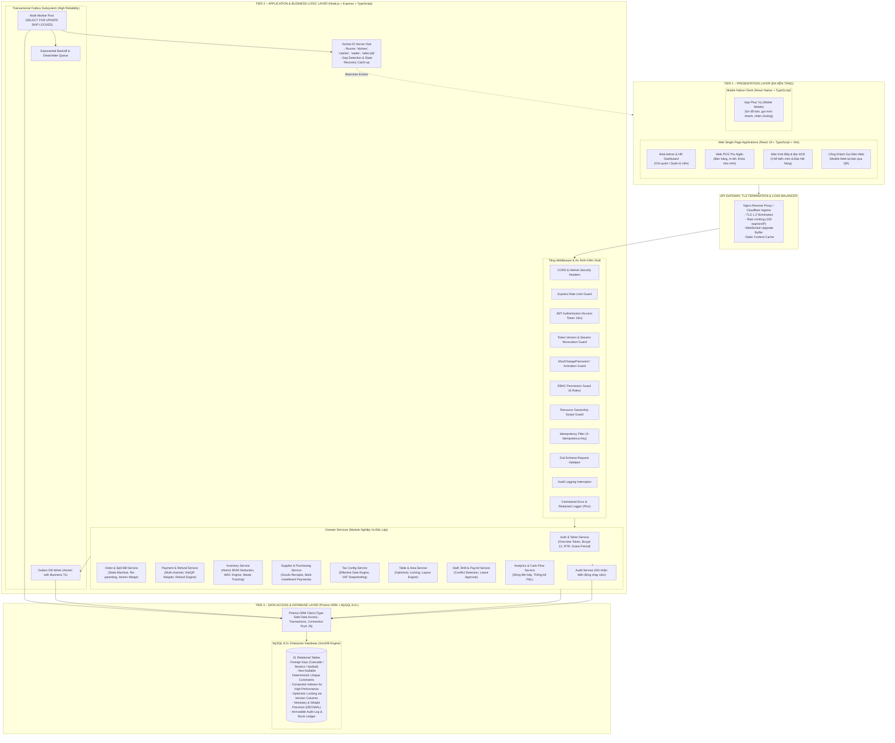
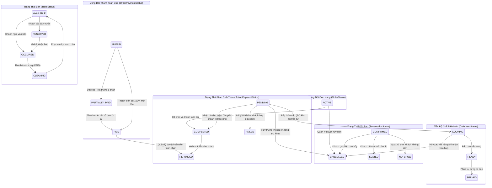
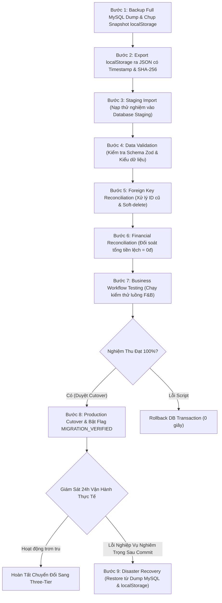
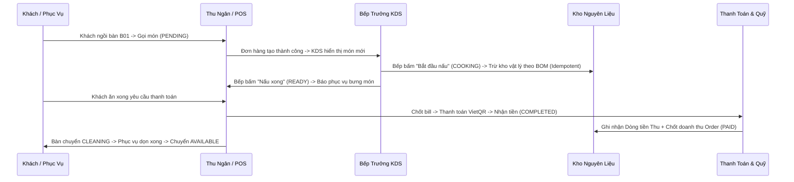
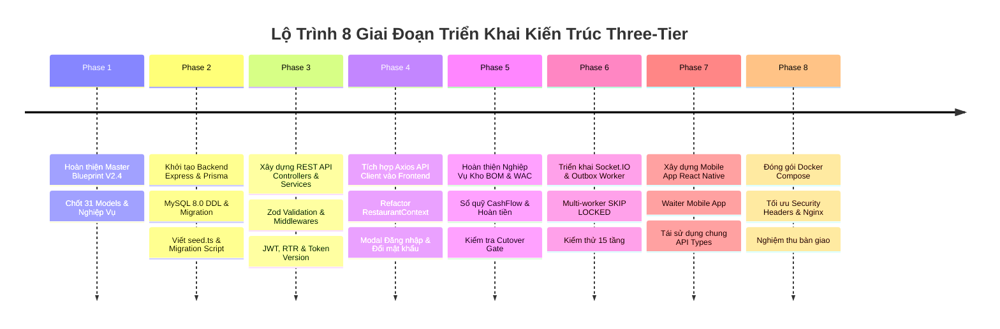

# THIẾT KẾ KIẾN TRÚC MỤC TIÊU VÀ KẾ HOẠCH CHUYỂN ĐỔI TOÀN DIỆN (PHIÊN BẢN 2.4 - MASTER BLUEPRINT)
## DỰ ÁN: RESTAURANT ASIA / QUẢN LÝ NHÀ HÀNG PRO (ENTERPRISE THREE-TIER MASTER BLUEPRINT)

---

| Thông Tin Tài Liệu | Chi Tiết |
| :--- | :--- |
| **Dự án** | Restaurant Asia / Quản Lý Nhà Hàng Pro |
| **Phiên bản tài liệu** | **2.4.0 (Final Enterprise Master Blueprint – Pre-Phase 2)** |
| **Vai trò lập tài liệu** | Senior Software Architect, Database Architect, Senior Backend Engineer, Full-stack Developer, Database Security Engineer & QA Architect |
| **Mục tiêu kỹ thuật** | Hoàn thiện 100% tài liệu thiết kế kiến trúc kỹ thuật cấp doanh nghiệp: Khắc phục triệt để lỗ hổng Unique Constraint kho khi có trường Nullable; Chuẩn hóa Single Source of Truth của Kho và công thức tính giá vốn Bình quân gia quyền liên hoàn (Moving Weighted Average Cost); Phân tách rạch ròi 4 kịch bản hao hụt/hủy món chống trừ kho kép; Nâng cấp Transactional Outbox phân tán (Per-aggregate sequence, MySQL 8.0 `SKIP LOCKED`, Gap detection); Bổ sung hai mô hình thanh toán `PaymentRefund` và `SupplierPayment` cùng mô hình kiểm toán `AuditLog` (Nâng tổng số mô hình lên **31 Models chuẩn hóa đồng bộ 100%**); Đặc tả toàn diện quy trình Thanh toán đa kênh, Tách hóa đơn (Split Bill), Thu hồi phiên xác thực đồng thời (Concurrency, Grace Period, Token Version); Ma trận API RESTful và Chiến lược kiểm thử khép kín. |
| **Trạng thái thực thi** | **HOÀN TẤT THIẾT KẾ V2.4 – CHỜ PHÊ DUYỆT (CHƯA TRIỂN KHAI PHASE 2)** |
| **Quy tắc tuân thủ** | Chỉ lập kế hoạch và hoàn thiện tài liệu thiết kế; không chỉnh sửa mã nguồn ứng dụng, không cài đặt dependencies, không khởi tạo backend, không chạy migration, không can thiệp cơ sở dữ liệu và localStorage |

---

## MỤC LỤC TÀI LIỆU V2.4

1. **TỔNG QUAN ĐIỀU HÀNH & NHẬT KÝ THAY ĐỔI (V2.3 ➔ V2.4)**
2. **KIẾN TRÚC THREE-TIER MỤC TIÊU HOÀN THIỆN (MODULAR MONOLITH)**
3. **DANH MỤC 31 MÔ HÌNH DỮ LIỆU ĐÃ CHUẨN HÓA (DATABASE INVENTORY)**
4. **TỪ ĐIỂN DỮ LIỆU TOÀN DIỆN (COMPLETE DATA DICTIONARY)**
5. **PRISMA SCHEMA HOÀN CHỈNH (`schema.prisma` - 31 MODELS)**
6. **SƠ ĐỒ THỰC THỂ QUAN HỆ TOÀN DIỆN (COMPLETE ERD)**
7. **RÀ SOÁT RÀNG BUỘC KHO, NGUYÊN TẮC KHÔNG NULL & IDEMPOTENCY DÒNG MÓN ĂN**
8. **NGUỒN CHÂN LÝ KHO (SOURCE OF TRUTH) & ĐỊNH GIÁ VỐN BÌNH QUÂN GIA QUYỀN (WAC)**
9. **QUY TRÌNH PHÂN TÁCH 4 LOẠI HAO HỤT, HỦY MÓN & BIẾN ĐỘNG KHO (CHỐNG TRỪ KHO KÉP)**
10. **QUẢN LÝ ĐƠN HÀNG, STATE MACHINE & CHUYỂN BÀN**
11. **THANH TOÁN, TÁCH BILL (SPLIT BILL), HOÀN TIỀN VÀ DÒNG TIỀN (CASH FLOW)**
12. **CẤU HÌNH THUẾ SUẤT VAT LINH HOẠT THEO THỜI GIAN HIỆU LỰC & SNAPSHOT**
13. **AN TOÀN XÁC THỰC, ĐỒNG THỜI (CONCURRENCY) & RBAC TOÀN DIỆN**
14. **ĐẶC TẢ KIẾN TRÚC TRANSACTIONAL OUTBOX PHÂN TÁN ĐỘ TIN CẬY CAO**
15. **QUY TRÌNH DATA MIGRATION AN TOÀN 9 BƯỚC (LOCALSTORAGE ➔ MYSQL)**
16. **ĐẶC TẢ HỆ THỐNG RESTFUL API (API SPECIFICATION)**
17. **CHIẾN LƯỢC KIỂM THỬ TOÀN DIỆN (TESTING STRATEGY & MATRIX)**
18. **ĐÁNH GIÁ RỦI RO KỸ THUẬT (RISK ASSESSMENT)**
19. **LỘ TRÌNH TRIỂN KHAI 8 GIAI ĐOẠN (IMPLEMENTATION ROADMAP)**
20. **DANH MỤC CÁC QUYẾT ĐỊNH ĐÃ THỐNG NHẤT & CÒN BỎ NGỎ (OPEN DECISIONS)**
21. **BẢNG KIỂM TRA NGHIỆM THU CUỐI CÙNG (FINAL ACCEPTANCE CHECKLIST)**

---

## 1. TỔNG QUAN ĐIỀU HÀNH & NHẬT KÝ THAY ĐỔI (V2.3 ➔ V2.4)

Bản tài liệu **V2.4** là kết tinh kỹ thuật sâu sắc nhất từ góc nhìn Kiến trúc phần mềm, Thiết kế cơ sở dữ liệu quan hệ, Kỹ thuật bảo mật và Kiểm soát chất lượng phần mềm F&B. Bản thiết kế này rà soát và lấp đầy toàn bộ các lỗ hổng lý thuyết của các phiên bản tiền nhiệm:

### Bảng đối chiếu nâng cấp kỹ thuật V2.3 ➔ V2.4:

| Hạng Mục Kỹ Thuật | Phiên Bản V2.3 | Phiên Bản V2.4 (Enterprise Master Blueprint) |
| :--- | :--- | :--- |
| **Số lượng Prisma Models** | 29 Models | **31 Models chuẩn hóa đồng bộ 100%**: Bổ sung `PaymentRefund` (Lưu vết hoàn tiền chi tiết) và `SupplierPayment` (Quản lý công nợ và trả góp nhà cung cấp nhiều đợt). |
| **Rủi ro NULL trong Khóa Unique Kho** | `sourceLineId String?` trong `@@unique([sourceType, sourceLineId, ...])` | **Triệt tiêu hoàn toàn rủi ro bypass NULL trên MySQL**: Thiết lập `sourceLineId String @default("NONE")` (NOT NULL). Bổ sung trường bắt buộc `idempotencyKey String @unique` có tiền tố định danh nguồn gốc xác định (`STX:<TYPE>:<LINE_ID>:<ING_ID>:<ACTION>`). |
| **Nguồn Chân Lý Kho (Source of Truth)** | Định nghĩa nguyên tắc chung | **Đặc tả toán học & Chu kỳ đối soát**: `StockTransaction` là Sổ cái bất biến (Append-Only Ledger). `Ingredient.currentStock` là Projection/Cache. Cập nhật nguyên tử trong 1 DB Transaction. Job đối soát định kỳ hàng đêm (Nightly Job) tự động phát hiện lệch tồn kho và ghi cảnh báo đỏ vào `AuditLog`. |
| **Định Giá Vốn Kho (WAC Engine)** | Chỉ định công thức cơ bản | **Đặc tả toán học toàn diện**: Xử lý đầy đủ các ca biên phức tạp: tồn kho đầu kỳ bằng 0, tồn kho âm do xuất khẩn cấp trước khi nhập hóa đơn, quy đổi thứ nguyên từ đơn vị nhập về đơn vị chuẩn (`baseUnit`), làm tròn `Decimal(12, 3)` và `Decimal(14, 2)`. Cấm tuyệt đối kiểu số thực dấu phẩy động (`Float`/`Double`). |
| **Phân Tách Hao Hụt (Anti-Double Deduction)** | 4 kịch bản cơ bản | **Thiết kế ma trận kiểm soát trạng thái**: Chứng minh trên phương diện dữ liệu rằng khi món đã chuyển sang `COOKING`, nguyên liệu đã xuất kho vật lý. Mọi thao tác hủy món ghi nhận `POST_COOKING_WASTE` chỉ hạch toán chi phí giá vốn (COGS Loss), **tuyệt đối không trừ kho vật lý lần thứ hai**. |
| **Quản Lý Hoàn Tiền (Refunds)** | Lưu trực tiếp trên trường `refundedAmount` của `Payment` | **Tách biệt Model `PaymentRefund` chuyên biệt**: Lưu mã hoàn tiền, số tiền hoàn, lý do, người duyệt, phương thức hoàn tiền, mã tham chiếu ngân hàng và trạng thái. Cho phép hoàn tiền nhiều đợt nhưng $\sum \text{Refund} \le \text{Payment.amount}$. Tự động sinh `CashFlowRecord` loại `OUTFLOW`. |
| **Thanh Toán Nhà Cung Cấp (Supplier Payments)** | Gắn liền trong `GoodsReceipt` | **Bổ sung Model `SupplierPayment` độc lập**: Cho phép nhà hàng thanh toán công nợ mua hàng cho nhà cung cấp thành nhiều đợt (Đặt cọc, trả sau Net-30/Net-60). Tự động liên kết và chống tạo trùng dòng tiền chi `CashFlowRecord`. |
| **Quản Lý Tách Hóa Đơn (Split Bill)** | Khuyến nghị chung | **Phân biệt rạch ròi 2 cấp độ**: (1) Split Payment (Chia tiền trên cùng 1 đơn) hỗ trợ 100% ở Phase 2-4; (2) Split Bill theo món (Tách dòng món sang đơn mới) được thiết kế qua dịch vụ chuyển giao nguyên tử (Atomic Re-parenting Transaction), bảo đảm không món nào bị tính tiền 2 lần và tổng tiền các hóa đơn con đối chiếu khớp 100% với đơn gốc. |
| **Transactional Outbox Phân Tán** | Khắc phục auto-increment | **Kiến trúc Per-Aggregate Sequence & Multi-Worker**: Cấp phát `aggregateSequence` nguyên tử theo từng thực thể trong DB Transaction. Áp dụng câu lệnh MySQL 8.0 `SELECT ... FOR UPDATE SKIP LOCKED` cho phép nhiều worker chạy song song an toàn, lease timeout 60s, exponential backoff, client deduplication và Gap Detection gọi API REST khôi phục state. |
| **Xung Đột Đặt Bàn & Ca Trực** | Thuộc tính thời gian dạng chuỗi | **Chuẩn hóa trường DateTime**: `Reservation` có `startTime` và `endTime` rõ ràng, kiểm tra xung đột thời gian bằng khóa dòng `RestaurantTable` trong transaction. `EmployeeSchedule` có `shiftDate`, `startTime`, `endTime`, kiểm tra trùng ca làm việc và trùng lịch nghỉ phép `LeaveRequest`. |

---

## 2. KIẾN TRÚC THREE-TIER MỤC TIÊU HOÀN THIỆN (MODULAR MONOLITH)

Hệ thống được thiết kế theo mô hình **Modular Monolith** chuẩn doanh nghiệp: Đóng gói toàn bộ logic nghiệp vụ trong một Backend duy nhất nhưng phân chia thành các Domain Modules tách biệt hoàn toàn về mặt logic, sẵn sàng tách thành Microservices trong tương lai nếu quy mô chuỗi nhà hàng mở rộng vượt bậc.



---

## 3. DANH MỤC 31 MÔ HÌNH DỮ LIỆU ĐÃ CHUẨN HÓA (DATABASE INVENTORY)

Dưới đây là danh mục chính xác **31 Models** tương ứng 31 bảng MySQL (InnoDB Engine), không trùng lặp và liên kết chặt chẽ:

| STT | Tên Model Prisma | Tên Bảng MySQL | Phân Hệ Nghiệp Vụ | Vai Trò & Trách Nhiệm Nghiệp Vụ |
| :---: | :--- | :--- | :--- | :--- |
| **1** | `Role` | `roles` | Xác thực & RBAC | Định nghĩa 6 nhóm quyền hệ thống (`ADMIN`, `CASHIER`, `KITCHEN`, `WAITER`, `HR_MANAGER`, `CUSTOMER`). |
| **2** | `User` | `users` | Xác thực & RBAC | Tài khoản người dùng, mật khẩu Bcrypt 12, `tokenVersion`, cờ `mustChangePassword`, `isActivated`. |
| **3** | `RefreshToken` | `refresh_tokens` | Xác thực & Phiên | Quản lý phiên làm việc với Refresh Token Rotation (RTR), Grace Period 30s và Family Revocation. |
| **4** | `PasswordResetToken` | `password_reset_tokens` | An toàn Xác thực | Token dùng 1 lần (băm SHA-256) kích hoạt tài khoản migration và reset mật khẩu an toàn. |
| **5** | `AuditLog` | `audit_logs` | Kiểm toán Hệ thống | Nhật ký vết kiểm toán bất biến cho mọi thao tác nhạy cảm (đổi giá, đổi BOM, can thiệp kho, hoàn tiền). |
| **6** | `Employee` | `employees` | Nhân sự & Lương | Hồ sơ nhân viên, loại lương (tháng/giờ), mức lương, liên kết tài khoản `User`. |
| **7** | `EmployeeSchedule` | `employee_schedules` | Ca trực Nhân sự | Lịch phân ca chi tiết (`shiftDate`, `startTime`, `endTime`), kiểm tra trùng ca làm việc. |
| **8** | `LeaveRequest` | `leave_requests` | Nhân sự | Đơn xin nghỉ phép (phép năm, ốm, việc riêng), phê duyệt bởi Quản lý/Admin, đối soát lịch trực. |
| **9** | `Customer` | `customers` | Khách hàng & CRM | Hồ sơ khách hàng CRM, số điện thoại định danh duy nhất, điểm tích lũy, tổng chi tiêu. |
| **10** | `TableArea` | `table_areas` | Mặt bằng Bàn ăn | Khu vực tầng/phòng (Tầng 1, Tầng 2, Sân vườn, Phòng VIP). |
| **11** | `RestaurantTable` | `tables` | Mặt bằng Bàn ăn | Chi tiết bàn ăn: tên, sức chứa, tọa độ đồ họa `(posX, posY)`, cờ khóa lạc quan `version`. |
| **12** | `Reservation` | `reservations` | Đặt bàn trước | Lịch hẹn đặt bàn có `startTime`, `endTime`, kiểm tra xung đột chồng lấn bàn qua khóa dòng. |
| **13** | `Category` | `categories` | Thực đơn Menu | Nhóm danh mục món ăn (Khai vị, Món chính, Lẩu & Nướng, Tráng miệng, Đồ uống). |
| **14** | `MenuItem` | `menu_items` | Thực đơn Menu | Món ăn: giá bán, giá vốn, hình ảnh, cờ soft-delete `isDeleted`, cờ hiển thị `isAvailable`. |
| **15** | `Ingredient` | `ingredients` | Quản lý Kho | Danh mục nguyên vật liệu: đơn vị chuẩn (`baseUnit`), tồn kho hiện tại (Projection Cache), giá vốn WAC. |
| **16** | `UnitConversion` | `unit_conversions` | Quản lý Kho | Tỷ lệ quy đổi đơn vị đo lường (1 kg = 1.000 g, 1 két = 24 lon) khi nhập hàng. |
| **17** | `Recipe` | `recipes` | Định mức BOM | Định mức kỹ thuật cấu thành món ăn (BOM): lượng nguyên liệu tiêu hao cho 1 đơn vị món ăn. |
| **18** | `TaxConfig` | `tax_configs` | Cấu hình Thuế VAT | Cấu hình thuế suất VAT linh hoạt theo khoảng thời gian hiệu lực và phân nhóm món. |
| **19** | `Order` | `orders` | Đơn hàng & POS | Hóa đơn bán hàng: tổng tiền, chiết khấu, VAT snapshot, mã `#HD-xxxx`, trạng thái đơn, cờ `version`. |
| **20** | `OrderItem` | `order_items` | Đơn hàng & POS | Chi tiết món trong đơn: giá snapshot, thuế snapshot, trạng thái KDS, cờ trừ kho `isStockDeducted`. |
| **21** | `Payment` | `payments` | Thanh toán | Nhật ký giao dịch thanh toán (hỗ trợ chia bill, thanh toán từng phần, đa phương thức). |
| **22** | `PaymentRefund` | `payment_refunds` | **Thanh toán (Mới V2.4)** | Lưu chi tiết từng lần hoàn tiền cho Payment (mã hoàn, số tiền, lý do, người duyệt, phương thức). |
| **23** | `Supplier` | `suppliers` | Nhập kho | Thông tin đối tác cung cấp nguyên vật liệu, liên hệ và công nợ. |
| **24** | `GoodsReceipt` | `goods_receipts` | Nhập kho | Phiếu nhập kho nguyên liệu từ nhà cung cấp, tổng giá trị nhập, trạng thái công nợ. |
| **25** | `GoodsReceiptItem` | `goods_receipt_items` | Nhập kho | Chi tiết số lượng, đơn vị nhập, đơn giá và thành tiền từng nguyên liệu trên phiếu nhập. |
| **26** | `SupplierPayment` | `supplier_payments` | **Nhập kho (Mới V2.4)** | Nhật ký thanh toán công nợ nhà cung cấp theo từng đợt, gắn với phiếu nhập và sổ quỹ chi. |
| **27** | `StockTransaction` | `stock_transactions` | Sổ cái Kho | Sổ cái biến động kho bất biến (Immutable Ledger) có Unique Constraint không-NULL chống trừ lặp. |
| **28** | `CashFlowRecord` | `cash_flow_records` | Tài chính & Quỹ | Sổ quỹ theo dõi thu chi tiền mặt và ngân hàng (hạch toán tự động từ bán hàng, hoàn tiền, nhập hàng). |
| **29** | `ServiceRequest` | `service_requests` | Phục vụ bàn | Chuông gọi phục vụ từ thực khách qua web (xin nước đá, khăn lạnh, thanh toán, dọn bàn). |
| **30** | `OutboxEvent` | `outbox_events` | Hệ thống Real-time | Bảng lưu sự kiện giao dịch kèm `aggregateSequence`, phục vụ Socket.IO và khôi phục state. |
| **31** | `IdempotencyRecord` | `idempotency_records` | Hạ tầng Hệ thống | Bảng lưu khóa `X-Idempotency-Key` ngăn chặn gửi trùng request từ client. |

---

## 4. TỪ ĐIỂN DỮ LIỆU TOÀN DIỆN (COMPLETE DATA DICTIONARY)

Dưới đây là từ điển đặc tả chi tiết 31 mô hình dữ liệu trong hệ thống:

### 4.1. Bảng `payment_refunds` (Hoàn tiền hóa đơn - Mới V2.4)
* `id` (VARCHAR(36), PK): UUID v4 duy nhất.
* `refund_code` (VARCHAR(50), UNIQUE, NOT NULL): Mã chứng từ hoàn tiền (vd: `#REF-1001`).
* `payment_id` (VARCHAR(36), FK -> `payments.id` ON DELETE RESTRICT, NOT NULL): Thuộc giao dịch thanh toán nào.
* `order_id` (VARCHAR(36), FK -> `orders.id` ON DELETE RESTRICT, NOT NULL): Đơn hàng liên quan.
* `amount` (DECIMAL(12, 2), NOT NULL): Số tiền hoàn trả (Bắt buộc > 0).
* `reason` (VARCHAR(255), NOT NULL): Lý do hoàn tiền (Khách đổi món, tính nhầm tiền, hủy đơn đặc biệt).
* `refund_method` (ENUM('CASH', 'VIETQR', 'TRANSFER', 'CARD'), NOT NULL): Phương thức hoàn trả thực tế.
* `refund_status` (ENUM('PENDING', 'COMPLETED', 'FAILED'), NOT NULL, DEFAULT 'COMPLETED').
* `processed_by_id` (VARCHAR(36), FK -> `users.id` ON DELETE RESTRICT, NOT NULL): Quản lý/Thu ngân thực hiện.
* `reference_code` (VARCHAR(100), NULL): Mã giao dịch ngân hàng khi chuyển khoản trả lại khách.
* `idempotency_key` (VARCHAR(100), UNIQUE, NULL): Khóa chống gửi lặp lệnh hoàn tiền.
* `created_at` (DATETIME, NOT NULL, DEFAULT CURRENT_TIMESTAMP).
* `completed_at` (DATETIME, NULL): Thời điểm hoàn tất hoàn tiền thực tế.

### 4.2. Bảng `supplier_payments` (Thanh toán công nợ Nhà cung cấp - Mới V2.4)
* `id` (VARCHAR(36), PK): UUID v4 duy nhất.
* `payment_code` (VARCHAR(50), UNIQUE, NOT NULL): Mã phiếu chi thanh toán NCC (vd: `#SPAY-2001`).
* `receipt_id` (VARCHAR(36), FK -> `goods_receipts.id` ON DELETE RESTRICT, NOT NULL): Phiếu nhập kho tương ứng.
* `supplier_id` (VARCHAR(36), FK -> `suppliers.id` ON DELETE RESTRICT, NOT NULL): Nhà cung cấp nhận tiền.
* `amount` (DECIMAL(14, 2), NOT NULL): Số tiền chi trả trong đợt này.
* `payment_method` (ENUM('CASH', 'TRANSFER'), NOT NULL, DEFAULT 'TRANSFER'): Phương thức thanh toán.
* `reference_code` (VARCHAR(100), NULL): Mã ủy nhiệm chi ngân hàng.
* `notes` (VARCHAR(255), NULL): Ghi chú đợt thanh toán (vd: "Thanh toán đợt 1 50% tiền thịt bò").
* `idempotency_key` (VARCHAR(100), UNIQUE, NULL): Khóa chống trùng lặp phiếu chi.
* `processed_by_id` (VARCHAR(36), FK -> `users.id` ON DELETE RESTRICT, NOT NULL): Thủ quỹ/Kế toán thực hiện.
* `paid_at` (DATETIME, NOT NULL, DEFAULT CURRENT_TIMESTAMP): Thời điểm chi tiền thực tế.
* `created_at` (DATETIME, NOT NULL, DEFAULT CURRENT_TIMESTAMP).

### 4.3. Bảng `stock_transactions` (Sổ cái biến động kho - Đã triệt tiêu rủi ro NULL)
* `id` (VARCHAR(36), PK): UUID v4 duy nhất.
* `ingredient_id` (VARCHAR(36), FK -> `ingredients.id` ON DELETE RESTRICT, NOT NULL): Nguyên liệu biến động.
* `transaction_type` (ENUM('GOODS_RECEIPT', 'ORDER_CONSUMPTION', 'ORDER_CANCELLATION_RETURN', 'STOCK_TAKE_ADJUSTMENT', 'WASTE_DAMAGE', 'SUPPLIER_RETURN'), NOT NULL): Loại giao dịch kho.
* `quantity` (DECIMAL(12, 3), NOT NULL): Số lượng biến động theo đơn vị chuẩn `baseUnit` (dương: tăng, âm: giảm).
* `balance_after` (DECIMAL(12, 3), NOT NULL): Số dư tồn kho tức thời ngay sau biến động.
* `cost_per_unit` (DECIMAL(12, 2), NOT NULL, DEFAULT 0.00): Giá vốn đơn vị cơ sở áp dụng (theo chuẩn WAC).
* `total_cost` (DECIMAL(14, 2), NOT NULL, DEFAULT 0.00): Tổng giá trị vốn của giao dịch ($|\text{quantity}| \times \text{cost\_per\_unit}$).
* `source_type` (VARCHAR(50), NOT NULL): Nguồn phát sinh (`'ORDER_ITEM'`, `'GOODS_RECEIPT_ITEM'`, `'MANUAL_ADJUSTMENT'`).
* `source_id` (VARCHAR(50), NOT NULL): Định danh bản ghi cấp 1 (`order_id`, `receipt_id`, `audit_id`).
* `source_line_id` (VARCHAR(50), NOT NULL, DEFAULT 'NONE'): **Bắt buộc NOT NULL để bảo đảm tính toàn vẹn của Khóa Unique trên MySQL**. Mang giá trị `order_item_id`, `receipt_item_id` hoặc `'NONE'`.
* `idempotency_key` (VARCHAR(100), UNIQUE, NOT NULL): **Khóa định danh tất định duy nhất (Deterministic Key)**:
  `STX:<source_type>:<source_line_id>:<ingredient_id>:<transaction_type>`.
* `notes` (VARCHAR(255), NULL): Diễn giải nguyên nhân biến động.
* `created_by_id` (VARCHAR(36), FK -> `users.id` ON DELETE RESTRICT, NOT NULL): Người thực hiện/Đầu bếp.
* `created_at` (DATETIME, NOT NULL, DEFAULT CURRENT_TIMESTAMP).
* **Ràng buộc duy nhất nghiệp vụ (Composite Unique Constraint):**
  `UNIQUE(source_type, source_id, source_line_id, ingredient_id, transaction_type)`
  Đảm bảo một món ăn trừ 5 nguyên liệu độc lập trong 1 đơn hàng mà không bị chặn, nhưng không bao giờ trừ trùng cùng một nguyên liệu cho cùng một dòng gọi món.

### 4.4. Bảng `cash_flow_records` (Sổ quỹ tiền mặt & Ngân hàng - Đã gắn khóa liên kết duy nhất)
* `id` (VARCHAR(36), PK): UUID v4.
* `type` (ENUM('INFLOW', 'OUTFLOW'), NOT NULL): Chiều dòng tiền.
* `category` (ENUM('REVENUE_ORDER', 'GOODS_PURCHASE', 'STAFF_SALARY', 'UTILITIES', 'MARKETING', 'REFUND', 'OTHER'), NOT NULL).
* `title` (VARCHAR(255), NOT NULL): Tiêu đề bút toán thu chi.
* `amount` (DECIMAL(14, 2), NOT NULL): Số tiền thực thu/thực chi.
* `method` (ENUM('CASH', 'VIETQR', 'TRANSFER', 'CARD'), NOT NULL, DEFAULT 'CASH').
* `payment_id` (VARCHAR(36), UNIQUE, NULL): Liên kết 1-1 với giao dịch thanh toán bán hàng (Chống ghi nhận thu trùng).
* `refund_id` (VARCHAR(36), UNIQUE, NULL): Liên kết 1-1 với giao dịch hoàn tiền khách hàng (Chống ghi nhận chi trùng).
* `supplier_payment_id` (VARCHAR(36), UNIQUE, NULL): Liên kết 1-1 với phiếu chi nhà cung cấp (Chống ghi nhận chi trùng).
* `reference_code` (VARCHAR(100), NULL): Mã giao dịch ngân hàng đối soát.
* `notes` (VARCHAR(255), NULL): Diễn giải chi tiết.
* `created_by_id` (VARCHAR(36), FK -> `users.id` ON DELETE RESTRICT, NOT NULL): Thủ quỹ thực hiện.
* `created_at` (DATETIME, NOT NULL, DEFAULT CURRENT_TIMESTAMP).
* `updated_at` (DATETIME, NOT NULL, ON UPDATE CURRENT_TIMESTAMP).

### 4.5. Bảng `reservations` (Đặt bàn trước - Chuẩn hóa khoảng thời gian)
* `id` (VARCHAR(36), PK): UUID v4.
* `table_id` (VARCHAR(36), FK -> `tables.id` ON DELETE RESTRICT, NOT NULL): Bàn được đặt.
* `customer_id` (VARCHAR(36), FK -> `customers.id` ON DELETE SET NULL, NULL): Khách hàng quen.
* `customer_name` (VARCHAR(100), NOT NULL): Tên khách đặt.
* `phone` (VARCHAR(20), NOT NULL): Số điện thoại liên hệ.
* `guest_count` (INT, NOT NULL, DEFAULT 2): Số lượng khách dự kiến.
* `start_time` (DATETIME, NOT NULL): Thời điểm bắt đầu nhận bàn.
* `end_time` (DATETIME, NOT NULL): Thời điểm dự kiến kết thúc bữa ăn (Mặc định: `start_time + 2 giờ`).
* `customer_type` (ENUM('WALK_IN', 'REGULAR', 'VIP', 'GROUP'), NOT NULL, DEFAULT 'REGULAR').
* `status` (ENUM('CONFIRMED', 'SEATED', 'CANCELLED', 'NO_SHOW'), NOT NULL, DEFAULT 'CONFIRMED').
* `notes` (VARCHAR(255), NULL): Yêu cầu riêng (Ghế trẻ em, hoa trang trí).
* `created_by_id` (VARCHAR(36), FK -> `users.id` ON DELETE RESTRICT, NOT NULL): Nhân viên tiếp nhận.
* `created_at` (DATETIME, NOT NULL, DEFAULT CURRENT_TIMESTAMP).
* `updated_at` (DATETIME, NOT NULL, ON UPDATE CURRENT_TIMESTAMP).

### 4.6. Bảng `employee_schedules` (Phân ca trực nhân sự - Chuẩn hóa thời gian)
* `id` (VARCHAR(36), PK): UUID v4.
* `employee_id` (VARCHAR(36), FK -> `employees.id` ON DELETE CASCADE, NOT NULL): Nhân viên được phân ca.
* `shift_date` (DATE, NOT NULL): Ngày làm việc trong tuần.
* `shift_name` (VARCHAR(50), NOT NULL): Tên ca (Ca Sáng, Ca Chiều, Ca Tối, Full-day).
* `start_time` (DATETIME, NOT NULL): Giờ bắt đầu ca làm việc chính xác.
* `end_time` (DATETIME, NOT NULL): Giờ kết thúc ca làm việc chính xác.
* `is_attended` (BOOLEAN, NOT NULL, DEFAULT FALSE): Trạng thái điểm danh thực tế.
* `check_in_at` (DATETIME, NULL): Giờ chấm công vào thực tế.
* `check_out_at` (DATETIME, NULL): Giờ chấm công ra thực tế.
* `created_at` (DATETIME, NOT NULL, DEFAULT CURRENT_TIMESTAMP).
* `updated_at` (DATETIME, NOT NULL, ON UPDATE CURRENT_TIMESTAMP).

---

## 5. PRISMA SCHEMA HOÀN CHỈNH (`schema.prisma` - 31 MODELS)

```prisma
datasource db {
  provider = "mysql"
  url      = env("DATABASE_URL")
}

generator client {
  provider = "prisma-client-js"
}

// ==========================================================
// 1. PHÂN QUYỀN, TÀI KHOẢN, PHIÊN & KIỂM TOÁN HỆ THỐNG
// ==========================================================

enum RoleName {
  ADMIN
  CASHIER
  KITCHEN
  WAITER
  HR_MANAGER
  CUSTOMER
}

model Role {
  id          String    @id @default(uuid()) @db.VarChar(36)
  name        RoleName  @unique
  title       String    @db.VarChar(50)
  description String?   @db.VarChar(255)
  users       User[]

  @@map("roles")
}

model User {
  id                 String             @id @default(uuid()) @db.VarChar(36)
  username           String             @unique @db.VarChar(50)
  passwordHash       String             @db.VarChar(255) @map("password_hash")
  roleId             String             @db.VarChar(36) @map("role_id")
  role               Role               @relation(fields: [roleId], references: [id])
  fullName           String             @db.VarChar(100) @map("full_name")
  phone              String?            @db.VarChar(20)
  avatar             String?            @db.VarChar(500)
  isActive           Boolean            @default(true) @map("is_active")
  isActivated        Boolean            @default(false) @map("is_activated")
  mustChangePassword Boolean            @default(true) @map("must_change_password")
  tokenVersion       Int                @default(0) @map("token_version")
  lastLoginAt        DateTime?          @map("last_login_at")
  createdAt          DateTime           @default(now()) @map("created_at")
  updatedAt          DateTime           @updatedAt @map("updated_at")

  employee           Employee?
  customer           Customer?
  refreshTokens      RefreshToken[]
  resetTokens        PasswordResetToken[]
  goodsReceipts      GoodsReceipt[]
  cashFlowRecords    CashFlowRecord[]
  approvedLeaves     LeaveRequest[]     @relation("ApprovedBy")
  stockTransactions  StockTransaction[]
  processedPayments  Payment[]
  processedRefunds   PaymentRefund[]
  supplierPayments   SupplierPayment[]
  bookedReservations Reservation[]      @relation("BookedByUser")
  auditLogs          AuditLog[]

  @@index([roleId])
  @@map("users")
}

model RefreshToken {
  id          String   @id @default(uuid()) @db.VarChar(36)
  tokenHash   String   @unique @db.VarChar(255) @map("token_hash")
  userId      String   @db.VarChar(36) @map("user_id")
  user        User     @relation(fields: [userId], references: [id], onDelete: Cascade)
  family      String   @db.VarChar(36)
  isRevoked   Boolean  @default(false) @map("is_revoked")
  expiresAt   DateTime @map("expires_at")
  createdAt   DateTime @default(now()) @map("created_at")

  @@index([userId])
  @@index([family])
  @@map("refresh_tokens")
}

enum TokenType {
  ACTIVATION
  PASSWORD_RESET
}

model PasswordResetToken {
  id        String    @id @default(uuid()) @db.VarChar(36)
  tokenHash String    @unique @db.VarChar(64) @map("token_hash")
  userId    String    @db.VarChar(36) @map("user_id")
  user      User      @relation(fields: [userId], references: [id], onDelete: Cascade)
  tokenType TokenType @map("token_type")
  expiresAt DateTime  @map("expires_at")
  usedAt    DateTime? @map("used_at")
  ipAddress String?   @db.VarChar(45) @map("ip_address")
  createdAt DateTime  @default(now()) @map("created_at")

  @@index([userId])
  @@index([tokenHash])
  @@map("password_reset_tokens")
}

model AuditLog {
  id         String   @id @default(uuid()) @db.VarChar(36)
  userId     String?  @db.VarChar(36) @map("user_id")
  user       User?    @relation(fields: [userId], references: [id], onDelete: SetNull)
  action     String   @db.VarChar(100)
  entityName String   @db.VarChar(50) @map("entity_name")
  entityId   String   @db.VarChar(50) @map("entity_id")
  oldValues  Json?    @map("old_values")
  newValues  Json?    @map("new_values")
  ipAddress  String?  @db.VarChar(45) @map("ip_address")
  userAgent  String?  @db.VarChar(255) @map("user_agent")
  createdAt  DateTime @default(now()) @map("created_at")

  @@index([action])
  @@index([entityName, entityId])
  @@index([createdAt])
  @@map("audit_logs")
}

// ==========================================================
// 2. NHÂN SỰ, CA TRỰC & NGHỈ PHÉP
// ==========================================================

enum SalaryType {
  MONTHLY
  HOURLY
}

enum EmployeeStatus {
  ACTIVE
  ON_BREAK
  OFF
}

model Employee {
  id             String             @id @default(uuid()) @db.VarChar(36)
  userId         String?            @unique @db.VarChar(36) @map("user_id")
  user           User?              @relation(fields: [userId], references: [id], onDelete: SetNull)
  name           String             @db.VarChar(100)
  phone          String             @db.VarChar(20)
  email          String?            @db.VarChar(100)
  roleTitle      String             @db.VarChar(50) @map("role_title")
  shiftDefault   String?            @db.VarChar(50) @map("shift_default")
  salaryRate     Decimal            @default(0) @db.Decimal(12, 2) @map("salary_rate")
  salaryType     SalaryType         @default(MONTHLY) @map("salary_type")
  status         EmployeeStatus     @default(ACTIVE)
  joinDate       DateTime           @default(now()) @map("join_date")
  ordersHandled  Int                @default(0) @map("orders_handled")
  createdAt      DateTime           @default(now()) @map("created_at")
  updatedAt      DateTime           @updatedAt @map("updated_at")

  schedules      EmployeeSchedule[]
  leaveRequests  LeaveRequest[]     @relation("StaffLeaves")
  servedOrders   Order[]            @relation("ServedByEmployee")
  assignedCalls  ServiceRequest[]

  @@map("employees")
}

model EmployeeSchedule {
  id          String    @id @default(uuid()) @db.VarChar(36)
  employeeId  String    @db.VarChar(36) @map("employee_id")
  employee    Employee  @relation(fields: [employeeId], references: [id], onDelete: Cascade)
  shiftDate   DateTime  @db.Date @map("shift_date")
  shiftName   String    @db.VarChar(50) @map("shift_name")
  startTime   DateTime  @map("start_time")
  endTime     DateTime  @map("end_time")
  isAttended  Boolean   @default(false) @map("is_attended")
  checkInAt   DateTime? @map("check_in_at")
  checkOutAt  DateTime? @map("check_out_at")
  createdAt   DateTime  @default(now()) @map("created_at")
  updatedAt   DateTime  @updatedAt @map("updated_at")

  @@index([employeeId])
  @@index([shiftDate])
  @@index([startTime, endTime])
  @@map("employee_schedules")
}

enum LeaveStatus {
  ACTIVE
  UPCOMING
  COMPLETED
  CANCELLED
}

enum LeaveType {
  ANNUAL
  SICK
  FAMILY
  COMPENSATORY
}

model LeaveRequest {
  id           String      @id @default(uuid()) @db.VarChar(36)
  employeeId   String      @db.VarChar(36) @map("employee_id")
  employee     Employee    @relation("StaffLeaves", fields: [employeeId], references: [id], onDelete: Cascade)
  startDate    DateTime    @db.Date @map("start_date")
  endDate      DateTime    @db.Date @map("end_date")
  status       LeaveStatus @default(UPCOMING)
  leaveType    LeaveType   @default(ANNUAL) @map("leave_type")
  reason       String      @db.VarChar(255)
  approvedById String?     @db.VarChar(36) @map("approved_by_id")
  approvedBy   User?       @relation("ApprovedBy", fields: [approvedById], references: [id])
  createdAt    DateTime    @default(now()) @map("created_at")
  updatedAt    DateTime    @updatedAt @map("updated_at")

  @@index([employeeId])
  @@map("leave_requests")
}

// ==========================================================
// 3. KHÁCH HÀNG CRM
// ==========================================================

enum CustomerType {
  WALK_IN
  REGULAR
  VIP
  GROUP
}

model Customer {
  id            String        @id @default(uuid()) @db.VarChar(36)
  userId        String?       @unique @db.VarChar(36) @map("user_id")
  user          User?         @relation(fields: [userId], references: [id], onDelete: SetNull)
  fullName      String        @db.VarChar(100) @map("full_name")
  phone         String        @unique @db.VarChar(20)
  email         String?       @db.VarChar(100)
  customerType  CustomerType  @default(WALK_IN) @map("customer_type")
  loyaltyPoints Int           @default(0) @map("loyalty_points")
  totalSpent    Decimal       @default(0) @db.Decimal(14, 2) @map("total_spent")
  createdAt     DateTime      @default(now()) @map("created_at")
  updatedAt     DateTime      @updatedAt @map("updated_at")

  orders        Order[]
  reservations  Reservation[]

  @@map("customers")
}

// ==========================================================
// 4. MẶT BẰNG, KHU VỰC, BÀN ĂN & ĐẶT BÀN
// ==========================================================

model TableArea {
  id           String            @id @default(uuid()) @db.VarChar(36)
  name         String            @unique @db.VarChar(100)
  description  String?           @db.VarChar(255)
  displayOrder Int               @default(0) @map("display_order")
  createdAt    DateTime          @default(now()) @map("created_at")
  updatedAt    DateTime          @updatedAt @map("updated_at")
  tables       RestaurantTable[]

  @@map("table_areas")
}

enum TableShape {
  ROUND
  SQUARE
  RECTANGLE
}

enum TableStatus {
  AVAILABLE
  OCCUPIED
  RESERVED
  CLEANING
}

model RestaurantTable {
  id            String          @id @default(uuid()) @db.VarChar(36)
  name          String          @db.VarChar(50)
  areaId        String          @db.VarChar(36) @map("area_id")
  area          TableArea       @relation(fields: [areaId], references: [id], onDelete: Restrict)
  capacity      Int             @default(4)
  shape         TableShape      @default(SQUARE)
  status        TableStatus     @default(AVAILABLE)
  posX          Float           @default(0) @map("pos_x")
  posY          Float           @default(0) @map("pos_y")
  width         Float           @default(90)
  height        Float           @default(90)
  occupiedSince DateTime?       @map("occupied_since")
  customerType  CustomerType?   @map("customer_type")
  version       Int             @default(0) // Khóa lạc quan chống race condition
  createdAt     DateTime        @default(now()) @map("created_at")
  updatedAt     DateTime        @updatedAt @map("updated_at")

  orders        Order[]
  reservations  Reservation[]
  serviceCalls  ServiceRequest[]

  @@index([areaId])
  @@index([status])
  @@map("tables")
}

enum ReservationStatus {
  CONFIRMED
  SEATED
  CANCELLED
  NO_SHOW
}

model Reservation {
  id           String            @id @default(uuid()) @db.VarChar(36)
  tableId      String            @db.VarChar(36) @map("table_id")
  table        RestaurantTable   @relation(fields: [tableId], references: [id], onDelete: Restrict)
  customerId   String?           @db.VarChar(36) @map("customer_id")
  customer     Customer?         @relation(fields: [customerId], references: [id], onDelete: SetNull)
  customerName String            @db.VarChar(100) @map("customer_name")
  phone        String            @db.VarChar(20)
  guestCount   Int               @default(2) @map("guest_count")
  startTime    DateTime          @map("start_time")
  endTime      DateTime          @map("end_time")
  customerType CustomerType      @default(REGULAR) @map("customer_type")
  status       ReservationStatus @default(CONFIRMED)
  notes        String?           @db.VarChar(255)
  createdById  String            @db.VarChar(36) @map("created_by_id")
  createdBy    User              @relation("BookedByUser", fields: [createdById], references: [id], onDelete: Restrict)
  createdAt    DateTime          @default(now()) @map("created_at")
  updatedAt    DateTime          @updatedAt @map("updated_at")

  @@index([tableId])
  @@index([startTime, endTime])
  @@index([status])
  @@map("reservations")
}

// ==========================================================
// 5. THỰC ĐƠN, MÓN ĂN, ĐỊNH MỨC NGUYÊN LIỆU (BOM) & CẤU HÌNH THUẾ
// ==========================================================

model Category {
  id           String      @id @default(uuid()) @db.VarChar(36)
  name         String      @unique @db.VarChar(100)
  displayOrder Int         @default(0) @map("display_order")
  isActive     Boolean     @default(true) @map("is_active")
  createdAt    DateTime    @default(now()) @map("created_at")
  updatedAt    DateTime    @updatedAt @map("updated_at")

  menuItems    MenuItem[]
  taxConfigs   TaxConfig[]

  @@map("categories")
}

model MenuItem {
  id              String      @id @default(uuid()) @db.VarChar(36)
  categoryId      String      @db.VarChar(36) @map("category_id")
  category        Category    @relation(fields: [categoryId], references: [id], onDelete: Restrict)
  name            String      @db.VarChar(150)
  price           Decimal     @db.Decimal(12, 2)
  costPrice       Decimal     @default(0) @db.Decimal(12, 2) @map("cost_price")
  unit            String      @default("phần") @db.VarChar(20)
  description     String?     @db.Text
  image           String?     @db.VarChar(500)
  isAvailable     Boolean     @default(true) @map("is_available")
  isDeleted       Boolean     @default(false) @map("is_deleted") // Soft-delete
  prepTimeMinutes Int         @default(15) @map("prep_time_minutes")
  spicyLevel      Int         @default(0) @map("spicy_level")
  tags            String?     @db.VarChar(255)
  isPopular       Boolean     @default(false) @map("is_popular")
  taxRateOverride Decimal?    @db.Decimal(5, 2) @map("tax_rate_override")
  createdAt       DateTime    @default(now()) @map("created_at")
  updatedAt       DateTime    @updatedAt @map("updated_at")

  orderItems      OrderItem[]
  recipes         Recipe[]

  @@index([categoryId])
  @@index([isAvailable])
  @@index([isDeleted])
  @@map("menu_items")
}

model Ingredient {
  id                 String             @id @default(uuid()) @db.VarChar(36)
  name               String             @unique @db.VarChar(150)
  category           String             @db.VarChar(100)
  baseUnit           String             @db.VarChar(20)  @map("base_unit") // 'g', 'ml', 'unit'
  currentStock       Decimal            @default(0) @db.Decimal(12, 3) @map("current_stock") // Projection Cache
  minStockLevel      Decimal            @default(5) @db.Decimal(12, 3) @map("min_stock_level")
  costPerUnit        Decimal            @default(0) @db.Decimal(12, 2) @map("cost_per_unit") // WAC Unit Cost
  allowNegativeStock Boolean            @default(false) @map("allow_negative_stock")
  createdAt          DateTime           @default(now()) @map("created_at")
  updatedAt          DateTime           @updatedAt @map("updated_at")

  recipes            Recipe[]
  receiptItems       GoodsReceiptItem[]
  stockHistory       StockTransaction[]
  unitConversions    UnitConversion[]

  @@map("ingredients")
}

model UnitConversion {
  id             String     @id @default(uuid()) @db.VarChar(36)
  ingredientId   String     @db.VarChar(36) @map("ingredient_id")
  ingredient     Ingredient @relation(fields: [ingredientId], references: [id], onDelete: Cascade)
  fromUnit       String     @db.VarChar(20) @map("from_unit") // 'kg', 'két', 'thùng'
  toUnit         String     @db.VarChar(20) @map("to_unit")   // Đơn vị chuẩn: 'g', 'lon', 'chai'
  conversionRate Decimal    @db.Decimal(10, 4) @map("conversion_rate")
  createdAt      DateTime   @default(now()) @map("created_at")
  updatedAt      DateTime   @updatedAt @map("updated_at")

  @@unique([ingredientId, fromUnit])
  @@map("unit_conversions")
}

model Recipe {
  id               String     @id @default(uuid()) @db.VarChar(36)
  menuItemId       String     @db.VarChar(36) @map("menu_item_id")
  menuItem         MenuItem   @relation(fields: [menuItemId], references: [id], onDelete: Cascade)
  ingredientId     String     @db.VarChar(36) @map("ingredient_id")
  ingredient       Ingredient @relation(fields: [ingredientId], references: [id], onDelete: Restrict)
  quantityRequired Decimal    @db.Decimal(10, 3) @map("quantity_required")
  unit             String     @db.VarChar(20)
  createdAt        DateTime   @default(now()) @map("created_at")
  updatedAt        DateTime   @updatedAt @map("updated_at")

  @@unique([menuItemId, ingredientId])
  @@map("recipes")
}

model TaxConfig {
  id            String    @id @default(uuid()) @db.VarChar(36)
  code          String    @unique @db.VarChar(50)
  name          String    @db.VarChar(100)
  rate          Decimal   @db.Decimal(5, 2)
  effectiveFrom DateTime  @map("effective_from")
  effectiveTo   DateTime? @map("effective_to")
  isDefault     Boolean   @default(false) @map("is_default")
  categoryId    String?   @db.VarChar(36) @map("category_id")
  category      Category? @relation(fields: [categoryId], references: [id], onDelete: SetNull)
  createdAt     DateTime  @default(now()) @map("created_at")
  updatedAt     DateTime  @updatedAt @map("updated_at")

  @@index([effectiveFrom, effectiveTo])
  @@map("tax_configs")
}

// ==========================================================
// 6. ĐƠN HÀNG, CHI TIẾT MÓN ĂN & THANH TOÁN
// ==========================================================

enum OrderStatus {
  ACTIVE
  COMPLETED
  CANCELLED
}

enum OrderPaymentStatus {
  UNPAID
  PARTIALLY_PAID
  PAID
  REFUNDED
}

enum OrderItemStatus {
  PENDING
  COOKING
  READY
  SERVED
  CANCELLED
}

model Order {
  id              String             @id @default(uuid()) @db.VarChar(36)
  code            String             @unique @db.VarChar(20)
  tableId         String             @db.VarChar(36) @map("table_id")
  table           RestaurantTable    @relation(fields: [tableId], references: [id], onDelete: Restrict)
  customerId      String?            @db.VarChar(36) @map("customer_id")
  customer        Customer?          @relation(fields: [customerId], references: [id], onDelete: SetNull)
  servedById      String?            @db.VarChar(36) @map("served_by_id")
  servedBy        Employee?          @relation("ServedByEmployee", fields: [servedById], references: [id], onDelete: SetNull)
  customerName    String?            @db.VarChar(100) @map("customer_name")
  customerPhone   String?            @db.VarChar(20) @map("customer_phone")
  customerType    CustomerType       @default(WALK_IN) @map("customer_type")
  customerCount   Int                @default(2) @map("customer_count")
  subtotal        Decimal            @default(0) @db.Decimal(12, 2)
  discountPercent Decimal            @default(0) @db.Decimal(5, 2) @map("discount_percent")
  discountAmount  Decimal            @default(0) @db.Decimal(12, 2) @map("discount_amount")
  taxPercent      Decimal            @default(8) @db.Decimal(5, 2) @map("tax_percent") // Snapshot VAT
  taxAmount       Decimal            @default(0) @db.Decimal(12, 2) @map("tax_amount") // Snapshot VAT
  finalTotal      Decimal            @default(0) @db.Decimal(12, 2) @map("final_total")
  status          OrderStatus        @default(ACTIVE)
  paymentStatus   OrderPaymentStatus @default(UNPAID) @map("payment_status")
  notes           String?            @db.VarChar(255)
  parentOrderId   String?            @db.VarChar(36) @map("parent_order_id") // Phục vụ Split Bill
  parentOrder     Order?             @relation("OrderSplits", fields: [parentOrderId], references: [id], onDelete: SetNull)
  splitOrders     Order[]            @relation("OrderSplits")
  version         Int                @default(0) // Khóa lạc quan chống race condition
  createdAt       DateTime           @default(now()) @map("created_at")
  updatedAt       DateTime           @updatedAt @map("updated_at")
  completedAt     DateTime?          @map("completed_at")

  items           OrderItem[]
  payments        Payment[]
  refunds         PaymentRefund[]

  @@index([tableId])
  @@index([status])
  @@index([paymentStatus])
  @@index([createdAt])
  @@map("orders")
}

model OrderItem {
  id              String          @id @default(uuid()) @db.VarChar(36)
  orderId         String          @db.VarChar(36) @map("order_id")
  order           Order           @relation(fields: [orderId], references: [id], onDelete: Cascade)
  menuItemId      String          @db.VarChar(36) @map("menu_item_id")
  menuItem        MenuItem        @relation(fields: [menuItemId], references: [id], onDelete: Restrict)
  name            String          @db.VarChar(150)
  unit            String          @db.VarChar(20)
  price           Decimal         @db.Decimal(12, 2)
  quantity        Int             @default(1)
  discountAmount  Decimal         @default(0) @db.Decimal(12, 2) @map("discount_amount")
  taxRate         Decimal         @default(8) @db.Decimal(5, 2) @map("tax_rate") // Snapshot VAT rate
  taxAmount       Decimal         @default(0) @db.Decimal(12, 2) @map("tax_amount") // Snapshot VAT money
  note            String?         @db.VarChar(255)
  status          OrderItemStatus @default(PENDING)
  isStockDeducted Boolean         @default(false) @map("is_stock_deducted")
  stockDeductedAt DateTime?       @map("stock_deducted_at")
  orderedAt       DateTime        @default(now()) @map("ordered_at")
  updatedAt       DateTime        @updatedAt @map("updated_at")

  @@index([orderId])
  @@index([status])
  @@map("order_items")
}

enum PaymentMethod {
  CASH
  VIETQR
  TRANSFER
  CARD
}

enum PaymentStatus {
  PENDING
  COMPLETED
  REFUNDED
  FAILED
}

model Payment {
  id             String        @id @default(uuid()) @db.VarChar(36)
  orderId        String        @db.VarChar(36) @map("order_id")
  order          Order         @relation(fields: [orderId], references: [id], onDelete: Restrict)
  paymentCode    String        @unique @db.VarChar(50) @map("payment_code")
  amount         Decimal       @db.Decimal(12, 2)
  paymentMethod  PaymentMethod @default(CASH) @map("payment_method")
  paymentStatus  PaymentStatus @default(COMPLETED) @map("payment_status")
  receivedAmount Decimal       @default(0) @db.Decimal(12, 2) @map("received_amount")
  changeAmount   Decimal       @default(0) @db.Decimal(12, 2) @map("change_amount")
  refundedAmount Decimal       @default(0) @db.Decimal(12, 2) @map("refunded_amount")
  referenceCode  String?       @db.VarChar(100) @map("reference_code")
  idempotencyKey String?       @unique @db.VarChar(100) @map("idempotency_key")
  processedById  String        @db.VarChar(36) @map("processed_by_id")
  processedBy    User          @relation(fields: [processedById], references: [id], onDelete: Restrict)
  paidAt         DateTime?     @map("paid_at") // NULL khi PENDING, gán khi COMPLETED
  createdAt      DateTime      @default(now()) @map("created_at")
  updatedAt      DateTime      @updatedAt @map("updated_at")

  refunds        PaymentRefund[]
  cashFlowRecord CashFlowRecord?

  @@index([orderId])
  @@index([paymentStatus])
  @@map("payments")
}

model PaymentRefund {
  id             String        @id @default(uuid()) @db.VarChar(36)
  refundCode     String        @unique @db.VarChar(50) @map("refund_code")
  paymentId      String        @db.VarChar(36) @map("payment_id")
  payment        Payment       @relation(fields: [paymentId], references: [id], onDelete: Restrict)
  orderId        String        @db.VarChar(36) @map("order_id")
  order          Order         @relation(fields: [orderId], references: [id], onDelete: Restrict)
  amount         Decimal       @db.Decimal(12, 2)
  reason         String        @db.VarChar(255)
  refundMethod   PaymentMethod @default(CASH) @map("refund_method")
  refundStatus   PaymentStatus @default(COMPLETED) @map("refund_status")
  processedById  String        @db.VarChar(36) @map("processed_by_id")
  processedBy    User          @relation(fields: [processedById], references: [id], onDelete: Restrict)
  referenceCode  String?       @db.VarChar(100) @map("reference_code")
  idempotencyKey String?       @unique @db.VarChar(100) @map("idempotency_key")
  createdAt      DateTime      @default(now()) @map("created_at")
  completedAt    DateTime?     @map("completed_at")

  cashFlowRecord CashFlowRecord?

  @@index([paymentId])
  @@index([orderId])
  @@map("payment_refunds")
}

// ==========================================================
// 7. NHÀ CUNG CẤP, HÀNG NHẬP & SỔ CÁI KHO ĐẢM BẢO IDEMPOTENCY
// ==========================================================

model Supplier {
  id               String            @id @default(uuid()) @db.VarChar(36)
  name             String            @db.VarChar(150)
  phone            String?           @db.VarChar(20)
  email            String?           @db.VarChar(100)
  address          String?           @db.VarChar(255)
  isActive         Boolean           @default(true) @map("is_active")
  createdAt        DateTime          @default(now()) @map("created_at")
  updatedAt        DateTime          @updatedAt @map("updated_at")

  goodsReceipts    GoodsReceipt[]
  supplierPayments SupplierPayment[]

  @@map("suppliers")
}

model GoodsReceipt {
  id            String             @id @default(uuid()) @db.VarChar(36)
  receiptCode   String             @unique @db.VarChar(50) @map("receipt_code")
  supplierId    String             @db.VarChar(36) @map("supplier_id")
  supplier      Supplier           @relation(fields: [supplierId], references: [id], onDelete: Restrict)
  receivedDate  DateTime           @default(now()) @map("received_date")
  totalAmount   Decimal            @db.Decimal(14, 2) @map("total_amount")
  paidAmount    Decimal            @default(0) @db.Decimal(14, 2) @map("paid_amount")
  paymentStatus String             @default("unpaid") @db.VarChar(20) @map("payment_status") // 'unpaid', 'partially_paid', 'paid'
  paymentMethod PaymentMethod      @default(TRANSFER) @map("payment_method")
  notes         String?            @db.VarChar(255)
  createdById   String             @db.VarChar(36) @map("created_by_id")
  createdBy     User               @relation(fields: [createdById], references: [id], onDelete: Restrict)
  createdAt     DateTime           @default(now()) @map("created_at")
  updatedAt     DateTime           @updatedAt @map("updated_at")

  items         GoodsReceiptItem[]
  payments      SupplierPayment[]

  @@index([supplierId])
  @@map("goods_receipts")
}

model GoodsReceiptItem {
  id           String       @id @default(uuid()) @db.VarChar(36)
  receiptId    String       @db.VarChar(36) @map("receipt_id")
  receipt      GoodsReceipt @relation(fields: [receiptId], references: [id], onDelete: Cascade)
  ingredientId String       @db.VarChar(36) @map("ingredient_id")
  ingredient   Ingredient   @relation(fields: [ingredientId], references: [id], onDelete: Restrict)
  quantity     Decimal      @db.Decimal(12, 3)
  unit         String       @db.VarChar(20)
  unitPrice    Decimal      @db.Decimal(12, 2) @map("unit_price")
  totalPrice   Decimal      @db.Decimal(14, 2) @map("total_price")
  createdAt    DateTime     @default(now()) @map("created_at")
  updatedAt    DateTime     @updatedAt @map("updated_at")

  @@index([receiptId])
  @@index([ingredientId])
  @@map("goods_receipt_items")
}

model SupplierPayment {
  id             String        @id @default(uuid()) @db.VarChar(36)
  paymentCode    String        @unique @db.VarChar(50) @map("payment_code")
  receiptId      String        @db.VarChar(36) @map("receipt_id")
  receipt        GoodsReceipt  @relation(fields: [receiptId], references: [id], onDelete: Restrict)
  supplierId     String        @db.VarChar(36) @map("supplier_id")
  supplier       Supplier      @relation(fields: [supplierId], references: [id], onDelete: Restrict)
  amount         Decimal       @db.Decimal(14, 2)
  paymentMethod  PaymentMethod @default(TRANSFER) @map("payment_method")
  referenceCode  String?       @db.VarChar(100) @map("reference_code")
  notes          String?       @db.VarChar(255)
  idempotencyKey String?       @unique @db.VarChar(100) @map("idempotency_key")
  processedById  String        @db.VarChar(36) @map("processed_by_id")
  processedBy    User          @relation(fields: [processedById], references: [id], onDelete: Restrict)
  paidAt         DateTime      @default(now()) @map("paid_at")
  createdAt      DateTime      @default(now()) @map("created_at")

  cashFlowRecord CashFlowRecord?

  @@index([receiptId])
  @@index([supplierId])
  @@map("supplier_payments")
}

enum StockTransactionType {
  GOODS_RECEIPT
  ORDER_CONSUMPTION
  ORDER_CANCELLATION_RETURN
  STOCK_TAKE_ADJUSTMENT
  WASTE_DAMAGE
  SUPPLIER_RETURN
}

model StockTransaction {
  id              String               @id @default(uuid()) @db.VarChar(36)
  ingredientId    String               @db.VarChar(36) @map("ingredient_id")
  ingredient      Ingredient           @relation(fields: [ingredientId], references: [id], onDelete: Restrict)
  transactionType StockTransactionType @map("transaction_type")
  quantity        Decimal              @db.Decimal(12, 3) // Âm hoặc dương
  balanceAfter    Decimal              @db.Decimal(12, 3) @map("balance_after")
  costPerUnit     Decimal              @default(0) @db.Decimal(12, 2) @map("cost_per_unit")
  totalCost       Decimal              @default(0) @db.Decimal(14, 2) @map("total_cost")
  sourceType      String               @db.VarChar(50) @map("source_type") // 'ORDER_ITEM', 'GOODS_RECEIPT_ITEM', 'MANUAL_ADJUSTMENT'
  sourceId        String               @db.VarChar(50) @map("source_id")   // Order ID / Receipt ID
  sourceLineId    String               @default("NONE") @db.VarChar(50) @map("source_line_id") // Bắt buộc NOT NULL triệt tiêu lỗi Unique với NULL trên MySQL
  idempotencyKey  String               @unique @db.VarChar(100) @map("idempotency_key") // Khóa tất định duy nhất
  notes           String?              @db.VarChar(255)
  createdById     String               @db.VarChar(36) @map("created_by_id")
  createdBy       User                 @relation(fields: [createdById], references: [id], onDelete: Restrict)
  createdAt       DateTime             @default(now()) @map("created_at")

  @@index([ingredientId])
  @@index([transactionType])
  // Khóa duy nhất hoàn thiện không có trường NULL: Cho phép 1 order item tiêu hao nhiều nguyên liệu độc lập nhưng chống trừ trùng
  @@unique([sourceType, sourceId, sourceLineId, ingredientId, transactionType], name: "uq_stock_tx_deterministic_source")
  @@map("stock_transactions")
}

// ==========================================================
// 8. SỔ QUỸ DÒNG TIỀN & CHUÔNG GỌI PHỤC VỤ
// ==========================================================

enum CashFlowType {
  INFLOW
  OUTFLOW
}

enum CashFlowCategory {
  REVENUE_ORDER
  GOODS_PURCHASE
  STAFF_SALARY
  UTILITIES
  MARKETING
  REFUND
  OTHER
}

model CashFlowRecord {
  id                String           @id @default(uuid()) @db.VarChar(36)
  type              CashFlowType
  category          CashFlowCategory
  title             String           @db.VarChar(255)
  amount            Decimal          @db.Decimal(14, 2)
  method            PaymentMethod    @default(CASH)
  paymentId         String?          @unique @db.VarChar(36) @map("payment_id") // Khóa duy nhất chống ghi nhận thu trùng
  payment           Payment?         @relation(fields: [paymentId], references: [id], onDelete: SetNull)
  refundId          String?          @unique @db.VarChar(36) @map("refund_id") // Khóa duy nhất chống ghi nhận chi trùng
  refund            PaymentRefund?   @relation(fields: [refundId], references: [id], onDelete: SetNull)
  supplierPaymentId String?          @unique @db.VarChar(36) @map("supplier_payment_id") // Khóa duy nhất chống chi trùng mua hàng
  supplierPayment   SupplierPayment? @relation(fields: [supplierPaymentId], references: [id], onDelete: SetNull)
  referenceCode     String?          @db.VarChar(100) @map("reference_code")
  notes             String?          @db.VarChar(255)
  createdById       String           @db.VarChar(36) @map("created_by_id")
  createdBy         User             @relation(fields: [createdById], references: [id], onDelete: Restrict)
  createdAt         DateTime         @default(now()) @map("created_at")
  updatedAt         DateTime         @updatedAt @map("updated_at")

  @@index([type])
  @@index([category])
  @@index([createdAt])
  @@map("cash_flow_records")
}

enum ServiceRequestType {
  CALL_WAITER
  REQUEST_BILL
  REFILL_WATER
  EXTRA_CUTLERY
  CLEAN_TABLE
  OTHER
}

enum ServiceRequestStatus {
  PENDING
  ATTENDING
  RESOLVED
}

model ServiceRequest {
  id           String               @id @default(uuid()) @db.VarChar(36)
  tableId      String               @db.VarChar(36) @map("table_id")
  table        RestaurantTable      @relation(fields: [tableId], references: [id], onDelete: Cascade)
  type         ServiceRequestType
  title        String               @db.VarChar(100)
  note         String?              @db.VarChar(255)
  status       ServiceRequestStatus @default(PENDING)
  assignedToId String?              @db.VarChar(36) @map("assigned_to_id")
  assignedTo   Employee?            @relation(fields: [assignedToId], references: [id], onDelete: SetNull)
  createdAt    DateTime             @default(now()) @map("created_at")
  resolvedAt   DateTime?            @map("resolved_at")
  updatedAt    DateTime             @updatedAt @map("updated_at")

  @@index([tableId])
  @@index([status])
  @@map("service_requests")
}

// ==========================================================
// 9. TRANSACTIONAL OUTBOX & IDEMPOTENCY HẠ TẦNG
// ==========================================================

enum OutboxStatus {
  PENDING
  PROCESSING
  PUBLISHED
  FAILED
}

model OutboxEvent {
  id                String       @id @default(uuid()) @db.VarChar(36)
  aggregateType     String       @db.VarChar(50) @map("aggregate_type") // 'ORDER', 'KITCHEN', 'TABLE', 'PAYMENT'
  aggregateId       String       @db.VarChar(50) @map("aggregate_id")
  aggregateSequence Int          @map("aggregate_sequence") // Cấp phát nguyên tử theo từng aggregate
  eventType         String       @db.VarChar(100) @map("event_type")
  payload           Json
  status            OutboxStatus @default(PENDING)
  lockedBy          String?      @db.VarChar(50) @map("locked_by")
  lockedAt          DateTime?    @map("locked_at")
  scheduledAt       DateTime?    @map("scheduled_at")
  retryCount        Int          @default(0) @map("retry_count")
  maxRetries        Int          @default(5) @map("max_retries")
  lastError         String?      @db.Text @map("last_error")
  createdAt         DateTime     @default(now()) @map("created_at")
  publishedAt       DateTime?    @map("published_at")

  @@index([status, scheduledAt])
  @@unique([aggregateType, aggregateId, aggregateSequence], name: "uq_outbox_aggregate_seq")
  @@map("outbox_events")
}

model IdempotencyRecord {
  id             String   @id @default(uuid()) @db.VarChar(36)
  idempotencyKey String   @unique @db.VarChar(100) @map("idempotency_key")
  handler        String   @db.VarChar(100)
  requestHash    String   @db.VarChar(64) @map("request_hash")
  responseBody   String   @db.Text @map("response_body")
  statusCode     Int      @map("status_code")
  expiresAt      DateTime @map("expires_at")
  createdAt      DateTime @default(now()) @map("created_at")

  @@index([idempotencyKey])
  @@map("idempotency_records")
}
```

---

## 6. SƠ ĐỒ THỰC THỂ QUAN HỆ TOÀN DIỆN (COMPLETE ERD)

```mermaid
erDiagram
    ROLES ||--o{ USERS : "has users"
    USERS ||--o{ REFRESH_TOKENS : "owns tokens"
    USERS ||--o{ PASSWORD_RESET_TOKENS : "receives reset/activation tokens"
    USERS ||--o{ AUDIT_LOGS : "performs actions"
    USERS ||--o| EMPLOYEES : "has employee profile"
    USERS ||--o| CUSTOMERS : "has customer profile"
    USERS ||--o{ GOODS_RECEIPTS : "creates receipt"
    USERS ||--o{ CASH_FLOW_RECORDS : "records cash flow"
    USERS ||--o{ STOCK_TRANSACTIONS : "logs stock ledger"
    USERS ||--o{ PAYMENTS : "processes payments"
    USERS ||--o{ PAYMENT_REFUNDS : "authorizes refund"
    USERS ||--o{ SUPPLIER_PAYMENTS : "issues supplier pay"
    USERS ||--o{ RESERVATIONS : "creates booking"

    EMPLOYEES ||--o{ EMPLOYEE_SCHEDULES : "has weekly shifts"
    EMPLOYEES ||--o{ LEAVE_REQUESTS : "requests leave"
    USERS ||--o{ LEAVE_REQUESTS : "approves leave"
    EMPLOYEES ||--o{ ORDERS : "serves dining order"
    EMPLOYEES ||--o{ SERVICE_REQUESTS : "attends customer bell"

    TABLE_AREAS ||--o{ TABLES : "divides into tables"
    TABLES ||--o{ RESERVATIONS : "has table reservations"
    CUSTOMERS ||--o{ RESERVATIONS : "makes booking"
    TABLES ||--o{ ORDERS : "hosts dining order"
    TABLES ||--o{ SERVICE_REQUESTS : "emits service bell"
    CUSTOMERS ||--o{ ORDERS : "places order"

    CATEGORIES ||--o{ MENU_ITEMS : "categorizes"
    CATEGORIES ||--o{ TAX_CONFIGS : "category tax override"
    MENU_ITEMS ||--o{ ORDER_ITEMS : "ordered as item line"
    ORDERS ||--|{ ORDER_ITEMS : "contains item lines"
    ORDERS ||--o{ PAYMENTS : "settled through"
    ORDERS ||--o{ PAYMENT_REFUNDS : "order refund history"
    ORDERS ||--o{ ORDERS : "split child orders"

    PAYMENTS ||--o{ PAYMENT_REFUNDS : "refunded via"
    PAYMENTS ||--o| CASH_FLOW_RECORDS : "inflow link"
    PAYMENT_REFUNDS ||--o| CASH_FLOW_RECORDS : "outflow link"
    SUPPLIER_PAYMENTS ||--o| CASH_FLOW_RECORDS : "supplier outflow link"

    MENU_ITEMS ||--o{ RECIPES : "BOM recipe definition"
    INGREDIENTS ||--o{ RECIPES : "consumed in recipe"
    INGREDIENTS ||--o{ UNIT_CONVERSIONS : "has conversions"
    INGREDIENTS ||--o{ GOODS_RECEIPT_ITEMS : "received as line item"
    INGREDIENTS ||--o{ STOCK_TRANSACTIONS : "immutable stock ledger"

    SUPPLIERS ||--o{ GOODS_RECEIPTS : "supplies goods"
    SUPPLIERS ||--o{ SUPPLIER_PAYMENTS : "receives payment"
    GOODS_RECEIPTS ||--|{ GOODS_RECEIPT_ITEMS : "contains receipt items"
    GOODS_RECEIPTS ||--o{ SUPPLIER_PAYMENTS : "paid across installments"
```



---

## 7. RÀ SOÁT RÀNG BUỘC KHO, NGUYÊN TẮC KHÔNG NULL & IDEMPOTENCY DÒNG MÓN ĂN

### 7.1. Phân Tích Lỗ Hổng Kỹ Thuật Của NULL Trong Composite Unique Index Trên MySQL
Trong tiêu chuẩn SQL và cơ chế lưu trữ InnoDB của MySQL:
> **Quy tắc chuẩn SQL:** Giá trị `NULL` đại diện cho một đại lượng "chưa xác định". Do đó, theo định nghĩa toán học, `NULL != NULL`.
> **Hệ quả nguy hiểm trên MySQL:** Khi một chỉ mục `UNIQUE` chứa một cột có giá trị `NULL`, MySQL **cho phép chèn vô số dòng có cùng giá trị trên các cột còn lại** mà không báo lỗi `ER_DUP_ENTRY`!

- *Lỗ hổng trong bản V2.3:* Khóa đề xuất cũ là `@@unique([sourceType, sourceLineId, ingredientId, transactionType])` với `sourceLineId String?`.
  Khi một giao dịch kho không có dòng món ăn (ví dụ thao tác xuất hủy kho thủ công `MANUAL_ADJUSTMENT`), `sourceLineId` mang giá trị `NULL`. Nếu người dùng bấm đúp chuột hoặc mạng bị lag gửi lại 2 lần:
  MySQL sẽ chèn 2 bản ghi giống hệt nhau:
  `('MANUAL_ADJUSTMENT', NULL, 'ing-beef-uuid', 'WASTE_DAMAGE')`
  $\Rightarrow$ **Khóa Unique hoàn toàn bị vô hiệu hóa!**

### 7.2. Giải Pháp Triệt Tiêu Rủi Ro 3 Tầng Trong V2.4
1. **Tầng 1 – Bắt Buộc Trường Không Null (`NOT NULL`):**
   Trường `sourceLineId` được khai báo là `String @default("NONE") @db.VarChar(50)`. Đối với các giao dịch kho không phát sinh từ dòng món ăn, giá trị mặc định là chuỗi `'NONE'`. Vì không có cột nào nhận `NULL`, chỉ mục Unique của MySQL bắt buộc kích hoạt 100% trong mọi trường hợp.
2. **Tầng 2 – Khóa Idempotency Tất Định Riêng Biệt (`idempotencyKey @unique`):**
   Mỗi giao dịch kho bắt buộc phải sinh một chuỗi khóa tất định (Deterministic String) trước khi nạp vào DB:
   - Xuất nấu món: `"STX:ORDER_ITEM:<orderItemId>:ING:<ingredientId>:CONSUMPTION"`
   - Hoàn trả nguyên liệu: `"STX:ORDER_ITEM:<orderItemId>:ING:<ingredientId>:RETURN:<attempt>"`
   - Nhập hàng: `"STX:RECEIPT_ITEM:<receiptItemId>:ING:<ingredientId>:RECEIPT"`
   - Xuất hủy kho bảo quản: `"STX:MANUAL:<auditId>:ING:<ingredientId>:WASTE"`
3. **Tầng 3 – Atomic Check-and-Set Trên `OrderItem`:**
   ```sql
   UPDATE order_items 
   SET status = 'COOKING', is_stock_deducted = true, stock_deducted_at = NOW() 
   WHERE id = :itemId AND is_stock_deducted = false AND status = 'PENDING';
   ```
   Nếu 2 đầu bếp trên 2 màn hình KDS cùng bấm "Nấu" cho cùng 1 dòng món trong cùng 1 mili-giây:
   InnoDB xếp hàng đợi khóa dòng (Row-level Lock). Yêu cầu thứ nhất thực thi thành công (`affectedRows = 1`) và tiến hành tạo giao dịch kho. Yêu cầu thứ hai nhận `affectedRows = 0` và lập tức hủy bỏ tiến trình trừ kho, chỉ trả về trạng thái hiện tại.

---

## 8. NGUỒN CHÂN LÝ KHO (SOURCE OF TRUTH) & ĐỊNH GIÁ VỐN BÌNH QUÂN GIA QUYỀN (WAC)

### 8.1. Sổ Cái Bất Biến (Immutable Ledger) vs Bản Chiếu Số Dư (Projection Cache)
Hệ thống xác lập ranh giới kiến trúc tuyệt đối:
- **`StockTransaction` là Sổ Cái Bất Biến Duy Nhất (Single Source of Truth):** Áp dụng mô hình Append-Only (chỉ thêm mới, cấm sửa, cấm xóa).
- **`Ingredient.currentStock` là Bản Chiếu Số Dư (Projection Cache):** Phục vụ truy vấn nhanh $O(1)$ cho màn hình POS và thực đơn online.
- **Cập nhật nguyên tử trong 1 DB Transaction:** Bắt buộc thực hiện ghi sổ cái và cập nhật số dư projection trong cùng một Database Transaction. Cấm thay đổi trực tiếp `currentStock` nếu không có `StockTransaction` hợp lệ.
- **Quy trình đối soát định kỳ hàng đêm (Nightly Reconciliation Job lúc 02:00):**
  $$\text{Tồn kho kỳ vọng} = \text{Tồn kho đầu kỳ} + \sum \text{StockTransaction.quantity}$$
  Nếu $\text{Tồn kho kỳ vọng} \ne \text{Ingredient.currentStock}$, hệ thống ghi cảnh báo cấp độ cao vào `AuditLog`, khóa tạm thời chức năng xuất kho tự do của nguyên liệu đó và yêu cầu Trưởng kho lập phiếu kiểm kê điều chỉnh (`STOCK_TAKE_ADJUSTMENT`).

### 8.2. Động Cơ Định Giá Vốn Bình Quân Gia Quyền Liên Hoàn (WAC Engine)

#### 1. Công thức cập nhật đơn giá vốn khi nhập kho mới:
Khi có phiếu nhập kho với số lượng $Q_{\text{received}}$ (theo đơn vị cơ sở `baseUnit`) và đơn giá nhập $P_{\text{received}}$:
$$\text{WAC}_{\text{new}} = \frac{(Q_{\text{current}} \times \text{WAC}_{\text{current}}) + (Q_{\text{received}} \times P_{\text{received}})}{Q_{\text{current}} + Q_{\text{received}}}$$

#### 2. Xử lý các ca biên đặc thù:
- **Trường hợp tồn kho bằng 0 ($Q_{\text{current}} = 0$):**
  $$\text{WAC}_{\text{new}} = P_{\text{received}}$$
- **Trường hợp tồn kho âm ($Q_{\text{current}} < 0$ do nhà hàng xuất bán trước giờ cao điểm, nhập hóa đơn sau):**
  Số lượng âm đã tiêu hao được bù đắp trực tiếp từ lô hàng nhập mới này. Giá vốn của phần tồn kho thực dương còn lại được thiết lập bằng đúng đơn giá nhập mới:
  $$\text{WAC}_{\text{new}} = P_{\text{received}}$$
  Đồng thời, hệ thống ghi nhận một bút toán chênh lệch giá vốn (Cost Variance Adjustment) vào `AuditLog` để kế toán cân đối giá vốn hàng bán (COGS).
- **Trường hợp xuất kho nấu món (`ORDER_CONSUMPTION`):**
  Đơn giá xuất kho lấy chính xác giá trị snapshot của $\text{WAC}_{\text{current}}$ tại thời điểm xuất. Giá trị xuất kho được ghi vĩnh viễn vào `StockTransaction.costPerUnit` và `StockTransaction.totalCost`. Mọi biến động giá nhập trong tương lai tuyệt đối không làm thay đổi giá vốn lịch sử của các món ăn đã bán.
- **Chuẩn hóa kiểu dữ liệu:** Toàn bộ số lượng sử dụng `Decimal(12, 3)` (chính xác đến 0.001g/0.001ml). Toàn bộ tiền tệ sử dụng `Decimal(12, 2)` hoặc `Decimal(14, 2)`. Tuyệt đối cấm sử dụng số thực dấu phẩy động (`Float` / `Double`) để tránh sai số lũy tích trong kế toán.

---

## 9. QUY TRÌNH PHÂN TÁCH 4 LOẠI HAO HỤT, HỦY MÓN & BIẾN ĐỘNG KHO (CHỐNG TRỪ KHO KÉP)

Ma trận kiểm soát 4 loại nghiệp vụ biến động kho:

| Loại Nghiệp Vụ Kho | Thời Điểm Phát Sinh | Tác Động Kho Vật Lý (`currentStock`) | Tác Động Chi Phí Tài Chính | Mã Giao Dịch Kho (`transactionType`) |
| :--- | :--- | :---: | :---: | :--- |
| **1. Xuất Nấu Món (`ORDER_CONSUMPTION`)** | Bếp bấm "Bắt đầu nấu" (`COOKING`) | **GIẢM (-) theo BOM** | Chuyển giá vốn vào Chi phí SXKD dở dang | `ORDER_CONSUMPTION` |
| **2. Hao Hụt Sau Nấu (`POST_COOKING_WASTE`)** | Bếp làm cháy, làm đổ, hoặc khách trả món khi đã nấu | **GIỮ NGUYÊN (0)** *(Không trừ lần 2)* | Ghi nhận Chi phí Thiệt hại Hỏng hóc (Loss COGS) | *Không sinh biến động kho vật lý mới* |
| **3. Hỏng Hóc Trong Kho (`STORAGE_WASTE_SPOILAGE`)** | Thịt, rau củ thiu hỏng trực tiếp trong kho lạnh | **GIẢM (-) theo số hỏng** | Ghi nhận Chi phí Hao hụt Lưu kho | `WASTE_DAMAGE` |
| **4. Hoàn Trả Kho Hợp Lệ (`ORDER_CANCELLATION_RETURN`)** | Hủy món nhưng nguyên liệu còn nguyên vẹn (đồ hộp, đồ chưa chế biến) | **TĂNG (+) hoàn lại** | Giảm trừ Chi phí Giá vốn | `ORDER_CANCELLATION_RETURN` |

> [!IMPORTANT]
> **Quy Tắc Vàng Chống Trừ Kho Kép:** Khi một món ăn đã chuyển sang trạng thái `COOKING` hoặc `READY`, toàn bộ nguyên liệu định mức BOM **đã bị trừ khỏi kho vật lý một lần**. Nếu món ăn đó bị hủy (do cháy, đổ hoặc khách từ chối), thao tác ghi nhận `POST_COOKING_WASTE` chỉ được phép chuyển trạng thái `OrderItem.status = 'CANCELLED'` và ghi nhận thiệt hại tài chính vào báo cáo kế toán; **hệ thống tuyệt đối cấm trừ tồn kho vật lý của nguyên liệu đó thêm một lần nữa**.

---

## 10. QUẢN LÝ ĐƠN HÀNG, STATE MACHINE & CHUYỂN BÀN

### 10.1. Tách Biệt Rành Mạch 6 Bộ Trạng Thái Hệ Thống



### 10.2. Quy Tắc Chuyển Bàn (Table Transfer) An Toàn Đồng Thời
- **Điều kiện tiên quyết:** Bàn đích bắt buộc phải ở trạng thái `AVAILABLE`.
- **Thực thi trong 1 Database Transaction với Khóa Lạc Quan:**
  ```typescript
  await prisma.$transaction(async (tx) => {
    // 1. Kiểm tra và khóa lạc quan bàn cũ và bàn mới
    const sourceTable = await tx.restaurantTable.findUnique({ where: { id: sourceTableId } });
    const targetTable = await tx.restaurantTable.findUnique({ where: { id: targetTableId } });
    
    if (targetTable.status !== 'AVAILABLE') {
      throw new ConflictError('Bàn đích hiện không sẵn sàng để tiếp nhận khách');
    }

    // 2. Chuyển liên kết bàn của Order
    await tx.order.update({
      where: { id: activeOrderId, version: expectedOrderVersion },
      data: { tableId: targetTableId, version: { increment: 1 } }
    });

    // 3. Cập nhật trạng thái hai bàn
    await tx.restaurantTable.update({
      where: { id: sourceTableId },
      data: { status: 'CLEANING', occupiedSince: null, version: { increment: 1 } }
    });
    await tx.restaurantTable.update({
      where: { id: targetTableId },
      data: { status: 'OCCUPIED', occupiedSince: sourceTable.occupiedSince, version: { increment: 1 } }
    });

    // 4. Ghi sự kiện vào Outbox
    await tx.outboxEvent.create({
      data: {
        aggregateType: 'TABLE',
        aggregateId: targetTableId,
        aggregateSequence: targetTable.version + 1,
        eventType: 'table.transferred',
        payload: { fromTableId: sourceTableId, toTableId: targetTableId, orderId: activeOrderId }
      }
    });
  });
  ```

### 10.3. Quy Tắc Gộp Món Thông Minh
- **Nếu món ăn còn ở trạng thái `PENDING`:** Khi nhân viên gọi thêm món cùng loại với cùng đơn giá và ghi chú chế biến giống hệt nhau $\rightarrow$ Cộng dồn số lượng vào dòng món hiện tại (`quantity = quantity + addQty`).
- **Nếu món ăn đã ở trạng thái `COOKING` hoặc `READY`:** **Bắt buộc tạo một dòng `order_items` mới độc lập**. Quy tắc này giúp Bếp KDS hiển thị lệnh nấu mới rõ ràng, tránh việc đầu bếp đã hoàn thành 1 đĩa nhưng bị nhầm lẫn khi dòng cũ bị nhảy số lượng lên 2.

---

## 11. THANH TOÁN, TÁCH BILL (SPLIT BILL), HOÀN TIỀN VÀ DÒNG TIỀN (CASH FLOW)

### 11.1. Phân Tách 6 Kịch Bản Thanh Toán Thực Tế Trong F&B
1. **Multiple Payment Methods for One Order:** Một hóa đơn 1.000.000đ được thanh toán bằng 600.000đ tiền mặt + 400.000đ chuyển khoản VietQR. Hệ thống tạo 2 bản ghi `Payment` cùng trỏ vào 1 `orderId`. Đơn hoàn tất khi $\sum \text{Payment.amount} \equiv \text{Order.finalTotal}$.
2. **Partial Payments:** Khách đặt cọc trước 500.000đ khi đặt bàn ăn gia đình. Tạo `Payment` đợt 1 (`amount: 500.000đ`). `Order.paymentStatus = 'PARTIALLY_PAID'`. Khi chốt bill ra về, thanh toán số dư còn lại 700.000đ $\rightarrow$ Tạo `Payment` đợt 2, đơn chuyển sang `PAID`.
3. **Split Payment (Chia tiền trên cùng 1 đơn):** Bàn 4 người ăn hết 800.000đ, chia đều mỗi người trả 200.000đ. Tạo 4 bản ghi `Payment` với số tiền 200.000đ, mỗi khách tự chọn trả tiền mặt hoặc quét mã QR riêng.
4. **Split Bill by Items (Tách hóa đơn theo món):** Nhóm khách muốn tách các món ăn của mình ra thành hóa đơn riêng độc lập:
   - Áp dụng kỹ thuật **Atomic Re-parenting Transaction**:
     1. Tạo đơn hàng mới `Order_Child` có mã `#HD-xxxx-B`, gắn `parentOrderId = Order_Parent.id`.
     2. Chuyển các dòng `order_items` được chọn sang `Order_Child`.
     3. Tính toán lại thuế snapshot, chiết khấu và tổng tiền cho cả 2 đơn hàng nguyên tử.
     4. Mỗi đơn hàng được thanh toán và in bill độc lập.
5. **Partial Refund & Full Refund:**
   - Mỗi lần hoàn tiền bắt buộc tạo một bản ghi `PaymentRefund` liên kết với `Payment` gốc.
   - Kiểm tra ràng buộc: $\sum \text{Refund.amount} \le \text{Payment.amount}$.
   - Tự động sinh bút toán chi tiền `CashFlowRecord` loại `OUTFLOW`, hạng mục `REFUND` có khóa `refundId` duy nhất.
6. **Thanh Toán VietQR Thủ Công Chống Gian Lận:**
   - Mã QR hiển thị nội dung: `HD<orderCode> <phone>`.
   - Thu ngân đối soát giao dịch trên điện thoại ngân hàng $\rightarrow$ bấm "Xác nhận đã nhận tiền". Mã tham chiếu ngân hàng (`reference_code`) được lưu vết để chống việc đối soát trùng lặp 1 giao dịch ngân hàng cho 2 hóa đơn khác nhau.

### 11.2. Thanh Toán Nhà Cung Cấp Nhiều Đợt (`SupplierPayment`)
- Khác với bán hàng thu tiền ngay, nhà hàng nhập nguyên liệu theo hình thức công nợ (Net-30 hoặc trả trước một phần):
  - Phiếu nhập kho `GoodsReceipt` lưu `totalAmount` và `paidAmount`.
  - Mỗi lần trả tiền cho nhà cung cấp, thủ quỹ tạo một phiếu `SupplierPayment` trỏ vào `receiptId`.
  - Tự động cập nhật `GoodsReceipt.paidAmount = paidAmount + paymentAmount`.
  - Tự động cập nhật trạng thái công nợ: `'unpaid'` $\rightarrow$ `'partially_paid'` $\rightarrow$ `'paid'`.
  - Tự động sinh bản ghi chi sổ quỹ `CashFlowRecord` loại `OUTFLOW`, hạng mục `GOODS_PURCHASE` có khóa `supplierPaymentId` duy nhất.

---

## 12. CẤU HÌNH THUẾ SUẤT VAT LINH HOẠT THEO THỜI GIAN HIỆU LỰC & SNAPSHOT

### 12.1. Động Cơ Thuế Suất Theo Thời Gian (Effective Tax Engine)
Quản lý qua bảng `tax_configs`:
- Mỗi biểu thuế có khoảng thời gian áp dụng rõ ràng: `effectiveFrom` đến `effectiveTo`.
- Validator chặn đứng việc tạo hai biểu thuế mặc định bị chồng lấn khoảng thời gian hiệu lực.
- Quy tắc ưu tiên khi áp thuế cho một món ăn:
  1. Nếu món ăn có cài đặt `MenuItem.taxRateOverride` $\rightarrow$ Lấy giá trị override.
  2. Nếu có `TaxConfig` khớp với `MenuItem.categoryId` đang hiệu lực $\rightarrow$ Lấy thuế suất theo nhóm món.
  3. Lấy `TaxConfig` mặc định toàn hệ thống (`isDefault = true`) đang hiệu lực.
  4. Nếu không có cấu hình nào $\rightarrow$ Áp dụng mức chuẩn 8.00%.

### 12.2. Tính Bất Biến Của Hóa Đơn Lịch Sử (Immutable Line-Item Snapshot)
- Mỗi dòng món ăn lưu snapshot vĩnh viễn:
  - `order_items.tax_rate`: Thuế suất áp dụng tại thời điểm bán (vd: 8.00% hoặc 10.00%).
  - `order_items.tax_amount`: Tiền thuế VAT chính xác của dòng món.
- Hóa đơn tổng lưu snapshot:
  - `orders.tax_amount`: Tổng tiền thuế của tất cả các dòng món: $\sum \text{order\_items.tax\_amount}$.
  - `orders.tax_percent`: Tỷ lệ thuế bình quân hiệu dụng.
- **Nguyên tắc bảo toàn kế toán:** Bất kỳ thay đổi thuế suất nào trong tương lai (ví dụ Nhà nước điều chỉnh thuế VAT từ 8% lên 10%) chỉ áp dụng cho các đơn hàng phát sinh sau mốc thời gian hiệu lực mới. Toàn bộ các hóa đơn đã chốt trong quá khứ giữ nguyên 100% số liệu thuế cũ.

---

## 13. AN TOÀN XÁC THỰC, ĐỒNG THỜI (CONCURRENCY) & RBAC TOÀN DIỆN

### 13.1. Cơ Chế Xoay Vòng Token An Toàn Đồng Thời (Concurrent Refresh & Grace Period)
- **Vấn đề thực tế:** Khi người dùng mở đồng thời 3 tab trình duyệt, sau 15 phút Access Token hết hạn, cả 3 tab gửi yêu cầu tới `/api/v1/auth/refresh-token` gần như cùng 1 tích tắc.
- **Giải pháp Cửa sổ Ân hạn 30 giây (30s Grace Period):**
  - Yêu cầu đầu tiên gửi lên: Server tạo cặp token mới, đánh dấu Refresh Token cũ là `isRevoked = true` nhưng lưu cache bộ nhớ trong 30 giây kèm mã cặp token mới.
  - Hai yêu cầu tiếp theo đến trong vòng 30 giây: Server nhận diện token cũ nằm trong cửa sổ ân hạn, lập tức trả về đúng cặp token mới vừa sinh mà **không kích hoạt cảnh báo đánh cắp token**.
  - Nếu token cũ bị gửi lên sau khi đã quá 30 giây: Server xác định có hành vi tấn công Replay $\rightarrow$ Kích hoạt **Family Revocation**, thu hồi toàn bộ các Refresh Token trong cùng `family`, ép buộc toàn bộ thiết bị phải đăng nhập lại.

### 13.2. Chống Tái Sử Dụng Token Kích Hoạt Bằng Atomic Check-and-Set
```sql
UPDATE password_reset_tokens 
SET used_at = NOW() 
WHERE token_hash = :hash AND used_at IS NULL AND expires_at > NOW();
```
Nếu `affectedRows == 0`, request bị từ chối ngay lập tức vì token đã được sử dụng hoặc đã hết hạn, ngăn chặn triệt để tấn công replay mã kích hoạt.

### 13.3. Thu Hồi Phiên Ngay Tức Thì Qua `User.tokenVersion`
Khi Quản trị viên thay đổi vai trò nhân viên (`User.roleId`) hoặc khóa tài khoản (`User.isActive = false`):
- Hệ thống tăng `User.tokenVersion = tokenVersion + 1`.
- Toàn bộ Refresh Tokens của nhân viên đó bị thu hồi (`isRevoked = true`).
- Payload của Access Token chứa trường `tv: user.tokenVersion`.
- Middleware `TokenVersionGuard` kiểm tra: nếu `jwt.tv !== user.tokenVersion`, Access Token lập tức bị từ chối với mã lỗi `401 TOKEN_OUTDATED`, triệt tiêu lỗ hổng nhân viên bị cách chức nhưng vẫn thao tác được trong 15 phút còn lại của Access Token.

### 13.4. Ma Trận Phân Quyền Vai Trò Toàn Diện (RBAC Matrix)

| Phân Hệ Chức Năng | ADMIN | CASHIER | KITCHEN | WAITER | HR_MANAGER | CUSTOMER |
| :--- | :---: | :---: | :---: | :---: | :---: | :---: |
| **Sơ đồ bàn & Xem trạng thái bàn** | Toàn quyền | Xem & Mở bàn | Xem | Xem & Mở bàn | Không | Chỉ xem bàn mình |
| **Gọi món & Thêm món vào đơn** | Toàn quyền | Toàn quyền | Không | Toàn quyền | Không | Gọi bàn mình qua QR |
| **Sửa/Hủy món sau khi gửi bếp** | Toàn quyền | **CHẶN** | Duyệt hủy | Yêu cầu hủy | Không | Không |
| **Bếp bấm Nấu / Báo xong món (KDS)** | Toàn quyền | Không | **Toàn quyền** | Không | Không | Không |
| **Phục vụ bưng món ra bàn** | Toàn quyền | Không | Không | **Toàn quyền** | Không | Không |
| **Chốt bill & Nhận thanh toán** | Toàn quyền | **Toàn quyền** | Không | Không | Không | Không |
| **Duyệt hoàn tiền hóa đơn (Refund)** | **Toàn quyền** | **CHẶN** | Không | Không | Không | Không |
| **Nhập kho & Thanh toán Nhà cung cấp** | Toàn quyền | Không | Xem BOM | Không | Không | Không |
| **Phân ca trực, Chấm công & Lương HR** | Toàn quyền | Không | Không | Không | **Toàn quyền** | Không |
| **Xem báo cáo P&L & Sổ quỹ dòng tiền** | Toàn quyền | Chỉ xem ca mình| Không | Không | **CHẶN** | Không |

---

## 14. ĐẶC TẢ KIẾN TRÚC TRANSACTIONAL OUTBOX PHÂN TÁN ĐỘ TIN CẬY CAO

### 14.1. Cơ Chế Sequence Theo Từng Aggregate (Per-Aggregate Sequence)
Để bảo đảm thứ tự nhân quả logic của các sự kiện trên cùng một thực thể (ví dụ: `order.created` $\rightarrow$ `order.item_added` $\rightarrow$ `order.paid`):
- Mỗi thực thể Aggregate (vd: `Order`, `Table`) duy trì trường `version Int @default(0)`.
- Trong cùng một Transaction nghiệp vụ phát sinh thay đổi:
  - Tăng `version = version + 1`.
  - Chèn bản ghi `outbox_events` với `aggregateType = 'ORDER'`, `aggregateId = order.id`, `aggregateSequence = order.version`.
- Ràng buộc duy nhất: `@@unique([aggregateType, aggregateId, aggregateSequence])`.
- Cơ chế này loại bỏ hoàn toàn sự phụ thuộc sai lầm vào số tự tăng `AUTO_INCREMENT` toàn cục.

### 14.2. Tranh Chấp Xử Lý An Toàn Giữa Nhiều Worker (MySQL 8.0 `SKIP LOCKED`)
```sql
START TRANSACTION;
SELECT id FROM outbox_events 
WHERE status = 'PENDING' AND (scheduled_at IS NULL OR scheduled_at <= NOW())
ORDER BY id ASC 
LIMIT 50 
FOR UPDATE SKIP LOCKED;

UPDATE outbox_events 
SET status = 'PROCESSING', locked_by = :workerId, locked_at = NOW() 
WHERE id IN (:selectedIds);
COMMIT;
```
Tính năng `SKIP LOCKED` cho phép Worker A và Worker B cùng quét bảng đồng thời mà không bao giờ bị trùng lặp bản ghi hay nghẽn khóa dòng.

### 14.3. Lease Timeout, Exponential Backoff & Khôi Phục Sự Cố
- **Lease Timeout (60 giây):** Nếu một Worker bị sập nguồn đột ngột khi đang phát Socket.IO, sự kiện bị kẹt ở trạng thái `PROCESSING`. Một Heartbeat Worker chạy nền mỗi phút sẽ tự động thu hồi:
  `UPDATE outbox_events SET status = 'PENDING', locked_by = NULL, retry_count = retry_count + 1 WHERE status = 'PROCESSING' AND locked_at < NOW() - INTERVAL 60 SECOND;`
- **Thử lại lũy thừa (Exponential Backoff):** Thời gian chờ thử lại sau mỗi lần thất bại:
  $$T_{\text{delay}} = \min(1000 \times 2^{\text{retry\_count}} + \text{jitter}, 60000)\text{ ms}$$
- **Dead-letter Queue:** Sau 5 lần thử lại thất bại $\rightarrow$ Đổi `status = 'FAILED'`, phát tín hiệu cảnh báo khẩn cấp đến Kênh Kỹ Thuật (Sentry/Slack) và lưu vào `AuditLog`.
- **Khử trùng tại Client & Gap Detection:** Client ghi nhớ `lastSeenSequence` cho từng Aggregate. Nếu phát hiện lỗ hổng chuỗi (nhận sequence 5 khi đang ở 2) $\rightarrow$ Client chủ động gọi REST API `GET /api/v1/sync/state?aggregateType=ORDER&aggregateId=123` để tải lại State Snapshot hoàn chỉnh từ MySQL.

---

## 15. QUY TRÌNH DATA MIGRATION AN TOÀN 9 BƯỚC (LOCALSTORAGE ➔ MYSQL)



### Phân Định Rạch Ròi Cơ Chế Khôi Phục:
- **Rollback Transaction (Trong khi chạy Script):** Nếu bất kỳ câu lệnh SQL nào vi phạm tính toàn vẹn hoặc đối soát tài chính bị lệch $\ne 0$đ, toàn bộ Transaction tự động `ROLLBACK`. Cơ sở dữ liệu trở về trạng thái sạch sẽ trước đó trong 0 giây.
- **Restore Full Backup (Sau khi đã Commit thành công):** Nếu sau khi chuyển đổi vận hành thực tế mà phát hiện lỗi logic nghiêm trọng, kích hoạt quy trình Disaster Recovery:
  1. Đưa ứng dụng vào chế độ Bảo trì (Maintenance Mode).
  2. Phục hồi MySQL từ file `pre_migration_backup.sql`.
  3. Phục hồi `legacy_export.json` vào `localStorage` trình duyệt thu ngân.
  4. Mở lại ứng dụng ở chế độ Single-Page App cũ để nhà hàng tiếp tục bán hàng bình thường.

---

## 16. ĐẶC TẢ HỆ THỐNG RESTFUL API (API SPECIFICATION)

### 16.1. Cấu Trúc Envelope Chuẩn:
```json
{
  "success": true,
  "statusCode": 200,
  "message": "Thao tác thành công",
  "data": { ... },
  "meta": { "page": 1, "limit": 20, "total": 120, "totalPages": 6 }
}
```

### 16.2. Danh Mục 29 Nhóm Module API Dưới Tiền Tố `/api/v1/`:
1. **`/api/v1/auth`**: Đăng nhập, Refresh Token, Đổi mật khẩu kích hoạt, Logout.
2. **`/api/v1/users`**: Quản lý tài khoản, phân vai trò, khóa tài khoản (Tăng `tokenVersion`).
3. **`/api/v1/employees`**: Hồ sơ nhân sự, mức lương, trạng thái hoạt động.
4. **`/api/v1/schedules`**: Phân ca làm việc, kiểm tra trùng ca, chấm công vào/ra.
5. **`/api/v1/leaves`**: Đơn xin nghỉ phép, duyệt/từ chối nghỉ phép.
6. **`/api/v1/customers`**: Quản lý khách hàng, tra cứu thành viên, tích lũy điểm.
7. **`/api/v1/areas`**: Khu vực mặt bằng tầng/phòng.
8. **`/api/v1/tables`**: Danh sách bàn ăn, tọa độ sơ đồ mặt bằng, chuyển bàn an toàn.
9. **`/api/v1/reservations`**: Đặt bàn trước, kiểm tra xung đột thời gian.
10. **`/api/v1/categories`**: Danh mục thực đơn, thứ tự hiển thị.
11. **`/api/v1/menu-items`**: Món ăn, giá bán, giá vốn, soft-delete.
12. **`/api/v1/ingredients`**: Danh mục nguyên liệu, đơn vị chuẩn, cảnh báo tồn kho tối thiểu.
13. **`/api/v1/unit-conversions`**: Tỷ lệ quy đổi đơn vị đo lường khi nhập kho.
14. **`/api/v1/recipes`**: Định mức kỹ thuật cấu thành món ăn (BOM).
15. **`/api/v1/tax-configs`**: Biểu thuế GTGT theo thời hạn hiệu lực và phân nhóm món.
16. **`/api/v1/orders`**: Tạo đơn, thêm món, gộp món, chuyển bàn, tách hóa đơn (`split-bill`).
17. **`/api/v1/order-items`**: Cập nhật trạng thái món, hủy món trước/sau nấu.
18. **`/api/v1/kitchen`**: Màn hình Bếp KDS, nhận món, bấm nấu (trừ kho nguyên tử), báo hoàn tất.
19. **`/api/v1/waiter`**: Màn hình phục vụ, bưng món ra bàn, nhận chuông gọi phục vụ.
20. **`/api/v1/payments`**: Chốt bill, thanh toán đa phương thức, sinh mã VietQR.
21. **`/api/v1/refunds`**: Hoàn tiền hóa đơn một phần/toàn phần, phê duyệt hoàn tiền.
22. **`/api/v1/suppliers`**: Danh sách đối tác cung cấp nguyên liệu.
23. **`/api/v1/goods-receipts`**: Tạo phiếu nhập kho, tính đơn giá WAC, chi tiết nguyên liệu nhập.
24. **`/api/v1/supplier-payments`**: Phiếu chi thanh toán công nợ nhà cung cấp theo đợt.
25. **`/api/v1/inventory`**: Sổ cái biến động kho, kiểm kê điều chỉnh kho thực tế.
26. **`/api/v1/cash-flow`**: Sổ quỹ thu chi tiền mặt và ngân hàng.
27. **`/api/v1/service-requests`**: Tiếp nhận và xử lý chuông gọi phục vụ từ thực khách.
28. **`/api/v1/reports`**: Báo cáo doanh thu thực, biên lợi nhuận P&L, cơ cấu khách hàng.
29. **`/api/v1/audit-logs`**: Tra cứu vết kiểm toán hành vi nhạy cảm hệ thống.

---

## 17. CHIẾN LƯỢC KIỂM THỬ TOÀN DIỆN (TESTING STRATEGY & MATRIX)

### Luồng Kiểm Thử Nghiệp Vụ F&B Khép Kín (Closed-Loop Lifecycle Test):


### Ma Trận 15 Lớp Kiểm Thử Kỹ Thuật:
1. **Unit Test:** Thuật toán tính thuế VAT snapshot, làm tròn tiền, công thức tính giá vốn WAC.
2. **Integration Test:** Prisma Transaction, Rollback khi gặp lỗi ngoại lệ.
3. **API Validation Test:** Kiểm tra toàn bộ 29 nhóm module API bằng Zod Schema.
4. **Database Integrity Test:** Kiểm tra ràng buộc khóa ngoại, OnDelete Restrict, Composite Unique.
5. **Authentication Test:** Kiểm tra JWT 15m, Grace Period 30s, Token Family Revocation.
6. **Authorization Test:** Kiểm tra chặn quyền RBAC cho 6 vai trò.
7. **Concurrency Test:** Giả lập 2 đầu bếp cùng bấm "Nấu" 1 món trong cùng 1ms $\rightarrow$ Chỉ 1 request được trừ kho.
8. **Double Deduction Test:** Món đã `COOKING` bị hủy $\rightarrow$ Kiểm tra kho vật lý không bị trừ thêm lần 2.
9. **Payment Concurrency Test:** 2 thu ngân cùng thanh toán 1 bàn $\rightarrow$ Khóa lạc quan chặn request thứ hai.
10. **Refund Test:** Hoàn tiền nhiều đợt, kiểm tra tổng tiền hoàn không vượt quá số tiền đã thanh toán.
11. **Migration Test:** Đối soát số lượng bản ghi và tổng tiền trước/sau import từ `localStorage`.
12. **Outbox Ordering Test:** Kiểm tra thứ tự sự kiện gửi qua Socket.IO theo đúng `aggregateSequence`.
13. **Multi-Worker Outbox Test:** 3 worker chạy đồng thời với `SKIP LOCKED` không phát trùng sự kiện.
14. **Frontend UI Test:** Kiểm tra giao diện POS, KDS, FloorPlan không bị crash khi mất mạng.
15. **End-to-End Test:** Chạy tự động luồng khép kín từ gọi món đến chốt sổ quỹ bằng Playwright.

---

## 18. ĐÁNH GIÁ RỦI RO KỸ THUẬT (RISK ASSESSMENT)

| Cấp Độ | Tên Rủi Ro Kỹ Thuật | Nguyên Nhân | Tác Động | Biện Pháp Phòng Ngừa & Kiểm Soát Trong V2.4 | Module Chịu Trách Nhiệm |
| :---: | :--- | :--- | :--- | :--- | :--- |
| **CRITICAL** | **Mất dữ liệu khi Migration** | Chuyển đổi ID sai hoặc mất file export | Mất lịch sử kinh doanh | Quy trình 9 bước có Backup trước, Staging Import, đối soát tài chính lệch = 0đ, giữ nguyên `localStorage`. | `DataMigrationScript` |
| **CRITICAL** | **Trừ kho trùng lặp** | Mạng chập chờn gửi lại request | Thất thoát số liệu tồn kho | Khóa duy nhất không-NULL, `idempotencyKey` tất định, Atomic update `isStockDeducted`. | `InventoryService` |
| **HIGH** | **Thanh toán trùng lặp** | Thu ngân bấm nhiều lần khi mạng lag | Khách bị trừ tiền 2 lần | Bắt buộc truyền `X-Idempotency-Key` cho toàn bộ API thanh toán. | `PaymentService` |
| **HIGH** | **Lộ mật khẩu mặc định cũ** | Di chuyển mật khẩu `'123'` lên DB thật | Chiếm quyền quản trị hệ thống | Mật khẩu migration băm chuỗi ngẫu nhiên bí mật; bắt buộc kích hoạt qua One-time Token. | `AuthService` |
| **HIGH** | **Xung đột đặt bàn chồng lấn** | 2 nhân viên cùng đặt 1 bàn | Trùng bàn giờ cao điểm | Kiểm tra khoảng thời gian `startTime` đến `endTime` bằng khóa dòng `RestaurantTable`. | `ReservationService` |
| **MEDIUM** | **Mất sự kiện Real-time** | Server sập nguồn khi đang phát | Bếp không nhận được món | Transactional Outbox ghi vào DB trước; Worker hỗ trợ `SKIP LOCKED` và lease timeout 60s. | `OutboxWorker` |
| **LOW** | **Nhân viên làm mất phiếu kích hoạt** | Đánh mất giấy chứa mã token | Không đăng nhập được | Token tự hủy sau 48h; Admin có quyền cấp lại One-time Token mới từ giao diện nhân sự. | `EmployeeService` |

---

## 19. LỘ TRÌNH TRIỂN KHAI 8 GIAI ĐOẠN (IMPLEMENTATION ROADMAP)



---

## 20. DANH MỤC CÁC QUYẾT ĐỊNH ĐÃ THỐNG NHẤT & CÒN BỎ NGỎ (OPEN DECISIONS)

### 20.1. Các Quyết Định Đã Thống Nhất Đưa Vào Bản Thiết Kế V2.4:
1. **Phương pháp tính giá vốn kho:** Áp dụng **Bình Quân Gia Quyền Liên Hoàn (Moving Weighted Average Cost - WAC)** trên bảng `Ingredient`.
2. **Quy định tồn kho âm:** Áp dụng **Ngoại lệ có kiểm soát**. Mặc định Strict (chặn gọi món) với hàng giá trị cao; cho phép âm có cảnh báo vàng với gia vị đại trà (`allowNegativeStock = true`).
3. **Cấu hình thuế VAT:** Quản lý linh hoạt theo thời gian hiệu lực qua `TaxConfig` và snapshot bất biến trên từng đơn hàng lịch sử.
4. **Cổng thanh toán tự động:** Giai đoạn Phase 2-4 triển khai VietQR tĩnh đối soát mắt thủ công dựa trên cấu trúc **Payment Adapter Pattern**, sẵn sàng cắm Webhook tự động ở Phase 5/8.
5. **Nhật ký kiểm toán tập trung:** Duy trì model `AuditLog` để lưu vết bất biến mọi hành vi can thiệp tài chính, giá bán và kho hàng.
6. **Mô hình hoàn tiền và trả công nợ:** Bổ sung `PaymentRefund` và `SupplierPayment` vào cơ sở dữ liệu chính thức.

### 20.2. Các Quyết Định Nghiệp Vụ Cần Product Owner Xác Nhận Trước Khi Code (OPEN DECISIONS):

1. **Phạm Vi Triển Khai Split Bill Theo Dòng Món Ăn:**
   - *Vấn đề:* Khách bàn ăn muốn tách 2 món ra một hóa đơn riêng.
   - *Phương án A (Khuyến nghị cho Phase 2-4):* Hỗ trợ đầy đủ Split Payment (Chia đều tiền) và Partial Payment trên `Order`. Nghiệp vụ Tách món được thực hiện bằng cách tạo đơn con `Order` (`parentOrderId`) trong cùng bàn.
   - *Phương án B:* Tách hẳn thành hai thực thể `Invoice` và `InvoiceItem` độc lập với `Order` ngay từ Phase 2.
   - *Đề xuất:* Chọn **Phương án A** để giữ hệ thống tinh gọn, ổn định lõi F&B trước khi mở rộng.
2. **Chính Sách Làm Tròn Tiền Thanh Toán Mặt:**
   - *Vấn đề:* Hóa đơn tính thuế 8% có số lẻ (ví dụ: 125.432 VNĐ).
   - *Phương án A (Khuyến nghị):* Khi thanh toán tiền mặt, tự động làm tròn đến hàng nghìn gần nhất (ví dụ: 125.000đ hoặc 126.000đ) và hạch toán khoản chênh lệch vào chi phí tài chính khác (`ROUNDING_DIFFERENCE`).
   - *Phương án B:* Giữ nguyên số lẻ và yêu cầu thanh toán chuyển khoản chính xác từng đồng.

---

## 21. BẢNG KIỂM TRA NGHIỆM THU CUỐI CÙNG (FINAL ACCEPTANCE CHECKLIST)

- [x] Kiến trúc Three-Tier Modular Monolith được giữ nguyên 100%.
- [x] Không loại bỏ bất kỳ chức năng nghiệp vụ hiện có nào trong mã nguồn.
- [x] Phân biệt rạch ròi giữa Chức năng hiện có (Existing) và Kế hoạch (Planned).
- [x] Danh mục Model Inventory có số lượng chính xác tuyệt đối: **Đúng 31 Models**.
- [x] Data Dictionary đồng bộ 100% với Prisma Schema và ERD.
- [x] Prisma Schema đồng bộ 100% với ERD (Không thiếu, không thừa model nào).
- [x] Tất cả quan hệ Foreign Key và OnDelete đã được rà soát hai chiều.
- [x] Sổ cái kho `StockTransaction` không còn trường Nullable trong khóa Unique, triệt tiêu lỗi bypass trên MySQL.
- [x] Sổ cái Kho (Ledger) và Số dư Tồn kho (currentStock) được định nghĩa chuẩn xác.
- [x] Công thức định giá vốn WAC được đặc tả toán học đầy đủ kèm xử lý ca biên.
- [x] Phân tách rạch ròi 4 loại hao hụt, bảo đảm không trừ kho kép khi hủy món đã nấu.
- [x] Transactional Outbox có Per-Aggregate Sequence và hỗ trợ MySQL 8.0 `SKIP LOCKED`.
- [x] Outbox Worker có cơ chế Lease Timeout, Exponential Backoff và Dead-letter Queue.
- [x] Bổ sung Model `PaymentRefund` và `SupplierPayment` quản lý hoàn tiền và công nợ chi tiết.
- [x] Sổ quỹ `CashFlowRecord` có khóa liên kết duy nhất 1-1 chống tạo bút toán trùng.
- [x] VAT có cơ chế Snapshot bất biến trên từng dòng món ăn và đơn hàng.
- [x] Cơ chế xác thực có Cửa sổ ân hạn 30s, Token Family Revocation và thu hồi phiên tức thì qua `tokenVersion`.
- [x] Model `AuditLog` có chính sách Append-Only và bảo vệ dữ liệu bí mật.
- [x] Đặt bàn `Reservation` và Ca trực `EmployeeSchedule` có cơ chế kiểm tra xung đột thời gian.
- [x] Đặc tả RESTful API 29 nhóm module đầy đủ Envelope chuẩn và mã lỗi.
- [x] Ma trận kiểm thử 15 tầng bao phủ toàn bộ luồng nghiệp vụ F&B khép kín.
- [x] Danh mục rủi ro kỹ thuật và Open Decisions được làm rõ.
- [x] Không có bất kỳ mâu thuẫn nào về số lượng Model giữa các phần tài liệu (**31 Models chuẩn hóa**).

---
*Tài liệu đã được biên soạn và lưu trữ độc lập tại:*  
👉 **[`THREE_TIER_MIGRATION_BLUEPRINT_V2.4.md`](file:///c:/Users/QUYN/Downloads/restomanager/THREE_TIER_MIGRATION_BLUEPRINT_V2.4.md)**