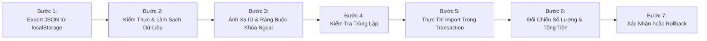
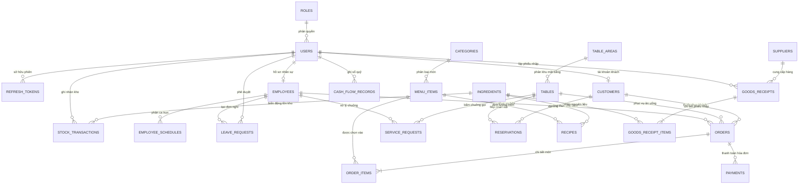
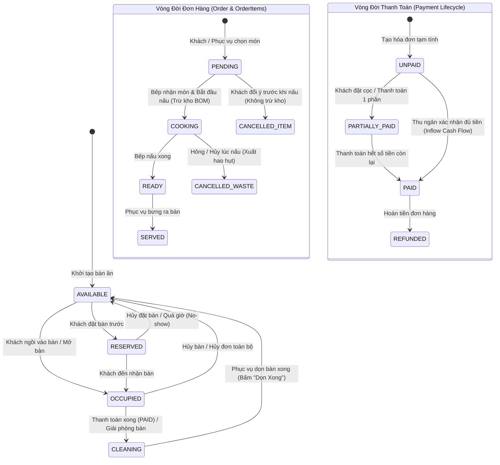
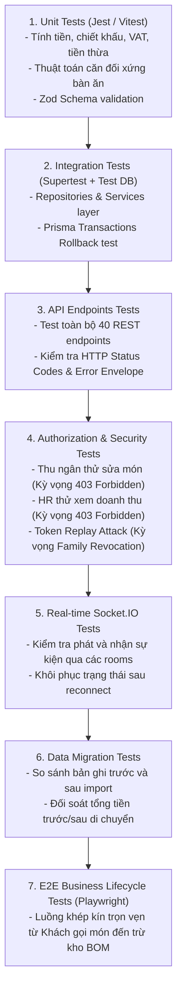
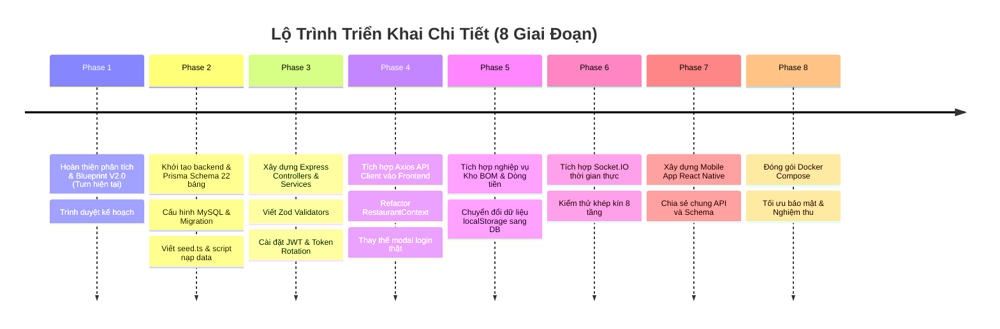

# THIẾT KẾ KIẾN TRÚC MỤC TIÊU VÀ KẾ HOẠCH CHUYỂN ĐỔI TOÀN DIỆN (PHIÊN BẢN 2.0)
## DỰ ÁN: RESTAURANT ASIA / QUẢN LÝ NHÀ HÀNG PRO (THREE-TIER MIGRATION BLUEPRINT)

---

| Thông Tin Tài Liệu | Chi Tiết |
| :--- | :--- |
| **Dự án** | Restaurant Asia / Quản Lý Nhà Hàng Pro |
| **Phiên bản tài liệu** | 2.0.0 (Master Blueprint – Post-Review Revision) |
| **Vai trò lập tài liệu** | Senior Software Architect, Database Engineer & Senior Backend Developer |
| **Mục đích** | Rà soát, chuẩn hóa và đặc tả chi tiết 100% các phân hệ để chuyển đổi từ Frontend-only (React + localStorage) sang Kiến trúc 3 tầng chuẩn (React/React Native + Express/Node.js + Prisma/MySQL) |
| **Tình trạng phê duyệt** | **CHỜ PHÊ DUYỆT (PENDING APPROVAL) – CHƯA TRIỂN KHAI CODE/MIGRATION** |

---

## MỤC LỤC TÀI LIỆU

1. **TỔNG QUAN KIẾN TRÚC VÀ CÁC THAY ĐỔI SO VỚI BẢN V1**
2. **SƠ ĐỒ KIẾN TRÚC THREE-TIER TOÀN DIỆN (MERMAID)**
3. **CHIẾN LƯỢC MIGRATION DỮ LIỆU TỪ LOCALSTORAGE SANG MYSQL**
4. **THIẾT KẾ CƠ SỞ DỮ LIỆU VÀ TỪ ĐIỂN DỮ LIỆU (DATA DICTIONARY)**
5. **PRISMA SCHEMA HOÀN CHỈNH (`schema.prisma`)**
6. **SƠ ĐỒ THỰC THỂ QUAN HỆ ĐẦY ĐỦ (MERMAID ERD)**
7. **QUẢN LÝ KHO NGUYÊN LIỆU VÀ ĐỊNH MỨC MÓN ĂN (INVENTORY & BOM)**
8. **THIẾT KẾ XÁC THỰC VÀ PHÂN QUYỀN CHUYÊN SÂU (AUTH & RBAC)**
9. **STATE MACHINE CHO QUẢN LÝ ĐƠN HÀNG VÀ THANH TOÁN**
10. **KIẾN TRÚC TRUYỀN THÔNG THỜI GIAN THỰC (SOCKET.IO)**
11. **ĐẶC TẢ CHI TIẾT HỆ THỐNG RESTFUL API (API SPECIFICATION)**
12. **CHIẾN LƯỢC KIỂM THỬ TOÀN DIỆN (TESTING STRATEGY)**
13. **ĐÁNH GIÁ RỦI RO VÀ GIẢI PHÁP KIỂM SOÁT (RISK ASSESSMENT)**
14. **LỘ TRÌNH TRIỂN KHAI THEO 8 GIAI ĐOẠN (IMPLEMENTATION ROADMAP)**

---

## 1. TỔNG QUAN KIẾN TRÚC VÀ CÁC THAY ĐỔI SO VỚI BẢN V1

Trong bản V1, hệ thống mới chỉ vạch ra khung sườn phân tầng sơ bộ. Bản thiết kế V2.0 này giải quyết triệt để các lỗ hổng kiến trúc và bổ sung các đặc tả kỹ thuật chi tiết theo yêu cầu:

1. **Phân biệt rõ ràng 3 nguồn dữ liệu:**
   - Dữ liệu tĩnh trong `mockData.ts` (dùng làm Seed Data cho môi trường phát triển mới).
   - Dữ liệu khởi tạo runtime trong `RestaurantContext.tsx`.
   - **Dữ liệu thực tế đang vận hành trong `localStorage` của trình duyệt người dùng** (được đối xử như dữ liệu sản xuất cần bảo tồn).
2. **Quy trình di chuyển dữ liệu (Data Migration Pipeline) khép kín:** Bổ sung công cụ trích xuất JSON, kiểm tra lỗi cú pháp/dữ liệu mồ côi (Orphan Records), lập bảng tra cứu ánh xạ ID (`legacy_id_mappings`), đối chiếu tổng số bản ghi và tổng tiền trước/sau migration, cùng kịch bản rollback tức thì nếu có lỗi.
3. **Hệ thống Quản lý Kho nguyên vật liệu (Inventory Management) hoàn chỉnh:**
   - Thiết lập bảng định mức công thức chế biến (**BOM - Bill of Materials**).
   - Cơ chế tự động tính lượng nguyên liệu tiêu thụ khi món được Bếp xác nhận chế biến.
   - Sổ cái lịch sử biến động kho (`StockTransactions`) cho 6 loại giao dịch (Nhập hàng, Tiêu hao đơn hàng, Hoàn trả khi hủy đơn, Kiểm kê điều chỉnh, Hàng hỏng/Hủy bỏ, Trả nhà cung cấp).
   - Chính sách kiểm soát tồn kho âm (Strict Non-negative Policy with Soft Audit Override).
4. **Hệ thống Bảo mật cấp Doanh nghiệp:**
   - Bổ sung cơ chế **Refresh Token Rotation (RTR)** với kỹ thuật phát hiện tái sử dụng token (Token Family Revocation).
   - Chặn đứng 100% việc Frontend tự quyết định quyền Admin: mọi request đều kiểm tra JWT và RBAC tại Middleware Backend.
   - Cơ chế kiểm tra quyền sở hữu tài nguyên (Resource Ownership Verification).
5. **State Machine phân định 4 trạng thái độc lập:**
   - `OrderStatus` (Đơn hàng): `ACTIVE`, `COMPLETED`, `CANCELLED`.
   - `OrderItemStatus` (Từng món ăn): `PENDING`, `COOKING`, `READY`, `SERVED`, `CANCELLED`.
   - `PaymentStatus` (Giao dịch): `UNPAID`, `PARTIALLY_PAID`, `PAID`, `REFUNDED`, `FAILED`.
   - `TableStatus` (Bàn ăn): `AVAILABLE`, `OCCUPIED`, `RESERVED`, `CLEANING`.
   - Làm rõ tính chất VietQR hiện tại: **Mã QR chuyển khoản ngân hàng xác nhận đối soát thủ công bởi Thu ngân**, chưa phải webhook ngân hàng tự động.
6. **Kiến trúc Real-time Socket.IO:** Phân chia phòng (`room:kitchen`, `room:waiter`, `room:cashier`, `room:table_<id>`), xác thực handshake bằng JWT, và cơ chế khôi phục trạng thái (State Recovery) khi mất mạng.
7. **Chiến lược Kiểm thử (Testing Matrix):** Kiểm thử tự động từ Unit, Integration, DB Transaction cho tới luồng nghiệp vụ khép kín từ lúc khách gọi món đến khi trừ kho nguyên liệu.

---

## 2. SƠ ĐỒ KIẾN TRÚC THREE-TIER TOÀN DIỆN (MERMAID)

```mermaid
flowchart TB
    subgraph TIER1["TIER 1 – CLIENT / PRESENTATION LAYER"]
        direction TB
        subgraph Web_Clients["Web Applications (React 19 + TypeScript)"]
            WEB_ADMIN["Web Admin & Analytics<br/>(Chủ nhà hàng / Quản lý HR)"]
            WEB_POS["Web POS Thu Ngân<br/>(Chế độ bảo mật khóa sửa món)"]
            WEB_KDS["Màn Hình Bếp KDS<br/>(Bếp trưởng & Quầy Bar)"]
            WEB_CUST["Cổng Khách Hàng Gọi Món<br/>(Self-ordering tại bàn qua Mobile Web)"]
        end
        subgraph Mobile_Clients["Mobile Application (React Native)"]
            MOB_WAITER["App Phục Vụ (Waiter App)<br/>(Xem bàn, gọi món nhanh, nhận chuông, bưng món)"]
            MOB_MANAGER["App Quản Lý Di Động<br/>(Theo dõi doanh thu & phê duyệt nghỉ phép)"]
        end
    end

    subgraph GATEWAY["API GATEWAY & REVERSE PROXY (Nginx / Cloudflare)"]
        PROXY["Nginx Reverse Proxy<br/>- HTTPS / SSL Termination<br/>- Rate Limiting (DDoS Protection)<br/>- Gzip / Brotli Compression<br/>- WebSocket Upgrade Router"]
    end

    subgraph TIER2["TIER 2 – SERVER / BUSINESS LOGIC LAYER (Node.js + Express + TypeScript)"]
        direction TB
        
        subgraph Realtime_Server["Real-time Subsystem (Socket.IO v4)"]
            WS_HANDSHAKE["Socket Auth Middleware (JWT Handshake)"]
            WS_ROOMS["Room Manager<br/>(kitchen, waiters, cashier, table_:id)"]
            WS_EMITTER["Event Emitter Service"]
        end

        subgraph Middleware_Chain["Pipeline Xử Lý Request"]
            CORS_MW["CORS & Helmet"]
            AUTH_MW["JWT Verification Middleware"]
            RBAC_MW["RBAC Permission Guard (6 Roles)"]
            OWNER_MW["Data Ownership Guard (Table/Account Scope)"]
            VAL_MW["Zod Schema Validator Middleware"]
            ERR_MW["Global Centralized Error Handler"]
        end

        subgraph Module_Controllers["Controllers Layer"]
            CTL_AUTH["AuthController"]
            CTL_TABLE["TableController"]
            CTL_MENU["MenuController"]
            CTL_ORDER["OrderController"]
            CTL_PAY["PaymentController"]
            CTL_INV["InventoryController"]
            CTL_STAFF["EmployeeController"]
            CTL_REPORT["ReportController"]
        end

        subgraph Module_Services["Services Layer (Business Rules & ACID Transactions)"]
            SVC_AUTH["AuthService (Bcrypt, Token Rotation)"]
            SVC_ORDER["OrderService (Gộp món, Hủy món, State Machine)"]
            SVC_PAY["PaymentService (Tính VAT, Voucher, Đóng bàn)"]
            SVC_INV["InventoryService (Định mức BOM, Trừ kho tự động)"]
            SVC_TABLE["TableService (Căn đối xứng, Chuyển bàn)"]
            SVC_STAFF["EmployeeService (Bảng lương, Phân ca, Nghỉ phép)"]
            SVC_REPORT["ReportService (KPI Doanh thu, Sổ quỹ dòng tiền)"]
        end

        subgraph Module_Repos["Repositories Layer"]
            REPO_BASE["Generic Base Repository"]
            REPO_MODELS["Prisma Model Repositories"]
        end
    end

    subgraph TIER3["TIER 3 – DATA ACCESS & DATABASE LAYER"]
        direction TB
        PRISMA_CLIENT["Prisma ORM Client v6+<br/>(Type-safe Query Builder & Connection Pooling)"]
        MYSQL_DB[("MySQL Database Server 8.0+<br/>- InnoDB Storage Engine<br/>- ACID Compliance<br/>- Foreign Keys ON DELETE RESTRICT/CASCADE<br/>- B-Tree Indexes & Constraints")]
    end

    Web_Clients <==>|HTTPS / WSS| PROXY
    Mobile_Clients <==>|HTTPS / WSS| PROXY
    PROXY <==> Middleware_Chain
    PROXY <==> WS_HANDSHAKE
    WS_HANDSHAKE --> WS_ROOMS
    WS_EMITTER --> WS_ROOMS
    Middleware_Chain --> Module_Controllers
    Module_Controllers --> Module_Services
    Module_Services --> WS_EMITTER
    Module_Services --> Module_Repos
    Module_Repos --> PRISMA_CLIENT
    PRISMA_CLIENT <==>|Connection Pool| MYSQL_DB
```



---

## 3. CHIẾN LƯỢC MIGRATION DỮ LIỆU TỪ LOCALSTORAGE SANG MYSQL

### 3.1. Phân Biệt Ba Nguồn Dữ Liệu
1. **Mock Data (`src/mockData.ts`):** Là dữ liệu cứng lập trình sẵn trong code (chứa 6 tài khoản, 14 bàn, 17 món ăn, 2 đơn mẫu). Nguồn này dùng làm **Seed Data** cho Database trống khi khởi tạo môi trường dev/staging.
2. **Context Default State (`RestaurantContext.tsx`):** Là trạng thái in-memory dùng để fallback khi `localStorage` rỗng.
3. **Thực tế `localStorage` của Trình duyệt Người dùng:** Là **dữ liệu kinh doanh thực tế** đã phát sinh trong quá trình vận hành (các đơn hàng mới được tạo, các bàn đã sửa vị trí, nhân viên mới thêm vào, bút toán dòng tiền thực tế). **Đây là đối tượng chính của quy trình di chuyển dữ liệu.**

### 3.2. Quy Trình Di Chuyển Dữ Liệu 7 Bước (Migration Pipeline)



#### Bước 1: Trích xuất (Export) dữ liệu từ `localStorage`
Xây dựng một script tiện ích nhỏ trên giao diện Frontend (hoặc qua Console DevTools) cho phép người quản trị bấm nút **"Xuất toàn bộ dữ liệu hệ thống"** để đóng gói toàn bộ key `rest_*` thành file JSON chuẩn:
```json
{
  "version": "1.0",
  "exportedAt": "2026-11-24T14:30:00.000Z",
  "accounts": [...],
  "areas": [...],
  "tables": [...],
  "menuItems": [...],
  "staff": [...],
  "shifts": [...],
  "leaveRequests": [...],
  "activeOrders": [...],
  "completedOrders": [...],
  "goodsReceipts": [...],
  "cashFlow": [...],
  "serviceRequests": [...]
}
```

#### Bước 2: Kiểm tra dữ liệu thiếu và sai định dạng (Sanitization & Validation)
Backend script `migrate-localstorage.ts` đọc file JSON và kiểm tra qua Zod schema:
- **Kiểm tra trường bắt buộc:** Bỏ qua hoặc gán giá trị mặc định cho các bản ghi thiếu `createdAt`, `status`.
- **Phát hiện dữ liệu mồ côi (Orphan Records):**
  - Món trong đơn hàng (`OrderItem`) tham chiếu tới `menuItemId` không còn tồn tại trong danh mục món ➔ Tự động lưu tên món và đơn giá lưu vết, gán `menuItemId = NULL` hoặc tạo món lưu kho "Món cũ đã xóa".
  - Bàn ăn tham chiếu tới `areaId` không hợp lệ ➔ Chuyển về khu vực mặc định `area-1`.
  - Đơn xin nghỉ phép tham chiếu tới nhân viên đã bị xóa ➔ Lưu vết tên nhân viên dạng văn bản.

#### Bước 3: Xử lý ID và Quan hệ Khóa ngoại (ID Translation Mapping)
Trong `localStorage`, các ID có dạng tiền tố chuỗi (`acc-admin`, `t-101`, `ord-101`, `oi-101-1`). Để bảo đảm tính tương thích với MySQL và Prisma:
- Duy trì định dạng ID kiểu `VARCHAR(36)` (CUID hoặc UUID v4) hoặc cho phép kế thừa các chuỗi ID hiện tại.
- Tạo một bảng tạm `legacy_id_mappings` trong quá trình import:
  ```sql
  CREATE TEMPORARY TABLE legacy_id_mappings (
    entity_type VARCHAR(50),
    legacy_id VARCHAR(100),
    new_uuid VARCHAR(36),
    PRIMARY KEY (entity_type, legacy_id)
  );
  ```
- Dịch chuyển toàn bộ khóa ngoại trong các bảng phụ thuộc dựa theo bảng ánh xạ này trước khi chèn vào MySQL.

#### Bước 4: Kiểm tra dữ liệu trùng lặp (Deduplication Check)
- Trùng `username` trong bảng `users`: Nếu trùng lặp, giữ lại tài khoản có `lastLogin` gần nhất, đổi tên tài khoản cũ thành `username_migrated_<timestamp>`.
- Trùng mã hóa đơn (`code` trong `orders`, vd: `#HD-1024`): Thêm hậu tố `-MIG` để bảo đảm tính duy nhất.
- Trùng mã phiếu nhập kho (`receiptCode` trong `goods_receipts`).

#### Bước 5: Thực thi Import tuần tự trong một Database Transaction
Thứ tự chèn bắt buộc tuân theo cấu trúc phân cấp phụ thuộc khóa ngoại để không vi phạm ràng buộc toàn vẹn:
```
1. roles
2. users (Mật khẩu plaintext '123' được băm qua bcrypt với saltRounds = 10)
3. employees & customers
4. table_areas ➔ tables
5. categories ➔ menu_items
6. suppliers ➔ goods_receipts ➔ goods_receipt_items
7. orders ➔ order_items ➔ payments
8. cash_flow_records
9. service_requests
10. leave_requests & employee_schedules
```

#### Bước 6: Đối chiếu đối soát dữ liệu (Reconciliation Audit)
Script migration tự động chạy truy vấn đối chiếu:
1. **Đối chiếu số lượng bản ghi (Row Count Reconciliation):**
   - Số tài khoản: `Count(JSON.accounts) === Count(DB.users)`.
   - Số bàn ăn: `Count(JSON.tables) === Count(DB.tables)`.
   - Số món ăn: `Count(JSON.menuItems) === Count(DB.menu_items)`.
   - Số đơn hàng: `(Count(activeOrders) + Count(completedOrders)) === Count(DB.orders)`.
2. **Đối chiếu số tiền tài chính (Financial Sum Reconciliation):**
   - Tổng doanh thu: `Sum(completedOrders.finalTotal) === Sum(DB.orders[status=COMPLETED].finalTotal)`.
   - Tổng dòng tiền thu vào: `Sum(cashFlow[type=inflow].amount) === Sum(DB.cash_flow_records[type=INFLOW].amount)`.
   - Tổng tiền nhập kho: `Sum(goodsReceipts.totalAmount) === Sum(DB.goods_receipts.totalAmount)`.

#### Bước 7: Kế hoạch Phục hồi nếu Thất bại (Rollback Strategy)
- Nếu bất kỳ bản ghi nào gây lỗi `Foreign Key Constraint Violation` hoặc số tiền đối soát bị lệch dù chỉ 1 đồng:
  - Lệnh `ROLLBACK` của MySQL được kích hoạt lập tức, hủy toàn bộ giao dịch.
  - Database quay trở lại trạng thái ban đầu sạch sẽ 100%.
  - Bắn log chi tiết vị trí dòng JSON gây lỗi để kỹ sư sửa đổi trước khi chạy lại.
  - Frontend vẫn tiếp tục đọc từ `localStorage` cho đến khi migration đạt 100% thành công mới chuyển cờ kết nối sang Backend API.

---

## 4. THIẾT KẾ CƠ SỞ DỮ LIỆU VÀ TỪ ĐIỂN DỮ LIỆU (DATA DICTIONARY)

Hệ thống bao gồm **22 Bảng quan hệ** chuẩn hóa 3NF, loại bỏ hoàn toàn dư thừa dữ liệu:

### Danh Mục 22 Bảng Dữ Liệu
1. `roles`: Danh mục vai trò (`ADMIN`, `CASHIER`, `KITCHEN`, `WAITER`, `HR_MANAGER`, `CUSTOMER`).
2. `users`: Tài khoản người dùng, mật khẩu hash bcrypt, liên kết `role_id`.
3. `refresh_tokens`: Quản lý phiên làm việc, chống tấn công replay token.
4. `employees`: Hồ sơ nhân sự (họ tên, SĐT, mức lương, hình thức lương), liên kết 1-1 với `users`.
5. `employee_schedules`: Lịch phân ca trực hàng tuần của nhân sự.
6. `leave_requests`: Đơn xin nghỉ phép của nhân viên (3 trạng thái).
7. `customers`: Hồ sơ khách hàng CRM (phân loại 4 nhóm, tích điểm, tổng chi tiêu).
8. `table_areas`: Khu vực / Tầng của nhà hàng (Tầng 1, Tầng 2, Sân vườn, VIP).
9. `tables`: Bàn ăn (sức chứa, hình dạng, tọa độ mặt bằng X/Y, trạng thái).
10. `reservations`: Lịch đặt bàn trước của khách hàng.
11. `categories`: Danh mục thực đơn (Khai vị, Món chính, Món lẩu, Hải sản,...).
12. `menu_items`: Món ăn & thức uống (giá bán, giá vốn cost, thời gian nấu, độ cay).
13. `ingredients`: Danh mục nguyên vật liệu thô trong kho (thịt, cá, rau, gia vị).
14. `recipes`: Bảng định mức công thức chế biến (**BOM**) liên kết món ăn và nguyên liệu.
15. `orders`: Hóa đơn / Đơn gọi món tại bàn (mã `#HD-xxxx`, tổng tiền, VAT, giảm giá).
16. `order_items`: Chi tiết từng món trong đơn (đơn giá thời điểm bán, số lượng, ghi chú, trạng thái KDS).
17. `payments`: Giao dịch thanh toán (hỗ trợ thanh toán từng phần, đa phương thức).
18. `suppliers`: Nhà cung cấp nguyên vật liệu.
19. `goods_receipts`: Phiếu nhập kho hàng hóa từ nhà cung cấp.
20. `goods_receipt_items`: Chi tiết số lượng và đơn giá từng nguyên liệu nhập.
21. `stock_transactions`: Sổ cái ghi nhận mọi biến động xuất/nhập/hủy/kiểm kê kho.
22. `cash_flow_records`: Sổ quỹ thu chi dòng tiền mặt và tài khoản ngân hàng.
23. `service_requests`: Chuông yêu cầu phục vụ từ khách hàng tại bàn.

---

## 5. PRISMA SCHEMA HOÀN CHỈNH (`schema.prisma`)

Dưới đây là mã nguồn Prisma Schema chuẩn xác, tương thích hoàn toàn với MySQL 8.0+:

```prisma
datasource db {
  provider = "mysql"
  url      = env("DATABASE_URL")
}

generator client {
  provider = "prisma-client-js"
}

// ==========================================================
// 1. PHÂN QUYỀN, TÀI KHOẢN & PHIÊN ĐĂNG NHẬP
// ==========================================================

enum RoleName {
  ADMIN
  CASHIER
  KITCHEN
  WAITER
  HR_MANAGER
  CUSTOMER
}

model Role {
  id          String    @id @default(uuid()) @db.VarChar(36)
  name        RoleName  @unique
  title       String    @db.VarChar(50)
  description String?   @db.VarChar(255)
  users       User[]

  @@map("roles")
}

model User {
  id               String         @id @default(uuid()) @db.VarChar(36)
  username         String         @unique @db.VarChar(50)
  passwordHash     String         @db.VarChar(255) @map("password_hash")
  roleId           String         @db.VarChar(36) @map("role_id")
  role             Role           @relation(fields: [roleId], references: [id])
  fullName         String         @db.VarChar(100) @map("full_name")
  phone            String?        @db.VarChar(20)
  avatar           String?        @db.VarChar(500)
  isActive         Boolean        @default(true) @map("is_active")
  lastLoginAt      DateTime?      @map("last_login_at")
  createdAt        DateTime       @default(now()) @map("created_at")
  updatedAt        DateTime       @updatedAt @map("updated_at")

  employee         Employee?
  customer         Customer?
  refreshTokens    RefreshToken[]
  goodsReceipts    GoodsReceipt[]
  cashFlowRecords  CashFlowRecord[]
  approvedLeaves   LeaveRequest[] @relation("ApprovedBy")
  stockTransactions StockTransaction[]

  @@index([roleId])
  @@map("users")
}

model RefreshToken {
  id          String   @id @default(uuid()) @db.VarChar(36)
  tokenHash   String   @unique @db.VarChar(255) @map("token_hash")
  userId      String   @db.VarChar(36) @map("user_id")
  user        User     @relation(fields: [userId], references: [id], onDelete: Cascade)
  family      String   @db.VarChar(36) // Token Family ID phục vụ Refresh Token Rotation
  isRevoked   Boolean  @default(false) @map("is_revoked")
  expiresAt   DateTime @map("expires_at")
  createdAt   DateTime @default(now()) @map("created_at")

  @@index([userId])
  @@index([family])
  @@map("refresh_tokens")
}

// ==========================================================
// 2. NHÂN SỰ, CA TRỰC & NGHỈ PHÉP
// ==========================================================

enum SalaryType {
  MONTHLY
  HOURLY
}

enum EmployeeStatus {
  ACTIVE
  ON_BREAK
  OFF
}

model Employee {
  id             String          @id @default(uuid()) @db.VarChar(36)
  userId         String?         @unique @db.VarChar(36) @map("user_id")
  user           User?           @relation(fields: [userId], references: [id], onDelete: SetNull)
  name           String          @db.VarChar(100)
  phone          String          @db.VarChar(20)
  email          String?         @db.VarChar(100)
  roleTitle      String          @db.VarChar(50) @map("role_title") // 'Quản lý', 'Thu ngân', 'Phục vụ', 'Bếp trưởng'
  shiftDefault   String?         @db.VarChar(50) @map("shift_default")
  salaryRate     Decimal         @default(0) @db.Decimal(12, 2) @map("salary_rate")
  salaryType     SalaryType      @default(MONTHLY) @map("salary_type")
  status         EmployeeStatus  @default(ACTIVE)
  joinDate       DateTime        @default(now()) @map("join_date")
  ordersHandled  Int             @default(0) @map("orders_handled")

  schedules      EmployeeSchedule[]
  leaveRequests  LeaveRequest[]  @relation("StaffLeaves")
  servedOrders   Order[]         @relation("ServedByEmployee")
  assignedCalls  ServiceRequest[]

  @@map("employees")
}

model EmployeeSchedule {
  id          String    @id @default(uuid()) @db.VarChar(36)
  employeeId  String    @db.VarChar(36) @map("employee_id")
  employee    Employee  @relation(fields: [employeeId], references: [id], onDelete: Cascade)
  dayOfWeek   Int       @map("day_of_week") // 0=Chủ nhật, 1=Thứ 2,... 6=Thứ 7
  shiftDate   DateTime  @db.Date @map("shift_date")
  shiftName   String    @db.VarChar(50) @map("shift_name") // 'Ca Sáng', 'Ca Chiều', 'Ca Đêm'
  timeRange   String    @db.VarChar(50) @map("time_range") // '06:00 - 14:00'
  isAttended  Boolean   @default(false) @map("is_attended")

  @@index([employeeId])
  @@index([shiftDate])
  @@map("employee_schedules")
}

enum LeaveStatus {
  ACTIVE    // Đang nghỉ
  UPCOMING  // Sắp nghỉ (đã duyệt)
  COMPLETED // Đã nghỉ xong
  CANCELLED // Đã hủy
}

enum LeaveType {
  ANNUAL
  SICK
  FAMILY
  COMPENSATORY
}

model LeaveRequest {
  id          String      @id @default(uuid()) @db.VarChar(36)
  employeeId  String      @db.VarChar(36) @map("employee_id")
  employee    Employee    @relation("StaffLeaves", fields: [employeeId], references: [id], onDelete: Cascade)
  startDate   DateTime    @db.Date @map("start_date")
  endDate     DateTime    @db.Date @map("end_date")
  status      LeaveStatus @default(UPCOMING)
  leaveType   LeaveType   @default(ANNUAL) @map("leave_type")
  reason      String      @db.VarChar(255)
  approvedById String?    @db.VarChar(36) @map("approved_by_id")
  approvedBy  User?       @relation("ApprovedBy", fields: [approvedById], references: [id])
  createdAt   DateTime    @default(now()) @map("created_at")

  @@index([employeeId])
  @@map("leave_requests")
}

// ==========================================================
// 3. KHÁCH HÀNG CRM (4 PHÂN LOẠI KHÁCH HÀNG)
// ==========================================================

enum CustomerType {
  WALK_IN
  REGULAR
  VIP
  GROUP
}

model Customer {
  id             String       @id @default(uuid()) @db.VarChar(36)
  userId         String?      @unique @db.VarChar(36) @map("user_id")
  user           User?        @relation(fields: [userId], references: [id], onDelete: SetNull)
  fullName       String       @db.VarChar(100) @map("full_name")
  phone          String       @unique @db.VarChar(20)
  email          String?      @db.VarChar(100)
  customerType   CustomerType @default(WALK_IN) @map("customer_type")
  loyaltyPoints  Int          @default(0) @map("loyalty_points")
  totalSpent     Decimal      @default(0) @db.Decimal(14, 2) @map("total_spent")
  createdAt      DateTime     @default(now()) @map("created_at")

  orders         Order[]
  reservations   Reservation[]

  @@map("customers")
}

// ==========================================================
// 4. MẶT BẰNG, KHU VỰC, BÀN ĂN & ĐẶT BÀN
// ==========================================================

model TableArea {
  id           String   @id @default(uuid()) @db.VarChar(36)
  name         String   @unique @db.VarChar(100)
  description  String?  @db.VarChar(255)
  displayOrder Int      @default(0) @map("display_order")
  tables       RestaurantTable[]

  @@map("table_areas")
}

enum TableShape {
  ROUND
  SQUARE
  RECTANGLE
}

enum TableStatus {
  AVAILABLE
  OCCUPIED
  RESERVED
  CLEANING
}

model RestaurantTable {
  id            String          @id @default(uuid()) @db.VarChar(36)
  name          String          @db.VarChar(50)
  areaId        String          @db.VarChar(36) @map("area_id")
  area          TableArea       @relation(fields: [areaId], references: [id], onDelete: Restrict)
  capacity      Int             @default(4)
  shape         TableShape      @default(SQUARE)
  status        TableStatus     @default(AVAILABLE)
  posX          Float           @default(0) @map("pos_x") // Tọa độ X trên canvas (%)
  posY          Float           @default(0) @map("pos_y") // Tọa độ Y trên canvas (%)
  width         Float           @default(90)
  height        Float           @default(90)
  occupiedSince DateTime?       @map("occupied_since")
  customerType  CustomerType?   @map("customer_type")

  orders        Order[]
  reservations  Reservation[]
  serviceCalls  ServiceRequest[]

  @@index([areaId])
  @@index([status])
  @@map("tables")
}

enum ReservationStatus {
  CONFIRMED
  SEATED
  CANCELLED
  NO_SHOW
}

model Reservation {
  id              String            @id @default(uuid()) @db.VarChar(36)
  tableId         String            @db.VarChar(36) @map("table_id")
  table           RestaurantTable   @relation(fields: [tableId], references: [id], onDelete: Restrict)
  customerId      String?           @db.VarChar(36) @map("customer_id")
  customer        Customer?         @relation(fields: [customerId], references: [id], onDelete: SetNull)
  customerName    String            @db.VarChar(100) @map("customer_name")
  phone           String            @db.VarChar(20)
  guestCount      Int               @default(2) @map("guest_count")
  reservationTime DateTime          @map("reservation_time")
  customerType    CustomerType      @default(REGULAR) @map("customer_type")
  status          ReservationStatus @default(CONFIRMED)
  notes           String?           @db.VarChar(255)
  createdAt       DateTime          @default(now()) @map("created_at")

  @@index([tableId])
  @@index([reservationTime])
  @@map("reservations")
}

// ==========================================================
// 5. THỰC ĐƠN, MÓN ĂN & ĐỊNH LƯỢNG NGUYÊN LIỆU (BOM)
// ==========================================================

model Category {
  id           String      @id @default(uuid()) @db.VarChar(36)
  name         String      @unique @db.VarChar(100)
  displayOrder Int         @default(0) @map("display_order")
  isActive     Boolean     @default(true) @map("is_active")
  menuItems    MenuItem[]

  @@map("categories")
}

model MenuItem {
  id               String      @id @default(uuid()) @db.VarChar(36)
  categoryId       String      @db.VarChar(36) @map("category_id")
  category         Category    @relation(fields: [categoryId], references: [id], onDelete: Restrict)
  name             String      @db.VarChar(150)
  price            Decimal     @db.Decimal(12, 2)
  costPrice        Decimal     @default(0) @db.Decimal(12, 2) @map("cost_price")
  unit             String      @default("phần") @db.VarChar(20)
  description      String?     @db.Text
  image            String?     @db.VarChar(500)
  isAvailable      Boolean     @default(true) @map("is_available")
  prepTimeMinutes  Int         @default(15) @map("prep_time_minutes")
  spicyLevel       Int         @default(0) @map("spicy_level")
  tags             String?     @db.VarChar(255) // Chuỗi JSON hoặc danh sách tag ngăn cách bởi dấu phẩy
  isPopular        Boolean     @default(false) @map("is_popular")
  createdAt        DateTime    @default(now()) @map("created_at")

  orderItems       OrderItem[]
  recipes          Recipe[]

  @@index([categoryId])
  @@index([isAvailable])
  @@map("menu_items")
}

model Ingredient {
  id            String             @id @default(uuid()) @db.VarChar(36)
  name          String             @unique @db.VarChar(150)
  category      String             @db.VarChar(100) // 'Thịt & Hải sản', 'Rau củ quả', 'Gia vị & Khô'
  unit          String             @db.VarChar(20)  // 'kg', 'g', 'lít', 'chai', 'hộp'
  currentStock  Decimal            @default(0) @db.Decimal(12, 3) @map("current_stock")
  minStockLevel Decimal            @default(5) @db.Decimal(12, 3) @map("min_stock_level")
  costPerUnit   Decimal            @default(0) @db.Decimal(12, 2) @map("cost_per_unit")

  recipes       Recipe[]
  receiptItems  GoodsReceiptItem[]
  stockHistory  StockTransaction[]

  @@map("ingredients")
}

model Recipe {
  id               String     @id @default(uuid()) @db.VarChar(36)
  menuItemId       String     @db.VarChar(36) @map("menu_item_id")
  menuItem         MenuItem   @relation(fields: [menuItemId], references: [id], onDelete: Cascade)
  ingredientId     String     @db.VarChar(36) @map("ingredient_id")
  ingredient       Ingredient @relation(fields: [ingredientId], references: [id], onDelete: Restrict)
  quantityRequired Decimal    @db.Decimal(10, 3) @map("quantity_required") // Định lượng tiêu tốn cho 1 suất
  unit             String     @db.VarChar(20)

  @@unique([menuItemId, ingredientId])
  @@map("recipes")
}

// ==========================================================
// 6. ĐƠN HÀNG, CHI TIẾT MÓN & THANH TOÁN
// ==========================================================

enum OrderStatus {
  ACTIVE
  COMPLETED
  CANCELLED
}

enum OrderItemStatus {
  PENDING
  COOKING
  READY
  SERVED
  CANCELLED
}

model Order {
  id              String          @id @default(uuid()) @db.VarChar(36)
  code            String          @unique @db.VarChar(20) // e.g. '#HD-8801'
  tableId         String          @db.VarChar(36) @map("table_id")
  table           RestaurantTable @relation(fields: [tableId], references: [id], onDelete: Restrict)
  customerId      String?         @db.VarChar(36) @map("customer_id")
  customer        Customer?       @relation(fields: [customerId], references: [id], onDelete: SetNull)
  servedById      String?         @db.VarChar(36) @map("served_by_id")
  servedBy        Employee?       @relation("ServedByEmployee", fields: [servedById], references: [id], onDelete: SetNull)
  customerName    String?         @db.VarChar(100) @map("customer_name")
  customerPhone   String?         @db.VarChar(20) @map("customer_phone")
  customerType    CustomerType    @default(WALK_IN) @map("customer_type")
  customerCount   Int             @default(2) @map("customer_count")
  subtotal        Decimal         @default(0) @db.Decimal(12, 2)
  discountPercent Decimal         @default(0) @db.Decimal(5, 2) @map("discount_percent")
  discountAmount  Decimal         @default(0) @db.Decimal(12, 2) @map("discount_amount")
  taxPercent      Decimal         @default(8) @db.Decimal(5, 2) @map("tax_percent")
  taxAmount       Decimal         @default(0) @db.Decimal(12, 2) @map("tax_amount")
  finalTotal      Decimal         @default(0) @db.Decimal(12, 2) @map("final_total")
  status          OrderStatus     @default(ACTIVE)
  notes           String?         @db.VarChar(255)
  createdAt       DateTime        @default(now()) @map("created_at")
  completedAt     DateTime?       @map("completed_at")

  items           OrderItem[]
  payments        Payment[]

  @@index([tableId])
  @@index([status])
  @@index([createdAt])
  @@map("orders")
}

model OrderItem {
  id          String          @id @default(uuid()) @db.VarChar(36)
  orderId     String          @db.VarChar(36) @map("order_id")
  order       Order           @relation(fields: [orderId], references: [id], onDelete: Cascade)
  menuItemId  String          @db.VarChar(36) @map("menu_item_id")
  menuItem    MenuItem        @relation(fields: [menuItemId], references: [id], onDelete: Restrict)
  name        String          @db.VarChar(150)
  unit        String          @db.VarChar(20)
  price       Decimal         @db.Decimal(12, 2)
  quantity    Int             @default(1)
  note        String?         @db.VarChar(255)
  status      OrderItemStatus @default(PENDING)
  orderedAt   DateTime        @default(now()) @map("ordered_at")

  @@index([orderId])
  @@index([status])
  @@map("order_items")
}

enum PaymentMethod {
  CASH
  VIETQR
  TRANSFER
  CARD
}

enum PaymentStatus {
  UNPAID
  PARTIALLY_PAID
  PAID
  REFUNDED
  FAILED
}

model Payment {
  id              String        @id @default(uuid()) @db.VarChar(36)
  orderId         String        @db.VarChar(36) @map("order_id")
  order           Order         @relation(fields: [orderId], references: [id], onDelete: Restrict)
  paymentCode     String        @unique @db.VarChar(50) @map("payment_code")
  amount          Decimal       @db.Decimal(12, 2)
  paymentMethod   PaymentMethod @default(CASH) @map("payment_method")
  paymentStatus   PaymentStatus @default(PAID) @map("payment_status")
  receivedAmount  Decimal       @default(0) @db.Decimal(12, 2) @map("received_amount")
  changeAmount    Decimal       @default(0) @db.Decimal(12, 2) @map("change_amount")
  referenceCode   String?       @db.VarChar(100) @map("reference_code") // Mã đối soát ngân hàng / POS
  paidAt          DateTime      @default(now()) @map("paid_at")

  @@index([orderId])
  @@map("payments")
}

// ==========================================================
// 7. NHÀ CUNG CẤP, HÀNG NHẬP & SỔ CÁI KHO (INVENTORY LEDGER)
// ==========================================================

model Supplier {
  id            String         @id @default(uuid()) @db.VarChar(36)
  name          String         @db.VarChar(150)
  phone         String?        @db.VarChar(20)
  email         String?        @db.VarChar(100)
  address       String?        @db.VarChar(255)
  isActive      Boolean        @default(true) @map("is_active")

  goodsReceipts GoodsReceipt[]

  @@map("suppliers")
}

model GoodsReceipt {
  id            String             @id @default(uuid()) @db.VarChar(36)
  receiptCode   String             @unique @db.VarChar(50) @map("receipt_code") // e.g. 'PNK-2026-001'
  supplierId    String             @db.VarChar(36) @map("supplier_id")
  supplier      Supplier           @relation(fields: [supplierId], references: [id], onDelete: Restrict)
  receivedDate  DateTime           @default(now()) @map("received_date")
  totalAmount   Decimal            @db.Decimal(14, 2) @map("total_amount")
  paymentStatus String             @default("paid") @db.VarChar(20) @map("payment_status") // 'paid' | 'pending'
  paymentMethod PaymentMethod      @default(TRANSFER) @map("payment_method")
  notes         String?            @db.VarChar(255)
  createdById   String             @db.VarChar(36) @map("created_by_id")
  createdBy     User               @relation(fields: [createdById], references: [id], onDelete: Restrict)

  items         GoodsReceiptItem[]

  @@index([supplierId])
  @@map("goods_receipts")
}

model GoodsReceiptItem {
  id            String       @id @default(uuid()) @db.VarChar(36)
  receiptId     String       @db.VarChar(36) @map("receipt_id")
  receipt       GoodsReceipt @relation(fields: [receiptId], references: [id], onDelete: Cascade)
  ingredientId  String       @db.VarChar(36) @map("ingredient_id")
  ingredient    Ingredient   @relation(fields: [ingredientId], references: [id], onDelete: Restrict)
  quantity      Decimal      @db.Decimal(12, 3)
  unit          String       @db.VarChar(20)
  unitPrice     Decimal      @db.Decimal(12, 2) @map("unit_price")
  totalPrice    Decimal      @db.Decimal(14, 2) @map("total_price")

  @@index([receiptId])
  @@index([ingredientId])
  @@map("goods_receipt_items")
}

enum StockTransactionType {
  GOODS_RECEIPT                // Nhập kho từ phiếu mua
  ORDER_CONSUMPTION            // Xuất tiêu hao do Bếp nấu món
  ORDER_CANCELLATION_RETURN    // Nhập hoàn kho khi hủy món chưa nấu
  STOCK_TAKE_ADJUSTMENT        // Điều chỉnh sau kiểm kê kho
  WASTE_DAMAGE                 // Xuất hủy do hỏng hóc, ôi thiu
  SUPPLIER_RETURN              // Xuất trả lại nhà cung cấp
}

model StockTransaction {
  id              String               @id @default(uuid()) @db.VarChar(36)
  ingredientId    String               @db.VarChar(36) @map("ingredient_id")
  ingredient      Ingredient           @relation(fields: [ingredientId], references: [id], onDelete: Restrict)
  transactionType StockTransactionType @map("transaction_type")
  quantity        Decimal              @db.Decimal(12, 3) // Dương nếu nhập vào, Âm nếu xuất ra
  balanceAfter    Decimal              @db.Decimal(12, 3) @map("balance_after") // Tồn kho thực tế sau giao dịch
  referenceType   String               @db.VarChar(50) @map("reference_type")   // 'ORDER', 'GOODS_RECEIPT', 'AUDIT'
  referenceId     String?              @db.VarChar(50) @map("reference_id")
  notes           String?              @db.VarChar(255)
  createdById     String               @db.VarChar(36) @map("created_by_id")
  createdBy       User                 @relation(fields: [createdById], references: [id], onDelete: Restrict)
  createdAt       DateTime             @default(now()) @map("created_at")

  @@index([ingredientId])
  @@index([transactionType])
  @@map("stock_transactions")
}

// ==========================================================
// 8. SỔ QUỸ DÒNG TIỀN (CASH FLOW) & CHUÔNG PHỤC VỤ
// ==========================================================

enum CashFlowType {
  INFLOW   // Thu tiền vào (+)
  OUTFLOW  // Chi tiền ra (-)
}

enum CashFlowCategory {
  REVENUE_ORDER   // Thu tiền bán hàng
  GOODS_PURCHASE  // Chi mua nguyên vật liệu
  STAFF_SALARY    // Chi lương nhân viên
  UTILITIES       // Chi điện, nước, mặt bằng
  MARKETING       // Chi quảng cáo
  OTHER           // Thu/chi khác
}

model CashFlowRecord {
  id            String           @id @default(uuid()) @db.VarChar(36)
  type          CashFlowType
  category      CashFlowCategory
  title         String           @db.VarChar(255)
  amount        Decimal          @db.Decimal(14, 2)
  method        PaymentMethod    @default(CASH)
  referenceCode String?          @db.VarChar(100) @map("reference_code")
  notes         String?          @db.VarChar(255)
  createdById   String           @db.VarChar(36) @map("created_by_id")
  createdBy     User             @relation(fields: [createdById], references: [id], onDelete: Restrict)
  createdAt     DateTime         @default(now()) @map("created_at")

  @@index([type])
  @@index([category])
  @@index([createdAt])
  @@map("cash_flow_records")
}

enum ServiceRequestType {
  CALL_WAITER
  REQUEST_BILL
  REFILL_WATER
  EXTRA_CUTLERY
  CLEAN_TABLE
  OTHER
}

enum ServiceRequestStatus {
  PENDING
  ATTENDING
  RESOLVED
}

model ServiceRequest {
  id           String               @id @default(uuid()) @db.VarChar(36)
  tableId      String               @db.VarChar(36) @map("table_id")
  table        RestaurantTable      @relation(fields: [tableId], references: [id], onDelete: Cascade)
  type         ServiceRequestType
  title        String               @db.VarChar(100)
  note         String?              @db.VarChar(255)
  status       ServiceRequestStatus @default(PENDING)
  assignedToId String?              @db.VarChar(36) @map("assigned_to_id")
  assignedTo   Employee?            @relation(fields: [assignedToId], references: [id], onDelete: SetNull)
  createdAt    DateTime             @default(now()) @map("created_at")
  resolvedAt   DateTime?            @map("resolved_at")

  @@index([tableId])
  @@index([status])
  @@map("service_requests")
}
```

---

## 6. SƠ ĐỒ THỰC THỂ QUAN HỆ ĐẦY ĐỦ (MERMAID ERD)



---

## 7. QUẢN LÝ KHO NGUYÊN LIỆU VÀ ĐỊNH MỨC MÓN ĂN (INVENTORY & BOM)

### 7.1. Định mức nguyên liệu theo món (BOM - Bill of Materials)
Mỗi món ăn trên thực đơn (`menu_items`) được liên kết với một hoặc nhiều nguyên liệu (`ingredients`) thông qua bảng trung gian `recipes`.
*Ví dụ:* Món **"Phở Bò Thăn Đặc Biệt"** (1 tô) được cấu hình BOM:
- Thịt bò thăn (`ingredient_id = 'ing-beef-tenderloin'`): `0.150` kg.
- Bánh phở tươi (`ingredient_id = 'ing-pho-noodles'`): `0.200` kg.
- Nước cốt xương bò hầm (`ingredient_id = 'ing-beef-broth'`): `0.400` lít.
- Hành lá & rau thơm (`ingredient_id = 'ing-herbs'`): `0.030` kg.

### 7.2. Quy Tắc Tự Động Tính Tiêu Hao và Trừ Tồn Kho
1. **Thời điểm trừ kho:**
   - **Quy tắc F&B chuẩn:** Tồn kho **KHÔNG TRỪ** khi khách mới thêm món vào giỏ hàng (`PENDING`).
   - Tồn kho **ĐƯỢC TRỪ CHÍNH THỨC** khi Bếp trưởng bấm nút **"Bắt đầu nấu" (`status = COOKING`)**. Lúc này nguyên liệu thực tế đã được lấy ra khỏi tủ lạnh để sơ chế.
2. **Kỹ thuật thực thi:**
   Tất cả thao tác trừ kho được bọc trong một **Prisma Database Transaction**:
   ```typescript
   await prisma.$transaction(async (tx) => {
     // 1. Lấy công thức BOM của món
     const recipes = await tx.recipe.findMany({ where: { menuItemId } });
     
     for (const r of recipes) {
       // 2. Tính lượng tiêu hao = định mức x số lượng đĩa
       const consumedQty = r.quantityRequired.mul(quantity);
       
       // 3. Trừ tồn kho hiện tại
       const updatedIng = await tx.ingredient.update({
         where: { id: r.ingredientId },
         data: { currentStock: { decrement: consumedQty } }
       });
       
       // 4. Ghi nhận sổ cái biến động kho
       await tx.stockTransaction.create({
         data: {
           ingredientId: r.ingredientId,
           transactionType: 'ORDER_CONSUMPTION',
           quantity: consumedQty.negated(), // Số âm
           balanceAfter: updatedIng.currentStock,
           referenceType: 'ORDER',
           referenceId: orderId,
           createdById: userId
         }
       });
     }
     // 5. Cập nhật trạng thái món sang COOKING
     await tx.orderItem.update({ where: { id: orderItemId }, data: { status: 'COOKING' } });
   });
   ```

### 7.3. Xử Lý Khi Hủy Món, Hủy Đơn và Hoàn Tiền
- **Trường hợp 1: Hủy món khi đang `PENDING` (Chờ nấu):**
  - Món chưa vào bếp, chưa trừ kho. Cập nhật `OrderItem.status = 'CANCELLED'`. **Không ghi nhận giao dịch kho.**
- **Trường hợp 2: Hủy món khi đang `COOKING` hoặc `READY` (Bếp đã nấu xong nhưng khách đổi ý/bỏ đi):**
  - Nguyên liệu đã bị nấu chín, không thể tái sử dụng.
  - Cập nhật `OrderItem.status = 'CANCELLED'`.
  - Hệ thống tự động ghi nhận một giao dịch xuất hao hụt: `transactionType = 'WASTE_DAMAGE'`. Tồn kho không được cộng bù.
- **Trường hợp 3: Bếp trưởng chủ động báo hủy hoàn nguyên liệu (Chưa kịp cho vào chảo):**
  - Bếp trưởng bấm "Hủy & Hoàn kho": Hệ thống sinh giao dịch `ORDER_CANCELLATION_RETURN`, cộng trả lại lượng nguyên liệu vào kho (`currentStock: { increment: qty }`).
- **Trường hợp 4: Hoàn tiền hóa đơn đã thanh toán (`REFUNDED`):**
  - Hoàn tiền chỉ tác động lên tầng tài chính: Cập nhật `Payment.paymentStatus = 'REFUNDED'`, sinh một bút toán chi dòng tiền `CashFlowRecord (type = OUTFLOW, category = OTHER, note = "Hoàn tiền đơn #HD-xxxx")`. Kho hàng không đổi vì khách đã sử dụng thức ăn.

### 7.4. Chính Sách Kiểm Soát Tồn Kho Âm (Negative Inventory Policy)
- **Cơ chế cảnh báo (Soft Alert with Strict Flag):**
  - Trong giờ cao điểm bán hàng, nếu kho hệ thống bị âm do nhân viên chưa kịp nhập phiếu kho buổi sáng, hệ thống **không chặn đứng việc bán hàng** làm ảnh hưởng khách (chế độ Soft Warning kèm cờ thông báo khẩn cấp tới Quản lý kho).
  - Đối với các mặt hàng đóng chai (Bia, Rượu ngoại, Nước ngọt lon), kích hoạt chế độ **Strict Non-negative**: Nếu `currentStock < quantity`, Backend từ chối thêm món và thông báo: *"Kho tạm hết bia, vui lòng kiểm kê!"*.

---

## 8. THIẾT KẾ XÁC THỰC VÀ PHÂN QUYỀN CHUYÊN SÂU (AUTH & RBAC)

### 8.1. Cơ Chế JWT và Refresh Token Rotation (RTR)
Hệ thống sử dụng mô hình xác thực 2 loại token độc lập:
1. **Access Token:**
   - Thời gian sống ngắn: **15 phút**.
   - Ký bằng thuật toán `HS256` hoặc `RS256`.
   - Payload: `{ sub: userId, username, role: RoleName, empId, tableId }`.
   - Lưu trữ tại Frontend: In-memory (State/React Context) hoặc secure storage của React Native.
2. **Refresh Token & Token Rotation (RTR):**
   - Thời gian sống: **7 ngày**.
   - Được hash bằng SHA-256 trước khi lưu vào bảng `refresh_tokens`.
   - Mỗi token thuộc một **Token Family**. Khi client gửi refresh token để lấy access token mới:
     - Token cũ lập tức bị đánh dấu `isRevoked = true`.
     - Cấp phát 1 refresh token mới cùng family và 1 access token mới.
   - **Phát hiện tái sử dụng Token (Token Reuse Detection):** Nếu một refresh token đã bị `isRevoked = true` mà lại được gửi lên server (dấu hiệu kẻ trộm token đang replay), Backend lập tức **vô hiệu hóa toàn bộ Token Family đó** và bắt buộc người dùng đăng nhập lại ngay lập tức.
3. **Đăng xuất và Thu hồi phiên:**
   - Xóa token khỏi client và gọi API `/api/v1/auth/logout`.
   - Backend đánh dấu `isRevoked = true` cho token đó trong Database.

### 8.2. Mã Hóa Mật Khẩu Bằng Bcrypt
- Toàn bộ mật khẩu trước khi lưu vào bảng `users.password_hash` đều qua thuật toán:
  ```typescript
  const salt = await bcrypt.genSalt(10);
  const passwordHash = await bcrypt.hash(plainPassword, salt);
  ```
- Tuyệt đối không bao giờ trả về trường `passwordHash` trong response API (sử dụng Prisma exclusion middleware / DTO mapping).

### 8.3. Ma Trận Phân Quyền Middleware (RBAC Matrix)

| Endpoint Group | Admin | Thu Ngân | Bếp/Bar | Phục Vụ | Quản Lý HR | Khách Bàn |
| :--- | :---: | :---: | :---: | :---: | :---: | :---: |
| `/api/v1/auth/*` | Mọi quyền | Mọi quyền | Mọi quyền | Mọi quyền | Mọi quyền | Xem thông tin mình |
| `/api/v1/users/*` | Toàn quyền | ❌ Cấm | ❌ Cấm | ❌ Cấm | ❌ Cấm | ❌ Cấm |
| `/api/v1/employees/*` | Toàn quyền | ❌ Cấm | ❌ Cấm | ❌ Cấm | Toàn quyền | ❌ Cấm |
| `/api/v1/tables/*` | Toàn quyền | Xem, gán bàn | Xem trạng thái | Xem, gán bàn | Xem sơ đồ | Xem bàn mình ngồi |
| `/api/v1/menu-items/*` | Toàn quyền | Xem món | Xem, Bật/tắt hết món | Xem món | Xem món | Xem món |
| `/api/v1/orders/*` | Toàn quyền | Xem, thanh toán (Khóa sửa) | Xem KDS | Tạo đơn, gộp món, bưng món | Xem | Tạo đơn bàn mình |
| `/api/v1/kitchen/*` | Toàn quyền | ❌ Cấm | Nhận & đổi trạng thái nấu | ❌ Cấm | Xem | ❌ Cấm |
| `/api/v1/payments/*` | Toàn quyền | Thu tiền, In bill | ❌ Cấm | Xem tạm tính | ❌ Cấm | Xem bill tạm tính |
| `/api/v1/inventory/*` | Toàn quyền | ❌ Cấm | ❌ Cấm | ❌ Cấm | ❌ Cấm | ❌ Cấm |
| `/api/v1/cash-flow/*` | Toàn quyền | ❌ Cấm | ❌ Cấm | ❌ Cấm | ❌ Bị chặn | ❌ Cấm |
| `/api/v1/reports/*` | Toàn quyền | ❌ Cấm | ❌ Cấm | ❌ Cấm | ❌ Bị chặn | ❌ Cấm |

---

## 9. STATE MACHINE CHO QUẢN LÝ ĐƠN HÀNG VÀ THANH TOÁN

### 9.1. Sơ Đồ Chuyển Trạng Thái (State Machine Flow)



### 9.2. Quy Tắc Nghiệp Vụ Chuyển Bàn, Gộp Món và Khóa Thu Ngân
1. **Chuyển bàn (Transfer Table):**
   - Chỉ được chuyển từ bàn `OCCUPIED` sang bàn có trạng thái `AVAILABLE`.
   - Thực thi trong Transaction: Cập nhật `Order.tableId` sang bàn mới, cập nhật bàn cũ thành `CLEANING`, cập nhật bàn mới thành `OCCUPIED`.
2. **Gộp món tự động (Auto-merging):**
   - Khi khách gọi thêm 1 đĩa bò giống hệt món đã gọi trước đó:
     - Nếu món cũ đang ở trạng thái `PENDING`: Cộng dồn số lượng `quantity = quantity + 1`.
     - Nếu món cũ đã chuyển sang `COOKING` hoặc `SERVED`: Tạo một dòng `OrderItem` mới độc lập để Bếp không bị nhầm lẫn giữa mẻ nấu cũ và mới.
3. **Chế độ bảo mật Thu ngân (Cashier Protection):**
   - Khi tài khoản có role `CASHIER` gọi API sửa số lượng hoặc xóa món trên đơn hàng, Backend ném mã lỗi HTTP `403 Forbidden` kèm mã lỗi `FORBIDDEN_CASHIER_ORDER_MODIFICATION`. Chỉ có `WAITER` hoặc `ADMIN` mới có quyền can thiệp vào danh sách món trước khi thanh toán.

---

## 10. KIẾN TRÚC TRUYỀN THÔNG THỜI GIAN THỰC (SOCKET.IO)

### 10.1. Cơ Chế Xác Thực và Phân Phòng (Rooms Architecture)
- **Xác thực Handshake:**
  Client kết nối tới WebSocket với header: `Authorization: Bearer <jwt_access_token>`. Middleware `socketAuthMiddleware` giải mã JWT. Nếu token không hợp lệ hoặc hết hạn, ngắt kết nối ngay lập tức.
- **Phân chia phòng (Room Segmentation):**
  Dựa trên vai trò giải mã từ token, Socket tự động gia nhập (join) vào các phòng chuyên biệt:
  - Role `KITCHEN` ➔ `socket.join('room:kitchen')`
  - Role `WAITER` ➔ `socket.join('room:waiters')`
  - Role `CASHIER` ➔ `socket.join('room:cashier')`
  - Role `ADMIN` ➔ `socket.join('room:admin')`
  - Khách hàng tại bàn ➔ `socket.join('room:table_' + tableId)`

### 10.2. Bảng Danh Mục Sự Kiện Thời Gian Thực (Events Specification)

| Tên Sự Kiện (Event Name) | Bên Phát Tín Hiệu (Sender) | Phòng Nhận (Target Room) | Nội Dung Dữ Liệu (Payload) | Nghiệp Vụ Xử Lý |
| :--- | :--- | :--- | :--- | :--- |
| `order:created` | OrderService | `room:kitchen`, `room:waiters` | `{ orderId, code, tableName, items: [...] }` | Bếp phát chuông tinh-tinh, hiển thị phiếu order mới trên KDS |
| `order:item_added` | OrderService | `room:kitchen` | `{ orderId, tableName, newItems: [...] }` | Bổ sung món mới gọi thêm vào phiếu bàn |
| `kitchen:item_cooking` | KitchenController | `room:table_<id>`, `room:waiters`| `{ orderItemId, name, status: 'COOKING' }` | Điện thoại khách cập nhật live tracker: "Bếp đang nấu món" |
| `kitchen:item_ready` | KitchenController | `room:waiters`, `room:table_<id>`| `{ orderItemId, tableName, name, unit }` | Rung chuông trên điện thoại phục vụ: "Món đã xong, bưng ra bàn" |
| `waiter:item_served` | WaiterController | `room:table_<id>`, `room:kitchen`| `{ orderItemId, status: 'SERVED' }` | Đánh dấu món đã ra bàn, khách an tâm thưởng thức |
| `service:call_bell` | ServiceRequestService| `room:waiters` | `{ requestId, tableName, type, note }` | Nhấp nháy cảnh báo đỏ trên trạm phục vụ: Khách xin nước/tính tiền |
| `table:status_changed` | TableService | `room:cashier`, `room:waiters`, `room:admin` | `{ tableId, status, occupiedSince }` | Cập nhật màu sắc bàn trên sơ đồ mặt bằng (FloorPlan) |

### 10.3. Cơ Chế Khôi Phục Khi Mất Kết Nối (Reconnection & State Recovery)
Nếu máy tính bảng của Bếp hoặc điện thoại phục vụ bị mất wifi tạm thời:
1. Thư viện Socket.IO client tự động thử kết nối lại (Auto-reconnect).
2. Khi kết nối lại thành công, client gửi sự kiện `sync:request` kèm `lastSyncTimestamp`.
3. Backend truy vấn các sự kiện hoặc trạng thái đơn hàng thay đổi trong khoảng thời gian mất mạng và gửi về gói dữ liệu bù đắp (`sync:response`) để đồng bộ lại giao diện 100%.

---

## 11. ĐẶC TẢ CHI TIẾT HỆ THỐNG RESTFUL API (API SPECIFICATION)

Toàn bộ phản hồi API tuân thủ cấu trúc đồng nhất (Standard JSON Envelope):
```json
{
  "success": true,
  "statusCode": 200,
  "message": "Thao tác thành công",
  "data": { ... },
  "meta": { "page": 1, "limit": 20, "total": 150, "totalPages": 8 }
}
```

### 11.1. Phân Hệ Xác Thực (`/api/v1/auth`)
* `POST /api/v1/auth/login`:
  - Request Body: `{ "username": "thungan", "password": "123" }`
  - Validation: `username` không rỗng, `password` tối thiểu 3 ký tự.
  - Response: `{ accessToken, refreshToken, user: { id, fullName, role, avatar } }`.
* `POST /api/v1/auth/refresh-token`:
  - Request Body: `{ "refreshToken": "..." }`
  - Xử lý: Kiểm tra Token Family, thu hồi token cũ, cấp phát cặp token mới.
* `POST /api/v1/auth/logout`:
  - Header: `Authorization: Bearer <accessToken>`
  - Thu hồi toàn bộ token của phiên.

### 11.2. Phân Hệ Đơn Hàng & POS (`/api/v1/orders`)
* `POST /api/v1/orders`:
  - Quyền hạn: `CUSTOMER`, `WAITER`, `ADMIN`.
  - Request Body:
    ```json
    {
      "tableId": "t-101",
      "customerName": "Anh Minh",
      "customerPhone": "0912345678",
      "customerType": "VIP",
      "customerCount": 4,
      "items": [
        { "menuItemId": "m-4", "quantity": 2, "note": "Ít hành" },
        { "menuItemId": "m-15", "quantity": 4, "note": "Nhiều đá" }
      ]
    }
    ```
  - Xử lý: Transaction mở bàn, kiểm tra tính khả dụng của món, tạo `Order` + `OrderItems`, kích hoạt Socket.IO `order:created`.
* `PATCH /api/v1/orders/:id/items/:itemId`:
  - Quyền hạn: `WAITER`, `ADMIN` (**Chặn `CASHIER`**).
  - Request Body: `{ "quantity": 3, "note": "Đổi không đá" }`.
* `POST /api/v1/payments/checkout`:
  - Quyền hạn: `CASHIER`, `ADMIN`.
  - Request Body:
    ```json
    {
      "orderId": "ord-101",
      "paymentMethod": "CASH",
      "discountPercent": 10,
      "taxPercent": 8,
      "receivedAmount": 500000
    }
    ```
  - Xử lý Transaction: Tính FinalTotal, lưu `Payment`, đóng `Order.status = 'COMPLETED'`, chuyển `Table.status = 'CLEANING'`, sinh bút toán `CashFlowRecord` thu tiền.

---

## 12. CHIẾN LƯỢC KIỂM THỬ TOÀN DIỆN (TESTING STRATEGY)

Hệ thống được bảo vệ bởi 8 lớp kiểm thử tự động (Automated Test Suites):



### Kịch Bản Kiểm Thử Trọng Tâm: Chu Kỳ Bán Hàng Đến Tiêu Hao Kho
1. **Bước 1 (Order):** Khách đặt 2 tô Phở Bò Thăn Đặc Biệt tại Bàn 01. (Kỳ vọng: DB sinh `Order`, Bàn 01 chuyển `OCCUPIED`).
2. **Bước 2 (Kitchen):** Bếp bấm "Bắt đầu nấu". (Kỳ vọng: DB cập nhật `COOKING`, trừ đúng 0.300 kg thịt bò và 0.400 kg bánh phở trong kho `ingredients`, sinh 2 dòng `stock_transactions`).
3. **Bước 3 (Kitchen Done):** Bếp bấm "Nấu xong". (Kỳ vọng: Socket phát `kitchen:item_ready`, điện thoại phục vụ rung chuông).
4. **Bước 4 (Serving):** Phục vụ bấm "Đã mang ra bàn". (Kỳ vọng: Cập nhật `SERVED`).
5. **Bước 5 (Checkout):** Thu ngân thanh toán tiền mặt 200.000đ cho đơn 192.240đ. (Kỳ vọng: Tiền thừa 7.760đ, sinh `Payment`, đơn `COMPLETED`, Bàn 01 thành `CLEANING`, sinh bút toán thu `CashFlowRecord`).

---

## 13. ĐÁNH GIÁ RỦI RO VÀ GIẢI PHÁP KIỂM SOÁT (RISK ASSESSMENT)

| Rủi Ro | Xác Suất | Mức Độ | Biện Pháp Kiểm Soát Cụ Thể |
| :--- | :---: | :---: | :--- |
| **Xung đột gộp bàn / chuyển bàn đồng thời** | Trung bình | Cao | Sử dụng `prisma.$transaction` với Isolation Level `SERIALIZABLE` hoặc cơ chế lạc quan `version` field. |
| **Lệch tiền lẻ khi làm tròn số thập phân** | Thấp | Nghiêm trọng | Dùng kiểu `Decimal(12, 2)` của MySQL và thư viện `decimal.js` trong Node.js, không dùng kiểu số thực `Float/Double` của JavaScript. |
| **Lộ mã bí mật Database và JWT Secret** | Thấp | Nghiêm trọng | Tách biệt file `.env`, dùng công cụ quét git-secrets trong CI/CD, không commit file cấu hình nhạy cảm lên Git. |
| **Mất mạng wifi tại bếp KDS** | Cao | Trung bình | Socket.IO Client tích hợp Local IndexedDB buffer và gửi sự kiện sync bù ngay khi có mạng trở lại. |

---

## 14. LỘ TRÌNH TRIỂN KHAI THEO 8 GIAI ĐOẠN



---

## 15. TỔNG HỢP CÁC ĐIỂM ĐÃ HOÀN THIỆN SO VỚI BẢN KẾ HOẠCH CŨ

1. **Phân định rõ nguồn dữ liệu:** Bản V1 coi dữ liệu mock là dữ liệu di chuyển. Bản V2 đã tách bạch 3 tầng dữ liệu, tập trung giải quyết bài toán di chuyển dữ liệu đang nằm trong `localStorage` thực tế của người dùng kèm cơ chế xác thực Zod, khử trùng lặp và Rollback.
2. **Chuẩn hóa Database & Prisma 22 bảng:** Bản V1 chỉ phác thảo các bảng chung chung. Bản V2 đã viết mã nguồn `schema.prisma` hoàn chỉnh với đầy đủ khóa chính UUID, khóa ngoại, chỉ mục (Index), kiểu dữ liệu tiền tệ `Decimal(12, 2)`, và các enum quan hệ.
3. **Xây dựng module Quản lý Kho & Định mức BOM thực tế:** Bổ sung bảng công thức `recipes`, bảng sổ cái biến động kho `stock_transactions`, chính sách trừ kho khi bếp nấu và quy tắc xử lý khi hủy món/hoàn tiền.
4. **Nâng cấp Bảo mật chuyên sâu:** Bổ sung cơ chế **Refresh Token Rotation (RTR)** có phát hiện token replay, phân quyền RBAC và kiểm tra quyền sở hữu tài nguyên dữ liệu.
5. **State Machine rõ ràng cho Đơn hàng & Thanh toán:** Tách bạch 4 bộ trạng thái độc lập (`OrderStatus`, `OrderItemStatus`, `PaymentStatus`, `TableStatus`) và quy định rõ tính chất đối soát thủ công của VietQR.
6. **Kiến trúc Real-time Socket.IO bài bản:** Bổ sung cơ chế phân phòng theo vai trò, xác thực handshake và kịch bản bù đắp dữ liệu khi mất kết nối.
7. **Đặc tả Kiểm thử tự động:** Xây dựng ma trận kiểm thử 8 tầng, đặc biệt kiểm thử khép kín luồng F&B từ khách đặt món đến khi trừ kho nguyên liệu.

---
*Tài liệu đã được lưu trữ an toàn tại:*  
👉 **[`THREE_TIER_MIGRATION_BLUEPRINT_V2.md`](file:///c:/Users/QUYN/Downloads/restomanager/THREE_TIER_MIGRATION_BLUEPRINT_V2.md)**

*Kính trình Bạn xem xét và phê duyệt để bước vào **Giai đoạn 2 (Thiết kế Database & Prisma Schema)**.*
