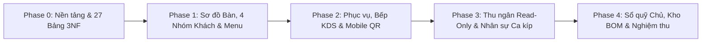

# Kế Hoạch Triển Khai Chi Tiết (Implementation Plan) — AC-RMS React Web UI
**Phiên bản**: 1.0 | **Ngày lập**: 24/11/2026 | **Trạng thái**: DRAFT — Chờ phê duyệt  
**Tài liệu đặc tả liên quan**: [01-analysis-spec.md](./01-analysis-spec.md)

---

## 0. Tổng Quan Dự Án (Executive Summary)
| Hạng mục | Giá trị |
|:---|:---|
| **Tên hệ thống** | Hệ thống Quản lý & Điều hành Chuỗi Nhà hàng Ẩm thực Châu Á (AC-RMS) |
| **Kiến trúc hệ thống** | Full-Stack React SPA + Node.js (Express + Socket.io) + Cloud MySQL 8.0 |
| **Công nghệ chốt** | React 19 + Vite + TypeScript + Node.js/Express + Socket.io + `mysql2` + Render Blueprint (`render.yaml`) |
| **Tổng số phân hệ** | 10 Phân hệ (`MOD-01` đến `MOD-10`) — 27 Bảng MySQL chuẩn 3NF |
| **Tổng số chức năng nguyên tử** | **96 chức năng nguyên tử** (đối soát 100% từ `01-analysis-spec.md`) |
| **Số giai đoạn (Phases)** | 5 Giai đoạn (`Phase 0` → `Phase 4`) |

---

## 1. Lộ Trình Triển Khai Tổng Quan (Milestone Overview)

| Giai đoạn | Tên Phase | Thời lượng | Mục tiêu cốt lõi | Sản phẩm bàn giao chính |
|:---|:---|:---|:---|:---|
| **Phase 0** | Khởi tạo React + Node.js + MySQL 27 Bảng | 14h | Dựng khung Full-stack, DDL MySQL 27 bảng, Express API, Socket.io & RBAC | Server Node.js + MySQL Pool + Khung React Design System |
| **Phase 1** | Sơ đồ Bàn, 4 Nhóm Khách & Thực đơn Châu Á | 16h | Hoàn thiện API & Giao diện MOD-01, MOD-02, MOD-03 | Sơ đồ bàn 4 màu, Đặt bàn/Cọc đoàn, Ghép bàn, nút `DELETE`, Menu 5 nước |
| **Phase 2** | Luồng Phục vụ, Bếp KDS Realtime & Mobile QR | 18h | Hoàn thiện API/Socket & Giao diện MOD-04, MOD-05, MOD-09 | Order tại bàn, Cổng QR khóa bàn/ẩn Login, KDS đẩy món Hoàn thành vào Bill & chuông `Ting` |
| **Phase 3** | Thu ngân Read-Only & Nhân sự Ca kíp 3 trạng thái | 16h | Hoàn thiện API & Giao diện MOD-06, MOD-07 | POS Thu ngân khóa sửa/xóa món (403 Guard), Xuất VAT, Lịch ca & Nghỉ phép Đã–Đang–Sắp |
| **Phase 4** | Sổ quỹ Chủ, Kho BOM & Cấu hình Deploy Render | 16h | Hoàn thiện MOD-08, `render.yaml`, Cloud MySQL SSL & Kiểm thử | Dashboard Chủ, Script Auto-Seed Cloud MySQL & Hướng dẫn Deploy Render 1-Click |

---

## 2. Kế Hoạch Chi Tiết Từng Giai Đoạn (Detailed Task Breakdown)

### 🚀 Giai đoạn Phase 0: Khởi tạo Full-Stack React + Node.js + CSDL Cloud MySQL 27 Bảng 3NF (14h)
> **Mục tiêu**: Khởi tạo dự án Full-Stack (React + Vite ở Frontend, Node.js + Express + Socket.io ở Backend), viết script DDL & Seed SQL chuẩn cho 27 bảng MySQL 3NF, kết nối Cloud MySQL có hỗ trợ SSL và cơ chế phân quyền RBAC 6 vai trò.  
> **Phạm vi chức năng**: `[10.1.1, 10.1.2, 10.2.1, 10.2.2, 10.2.3, 7.1.1]`

#### 📋 Danh sách công việc chi tiết (Tasks Checklist):
- [x] **[P0-01] Khởi tạo cấu trúc dự án Full-Stack (React + Node.js Express) & Hệ thống CSS Design System** `(3h)`
  - **Module / File**: `package.json`, `vite.config.ts`, `tsconfig.json`, `server/index.ts`, `src/styles/design-system.css`
  - **Phụ thuộc**: Không
  - **Chi tiết**: Thiết lập React 19 + TypeScript + Express + Socket.io, cấu hình đúng 2 font tiếng Việt (`Spectral` cho Display, `Be Vietnam Pro` cho Body/UI), thang chữ chuẩn, bảng màu ngữ nghĩa ẩm thực Châu Á và 4 mã màu trạng thái bàn (`Trong` Xanh lá, `DaDat` Vàng, `DangPhucVu` Đỏ, `ChoThanhToan` Cam).
  - **Tiêu chuẩn nghiệm thu (DoD)**: Dự án chạy `npm run build` thành công 100% cả Frontend và Backend.

- [x] **[P0-02] Thiết kế DDL SQL 27 Bảng MySQL 3NF, Seed Data & Kết nối Cloud MySQL Pool (`mysql2`)** `(5h)`
  - **Module / File**: `database/schema_27_tables.sql`, `database/seed_27_tables.sql`, `server/db/mysqlPool.ts`, `server/db/initDb.ts`, `src/types/database.ts`
  - **Phụ thuộc**: P0-01
  - **Chi tiết**: Viết file SQL chuẩn MySQL 8.0 tạo đủ 27 bảng (`tbl_khu_vuc` đến `tbl_yeu_cau_khach_hang`) kèm khóa chính, khóa ngoại, `CHECK` constraints và B-Tree Index; cấu hình `mysql2/promise` hỗ trợ `DATABASE_URL` và SSL/TLS (tương thích Aiven Free MySQL & TiDB Cloud Serverless), tích hợp script tự động khởi tạo bảng & seed dữ liệu mẫu khi deploy lên Render (kèm Hybrid Adapter dự phòng khi chạy local chưa bật MySQL).
  - **Tiêu chuẩn nghiệm thu (DoD)**: Chạy `npm run db:init` tạo sạch 27 bảng trên MySQL và nạp đầy đủ dữ liệu mẫu 4 khu vực, 16 bàn, 4 nhóm khách, menu 5 nước, BOM, lịch ca, sổ quỹ.

- [x] **[P0-03] Xây dựng Backend REST API, Socket.io Realtime Hub & Đồng bộ Client Store** `(4h)`
  - **Module / File**: `server/routes/api.ts`, `server/socket/realtimeHub.ts`, `src/store/useRestaurantStore.ts`, `src/utils/soundNotifier.ts`
  - **Phụ thuộc**: P0-02
  - **Chi tiết**: Xây dựng các endpoint REST `/api/v1/*` đồng bộ hai chiều với MySQL và phát sự kiện `Socket.io` realtime giữa Phục vụ, Bếp KDS, Thu ngân, Mobile QR và Chủ nhà hàng; tích hợp bộ phát âm thanh chuông **`Ting`** bằng Web Audio API.
  - **Tiêu chuẩn nghiệm thu (DoD)**: Gọi API cập nhật trạng thái món hoặc bàn sẽ lưu xuống MySQL và broadcast qua Socket.io tới mọi client đang mở trong < 100ms.

- [x] **[P0-04] Xây dựng Phân hệ Tài khoản, Middleware Phân quyền RBAC & Chốt chặn Bảo mật 403 (MOD-10)** `(2h)`
  - **Module / File**: `server/middleware/rbacGuard.ts`, `src/features/auth/AuthModal.tsx`, `src/features/rbac/RbacManagerView.tsx`, `src/components/layout/AppShell.tsx`
  - **Phụ thuộc**: P0-03
  - **Chi tiết**: Xây dựng xác thực đăng nhập (`tbl_tai_khoan`, `tbl_vai_tro`), middleware `rbacGuard` tại Express Backend trả về mã **HTTP 403 Forbidden** nếu `Manager` gọi API Doanh thu/Sổ quỹ/Kho hoặc `Cashier` gọi API thêm/sửa/xóa món trên hóa đơn.
  - **Tiêu chuẩn nghiệm thu (DoD)**: Test gọi API `/api/v1/owner/cashflow` với role `Manager` trả về đúng HTTP 403 Forbidden và ẩn 100% trên UI.

#### 🧪 Tiêu chuẩn hoàn thành Phase 0 (Exit Criteria):
- [ ] 100% 27 bảng CSDL chuẩn 3NF có mặt trong Store kèm dữ liệu mẫu thực tế.
- [ ] Chốt chặn phân quyền RBAC hoạt động chính xác cho cả 6 vai trò nội bộ.

---

### 🏮 Giai đoạn Phase 1: Quản lý Sơ đồ Bàn, 4 Nhóm Khách hàng & Thực đơn Châu Á (16h)
> **Mục tiêu**: Xây dựng giao diện trực quan cho MOD-01 (Sơ đồ bàn 4 màu, Đặt bàn/Cọc, Ghép bàn, nút `DELETE`), MOD-02 (4 nhóm khách hàng: Vãng lai, Thường, VIP, Đoàn) và MOD-03 (Thực đơn 5 trường phái Châu Á, độ cay 0–3, gói Combo và BOM).  
> **Phạm vi chức năng**: `[1.1.1..1.4.2, 2.1.1..2.4.3, 3.1.1..3.3.2]`

#### 📋 Danh sách công việc chi tiết (Tasks Checklist):
- [x] **[P1-01] Giao diện Quản lý Khu vực & Sơ đồ Bàn thời gian thực + Nút DELETE Bàn (MOD-01)** `(6h)`
  - **Module / File**: `src/features/tables/TableMapView.tsx`, `src/features/tables/AreaManagerModal.tsx`, `src/features/tables/ReservationModal.tsx`
  - **Phụ thuộc**: P0-03
  - **Chi tiết**: Hiển thị sơ đồ bàn theo từng tầng/khu vực (`Sảnh chính T1`, `Sảnh gia đình T2`, `Phòng VIP`, `Khu Khách đoàn`) với 4 mã màu trạng thái; chức năng thêm/sửa/xóa khu vực và bàn, tự động sinh mã QR cố định; đặt bàn trước kèm tiền cọc tiệc đoàn; chuyển bàn, ghép nhiều bàn đoàn (`ma_ban_chinh`) gom chung 1 hóa đơn; và **Nút `DELETE` giải phóng bàn** (chỉ cho phép khi hóa đơn đã thanh toán).
  - **Tiêu chuẩn nghiệm thu (DoD)**: Bấm nút `DELETE` trên bàn chưa thanh toán bị chặn và báo lỗi rõ ràng; bấm `DELETE` trên bàn đã thanh toán trả bàn về màu Xanh lá (`Trong`) và gỡ liên kết bàn ghép.

- [x] **[P1-02] Giao diện Quản lý 4 Nhóm Khách hàng: Vãng lai, Thường, VIP, Đoàn (MOD-02)** `(5h)`
  - **Module / File**: `src/features/customers/CustomerManagerView.tsx`, `src/features/customers/GroupContractModal.tsx`
  - **Phụ thuộc**: P0-03
  - **Chi tiết**: Quản lý hồ sơ 4 nhóm khách (`tbl_khach_hang`, `tbl_khach_doan`): Khách vãng lai phục vụ nhanh; Khách thường tích/tiêu điểm thưởng; Khách VIP nâng hạng thẻ (Silver/Gold/Diamond), cấu hình chiết khấu 10%–20% và cờ `VIP Flag`; Khách đoàn lưu thông tin công ty, người đại diện, Mã số thuế, địa chỉ xuất hóa đơn đỏ VAT, tiền đặt cọc và gói Combo tiệc.
  - **Tiêu chuẩn nghiệm thu (DoD)**: Phân biệt rõ 4 tab/nhóm khách, thêm mới khách đoàn lưu đầy đủ MST và tiền cọc đồng bộ sang Sổ quỹ (`ThuTienCoc`).

- [x] **[P1-03] Giao diện Quản lý Thực đơn Ẩm thực Châu Á, Độ cay, Combo & Định mức BOM (MOD-03)** `(5h)`
  - **Module / File**: `src/features/menu/MenuManagerView.tsx`, `src/features/menu/ComboBuilderModal.tsx`, `src/features/menu/BomConfigModal.tsx`
  - **Phụ thuộc**: P0-03
  - **Chi tiết**: Quản lý danh mục theo 5 trường phái ẩm thực (`Việt Nam`, `Trung Hoa`, `Nhật Bản`, `Hàn Quốc`, `Thái Lan`), thêm/sửa món ăn kèm đơn giá, hình ảnh, cấp độ cay (0: Không cay → 3: Cay nồng), thời gian chế biến tiêu chuẩn; cấu hình gói Combo tiệc đoàn (`tbl_chi_tiet_combo`), định mức tiêu hao nguyên liệu BOM (`tbl_dinh_muc_mon`) và công tắc gạt **Còn món / Hết món** đồng bộ realtime.
  - **Tiêu chuẩn nghiệm thu (DoD)**: Khi gạt một món sang `Hết món`, món đó lập tức bị khóa chọn trên cả màn hình Phục vụ và Cổng Mobile QR.

#### 🧪 Tiêu chuẩn hoàn thành Phase 1 (Exit Criteria):
- [ ] Sơ đồ bàn hiển thị đúng 4 màu trạng thái, hỗ trợ ghép bàn đoàn và nút `DELETE` giải phóng bàn đúng quy tắc nghiệp vụ.
- [ ] Thực đơn Châu Á lọc được theo 5 quốc gia, hiển thị rõ cấp độ cay và định mức BOM.

---

### 🍲 Giai đoạn Phase 2: Luồng Phục vụ tại bàn, Bếp KDS Realtime & Cổng Mobile QR (18h)
> **Mục tiêu**: Xây dựng luồng tương tác thời gian thực giữa Nhân viên Phục vụ (MOD-04), Màn hình Bếp KDS (MOD-05) và Cổng Khách hàng quét mã QR độc lập tại bàn (MOD-09).  
> **Phạm vi chức năng**: `[4.1.1..4.5.2, 5.1.1..5.2.4, 9.1.1..9.2.5]`

#### 📋 Danh sách công việc chi tiết (Tasks Checklist):
- [x] **[P2-01] Giao diện Nghiệp vụ Phục vụ tại bàn: Mở bàn, Gọi món, Hủy món & Kiểm chốt Bill (MOD-04)** `(7h)`
  - **Module / File**: `src/features/waitstaff/WaitstaffOrderDrawer.tsx`, `src/features/waitstaff/BillCheckModal.tsx`, `src/features/waitstaff/NotificationBell.tsx`
  - **Phụ thuộc**: P1-01, P1-02, P1-03
  - **Chi tiết**: Mở bàn đón khách (chọn đúng 1 trong 4 nhóm khách), chọn món/Combo kèm số lượng, độ cay yêu cầu (0–3), ghi chú khẩu vị (`ít ngọt, không hành, ăn chay`) và bấm **GỬI BẾP**; gọi thêm món (`lan_goi` tăng tự động); hủy món (chỉ cho phép khi `trang_thai_mon === 'ChoCheBien'`, khóa hủy khi Bếp đã bấm `DangCheBien`); nhận chuông **`Ting`** bưng món và bấm `Đã phục vụ`; màn hình **Kiểm tra Bill cùng khách tại bàn** và bấm **CHỐT BILL GỬI THU NGÂN**.
  - **Tiêu chuẩn nghiệm thu (DoD)**: Món đang ở trạng thái `DangCheBien` hoặc `HoanThanh` bị khóa nút Hủy; bấm Chốt Bill chỉ gom các món đã `HoanThanh`/`DaPhucVu` và chuyển bàn sang màu Cam (`ChoThanhToan`).

- [x] **[P2-02] Giao diện Màn hình Bếp KDS Thời gian thực & Tự động đẩy món Hoàn thành vào Bill (MOD-05)** `(6h)`
  - **Module / File**: `src/features/kds/KitchenKdsView.tsx`, `src/features/kds/KdsTicketCard.tsx`
  - **Phụ thuộc**: P2-01
  - **Chi tiết**: Hiển thị bảng điều phối chế biến KDS độ tương phản cao, sắp xếp món theo FIFO và tự động đẩy các món thuộc bàn có cờ **`VIP Flag`** lên đầu danh sách kèm nhãn vàng VIP; cảnh báo viền đỏ khi vượt thời gian nấu tiêu chuẩn; nút chuyển trạng thái `Chờ chế biến → Đang chế biến → Hoàn thành`. Khi bấm **`HOÀN THÀNH`**: ghi `tbl_nhat_ky_bep`, tự động trừ tồn kho nguyên liệu theo `tbl_dinh_muc_mon`, phát chuông **`Ting`** và **TỰ ĐỘNG NẠP MÓN VÀO BILL TÍNH TIỀN**.
  - **Tiêu chuẩn nghiệm thu (DoD)**: Trước khi Bếp bấm `Hoàn thành`, món ăn tuyệt đối chưa được cộng vào tổng tiền hóa đơn thanh toán; ngay khi bấm `Hoàn thành`, món xuất hiện trong Bill, trừ kho BOM và phát chuông `Ting`.

- [x] **[P2-03] Giao diện Cổng Khách hàng Mobile QR Độc lập tại bàn (MOD-09)** `(5h)`
  - **Module / File**: `src/features/qr-portal/MobileQrPortalView.tsx`, `src/features/qr-portal/QrSupportBar.tsx`
  - **Phụ thuộc**: P2-01, P2-02
  - **Chi tiết**: Giao diện Mobile tối ưu cho thực khách khi quét mã QR tại mặt bàn: **khóa cứng theo số bàn vừa quét (không cho tự đổi bàn)**, **ẨN HOÀN TOÀN nút đăng nhập nhân viên/quản lý**; xem thực đơn Châu Á trực quan, chọn độ cay (0–3), gửi gọi món xuống KDS; theo dõi trực tiếp thanh tiến độ từng món (`Chờ → Đang nấu → Hoàn thành`), xem tạm tính hóa đơn và bấm 4 nút gọi hỗ trợ nhanh (`Gọi nước lọc`, `Gọi khăn lạnh`, `Yêu cầu kiểm Bill`, `Gặp phục vụ`) lưu vào `tbl_yeu_cau_khach_hang`.
  - **Tiêu chuẩn nghiệm thu (DoD)**: Giao diện Mobile QR hoàn toàn không có bất kỳ nút/link đăng nhập quản trị nội bộ nào và không thể sửa mã bàn.

#### 🧪 Tiêu chuẩn hoàn thành Phase 2 (Exit Criteria):
- [ ] Luồng Gọi món (Phục vụ/QR) → KDS Bếp bấm `Hoàn thành` → Chuông `Ting` → Nạp vào Bill → Kiểm & Chốt Bill chạy thông suốt 100%.

---

### 💳 Giai đoạn Phase 3: Thu ngân Read-Only & Quản trị Nhân sự Ca kíp – Nghỉ phép 3 Trạng thái (16h)
> **Mục tiêu**: Xây dựng màn hình POS Thu ngân chế độ Chỉ đọc chống thất thoát (MOD-06) và phân hệ Nhân sự – Điều hành sảnh với lịch phân ca `Ca nào – Giờ nào` cùng bộ lọc nghỉ phép 3 trạng thái `Đã – Đang – Sắp nghỉ` (MOD-07).  
> **Phạm vi chức năng**: `[6.1.1..6.3.4, 7.2.1..7.5.3]`

#### 📋 Danh sách công việc chi tiết (Tasks Checklist):
- [x] **[P3-01] Giao diện Quầy Thu ngân POS Chế độ Chỉ đọc (Read-Only), Khấu trừ Cọc/VIP & Xuất Hóa đơn VAT (MOD-06)** `(8h)`
  - **Module / File**: `src/features/cashier/CashierPosView.tsx`, `src/features/cashier/VatInvoiceModal.tsx`, `src/features/cashier/VietQrPaymentModal.tsx`
  - **Phụ thuộc**: P2-01, P2-02
  - **Chi tiết**: Tiếp nhận danh sách bàn đã được Phục vụ chốt Bill (`ChoThanhToan`); mở chi tiết hóa đơn ở chế độ **CHỈ ĐỌC (`READ-ONLY`) — khóa cứng và ẩn mọi nút thêm/sửa/xóa món** kèm thông báo chốt chặn kiểm soát nội bộ; tự động khấu trừ tiền đặt cọc (`tien_coc_tru`), áp dụng chiết khấu hạng thẻ VIP (10%–20%) hoặc trừ điểm thành viên, tính thuế GTGT (VAT 8%–10%); chọn phương thức thanh toán (`Tiền mặt`, `Thẻ ngân hàng POS`, `Chuyển khoản VietQR`), in phiếu tính tiền, xuất **Hóa đơn đỏ điện tử VAT** cho Khách đoàn và tự động ghi bút toán `ThuHoaDon` vào Sổ quỹ của Chủ.
  - **Tiêu chuẩn nghiệm thu (DoD)**: Thu ngân không có cách nào thêm/bớt/xóa món trên hóa đơn; thanh toán xong tự động sinh bản ghi trong `tbl_giao_dich_thanh_toan` và `tbl_so_quy_dong_tien`, đồng thời giữ bàn chờ Phục vụ bấm `DELETE`.

- [x] **[P3-02] Giao diện Hồ sơ Nhân sự, Phân công Ca kíp (Ca nào – Giờ nào) & Nghỉ phép 3 Trạng thái (MOD-07)** `(8h)`
  - **Module / File**: `src/features/hr/HrManagementView.tsx`, `src/features/hr/ShiftScheduleMatrix.tsx`, `src/features/hr/LeaveThreeStatePanel.tsx`, `src/features/hr/PayrollSummaryPanel.tsx`
  - **Phụ thuộc**: P0-04
  - **Chi tiết**: Quản lý hồ sơ nhân viên (`tbl_nhan_vien`), cấu hình 3 khung giờ ca chuẩn (`Ca Sáng 06:00–14:00`, `Ca Chiều 14:00–22:00`, `Ca Tối 17:00–22:30`); bảng lịch phân ca hiển thị tường minh **Nhân viên nào – Làm Ca nào – Giờ nào – Phụ trách Khu vực nào** (`tbl_phan_cong_ca`); quy trình tạo & phê duyệt đơn nghỉ phép có chỉ định **Nhân viên trực thay ca** và bộ lọc thông minh theo 3 trạng thái: **ĐÃ NGHỈ** (đối chiếu ngày công), **ĐANG NGHỈ** (kiểm soát người vắng hôm nay & người trực thay), **SẮP NGHỈ** (chủ động xếp lịch tuần tới); chấm công Check-in/Check-out và tự động tính bảng lương tháng (`tbl_bang_luong`).
  - **Tiêu chuẩn nghiệm thu (DoD)**: Khi duyệt đơn nghỉ phép có người trực thay, lịch phân ca tự động cập nhật người thay thế; bộ lọc 3 trạng thái `Đã nghỉ`, `Đang nghỉ`, `Sắp nghỉ` phân loại chính xác theo ngày.

#### 🧪 Tiêu chuẩn hoàn thành Phase 3 (Exit Criteria):
- [ ] Màn hình POS Thu ngân đảm bảo 100% Read-only đối với danh sách món và tính đúng công thức `Tổng món hoàn thành - Cọc - Giảm VIP/Điểm + VAT`.
- [ ] Quản lý sảnh và HR vận hành đầy đủ lịch ca và nghỉ phép 3 trạng thái nhưng không thấy bất kỳ dữ liệu doanh thu/sổ quỹ nào.

---

### 💰 Giai đoạn Phase 4: Sổ quỹ Dòng tiền, Nhập kho Nguyên liệu (Độc quyền Chủ) & Kiểm thử (14h)
> **Mục tiêu**: Hoàn thiện Dashboard Tài chính & Kho nguyên vật liệu dành riêng cho Chủ nhà hàng (MOD-08) và kiểm thử nghiệm thu toàn bộ 96 chức năng nguyên tử.  
> **Phạm vi chức năng**: `[8.1.1..8.3.4]`

#### 📋 Danh sách công việc chi tiết (Tasks Checklist):
- [x] **[P4-01] Giao diện Sổ quỹ Dòng tiền Thu–Chi, Báo cáo Doanh thu & Lợi nhuận ròng cho Chủ nhà hàng (MOD-08)** `(6h)`
  - **Module / File**: `src/features/owner/OwnerCashflowView.tsx`, `src/features/owner/RevenueAnalyticsPanel.tsx`
  - **Phụ thuộc**: P3-01, P3-02
  - **Chi tiết**: Dành độc quyền cho `Role Owner`: theo dõi Sổ quỹ dòng tiền (`tbl_so_quy_dong_tien`) tự động tổng hợp Tổng Thu (`ThuTienCoc` + `ThuHoaDon`), Tổng Chi (`ChiNhapHang` + `ChiLuong` + `ChiVanHanhKhac`), số dư tức thì của **Quỹ tiền mặt** và **Tài khoản ngân hàng**, tính toán **Lợi nhuận ròng (Lãi / Lỗ)**; biểu đồ thống kê doanh thu theo kỳ, cơ cấu doanh thu theo 4 nhóm khách hàng và bảng xếp hạng Top món ăn Châu Á bán chạy nhất.
  - **Tiêu chuẩn nghiệm thu (DoD)**: Mọi giao dịch thu cọc, thu hóa đơn, chi nhập hàng, chi lương đều tự động cập nhật số dư lũy kế `so_du_quy_sau_gd` theo thời gian thực.

- [x] **[P4-02] Giao diện Quản lý Nhà cung cấp, Lập phiếu nhập kho & Cảnh báo tồn kho tối thiểu (MOD-08)** `(5h)`
  - **Module / File**: `src/features/owner/InventoryImportView.tsx`, `src/features/owner/PurchaseOrderModal.tsx`
  - **Phụ thuộc**: P4-01
  - **Chi tiết**: Quản lý danh bạ Nhà cung cấp thực phẩm & gia vị Châu Á kèm công nợ (`tbl_nha_cung_cap`); lập phiếu nhập kho nguyên vật liệu đầu vào (`tbl_phieu_nhap_hang`, `tbl_chi_tiet_phieu_nhap`) với số lượng, đơn giá nhập, hạn sử dụng lô hàng, tiền thanh toán ngay và tiền nợ lại; cảnh báo xác nhận nếu hạn sử dụng cận (< 3 ngày) hoặc giá biến động > 30%; tự động cộng tồn kho, tính đơn giá bình quân gia quyền, ghi bút toán `ChiNhapHang` vào Sổ quỹ và phát cảnh báo đỏ khi nguyên liệu chạm ngưỡng tồn kho tối thiểu (`nguong_ton_toi_thieu`).
  - **Tiêu chuẩn nghiệm thu (DoD)**: Lập phiếu nhập kho tự động tăng tồn kho `tbl_nguyen_lieu`, tăng công nợ NCC (nếu có nợ) và trừ quỹ trong `tbl_so_quy_dong_tien`.

- [x] **[P4-03] Cấu hình Deploy Render (`render.yaml`), Kết nối Cloud MySQL Miễn phí & Kiểm thử E2E** `(5h)`
  - **Module / File**: `render.yaml`, `.env.example`, `src/tests/businessRules.test.ts`, `README.md`
  - **Phụ thuộc**: Toàn bộ các task trước
  - **Chi tiết**: Tạo file cấu hình Blueprint `render.yaml` và kịch bản `npm run build` + `npm run start` để Render tự động build React frontend và chạy Node.js Express + Socket.io server trên cùng 1 Web Service; viết hướng dẫn từng bước kết nối với **Aiven Free MySQL** / **TiDB Cloud Serverless** qua biến `DATABASE_URL`; chạy bộ kiểm thử tự động các quy tắc nghiệp vụ cốt lõi.
  - **Tiêu chuẩn nghiệm thu (DoD)**: 100% test pass, `npm run build` và `npm run start` phục vụ hoàn chỉnh cả UI React, REST API `/api/v1/*`, WebSocket và tự động migrate/seed 27 bảng lên Cloud MySQL.

#### 🧪 Tiêu chuẩn hoàn thành Phase 4 (Exit Criteria):
- [ ] Toàn bộ 10 phân hệ (MOD-01 đến MOD-10) và 96 chức năng nguyên tử hoạt động hoàn chỉnh trên giao diện React.
- [ ] Unit test cho các quy tắc nghiệp vụ cốt lõi đạt độ bao phủ $\ge 80\%$.

---

## 3. Ma Trận Đối Soát Chức Năng Nguyên Tử (Traceability Matrix)

Đảm bảo **100% (96/96)** chức năng nguyên tử từ `01-analysis-spec.md` được phân bổ vào các Task cụ thể:

| Mã Atomic ID | Tên chức năng nguyên tử | Task phụ trách | Giai đoạn |
|:---|:---|:---:|:---:|
| `1.1.1` – `1.1.3` | Thêm, cập nhật, xóa khu vực sảnh (3 chức năng) | **P1-01** | Phase 1 |
| `1.2.1` – `1.2.4` | Tạo bàn, sinh mã QR cố định, sửa, xóa bàn ăn (4 chức năng) | **P1-01** | Phase 1 |
| `1.3.1` – `1.3.5` | Hiển thị 4 màu trạng thái bàn & Bấm nút `DELETE` giải phóng bàn (5 chức năng) | **P1-01** | Phase 1 |
| `1.4.1` – `1.4.2` | Đặt bàn trước theo khung giờ & Chuyển/Ghép bàn đoàn (2 chức năng) | **P1-01** | Phase 1 |
| `2.1.1` – `2.1.2` | Mở bàn nhanh Khách vãng lai & Xuất phiếu bán lẻ (2 chức năng) | **P1-02** | Phase 1 |
| `2.2.1` – `2.2.3` | Đăng ký Khách thường, tích điểm & khấu trừ điểm thưởng (3 chức năng) | **P1-02** | Phase 1 |
| `2.3.1` – `2.3.3` | Nâng hạng thẻ VIP, chiết khấu VIP & gắn cờ `VIP Flag` (3 chức năng) | **P1-02** | Phase 1 |
| `2.4.1` – `2.4.3` | Lưu pháp nhân Khách đoàn (MST/VAT), thu tiền đặt cọc & gắn Combo đoàn (3 chức năng) | **P1-02** | Phase 1 |
| `3.1.1` – `3.1.3` | Tạo danh mục, phân loại 5 trường phái ẩm thực Châu Á & sắp xếp (3 chức năng) | **P1-03** | Phase 1 |
| `3.2.1` – `3.2.5` | Thêm/sửa món, độ cay (0–3), cấu hình gói Combo & định mức BOM (5 chức năng) | **P1-03** | Phase 1 |
| `3.3.1` – `3.3.2` | Báo Hết món / Còn món & đồng bộ tức thì lên App + Mobile QR (2 chức năng) | **P1-03** | Phase 1 |
| `4.1.1` – `4.1.2` | Mở phiên phục vụ tại bàn & chọn đúng 1 trong 4 nhóm khách (2 chức năng) | **P2-01** | Phase 2 |
| `4.2.1` – `4.2.3` | Chọn món, độ cay, ghi chú khẩu vị & bấm Gửi Bếp KDS (3 chức năng) | **P2-01** | Phase 2 |
| `4.3.1` – `4.3.2` | Gọi thêm món phát sinh & Hủy món khi Bếp chưa nấu (2 chức năng) | **P2-01** | Phase 2 |
| `4.4.1` – `4.4.2` | Nhận chuông `Ting` từ Bếp & xác nhận Đã phục vụ tại bàn (2 chức năng) | **P2-01** | Phase 2 |
| `4.5.1` – `4.5.2` | Kiểm tra Bill đối chiếu cùng khách & bấm Chốt Bill gửi Thu ngân (2 chức năng) | **P2-01** | Phase 2 |
| `5.1.1` – `5.1.4` | Nhận order KDS realtime, sắp xếp FIFO, ưu tiên `VIP Flag` & cảnh báo trễ (4 chức năng) | **P2-02** | Phase 2 |
| `5.2.1` – `5.2.4` | Chuyển `Chờ → Đang nấu → Hoàn thành`, phát chuông `Ting`, nạp Bill & trừ kho BOM (4 chức năng) | **P2-02** | Phase 2 |
| `6.1.1` – `6.1.2` | Nhận bàn Chờ thanh toán & mở hóa đơn chế độ **Read-only** khóa sửa/xóa món (2 chức năng) | **P3-01** | Phase 3 |
| `6.2.1` – `6.2.3` | Tự động trừ tiền đặt cọc, giảm giá VIP/Điểm & tính thuế VAT (3 chức năng) | **P3-01** | Phase 3 |
| `6.3.1` – `6.3.4` | Thu tiền (TM/Thẻ/VietQR), in phiếu, xuất hóa đơn đỏ VAT & ghi `ThuHoaDon` vào Sổ quỹ (4 chức năng) | **P3-01** | Phase 3 |
| `7.1.1` | Ẩn hoàn toàn Doanh thu, Dòng tiền, Lãi/Lỗ đối với Quản lý sảnh (1 chức năng) | **P0-04** | Phase 0 |
| `7.2.1` – `7.2.2` | Thêm mới, cập nhật hồ sơ nhân viên và định mức lương ca (2 chức năng) | **P3-02** | Phase 3 |
| `7.3.1` – `7.3.2` | Thiết lập khung giờ Ca Sáng/Chiều/Tối & phân công `Ca nào – Giờ nào – Khu vực nào` (2 chức năng) | **P3-02** | Phase 3 |
| `7.4.1` – `7.4.3` | Tạo đơn nghỉ, duyệt gán người thay ca & lọc 3 trạng thái `Đã – Đang – Sắp nghỉ` (3 chức năng) | **P3-02** | Phase 3 |
| `7.5.1` – `7.5.3` | Chấm công Check-in/out, tổng hợp công đối trừ `ĐÃ NGHỈ` & xuất bảng lương tháng (3 chức năng) | **P3-02** | Phase 3 |
| `8.1.1` – `8.1.3` | Xem Sổ quỹ Thu–Chi, số dư Tiền mặt/Ngân hàng & báo cáo Lợi nhuận ròng Lãi/Lỗ (3 chức năng) | **P4-01** | Phase 4 |
| `8.2.1` – `8.2.3` | Biểu đồ doanh thu theo kỳ, theo 4 nhóm khách & Top món Châu Á bán chạy (3 chức năng) | **P4-01** | Phase 4 |
| `8.3.1` – `8.3.4` | Quản lý Nhà cung cấp, lập phiếu nhập kho, cộng tồn kho & cảnh báo tồn tối thiểu (4 chức năng) | **P4-02** | Phase 4 |
| `9.1.1` – `9.1.2` | Quét QR khóa cứng số bàn & ẩn hoàn toàn nút đăng nhập nội bộ của nhân viên (2 chức năng) | **P2-03** | Phase 2 |
| `9.2.1` – `9.2.5` | Xem menu Châu Á, gọi món qua QR, xem tiến độ KDS, xem tạm tính & gọi hỗ trợ nhanh (5 chức năng) | **P2-03** | Phase 2 |
| `10.1.1` – `10.1.2` | Đăng nhập xác thực theo vai trò & đổi mật khẩu / khóa tài khoản (2 chức năng) | **P0-04** | Phase 0 |
| `10.2.1` – `10.2.3` | Cấp tài khoản, cấu hình ma trận RBAC 6 vai trò & chặn 403 truy cập trái phép (3 chức năng) | **P0-04** | Phase 0 |

- **Tổng số chức năng nguyên tử đã phân bổ**: **96 / 96**
- **Số chức năng chưa phân bổ**: **0**

---

## 4. Quản Lý Rủi Ro Dự Án (Risk Register)

| Mã RR | Rủi ro tiềm ẩn | Mức độ | Giải pháp phòng ngừa & Giảm thiểu trong thiết kế | Phụ trách |
|:---|:---|:---:|:---|:---|
| **R-01** | Lệch số tiền giữa Bếp và Thu ngân do tính cả món chưa nấu | Cao | Thiết lập chốt chặn cứng trong Store: Hàm tính tổng hóa đơn chỉ lọc các dòng `ChiTietDonGoi` có `trang_thai_mon IN ('HoanThanh', 'DaPhucVu')`. | P2-02, P3-01 |
| **R-02** | Thu ngân tự ý sửa hoặc xóa món khi khách thanh toán | Cao | Giao diện POS Thu ngân mở ở chế độ `Read-only` (loại bỏ hoàn toàn nút sửa/xóa) và khóa tại hàm Store nếu `currentRole === 'Cashier'`. | P3-01 |
| **R-03** | Quản lý sảnh xem được doanh thu hoặc giá vốn nhập hàng | Cao | Áp dụng RBAC Guard ẩn toàn bộ phân hệ `MOD-08` và các thẻ KPI tài chính khi đăng nhập bằng vai trò `Manager`. | P0-04, P4-01 |
| **R-04** | Khách hàng quét QR tự ý đổi sang bàn khác hoặc bấm vào trang Admin | Trung bình | Route `/qr/:maBan` cô lập hoàn toàn khỏi `AppShell` nội bộ, khóa cứng `maBan` theo token QR và không render bất kỳ nút Login nhân viên nào. | P2-03 |
